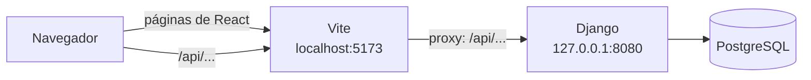

# API JSON para el frontend

Qué contiene: cada endpoint de la API JSON con quién lo usa, qué manda, qué responde y sus errores, y cómo conectar React en desarrollo.
Cuándo leerlo: solo si vas a trabajar en el frontend en React o a llamar a la API. Los IDs (CU, ENT, D) se explican en el [glosario de IDs](README.md#glosario-de-ids).

La **API** (interfaz de programación) es la forma en que otro programa, aquí el frontend en React, usa el sistema: en lugar de páginas HTML recibe y manda datos en **JSON** (texto con la forma `{"campo": "valor"}`). Vive bajo `/api/` y llama a las **mismas** funciones de `rentals/use_cases/` (y de `accounts/registration.py` y `accounts/account.py`) que las páginas HTML: no repite ninguna regla. Las páginas de Django siguen funcionando como respaldo. El código está en `rentals/api/` y `accounts/api.py`; las pruebas, en `tests/integration/test_api.py` y `tests/integration/test_api_mi_cuenta.py`.

**Cómo llega React a Django:** en desarrollo, React corre en el servidor de **Vite** (por defecto `http://localhost:5173`) y Django en el puerto **8080**. El navegador solo habla con Vite; Vite reenvía cada petición que empieza con `/api` a `http://127.0.0.1:8080` (su **proxy**). Así el navegador cree que todo viene del mismo origen: la cookie de sesión funciona y no hace falta CORS ([D-26](decisiones.md#d-26)). La configuración está en la [sección 3](#3-conectar-react-en-desarrollo).



## 1. Reglas comunes

### Sesión y CSRF

- La API usa la **sesión normal de Django**: al iniciar sesión, Django guarda una **cookie** (un dato que el navegador manda en cada petición) llamada `sessionid`. No hay tokens propios.
- El **token CSRF** es una clave que Django exige en cada `POST` para comprobar que la petición viene de nuestra propia página y no de otro sitio.
- `GET /api/csrf/` deja la cookie `csrftoken`. Cada `POST` manda ese valor en el encabezado `X-CSRFToken`.
- Al iniciar o cerrar sesión Django cambia el token: lee la cookie `csrftoken` antes de cada `POST` (el ejemplo de la sección 3 lo hace).

### Formato de las respuestas

| Caso | Código | Cuerpo |
|---|---|---|
| Éxito | 200 (201 al crear) | `{"data": …, "message": "texto para el usuario o vacío"}` |
| Rechazo de una regla o un campo mal enviado | 400 | `{"errors": ["mensaje para el usuario", …]}` |
| Sin sesión | 401 | `{"errors": ["Inicia sesión para continuar."]}` |
| Sin el rol, o sin el token CSRF | 403 | `{"errors": ["No tienes permiso para hacer esto."]}` · `{"errors": ["La sesión de seguridad venció. Recarga la página e inténtalo de nuevo."]}` |
| No existe, o no es tuya | 404 | `{"errors": ["No encontramos lo que buscas."]}` |
| Método equivocado | 405 | `{"errors": ["Esta dirección no acepta ese método."]}` |

- Los mensajes de 400 son **el mismo texto** que ven las páginas.
- Un campo que falta o tiene mal formato da `"Etiqueta: mensaje de Django"`, por ejemplo `"Fecha de recojo: Este campo es obligatorio."`.
- Un cuerpo que no es un objeto JSON da `"La petición debe traer un objeto JSON."`.

### Datos

- **Fechas de salida:** ISO 8601 con la zona de La Paz, por ejemplo `"2026-10-30T18:00:00-04:00"`.
- **Fechas de entrada:** los mismos campos que el formulario de la página, `start_date` (`"2026-10-30"`), `start_time` (`"18:00"`), `end_date` y `end_time`. La hora se entiende en La Paz.
- **Montos:** texto con dos decimales y punto, por ejemplo `"40.00"`. Los mensajes usan el formato de la página: `"40,00 Bs"`.
- **Estados:** el valor (`"reserved"`) y su etiqueta (`"Reservada"`). Renta: `reserved`, `rented`, `not_picked_up`, `returned`, `cancelled`. Equipo: `available`, `in_review`, `in_repair`, `retired`.
- **Roles:** `cliente`, `operador`, `mantenimiento`, `administrador`. El administrador puede usar todos los endpoints del personal ([ENT-13](respuestas-del-cliente.md#ent-13): el administrador puede todo).

### Objetos que se repiten

**Renta** (`rental`):

```json
{
  "id": 12,
  "equipment": {"inventory_id": "MES-00001", "name": "Mesa plegable 1,80 m"},
  "client": "cl01",
  "start": "2026-10-30T18:00:00-04:00",
  "end": "2026-11-01T09:00:00-04:00",
  "status": "reserved",
  "status_label": "Reservada",
  "rental_days": 2,
  "daily_price": "20.00",
  "total_price": "40.00",
  "is_paid": false,
  "payment_label": "Pago pendiente",
  "payment_method": "",
  "payment_method_label": "",
  "client_can_change": true,
  "registered_by": null,
  "picked_up_at": null,
  "returned_at": null,
  "cancelled_at": null
}
```

`payment_label` es solo `"Pagado"` o `"Pago pendiente"` ([ENT-104](respuestas-del-cliente.md#ent-104)); la forma de pago va aparte en `payment_method` (`"qr"`, `"cash"` o `""` sin pagar) y `payment_method_label` (`"QR"`, `"Efectivo"` o `""`).

**Equipo** (`equipment`): `{"inventory_id": "MES-00001", "name": "Mesa plegable 1,80 m", "status": "available", "status_label": "Disponible", "daily_price": "20.00"}`.

**Deuda** (`debt`): `{"id": 3, "rental_id": 12, "client": "cl02", "equipment": "SIL-00006", "reason": "late_return", "reason_label": "Devolución tardía", "amount": "40.00", "created_at": "…", "paid_at": null}`.

**Usuario** (`user`): `{"id": 1, "username": "cl01", "first_name": "Carla", "last_name": "Mendoza", "email": "carla.mendoza@correo.com", "phone": "71000001", "role": "cliente", "role_name": "Cliente"}`. Nunca trae la contraseña.

## 2. Endpoints

Los mensajes de error de cada endpoint son los de su caso de uso en [casos-de-uso.md](casos-de-uso.md); aquí van los más comunes. «Con sesión» quiere decir cualquier usuario que inició sesión, igual que la página.

### Sesión

| Método y ruta | Quién | Cuerpo | `data` de la respuesta |
|---|---|---|---|
| `GET /api/csrf/` | Todos | — | `{"csrf_token": "…"}` y la cookie `csrftoken` |
| `POST /api/auth/login/` | Todos | `{"username": "cl01", "password": "Demo1234"}` | el usuario + `debt_total`; `message`: `"Hola, Carla."` |
| `POST /api/auth/logout/` | Todos | — | `null`; `message`: `"Sesión cerrada."` |
| `GET /api/auth/me/` | Con sesión | — | el usuario + `"debt_total": "0.00"` |

### [CU-17](casos-de-uso.md#cu-17) · Mi cuenta

| Método y ruta | Quién | Cuerpo | Respuesta |
|---|---|---|---|
| `POST /api/auth/profile/` | Con sesión | `{"first_name": "Carla", "last_name": "Mendoza", "email": "carla@correo.com", "phone": "71000001"}` | el usuario + `debt_total`; `message`: `"Tus datos se guardaron."` |
| `POST /api/auth/password/` | Con sesión | `{"old_password": "Demo1234", "new_password1": "Nueva2026x", "new_password2": "Nueva2026x"}` | `null`; `message`: `"Tu contraseña se cambió."`; la sesión sigue abierta |
| `POST /api/auth/password-reset/` | Todos | `{"email": "carla@correo.com"}` | `null`; `message`: `"Si el correo es de una cuenta activa, te mandamos un enlace para crear tu contraseña."` |

- El usuario y el rol no se cambian: `username` en el cuerpo de `profile/` se ignora.
- `profile/` usa las reglas del registro y trae todas las causas juntas, por ejemplo `["Falta el campo Nombre.", "El correo ya está registrado."]`. Tu propio correo no choca contigo.
- `password/` usa `PasswordChangeForm` de Django y los mismos validadores del registro: `"Contraseña antigua: …"`, `"Contraseña nueva: Esta contraseña es demasiado común."`.
- `password-reset/` responde lo mismo exista o no la cuenta. El enlace del correo abre la página de Django `/reset/<uid>/<token>/`, donde se escribe la contraseña nueva.

Errores del login: `"Usuario o contraseña incorrectos."` · `"Tu cuenta está desactivada. Comunícate con la tienda."` (solo con la contraseña correcta, [ENT-79](respuestas-del-cliente.md#ent-79)).

### [CU-01](casos-de-uso.md#cu-01) · Registro del cliente

`POST /api/auth/signup/` · Visitante · 201

```json
{"first_name": "Lucía", "last_name": "Vargas", "email": "lucia@correo.com", "phone": "71234567",
 "username": "lucia", "password": "Clave1234", "password_confirmation": "Clave1234"}
```

Respuesta: `data` = el usuario; `message`: `"Cuenta creada. Ya puedes iniciar sesión con lucia."`. Un rechazo trae **todas** las causas juntas, por ejemplo `["Falta el campo Teléfono.", "Las contraseñas no coinciden.", "El usuario lucia ya existe."]`.

### [CU-03](casos-de-uso.md#cu-03) · Catálogo

`GET /api/catalog/?q=mesa&free_from=2026-11-02&free_to=2026-11-04&status=&page=1` · Con sesión

```json
{"data": {"count": 25, "page": 1, "pages": 2, "results": [
  {"inventory_id": "MES-00001", "name": "Mesa plegable 1,80 m", "status": "available", "status_label": "Disponible",
   "daily_price": "20.00"}
]}, "message": ""}
```

- De 20 en 20 ([ENT-86](respuestas-del-cliente.md#ent-86)). Sin `busy_periods`: el catálogo no dice cuándo usan el equipo otras personas ([ENT-99](respuestas-del-cliente.md#ent-99)).
- Sin `free_from` y `free_to` trae los equipos disponibles; con las dos fechas, solo los libres en ese periodo.
- El cliente ve solo los disponibles; `status` solo filtra para el personal.
- Errores: `"Elige las dos fechas para ver los equipos libres."` · `"La fecha final debe ser posterior a la inicial."`. Un combo (`CMB-00001`) aparece como cualquier equipo ([ENT-96](respuestas-del-cliente.md#ent-96)).

### [CU-04](casos-de-uso.md#cu-04) · Rentar en línea y pagar con QR

`POST /api/rentals/` · Con sesión · 201

```json
{"equipment": "MES-00001", "start_date": "2026-10-30", "start_time": "18:00", "end_date": "2026-11-01", "end_time": "09:00"}
```

Respuesta: `data` = la renta «Reservada» con el pago pendiente; `message`: `"Reserva hecha. Paga con el QR para confirmarla."`. Errores:

- `"La fecha de recojo ya pasó. Elige hoy o un día siguiente."` (el recojo de hoy a las 18:00 vale hasta la medianoche, [ENT-94](respuestas-del-cliente.md#ent-94))
- `"La fecha y hora de devolución debe ser posterior a la de recojo."`
- `"La renta no puede durar más de 5 días."`
- `"El recojo debe ser desde las 18:00."` · `"La devolución debe ser hasta las 09:00."`
- `"Tienes una deuda pendiente de 40,00 Bs. Págala en la tienda para volver a rentar."`
- `"El equipo MES-00003 no está disponible (estado: En revisión)."`
- `"El equipo MES-00001 está ocupado del 30/10/2026 18:00 al 01/11/2026 09:00."` (y, si esa renta empieza después, `" Está libre hasta el 30/10/2026 a las 09:00."`)
- `"Equipo: Escoja una opción válida. Esa opción no está entre las disponibles."` si el código no existe.

`POST /api/rentals/<id>/pay/` · El cliente de esa renta en línea · `{"approved": true}` o `{"approved": false}`

- `true`: `message` = `"Pago recibido. Tu renta está confirmada."`.
- `false`: la reserva sigue con el pago pendiente; `message` = `"Tu reserva está hecha, pero el pago no se completó. Paga en la tienda al recoger el equipo."`.
- Errores: `"La renta de MES-00001 ya está pagada."` · `"La renta de MES-00001 ya fue cancelada el 28/10/2026 10:15."`. La renta de otro cliente o de la tienda da 404.

### [CU-16](casos-de-uso.md#cu-16) · Mis rentas

`GET /api/my-rentals/` · Con sesión

```json
{"data": {"rentals": [/* rentas, la más reciente primero */], "debts": [/* deudas sin pagar */], "debt_total": "40.00"},
 "message": "Tienes una deuda pendiente de 40,00 Bs. Págala en la tienda para volver a rentar."}
```

Sin deuda, `message` viene vacío.

### [CU-06](casos-de-uso.md#cu-06) y [CU-07](casos-de-uso.md#cu-07) · Modificar y cancelar

`POST /api/rentals/<id>/modify/` · El cliente de la renta (hasta 24 h antes), quien la registró o el operador (hasta antes del inicio, [ENT-95](respuestas-del-cliente.md#ent-95))

```json
{"start_date": "2026-11-06", "start_time": "18:00", "end_date": "2026-11-08", "end_time": "09:00"}
```

Respuesta: la renta con sus fechas nuevas; `message`: `"Reserva modificada: MES-00005 ahora va del 06/11/2026 18:00 al 08/11/2026 09:00."`. Si la modifica el personal, el cliente recibe un correo con las fechas nuevas. Errores:

- `"La reserva es de 2 días. Elige fechas con la misma cantidad de días; para cambiarla, cancela y renta de nuevo."`
- `"Ya no puedes modificar en línea; comunícate con la tienda."` (cliente a menos de 24 h, [ENT-80](respuestas-del-cliente.md#ent-80))
- `"La reserva de MES-00005 ya empezó el 06/11/2026 18:00; ya no se puede modificar."` (personal, [ENT-95](respuestas-del-cliente.md#ent-95))
- `"La renta de MES-00005 ya fue entregada el …"` y los de horarios y fechas ocupadas de [CU-04](casos-de-uso.md#cu-04).

`POST /api/rentals/<id>/cancel/` · Los mismos; el personal hasta el recojo · sin cuerpo

Respuesta: la renta cancelada; `message`: `"Reserva cancelada: MES-00005 de cl01."`. El sistema solo cancela: si estaba pagada, el dinero se devuelve a mano en la tienda ([ENT-89](respuestas-del-cliente.md#ent-89)). Errores: `"Ya no puedes cancelar en línea; comunícate con la tienda."` · `"La renta de MES-00005 ya fue cancelada el …"`. Una renta que el usuario no puede abrir da 404.

### [CU-02](casos-de-uso.md#cu-02) · Clientes en la tienda

`GET /api/staff/clients/?q=rojas` · Operador → `data` = hasta 10 usuarios cuyo usuario, nombre, apellido o correo contiene el texto ([ENT-54](respuestas-del-cliente.md#ent-54)). Sin `q`, lista vacía.

`POST /api/staff/clients/` · Operador · 201 · el cuerpo del registro **sin** `password` ni `password_confirmation` ([ENT-102](respuestas-del-cliente.md#ent-102): el operador no conoce la contraseña del cliente) → `data` = el usuario + `"email_sent": true`; `message`: `"Cuenta creada para lucia. Le enviamos un correo para crear su contraseña. Ya puedes registrar su renta."`. Si el correo falla, `"email_sent": false` y `message`: `"La cuenta se creó, pero no se pudo enviar el correo. Pide al cliente que use \"Olvidé mi contraseña\" con su correo."`.

### [CU-05](casos-de-uso.md#cu-05) · Renta en tienda

`POST /api/staff/rentals/` · Operador · 201

```json
{"client": 2, "equipment": "MES-00004", "start_date": "2026-10-28", "start_time": "18:00", "end_date": "2026-10-30", "end_time": "09:00"}
```

`client` es el `id` del usuario que devolvió la búsqueda. La renta nace «Reservada» y pagada en efectivo; si el cliente se la lleva al momento, se registra el recojo ([CU-08](casos-de-uso.md#cu-08), [ENT-91](respuestas-del-cliente.md#ent-91)); `message`: `"Renta registrada: MES-00004 para cl02."`. Errores: los de [CU-04](casos-de-uso.md#cu-04), `"El cliente cl02 tiene una deuda pendiente de 40,00 Bs. Cóbrala antes de registrar otra renta."` y `"Cliente: Escoja una opción válida. …"` si el cliente no existe o está desactivado.

### [CU-08](casos-de-uso.md#cu-08) · Entregar

`GET /api/staff/reservations/?order=recent` · Operador → `data` = las rentas «Reservadas», la más nueva primero ([ENT-100](respuestas-del-cliente.md#ent-100)); con `?order=date`, la de recojo más próximo primero. Un valor desconocido usa `recent`.

`POST /api/staff/rentals/<id>/pickup/` · Operador · `{"paid_now": true}` solo si cobró en efectivo en ese momento

- `message`: `"Recojo registrado: MES-00001 entregado a cl01."` o, si cobró, `"Cobro de 40,00 Bs en efectivo y recojo registrados: MES-00001 entregado a cl01."`.
- Errores: `"Falta el pago de 40,00 Bs de esta renta. Cóbralo en efectivo o cancela la reserva si el cliente no paga."` · `"El equipo MES-00001 está en revisión. Espera a que mantenimiento lo revise o cancela la reserva."` · `"La reserva de MES-00001 venció a la medianoche."` · `"La renta de MES-00001 ya fue entregada el …"`.

### [CU-09](casos-de-uso.md#cu-09) · Devolver

`GET /api/staff/returns/?order=recent` · Operador → `data` = las rentas «Rentadas», la más nueva primero ([ENT-100](respuestas-del-cliente.md#ent-100)); con `?order=date`, la que vence primero. Solo esas se devuelven ([ENT-93](respuestas-del-cliente.md#ent-93)).

`POST /api/staff/rentals/<id>/return/` · Operador · `{"note": "Una pata floja"}`

- `message`: `"Devolución registrada: MES-00001 recibido de cl01. A tiempo."` o `"… Con 2 días de atraso: deuda de 40,00 Bs."`.
- Errores: `"Escribe cómo llegó el equipo."` · `"La renta de MES-00001 nunca se entregó: solo se devuelve una renta «Rentada»."` · `"La renta de MES-00001 ya fue devuelta el …"`.

### [CU-11](casos-de-uso.md#cu-11) · Deudas

`GET /api/staff/debts/` · Operador

```json
{"data": {"debts": [/* deudas sin pagar */], "totals": [{"username": "cl02", "first_name": "Diego", "last_name": "Rojas", "total": "40.00"}]}, "message": ""}
```

`debts` viene con la deuda más nueva primero y `totals` con el cliente de la deuda más nueva primero ([ENT-100](respuestas-del-cliente.md#ent-100)).

`POST /api/staff/debts/<id>/pay/` · Operador · sin cuerpo. Las deudas se pagan solo en la tienda ([ENT-92](respuestas-del-cliente.md#ent-92)): no hay endpoint para que el cliente pague una deuda → `message`: `"Pago registrado: deuda de 40,00 Bs de cl02."`. Error: `"Esta deuda ya se pagó el 28/10/2026 10:15."`.

### [CU-10](casos-de-uso.md#cu-10) · Mantenimiento

`GET /api/maintenance/equipment/?status=in_review` · Mantenimiento → `data` = todos los equipos que no están de baja, el que cambió de estado más recientemente primero ([ENT-100](respuestas-del-cliente.md#ent-100)); `status` filtra por estado ([ENT-90](respuestas-del-cliente.md#ent-90)).

```json
{"data": [{"inventory_id": "SIL-00003", "name": "Silla plegable blanca", "status": "in_review", "status_label": "En revisión", "daily_price": "4.00",
           "choices": [{"value": "available", "label": "Disponible"}, {"value": "in_repair", "label": "En reparación"}, {"value": "retired", "label": "Baja"}],
           "last_client": "cl02", "charge_label": "Cobrar el daño al último cliente (cl02, renta del 25/10)"}], "message": ""}
```

`choices` son los estados permitidos desde el actual. `last_client` y `charge_label` vienen `null` y vacío si el equipo nunca volvió de una renta: entonces no se muestra la casilla. El frontend muestra la casilla solo si el estado elegido es `in_repair` o `retired`, **sin marcar**.

`POST /api/maintenance/equipment/<code>/review/` · Mantenimiento · `{"status": "in_repair", "comment": "Tapiz roto", "charge_last_client": true}`

- `charge_last_client` true: deuda del 20 % (reparación) o del 100 % (baja), con el tope de [D-06](decisiones.md#d-06). Sin `true`: no hay deuda y el log escribe `DAMAGE_NOT_CHARGED`.
- Reparación o baja cancelan las reservas no recogidas del equipo; sus `id` vienen en `cancelled_rentals`.

```json
{"data": {"inventory_id": "SIL-00003", "status": "in_repair", "status_label": "En reparación", "daily_price": "4.00",
          "debt": {/* deuda creada o null */}, "cancelled_rentals": [15]},
 "message": "SIL-00003 ahora está «En reparación». Deuda de 16,00 Bs para cl02."}
```

Errores: `"El equipo SIL-00003 solo puede pasar a disponible, en revisión, en reparación o baja."` · `"El equipo SIL-00005 está dado de baja; su estado ya no puede cambiar."` · `"El equipo SIL-00004 ya está «En reparación»."`.

### [CU-12](casos-de-uso.md#cu-12) · Registrar un equipo

`POST /api/admin/equipment/` · Administrador · 201

```json
{"inventory_id": "mes-00021", "serial_number": "DURAPLAST-2024-00031", "name": "Mesa plegable 1,80 m", "value": "400.00"}
```

Respuesta: el equipo «Disponible», con el código en mayúsculas; `message`: `"Equipo registrado: MES-00021 · Mesa plegable 1,80 m."`. Un rechazo trae todas las causas, por ejemplo `["El código debe tener 3 letras, un guion y 5 números, por ejemplo MES-00001.", "Ya existe un equipo con este número de serie."]`.

### [CU-15](casos-de-uso.md#cu-15) · Panel del responsable

`GET /api/manager/dashboard/` · Administrador

```json
{"data": {
  "active": {"total": 3, "rows": [/* rentas */]},
  "overdue": {"total": 1, "rows": [/* rentas */]},
  "today": {"total": 2, "rows": [/* rentas */]},
  "pending_payment": {"total": 1, "rows": [/* rentas */]},
  "to_review": {"total": 2, "rows": [/* equipos */]},
  "debts_by_client": {"total": 1, "rows": [{"username": "cl02", "first_name": "Diego", "last_name": "Rojas", "total": "40.00"}]},
  "debt_total": "40.00"
}, "message": ""}
```

Cada lista trae su total y sus primeras 10 filas, lo último primero: las rentas por fecha de creación, los equipos por su último cambio de estado y los clientes por su deuda más nueva ([ENT-100](respuestas-del-cliente.md#ent-100)).

[CU-13](casos-de-uso.md#cu-13) (corregir el estado de un equipo) y [CU-14](casos-de-uso.md#cu-14) (historial) siguen en el admin de Django.

## 3. Conectar React en desarrollo

1. Corre Django en el puerto 8080 (el que espera el proxy):

   ```powershell
   python manage.py runserver 8080
   ```

2. En `vite.config.js`, manda `/api` a Django con `server.proxy`: cada petición a `/api/...` que recibe Vite se reenvía a `http://127.0.0.1:8080/api/...`. Así el navegador cree que todo viene del mismo origen: la cookie de sesión funciona y no hace falta CORS (un permiso extra que exigiría si React y Django estuvieran en orígenes distintos).

   ```js
   import { defineConfig } from "vite";
   import react from "@vitejs/plugin-react";

   export default defineConfig({
     plugins: [react()],
     server: {
       proxy: {
         "/api": "http://127.0.0.1:8080",
       },
     },
   });
   ```

3. Pide el token una vez al cargar la aplicación y manda las peticiones con `credentials: "include"` y `X-CSRFToken`:

   ```js
   function readCookie(name) {
     const match = document.cookie.match(new RegExp(`(?:^|; )${name}=([^;]*)`));
     return match ? decodeURIComponent(match[1]) : "";
   }

   export async function api(path, { method = "GET", body } = {}) {
     const response = await fetch(`/api${path}`, {
       method,
       credentials: "include",
       headers: {
         "Content-Type": "application/json",
         "X-CSRFToken": readCookie("csrftoken"),
       },
       body: body === undefined ? undefined : JSON.stringify(body),
     });
     const payload = await response.json();
     if (!response.ok) throw payload.errors;
     return payload;
   }

   await api("/csrf/");
   await api("/auth/login/", { method: "POST", body: { username: "cl01", password: "Demo1234" } });
   const { data } = await api("/my-rentals/");
   ```

Cada `errors` ya está en español y listo para mostrar al usuario.
