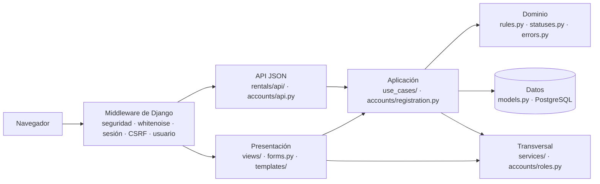
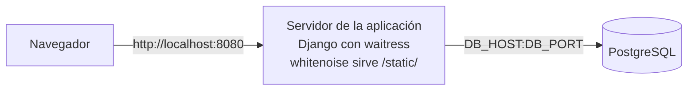
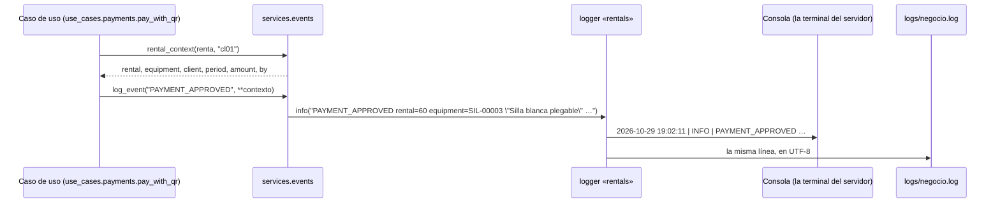

# Cómo está hecho el sistema

> Versión del 28/10/2026 (versión final). Django 6.1 + PostgreSQL 17. Una app de cuentas (`accounts`) y una de negocio (`rentals`).
> La base de datos, con el porqué de cada tabla, está en [base-de-datos.md](base-de-datos.md).

## Capas



### Qué capa es cada carpeta

| Capa | Carpetas y archivos | Qué hace | Qué no hace |
|---|---|---|---|
| **Presentación** | `rentals/views/`, `templates/`, `rentals/forms.py`; también `accounts/views.py`, `accounts/forms.py`, los `urls.py`, los `admin.py`, `context_processors.py` y la API JSON (`rentals/api/`, `accounts/api.py`) | Lee la petición, revisa que los datos tengan forma, llama a **una** función del caso de uso, muestra el mensaje y elige la página. | No decide reglas. |
| **Aplicación** | `rentals/use_cases/`; también `accounts/registration.py` | Hace una operación completa: valida, bloquea la fila, guarda, escribe el log y manda el correo. | No sabe nada de HTTP: las páginas y la API JSON llaman a las mismas funciones. |
| **Dominio** | `rentals/rules.py`, `rentals/statuses.py`, `rentals/errors.py`; también `accounts/validators.py` | Las reglas puras (fechas, horas y montos), los estados fijos y los rechazos con su causa para el usuario. | No lee ni escribe la base. |
| **Datos** | `rentals/models.py`, `accounts/models.py`, `migrations/` y PostgreSQL | Las tablas, sus restricciones y el estado calculado de la renta. | No decide qué operación se permite. |
| **Transversal** | `rentals/services/`, `accounts/roles.py` | Lo que usan varias capas sin ser una regla: el log de negocio, los correos, los textos para mostrar y los roles. | No cambia la base. |

Las dependencias van en un solo sentido: presentación → aplicación → dominio y datos. La capa transversal la usan las demás. `seed_demo` no es una capa: es una herramienta de la demo que llama a los casos de uso.

**Patrón de cada operación que guarda:** validar lo que no necesita la base → abrir la transacción → bloquear la fila (`select_for_update`) → validar lo que sí la necesita → guardar → escribir el log → mandar el correo. Si algo falla, se lanza un error (subclase de `OperationRejectedError`) con la causa en español, no se guarda nada y el log escribe `<ACCIÓN>_REJECTED`.

## Mapa del código

```text
accounts/
    models.py  registration.py  roles.py  forms.py  validators.py  views.py  admin.py  urls.py
rentals/
    models.py  admin.py  forms.py  urls.py  apps.py  context_processors.py
    rules.py  statuses.py  errors.py          ← dominio: reglas puras, estados y errores
    use_cases/                                ← un archivo por grupo de casos de uso
        catalog.py  renting.py  payments.py  handover.py  review.py
        inventory.py  history.py  dashboard.py
    services/                                 ← lo que usan los casos de uso sin ser una regla
        events.py  notifications.py  formatting.py
    views/  management/  migrations/
    api/                                      ← API JSON: mismas funciones de use_cases/, respuestas JSON
```

| Módulo | Responsabilidad | CU |
|---|---|---|
| `accounts/models.py` | `Role` y `User`: teléfono único, correo único sin distinguir mayúsculas y el rol, que pone `is_staff` e `is_superuser`. | CU-01, CU-02 |
| `accounts/registration.py` | `register_client`: crea la cuenta de un cliente en la web o en la tienda y junta todas las causas de un rechazo. | CU-01, CU-02 |
| `accounts/roles.py` | Los roles, `has_role`, `is_store_staff` y el decorador `role_required`. Está en `accounts` porque los roles son de los usuarios. | Todos (RF-19) |
| `accounts/forms.py` | Login con sus mensajes (también para la cuenta desactivada), formulario de registro y formularios del admin de usuarios. | CU-01, CU-02 |
| `accounts/validators.py` | La contraseña necesita una mayúscula y un número. | CU-01, CU-02 |
| `accounts/views.py` | Páginas de registro en la web y en la tienda. | CU-01, CU-02 |
| `accounts/admin.py` | Usuarios con su rol y su deuda; el log cuando se bloquea o desbloquea una cuenta. | — (ENT-79) |
| `rentals/models.py` | `Equipment`, `Rental` (estado calculado y consultas por estado), `Debt` (con su suma) y `StatusChange`. | Todos |
| `rentals/rules.py` | Reglas puras: horarios, días, precio por día, plazo de 24 h, medianoche, atraso, cargos por daño y su tope. | CU-04 a CU-10 |
| `rentals/statuses.py` | Opciones fijas: estados del equipo y de la renta, resultado de la devolución, forma de pago y motivo de la deuda. | Todos |
| `rentals/errors.py` | Los rechazos con su causa para el usuario. | Todos (RC-04) |
| `rentals/use_cases/catalog.py` | Catálogo con filtros y páginas de 20, sin etiquetas de libre u ocupado (ENT-99). | CU-03 |
| `rentals/use_cases/renting.py` | Búsqueda de clientes, rentar en línea y en tienda, modificar, cancelar y «Mis rentas». | CU-04 a CU-07, CU-16 |
| `rentals/use_cases/payments.py` | QR simulado; crear, sumar, listar y cobrar deudas. | CU-04, CU-11 |
| `rentals/use_cases/handover.py` | Entregar (cobra si falta el pago) y devolver (crea la deuda por atraso). | CU-08, CU-09 |
| `rentals/use_cases/review.py` | Revisión de mantenimiento de cualquier equipo: estado nuevo, deuda por daño solo si se marca el cobro y, con reparación o baja, cancela las reservas no recogidas. | CU-10 |
| `rentals/use_cases/inventory.py` | Registrar un equipo con las reglas del modelo. | CU-12 |
| `rentals/use_cases/history.py` | `change_status`: el único lugar que cambia `Equipment.status`, siempre con su fila de historial; `correct_status` (admin) y `cancel_if_out_of_service` (cancela las reservas al pasar a reparación o baja). | CU-09, CU-10, CU-13 |
| `rentals/use_cases/dashboard.py` | Las seis listas del panel del responsable. | CU-15 |
| `rentals/services/events.py` | Log de negocio: el contexto de una renta (`rental_context`) y el decorador que escribe cada rechazo una sola vez, con lo que se intentó. | Todos (RC-05, ENT-101) |
| `rentals/services/notifications.py` | Correos al cliente, enviados cuando la transacción se confirma. | CU-01, CU-02, CU-04 a CU-07, CU-09, CU-10 |
| `rentals/services/formatting.py` | Textos para mostrar: fechas, montos, días, el aviso de deuda y por qué una renta ya no está «Reservada». | Todos (RC-04) |
| `rentals/forms.py` | Formularios de filtros, fechas, renta en tienda, devolución y registro de equipos. Solo revisan que los datos tengan forma. | CU-03 a CU-05, CU-09, CU-12 |
| `rentals/admin.py` | Admin de equipos, rentas, deudas e historial; sus acciones llaman a los casos de uso. | CU-07, CU-11 a CU-15 |
| `rentals/context_processors.py` | Le dice al menú qué enlaces mostrar según el rol. | Todos (RF-19) |
| `rentals/views/renting.py` | Catálogo, rentar, pagar con QR, confirmación, modificar, cancelar, renta en tienda y «Mis rentas». | CU-03 a CU-07, CU-16 |
| `rentals/views/handover.py` | Reservas por entregar y devoluciones. | CU-08, CU-09 |
| `rentals/views/review.py` | Lista de mantenimiento y su decisión. | CU-10 |
| `rentals/views/debts.py` | Deudas pendientes y su cobro. | CU-11 |
| `rentals/views/inventory.py` | Registrar un equipo. | CU-12 |
| `rentals/views/dashboard.py` | Panel del responsable. | CU-15 |
| `rentals/views/home.py` | Manda a cada usuario a la página de su rol. | — (RF-19) |
| `rentals/api/` | API JSON: `responses.py` (formato, método, sesión, rol y errores), `serializers.py` (fechas ISO y montos) y un archivo por grupo de casos de uso. Contrato en [api.md](api.md). | CU-03 a CU-12, CU-15, CU-16 |
| `accounts/api.py` | API de la sesión (CSRF, login, logout, «quién soy») y de las cuentas. | CU-01, CU-02 |
| `rentals/management/commands/seed_demo.py` | Deja la base con el escenario de la demo. | — |
| `config/settings.py` | Configuración leída de `.env`, tasas y formatos del negocio, log y correo. | — |

## Por qué hay solo dos apps

Se quedan dos apps: `accounts` (usuarios y roles) y `rentals` (el negocio). Separar más, por ejemplo el inventario o las deudas en su propia app, **crearía dependencias en círculo entre apps**:

- La revisión de un equipo cancela sus rentas futuras y crea deudas, y la devolución de una renta cambia el estado del equipo: una app de inventario importaría de `rentals` y `rentals` de ella.
- Las deudas nacen en la devolución y en la revisión, y bloquean las rentas nuevas: una app de deudas dependería de las otras y ellas de ella.
- Mover un modelo de app cambia el nombre de sus tablas: habría que reiniciar otra vez las migraciones y la base de cada integrante antes de la entrega.

Dentro de `rentals` la separación existe sin ese costo: cada grupo de casos de uso tiene su archivo en `use_cases/`. Entre módulos no hay importaciones en círculo (revisado con un script). `accounts` usa de `rentals` el log, los errores y el correo de bienvenida (`services/` y `errors.py`); `rentals` usa de `accounts` los roles (`accounts/roles.py`) y, en `seed_demo`, el modelo `Role`. Ninguna vista usa modelos de la otra app.

## Roles

| Rol (`Role.code`) | Página de inicio | Qué puede hacer |
|---|---|---|
| `cliente` | Catálogo | Crear su cuenta, rentar y pagar, modificar y cancelar sus reservas, ver sus rentas y su deuda. |
| `operador` | Reservas por entregar | Crear cuentas, rentar en tienda, entregar, cobrar, recibir, cobrar deudas, modificar y cancelar. |
| `mantenimiento` | Mantenimiento | Revisar los equipos devueltos. |
| `administrador` | Panel del responsable | Todo lo anterior, registrar equipos y el admin de Django. `is_staff` e `is_superuser` se ponen solos según el rol. |

`role_required` revisa el rol en cada página del personal: sin sesión manda al login; sin el rol responde 403 con una página en español. Solo el admin bloquea a un usuario, desactivando su cuenta (`is_active = False`). `AUTHENTICATION_BACKENDS` tiene primero `ModelBackend`, con el que entran las cuentas activas y que deja sin sesión a una cuenta que se desactiva, y después `AllowAllUsersModelBackend`, que solo reconoce una cuenta desactivada con su contraseña correcta para que `LoginForm.confirm_login_allowed` le diga por qué no entra.

## Despliegue



| Nodo | Qué es | Qué hace |
|---|---|---|
| Navegador | Chrome o Firefox | Muestra las páginas; cada formulario lleva su token CSRF. |
| Servidor de la aplicación | waitress, un servidor web de producción en Python puro que funciona en Windows, corre `config.wsgi:application` | Atiende las peticiones con Django, sirve los estilos ya juntados por `collectstatic` (whitenoise) y escribe el log de negocio en la consola y en `logs/negocio.log`. Lee su configuración de `.env`. Para programar, `runserver` ocupa su lugar. |
| PostgreSQL | PostgreSQL 15 o superior | Guarda los datos. |

Los pasos están en el README, en «Correr como en producción». Las opciones que exigen HTTPS (cookies seguras, redirección y HSTS) se activan con `USE_HTTPS=True` en `.env`.

### Revisión de seguridad: `python manage.py check --deploy`

Con `DEBUG=False`, una `SECRET_KEY` propia, `USE_HTTPS=True` y Gmail configurado: **sin advertencias** («System check identified no issues»). En local, sin HTTPS y sin Gmail, quedan estas, todas esperadas (RC-03):

| Código | Qué dice | Por qué queda en local |
|---|---|---|
| `mail.E001` | El correo usa el backend de consola, que es solo para desarrollo. | Sin `EMAIL_HOST_USER` y `EMAIL_HOST_PASSWORD` los correos se imprimen. Desaparece al configurar Gmail. |
| `security.W004` | Falta `SECURE_HSTS_SECONDS`. | HSTS solo se activa con `USE_HTTPS=True`; en `http://localhost` rompería el sitio. |
| `security.W008` | `SECURE_SSL_REDIRECT` no está en `True`. | En local no hay HTTPS al que redirigir. |
| `security.W012` | `SESSION_COOKIE_SECURE` no está en `True`. | Con HTTP el navegador no enviaría la cookie y no se podría iniciar sesión. |
| `security.W016` | `CSRF_COOKIE_SECURE` no está en `True`. | Igual que la anterior, para el token CSRF. |

## Cómo viaja una línea del log



Cada línea se entiende sin buscar en la base (ENT-101). `rental_context` es la única función que arma los datos de una renta:

```text
2026-10-29 19:02:11 | INFO    | PAYMENT_APPROVED rental=60 equipment=SIL-00003 "Silla blanca plegable" client=cl01 "Carla Mendoza" period=30/10/2026 18:00-01/11/2026 09:00 amount=8.00 by=cl01
2026-10-29 19:03:40 | WARNING | ACCOUNT_REJECTED username=juan23 email=juan@correo.com reason="Esta contraseña es demasiado común." by=web
```

Si un caso de uso lanza `OperationRejectedError`, el decorador `logs_rejection(evento, intento)` escribe el evento con nivel `WARNING`, con **lo que se intentó** (aunque todavía no exista un id), el motivo y quién actuó, y deja pasar el error a la vista. Si un correo falla, `services/notifications.py` escribe `EMAIL_FAILED` y la operación sigue. Nunca se escribe una contraseña.

### Eventos del log

«Renta» son los campos de `rental_context`: `rental=<id> equipment=<código> "<nombre>" client=<usuario> "<nombre completo>" period=<recojo>-<devolución> amount=<total en Bs> by=<quién actuó>`. En un pedido rechazado faltan `rental` y `amount`. «Deuda» es `debt=<id> charge=<motivo>` más la renta, con `amount` = el monto de la deuda.

| Evento | Cuándo se escribe | Datos |
|---|---|---|
| `RENTAL_CREATED` | Se guarda una renta, en línea o en la tienda (CU-04, CU-05). | Renta, `paid=yes/no` |
| `RENTAL_REJECTED` | Se rechaza una renta. | Renta pedida (equipo, cliente, fechas pedidas), `reason` |
| `PAYMENT_APPROVED` · `PAYMENT_FAILED` | El cliente presiona un botón del QR simulado (CU-04). | Renta |
| `PAYMENT_REJECTED` | El QR de una renta ya pagada o que ya no está «Reservada». | Renta, `reason` |
| `PAYMENT_CASH` | El operador cobra en efectivo: en la renta en tienda o al entregar. | Renta (`by` = el operador) |
| `RENTAL_MODIFIED` | Cambian las fechas de una reserva (CU-06). | Renta con las fechas nuevas |
| `MODIFY_REJECTED` | Se rechaza una modificación. | Renta con las fechas pedidas, `reason` |
| `RENTAL_CANCELLED` | Se cancela una reserva, a mano o por reparación, baja o cuenta desactivada (CU-07). | Renta, `reason` (el del correo) |
| `CANCEL_REJECTED` | Se rechaza una cancelación. | Renta, `reason` |
| `PICKUP_REGISTERED` | El operador entrega el equipo (CU-08). | Renta |
| `PICKUP_REJECTED` | Se rechaza una entrega. | Renta, `reason` |
| `RETURN_REGISTERED` | El operador recibe el equipo (CU-09). | Renta, `result`, `late_days` |
| `RETURN_REJECTED` | Se rechaza una devolución. | Renta, `reason` |
| `DEBT_CREATED` | Nace una deuda por atraso (CU-09) o por daño (CU-10). | Deuda (`by` = quien devolvió o revisó) |
| `DEBT_PAID` | El operador o el admin registra el pago de una deuda (CU-11). | Deuda |
| `DEBT_PAYMENT_REJECTED` | Se quiere cobrar una deuda ya pagada. | Deuda, `reason` |
| `DAMAGE_NOT_CHARGED` | Mantenimiento manda a reparación o baja sin marcar el cobro (ENT-90). | `status`, renta del último cliente |
| `REVIEW_REJECTED` | Se rechaza una revisión (CU-10). | `equipment`, `status` pedido, `reason`, `by` |
| `STATUS_CHANGED` | Cambia el estado de un equipo (CU-09, CU-10, CU-13). | `equipment`, `old`, `new`, `by` |
| `STATUS_CHANGE_REJECTED` | Se rechaza un cambio de estado. | `equipment`, `new` pedido, `reason`, `by` |
| `EQUIPMENT_REGISTERED` | Se registra un equipo, en la página o en el admin (CU-12). | `equipment`, `serial`, `value`, `by` |
| `EQUIPMENT_REJECTED` | Se rechaza un equipo nuevo. | `equipment`, `serial` y `value` escritos, `reason`, `by` |
| `ACCOUNT_CREATED` | Se crea la cuenta de un cliente (CU-01, CU-02). | `user=<usuario> "<nombre>"`, `email`, `role`, `channel=web/store`, `by` |
| `ACCOUNT_REJECTED` | Se rechaza un registro. | `username` y `email` escritos, `reason`, `by` |
| `PROFILE_UPDATED` | Alguien guarda sus datos en «Mi cuenta» (CU-17). | `user`, `fields` (solo los nombres de los campos que cambiaron), `by` |
| `PROFILE_REJECTED` | Se rechazan sus datos. | `user`, `reason`, `by` |
| `PASSWORD_CHANGED` | Se guarda una contraseña nueva: en «Mi cuenta» o con el enlace del correo. | `user`, `channel=account/reset`, `by` |
| `PASSWORD_RESET_REQUESTED` | Alguien pide «Olvidé mi contraseña». | `email` escrito, `users` (las cuentas encontradas o `-`), `by=web` |
| `ACCOUNT_DEACTIVATED` · `ACCOUNT_REACTIVATED` | El admin quita o vuelve a poner «Activo» (ENT-79). | `user`, `by` |
| `LOGIN_REJECTED` | Una cuenta desactivada escribe su contraseña correcta. | `reason=inactive`, `user` |
| `EMAIL_FAILED` | El servidor de correo no responde. | `to`, `subject`, `error` |
| `DEMO_RESET` | `seed_demo` vacía el log y crea la demo. | — |

## Correo

Se usa `django.core.mail.send_mail` con el setting `MAILERS` de Django 6.1. Por defecto, el backend de consola (el correo se imprime en la terminal). Si `.env` tiene `EMAIL_HOST_USER` y `EMAIL_HOST_PASSWORD`, se usa el SMTP de Gmail (`smtp.gmail.com:587`, TLS, con una contraseña de aplicación).

## Pruebas y CI

| Tipo | Carpeta | Qué prueba |
|---|---|---|
| Unitarias | `tests/unit/` | Reglas y validaciones, sin base de datos. |
| Integración | `tests/integration/` | Cada caso de uso con la base de datos, el log (`caplog`) y el correo (`mail.outbox`). |
| Sistema | `tests/system/` | Recorridos completos por la web. |

GitHub Actions (`.github/workflows/ci-sesion12.yml`) corre en cada push: revisa la configuración, que no falte ninguna migración, y todas las pruebas con un PostgreSQL temporal.
