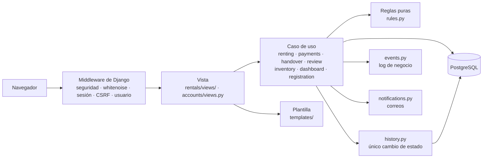
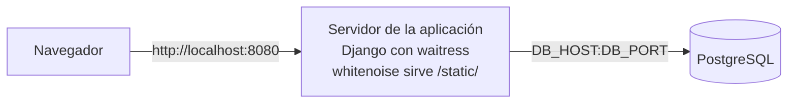
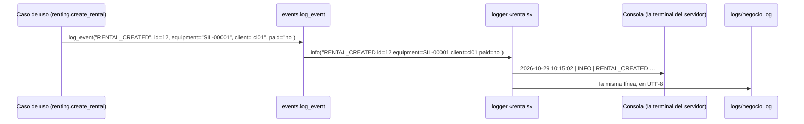

# Cómo está hecho el sistema

> Versión del 28/10/2026 (versión final). Django 6.1 + PostgreSQL 17. Una app de cuentas (`accounts`) y una de negocio (`rentals`).
> La base de datos, con el porqué de cada tabla, está en [base-de-datos.md](base-de-datos.md).

## Capas

| Capa | Archivos | Qué hace | Qué no hace |
|---|---|---|---|
| Vista | `rentals/views/`, `accounts/views.py` | Lee la petición, llama a **una** función del caso de uso, muestra el mensaje y elige la página. | No decide reglas. |
| Caso de uso | `renting.py` (rentar, modificar, cancelar), `payments.py` (QR, efectivo, deudas), `handover.py` (entregar y devolver), `review.py` (revisar), `inventory.py` (registrar equipos), `dashboard.py` (panel), `accounts/registration.py` (crear cuentas) | Hace una operación completa: valida, bloquea la fila, guarda, escribe el log y manda el correo. | No sabe nada de HTTP: una API futura puede llamar a las mismas funciones. |
| Reglas | `rules.py` | Compara fechas, horas y montos y responde sí, no o un número. | No lee ni escribe la base. |
| Datos | `models.py`, `migrations/` | Define las tablas, sus restricciones y calcula el estado de la renta. | — |

**Patrón de cada operación que guarda:** validar lo que no necesita la base → abrir la transacción → bloquear la fila (`select_for_update`) → validar lo que sí la necesita → guardar → escribir el log → mandar el correo. Si algo falla, se lanza un error (subclase de `OperationRejectedError`) con la causa en español, no se guarda nada y el log escribe `<ACCIÓN>_REJECTED`.

## Mapa del código

| Módulo | Responsabilidad | CU |
|---|---|---|
| `accounts/models.py` | `Role` y `User`: teléfono único, correo único sin distinguir mayúsculas y el rol, que pone `is_staff` e `is_superuser`. | CU-01, CU-02 |
| `accounts/registration.py` | `register_client`: crea la cuenta de un cliente en la web o en la tienda y junta todas las causas de un rechazo. | CU-01, CU-02 |
| `accounts/forms.py` | Login con sus mensajes (también para la cuenta desactivada), formulario de registro y formularios del admin de usuarios. | CU-01, CU-02 |
| `accounts/validators.py` | La contraseña necesita una mayúscula y un número. | CU-01, CU-02 |
| `accounts/views.py` | Páginas de registro en la web y en la tienda. | CU-01, CU-02 |
| `accounts/admin.py` | Usuarios con su rol y su deuda; el log cuando se bloquea o desbloquea una cuenta. | — (ENT-79) |
| `rentals/rules.py` | Reglas puras: horarios, días, precio por día, plazo de 24 h, medianoche, atraso, cargos por daño y su tope. | CU-04 a CU-10 |
| `rentals/statuses.py` | Opciones fijas: estados del equipo y de la renta, resultado de la devolución, forma de pago y motivo de la deuda. | Todos |
| `rentals/models.py` | `Equipment`, `Rental` (estado calculado y consultas por estado), `Debt` (con su suma) y `StatusChange`. | Todos |
| `rentals/renting.py` | Catálogo con filtros y páginas, búsqueda de clientes, rentar en línea y en tienda, modificar, cancelar y «Mis rentas». | CU-03 a CU-07, CU-16 |
| `rentals/payments.py` | QR simulado; crear, sumar, listar y cobrar deudas. | CU-04, CU-11 |
| `rentals/handover.py` | Entregar (cobra si falta el pago) y devolver (crea la deuda por atraso). | CU-08, CU-09 |
| `rentals/review.py` | Revisión de mantenimiento: estado nuevo, deuda por daño y, si es baja, cancela las reservas futuras. | CU-10 |
| `rentals/history.py` | `change_status`: el único lugar que cambia `Equipment.status`, siempre con su fila de historial. | CU-09, CU-10, CU-13 |
| `rentals/inventory.py` | Registrar un equipo con las reglas del modelo. | CU-12 |
| `rentals/dashboard.py` | Las seis listas del panel del responsable. | CU-15 |
| `rentals/roles.py` | Los roles, `has_role`, `is_store_staff` y el decorador `role_required`. | Todos (RF-19) |
| `rentals/context_processors.py` | Le dice al menú qué enlaces mostrar según el rol. | Todos (RF-19) |
| `rentals/events.py` | Log de negocio y el decorador que escribe cada rechazo una sola vez. | Todos (RC-05) |
| `rentals/notifications.py` | Correos al cliente, enviados cuando la transacción se confirma. | CU-01, CU-02, CU-04 a CU-07, CU-09, CU-10 |
| `rentals/formatting.py` | Textos compartidos: fechas, montos, días, el aviso de deuda y por qué una renta ya no está «Reservada». | Todos (RC-04) |
| `rentals/errors.py` | Los rechazos con su causa para el usuario. | Todos (RC-04) |
| `rentals/forms.py` | Formularios de filtros, fechas, renta en tienda, devolución y registro de equipos. Solo revisan que los datos tengan forma. | CU-03 a CU-05, CU-09, CU-12 |
| `rentals/admin.py` | Admin de equipos, rentas, deudas e historial; sus acciones llaman a los casos de uso. | CU-07, CU-11 a CU-15 |
| `rentals/views/renting.py` | Catálogo, rentar, pagar con QR, confirmación, modificar, cancelar, renta en tienda y «Mis rentas». | CU-03 a CU-07, CU-16 |
| `rentals/views/handover.py` | Reservas por entregar y devoluciones. | CU-08, CU-09 |
| `rentals/views/review.py` | Lista de mantenimiento y su decisión. | CU-10 |
| `rentals/views/debts.py` | Deudas pendientes y su cobro. | CU-11 |
| `rentals/views/inventory.py` | Registrar un equipo. | CU-12 |
| `rentals/views/dashboard.py` | Panel del responsable. | CU-15 |
| `rentals/views/home.py` | Manda a cada usuario a la página de su rol. | — (RF-19) |
| `rentals/management/commands/seed_demo.py` | Deja la base con el escenario de la demo. | — |
| `config/settings.py` | Configuración leída de `.env`, tasas y formatos del negocio, log y correo. | — |

## Organización en apps

Se quedan dos apps: `accounts` (usuarios y roles) y `rentals` (el negocio). Se evaluó separar el inventario (`Equipment`, `StatusChange`, `history.py`, `inventory.py`) en otra app y **no conviene**:

- Las dos apps dependerían una de la otra: `Rental` apunta a `Equipment` y la devolución cambia su estado, pero la revisión del equipo crea deudas y cancela rentas, y el precio por día del equipo sale de `rules.py`.
- Mover un modelo de app cambia el nombre de sus tablas: habría que reiniciar otra vez las migraciones y la base de cada integrante antes de la entrega.
- Dentro de `rentals` cada caso de uso ya tiene su módulo, así que la separación existe sin ese costo.

Entre las dos apps no hay importaciones circulares entre módulos (revisado con un script). `accounts` usa de `rentals` el log (`events.py`), los errores y el correo de bienvenida; `rentals` usa de `accounts` solo `Role`, a través de `roles.py`. Ninguna vista usa modelos de la otra app.

## Roles

| Rol (`Role.code`) | Página de inicio | Qué puede hacer |
|---|---|---|
| `cliente` | Catálogo | Crear su cuenta, rentar y pagar, modificar y cancelar sus reservas, ver sus rentas y su deuda. |
| `operador` | Reservas por entregar | Crear cuentas, rentar en tienda, entregar, cobrar, recibir, cobrar deudas, modificar y cancelar. |
| `mantenimiento` | Mantenimiento | Revisar los equipos devueltos. |
| `administrador` | Panel del responsable | Todo lo anterior, registrar equipos y el admin de Django. `is_staff` e `is_superuser` se ponen solos según el rol. |

`role_required` revisa el rol en cada página del personal: sin sesión manda al login; sin el rol responde 403 con una página en español. Solo el admin bloquea a un usuario, desactivando su cuenta (`is_active = False`). `AUTHENTICATION_BACKENDS` tiene primero `ModelBackend`, con el que entran las cuentas activas y que deja sin sesión a una cuenta que se desactiva, y después `AllowAllUsersModelBackend`, que solo reconoce una cuenta desactivada con su contraseña correcta para que `LoginForm.confirm_login_allowed` le diga por qué no entra.

## Despliegue

| Nodo | Qué es | Qué hace |
|---|---|---|
| Navegador | Chrome o Firefox | Muestra las páginas; cada formulario lleva su token CSRF. |
| Servidor de la aplicación | waitress, un servidor web de producción en Python puro que funciona en Windows, corre `config.wsgi:application` | Atiende las peticiones con Django, sirve los estilos ya juntados por `collectstatic` (whitenoise) y escribe el log de negocio en la consola y en `logs/negocio.log`. Lee su configuración de `.env`. Para programar, `runserver` ocupa su lugar. |
| PostgreSQL | PostgreSQL 15 o superior | Guarda los datos. |

Los pasos están en el README, en «Correr como en producción». Las opciones que exigen HTTPS (cookies seguras, redirección y HSTS) se activan con `USE_HTTPS=True` en `.env`.

## Cómo viaja una línea del log

Si un caso de uso lanza `OperationRejectedError`, el decorador `logs_rejection` escribe `RENTAL_REJECTED reason="…"` con nivel `WARNING` y deja pasar el error a la vista. Si un correo falla, `notifications.py` escribe `EMAIL_FAILED` y la operación sigue.

## Correo

Se usa `django.core.mail.send_mail` con el setting `MAILERS` de Django 6.1. Por defecto, el backend de consola (el correo se imprime en la terminal). Si `.env` tiene `EMAIL_HOST_USER` y `EMAIL_HOST_PASSWORD`, se usa el SMTP de Gmail (`smtp.gmail.com:587`, TLS, con una contraseña de aplicación).

## Pruebas y CI

| Tipo | Carpeta | Qué prueba |
|---|---|---|
| Unitarias | `tests/unit/` | Reglas y validaciones, sin base de datos. |
| Integración | `tests/integration/` | Cada caso de uso con la base de datos, el log (`caplog`) y el correo (`mail.outbox`). |
| Sistema | `tests/system/` | Recorridos completos por la web. |

GitHub Actions (`.github/workflows/ci-sesion12.yml`) corre en cada push: revisa la configuración, que no falte ninguna migración, y todas las pruebas con un PostgreSQL temporal.
