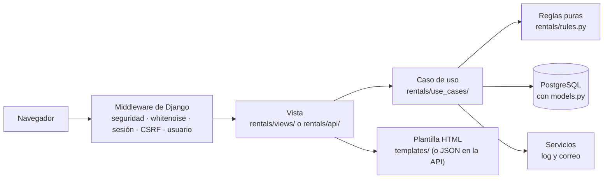
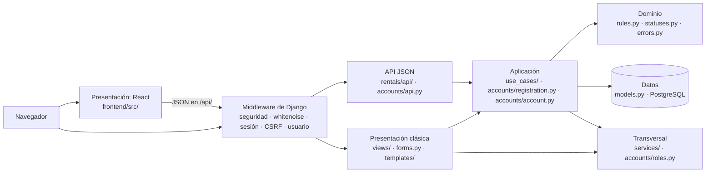
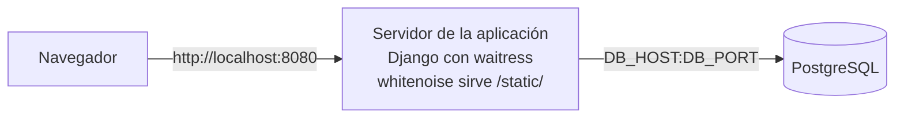

# Cómo está hecho el sistema

Qué contiene: qué hay en cada carpeta y qué no entra en ella, las capas, el mapa del código, cómo se sirve el sistema (runserver, waitress, whitenoise), la configuración secreta, el log de negocio, el correo y el CI.
Cuándo leerlo: antes de cambiar código, para saber dónde va cada cosa. Los IDs (ENT, D, CU, RF, RC) se explican en el [glosario de IDs](README.md#glosario-de-ids).

## En pocas palabras

El sistema es una aplicación web hecha con **Django** 6.1, un framework de Python que trae lo común de una web (usuarios, sesiones, formularios, administración, acceso a la base de datos), y **PostgreSQL**, la base de datos donde se guardan usuarios, equipos, rentas, deudas e historial. Django organiza el código en **apps**, carpetas con sus modelos, vistas y URLs. Hay dos:

- `accounts`: las cuentas, los roles, el registro, el login y «Mi cuenta».
- `rentals`: el negocio: equipos, rentas, pagos, devoluciones, revisión, deudas y el panel.

Además, `config/` tiene la configuración del proyecto (`settings.py`) y las URLs raíz (`urls.py`): `/admin/` es el admin de Django, `/api/` la API JSON para el frontend en React, y el resto son las páginas de `accounts` y `rentals`.

La forma principal de usar el sistema es el **frontend en React** (`frontend/`, en el puerto 5173 mientras se programa): es solo presentación, le pide todo a la API JSON y la API llama a los mismos casos de uso que las páginas clásicas de Django.

Cuando alguien presiona un botón, la petición sigue siempre el mismo camino:



- El **middleware** es código de Django que corre en cada petición antes de llegar a la vista: agrega cabeceras de seguridad, sirve los estilos (whitenoise), carga la sesión, revisa el token CSRF (una clave oculta en cada formulario que impide que otro sitio envíe formularios en nombre del usuario) e identifica al usuario.
- La **vista** lee lo que llegó en la petición, llama a **una** función del caso de uso y elige la página que responde. Nunca decide una regla del negocio.
- El **caso de uso** hace la operación completa: valida, abre una transacción, bloquea la fila, guarda, escribe el log y manda el correo.
- La **plantilla** es el HTML de la página, con huecos que Django llena con los datos.

## Qué hay en cada carpeta

### `rentals/use_cases/`

- **Qué es:** una función por operación del negocio, agrupadas en un archivo por tema. Es el corazón del sistema: las páginas, la API y el admin llaman a estas mismas funciones.
- **Qué entra:** todo lo que una operación necesita en orden: revisar las reglas, abrir la **transacción** (`transaction.atomic()`: o se guarda todo o no se guarda nada), **bloquear la fila** (`select_for_update()`: si dos personas hacen clic a la vez, la segunda espera y después ve lo que guardó la primera), guardar, escribir el log y mandar el correo. También las lecturas que arman lo que muestra una página («Mis rentas», el panel).
- **Qué no entra:** nada de la petición HTTP (formularios, mensajes, redirecciones) ni la elección de la página: eso es de las vistas. Tampoco cálculos puros de fechas o montos: eso es de `rules.py`.
- **Archivos y casos de uso:** la tabla «CU → archivo» está en [`rentals/use_cases/__init__.py`](../rentals/use_cases/__init__.py) y en [casos-de-uso.md](casos-de-uso.md#dónde-está-cada-caso-de-uso). Las dependencias entre archivos van en un solo sentido, sin importaciones en círculo: `equipment_status` → `reservation_changes` → `renting` → `debts` ([D-42](decisiones.md#d-42)).

### `rentals/rules.py`

- **Qué es:** las **reglas puras**: funciones que reciben valores, los comparan y devuelven un resultado, sin tocar la base. Por ejemplo `rental_days`, `classify_return`, `late_days`, `periods_overlap`, `daily_price_for`.
- **Qué entra:** horarios, días, precio por día, plazo de 24 h, medianoche, atraso, cargos por daño y su tope, y las constantes de horario (18:00, 09:00, 12:00).
- **Qué no entra:** nada que lea o escriba la base, ni textos para el usuario. Por eso se prueban con objetos sin guardar, muy rápido (`tests/unit/`).

### `rentals/services/`

- **Qué es:** lo que usan varios casos de uso sin ser una regla del negocio.
- **Qué entra:** `events.py` (el log de negocio y el decorador que escribe cada rechazo), `notifications.py` (los correos al cliente) y `formatting.py` (los textos para mostrar: fechas, montos, avisos).
- **Qué no entra:** decisiones del negocio ni cambios en la base.

### `rentals/views/` (y `accounts/views.py`)

- **Qué es:** las **vistas** de las páginas HTML, un archivo por grupo de casos de uso.
- **Qué entra:** leer la petición y el formulario, revisar el rol (`role_required`), llamar a una función de `use_cases/`, mostrar el mensaje de éxito o el rechazo y elegir la plantilla o la redirección.
- **Qué no entra:** reglas del negocio, consultas propias a la base o cambios de estado.

### `rentals/api/` (y `accounts/api.py`)

- **Qué es:** la **API JSON**: las mismas operaciones que las páginas, pero respondiendo datos en JSON para el frontend en React. Su contrato está en [api.md](api.md).
- **Qué entra:** `responses.py` (el formato común, los códigos 400/401/403/404/405 y la sesión), `serializers.py` (cómo se escriben fechas y montos en JSON), `urls.py` y un archivo por grupo de casos de uso.
- **Qué no entra:** reglas propias: valida con los mismos formularios y llama a las mismas funciones de `use_cases/` que las páginas ([D-25](decisiones.md#d-25)).

### `templates/`

- **Qué es:** las **plantillas** HTML de todas las páginas, en un solo lugar: `templates/accounts/`, `templates/rentals/`, las páginas de error (403, 404, 500) y `templates/admin/` para el logo del admin.
- **Qué entra:** cómo se ve cada página. `templates/includes/` tiene las partes que se repiten (el formulario de fechas, los errores, la etiqueta del pago).
- **Qué no entra:** cálculos ni reglas: reciben los datos ya listos de la vista.

### `migrations/` (en `accounts/` y en `rentals/`)

- **Qué es:** una **migración** es un archivo que dice cómo crear o cambiar las tablas de la base para que coincidan con `models.py`. Django las escribe con `python manage.py makemigrations` y las aplica con `python manage.py migrate`; la tabla `django_migrations` recuerda cuáles ya se aplicaron.
- **Qué entra:** `0001_initial.py` de cada app (las tablas), `accounts/0002_roles.py` (crea los 4 roles; `seed_demo` reutiliza su función `create_roles`) y `rentals/0002_equipment_field_messages.py` (los mensajes en español de los campos del equipo).
- **Qué no entra:** cambios a mano: se generan con `makemigrations` y el CI revisa que no falte ninguna (`makemigrations --check`).

### `rentals/management/commands/`

- **Qué es:** los **comandos propios** de `manage.py`: se corren con `python manage.py <nombre>`.
- **Qué entra:** `seed_demo.py`, que borra todo y crea la demo (solo con `DEBUG=True`, [D-41](decisiones.md#d-41)).
- **Qué no entra:** nada que se use en producción.

### `static/`

- **Qué es:** los **archivos estáticos** escritos por el equipo, que el navegador descarga tal cual: `css/style.css` (las páginas), `css/admin.css` (el admin) e `img/logo.png`.
- **Qué entra:** CSS e imágenes. El proyecto no tiene JavaScript propio.
- **Qué no entra:** archivos generados: esos van a `staticfiles/`.

### `staticfiles/`

- **Qué es:** la carpeta que llena `python manage.py collectstatic`: junta los estáticos de `static/` y los del admin de Django, los comprime y les pone un nombre con su versión (por ejemplo `style.4f3a2c.css`), así el navegador baja la versión nueva cuando cambian.
- **Qué entra:** solo lo que genera `collectstatic`; whitenoise la sirve en producción.
- **Qué no entra:** cambios a mano. No se sube a git (está en `.gitignore`): cada servidor la genera.

### Las demás carpetas

| Carpeta | Qué tiene |
|---|---|
| `config/` | `settings.py` (la configuración, leída de `.env`), `settings_test.py` (los ajustes de las pruebas), `urls.py` (las URLs raíz) y `wsgi.py` (el punto de entrada que usa waitress). |
| `accounts/` | El usuario con rol y teléfono, los roles (`roles.py`), el registro de clientes (`registration.py`), «Mi cuenta» (`account.py`), sus formularios, vistas, URLs, API y admin. |
| `rentals/` | Además de las carpetas de arriba: los modelos (`models.py`), los estados (`statuses.py`), los errores de rechazo (`errors.py`), los formularios (`forms.py`), el admin (`admin.py`) y las URLs. |
| `tests/` | Las pruebas: `unit/`, `integration/` y `system/` ([pruebas.md](pruebas.md)). |
| `scripts/` | `create_db.sql`, que crea el usuario y la base de PostgreSQL. |
| `docs/` | Esta documentación. |
| `logs/` | `negocio.log`, el log de negocio. No se sube a git. |

## Capas

Una **capa** es un grupo de código con una sola responsabilidad. Las dependencias van en un solo sentido: presentación → aplicación → dominio y datos; la capa transversal la usan las demás. `seed_demo` no es una capa: es una herramienta de la demo que llama a los casos de uso.



| Capa | Carpetas y archivos | Qué hace | Qué no hace |
|---|---|---|---|
| **Presentación: React** | `frontend/src/` (páginas, componentes y `api/`) | Muestra las pantallas, junta lo que escribe la persona, llama a la API JSON y muestra el mensaje o todas las causas del rechazo que responde. | No decide reglas: no revisa fechas, montos ni estados; eso lo responde la API. |
| **Presentación: Django** (páginas clásicas y API JSON) | `rentals/views/`, `templates/`, `rentals/forms.py`; también `accounts/views.py`, `accounts/forms.py`, los `urls.py`, los `admin.py`, `context_processors.py` y la API JSON (`rentals/api/`, `accounts/api.py`) | Lee la petición, revisa que los datos tengan forma, llama a **una** función del caso de uso, muestra el mensaje y elige la página. | No decide reglas. |
| **Aplicación** | `rentals/use_cases/`; también `accounts/registration.py` y `accounts/account.py` | Hace una operación completa: valida, bloquea la fila, guarda, escribe el log y manda el correo. | No sabe nada de HTTP: las páginas y la API JSON llaman a las mismas funciones. |
| **Dominio** | `rentals/rules.py`, `rentals/statuses.py`, `rentals/errors.py`; también `accounts/validators.py` | Las reglas puras (fechas, horas y montos), los estados fijos y los rechazos con su causa para el usuario. | No lee ni escribe la base. |
| **Datos** | `rentals/models.py`, `accounts/models.py`, `migrations/` y PostgreSQL | Las tablas, sus restricciones y el estado calculado de la renta. | No decide qué operación se permite. |
| **Transversal** | `rentals/services/`, `accounts/roles.py` | Lo que usan varias capas sin ser una regla: el log de negocio, los correos, los textos para mostrar y los roles. | No cambia la base. |

**Patrón de cada operación que guarda:** validar lo que no necesita la base → abrir la transacción → bloquear la fila (`select_for_update`) → validar lo que sí la necesita → guardar → escribir el log → mandar el correo. Si algo falla, se lanza un error (una subclase de `OperationRejectedError`) con la causa en español, no se guarda nada y el log escribe `<ACCIÓN>_REJECTED`.

## Mapa del código

```text
accounts/
    models.py  registration.py  account.py  roles.py  forms.py  validators.py
    views.py  admin.py  urls.py  api.py  migrations/
rentals/
    models.py  admin.py  forms.py  urls.py  apps.py  context_processors.py
    rules.py  statuses.py  errors.py          ← dominio: reglas puras, estados y errores
    use_cases/                                ← un archivo por grupo de casos de uso
        catalog.py  renting.py  payments.py  reservation_changes.py  debts.py
        handover.py  review.py  inventory.py  equipment_status.py  dashboard.py
    services/                                 ← lo que usan los casos de uso sin ser una regla
        events.py  notifications.py  formatting.py
    views/                                    ← páginas HTML
        renting.py  handover.py  review.py  debts.py  inventory.py  dashboard.py  home.py
    api/                                      ← API JSON: mismas funciones de use_cases/
    management/commands/seed_demo.py
    migrations/
config/  templates/  static/  tests/  scripts/  docs/
```

| Módulo | Responsabilidad | CU |
|---|---|---|
| `accounts/models.py` | `Role` y `User`: teléfono único, correo único sin distinguir mayúsculas y el rol, que pone `is_staff` e `is_superuser`. | [CU-01](casos-de-uso.md#cu-01), [CU-02](casos-de-uso.md#cu-02) |
| `accounts/registration.py` | `register_client` (web, con contraseña) y `register_store_client` (tienda, sin contraseña y con el correo «Crea tu contraseña»); juntan todas las causas de un rechazo. | [CU-01](casos-de-uso.md#cu-01), [CU-02](casos-de-uso.md#cu-02) |
| `accounts/account.py` | `update_profile`: «Mi cuenta» edita nombre, apellido, correo y teléfono con las reglas del registro. | [CU-17](casos-de-uso.md#cu-17) |
| `accounts/roles.py` | Los roles, `has_role`, `is_store_staff` y el decorador `role_required`. Está en `accounts` porque los roles son de los usuarios. | Todos ([RF-19](casos-de-uso.md#rf-19)) |
| `accounts/forms.py` | Login con sus mensajes (también para la cuenta desactivada), formularios de registro y de «Mi cuenta», los de contraseña de Django con su log y los del admin de usuarios. | [CU-01](casos-de-uso.md#cu-01), [CU-02](casos-de-uso.md#cu-02), [CU-17](casos-de-uso.md#cu-17) |
| `accounts/validators.py` | La contraseña necesita una mayúscula y un número. | [CU-01](casos-de-uso.md#cu-01), [CU-02](casos-de-uso.md#cu-02) |
| `accounts/views.py` | Páginas de registro en la web y en la tienda, «Mi cuenta» y cambiar la contraseña; las de recuperarla son las de Django, en `accounts/urls.py`. | [CU-01](casos-de-uso.md#cu-01), [CU-02](casos-de-uso.md#cu-02), [CU-17](casos-de-uso.md#cu-17) |
| `accounts/admin.py` | Usuarios con su rol y su deuda; el log cuando se bloquea o desbloquea una cuenta y la cancelación de sus reservas ([D-27](decisiones.md#d-27)). | — ([ENT-79](respuestas-del-cliente.md#ent-79)) |
| `rentals/models.py` | `Equipment`, `Rental` (estado calculado y consultas por estado), `Debt` (con su suma) y `StatusChange`. | Todos |
| `rentals/rules.py` | Reglas puras: horarios, días, precio por día, plazo de 24 h, medianoche, atraso, cargos por daño y su tope. | [CU-04](casos-de-uso.md#cu-04) a [CU-10](casos-de-uso.md#cu-10) |
| `rentals/statuses.py` | Opciones fijas: estados del equipo y de la renta, resultado de la devolución, forma de pago y motivo de la deuda. | Todos |
| `rentals/errors.py` | Los rechazos con su causa para el usuario. | Todos ([RC-04](casos-de-uso.md#rc-04)) |
| `rentals/use_cases/catalog.py` | Catálogo con filtros y páginas de 20, sin etiquetas de libre u ocupado ([ENT-99](respuestas-del-cliente.md#ent-99)). | [CU-03](casos-de-uso.md#cu-03) |
| `rentals/use_cases/renting.py` | Crear la renta en línea y en tienda, buscar clientes y «Mis rentas». | [CU-04](casos-de-uso.md#cu-04), [CU-05](casos-de-uso.md#cu-05), [CU-16](casos-de-uso.md#cu-16) |
| `rentals/use_cases/payments.py` | El pago con el QR simulado. | [CU-04](casos-de-uso.md#cu-04) |
| `rentals/use_cases/reservation_changes.py` | Modificar y cancelar una reserva, también la cancelación automática (equipo fuera de servicio o cuenta desactivada). | [CU-06](casos-de-uso.md#cu-06), [CU-07](casos-de-uso.md#cu-07) |
| `rentals/use_cases/debts.py` | Crear, sumar, listar y cobrar deudas. | [CU-11](casos-de-uso.md#cu-11) |
| `rentals/use_cases/handover.py` | Entregar (cobra si falta el pago) y devolver (crea la deuda por atraso). | [CU-08](casos-de-uso.md#cu-08), [CU-09](casos-de-uso.md#cu-09) |
| `rentals/use_cases/review.py` | Revisión de mantenimiento de cualquier equipo: estado nuevo, deuda por daño solo si se marca el cobro y, con reparación o baja, cancela las reservas no recogidas. | [CU-10](casos-de-uso.md#cu-10) |
| `rentals/use_cases/inventory.py` | Registrar un equipo con las reglas del modelo. | [CU-12](casos-de-uso.md#cu-12) |
| `rentals/use_cases/equipment_status.py` | `change_status`: el único lugar que cambia `Equipment.status`, siempre con su fila de historial; `correct_status` (admin) y `cancel_if_out_of_service` (cancela las reservas al pasar a reparación o baja). | [CU-09](casos-de-uso.md#cu-09), [CU-10](casos-de-uso.md#cu-10), [CU-13](casos-de-uso.md#cu-13) |
| `rentals/use_cases/dashboard.py` | Las seis listas del panel del responsable, lo último primero. | [CU-15](casos-de-uso.md#cu-15) |
| `rentals/services/events.py` | Log de negocio: el contexto de una renta (`rental_context`) y el decorador que escribe cada rechazo una sola vez, con lo que se intentó. | Todos ([RC-05](casos-de-uso.md#rc-05), [ENT-101](respuestas-del-cliente.md#ent-101)) |
| `rentals/services/notifications.py` | Correos al cliente, enviados cuando la transacción se confirma y en un hilo aparte; «Crea tu contraseña» sale en el momento y dice si salió. | [CU-01](casos-de-uso.md#cu-01), [CU-02](casos-de-uso.md#cu-02), [CU-04](casos-de-uso.md#cu-04) a [CU-07](casos-de-uso.md#cu-07), [CU-09](casos-de-uso.md#cu-09), [CU-10](casos-de-uso.md#cu-10) |
| `rentals/services/formatting.py` | Textos para mostrar: fechas, montos, días, el aviso de deuda y por qué una renta ya no está «Reservada». | Todos ([RC-04](casos-de-uso.md#rc-04)) |
| `rentals/forms.py` | Formularios de filtros, fechas, renta en tienda, «Ordenar por», devolución y registro de equipos. Solo revisan que los datos tengan forma. | [CU-03](casos-de-uso.md#cu-03) a [CU-05](casos-de-uso.md#cu-05), [CU-08](casos-de-uso.md#cu-08), [CU-09](casos-de-uso.md#cu-09), [CU-12](casos-de-uso.md#cu-12) |
| `rentals/admin.py` | Admin de equipos, rentas, deudas e historial, lo último primero; sus acciones llaman a los casos de uso. | [CU-07](casos-de-uso.md#cu-07), [CU-11](casos-de-uso.md#cu-11) a [CU-15](casos-de-uso.md#cu-15) |
| `rentals/context_processors.py` | Le dice al menú qué enlaces mostrar según el rol. | Todos ([RF-19](casos-de-uso.md#rf-19)) |
| `rentals/views/renting.py` | Catálogo, rentar, pagar con QR, confirmación, modificar, cancelar, renta en tienda y «Mis rentas». | [CU-03](casos-de-uso.md#cu-03) a [CU-07](casos-de-uso.md#cu-07), [CU-16](casos-de-uso.md#cu-16) |
| `rentals/views/handover.py` | Reservas por entregar y devoluciones. | [CU-08](casos-de-uso.md#cu-08), [CU-09](casos-de-uso.md#cu-09) |
| `rentals/views/review.py` | Lista de mantenimiento y su decisión. | [CU-10](casos-de-uso.md#cu-10) |
| `rentals/views/debts.py` | Deudas pendientes y su cobro. | [CU-11](casos-de-uso.md#cu-11) |
| `rentals/views/inventory.py` | Registrar un equipo. | [CU-12](casos-de-uso.md#cu-12) |
| `rentals/views/dashboard.py` | Panel del responsable. | [CU-15](casos-de-uso.md#cu-15) |
| `rentals/views/home.py` | Manda a cada usuario a la página de su rol. | — ([RF-19](casos-de-uso.md#rf-19)) |
| `rentals/api/` | API JSON: `responses.py` (formato, método, sesión, rol y errores), `serializers.py` (fechas ISO y montos) y un archivo por grupo de casos de uso. Contrato en [api.md](api.md). | [CU-03](casos-de-uso.md#cu-03) a [CU-12](casos-de-uso.md#cu-12), [CU-15](casos-de-uso.md#cu-15), [CU-16](casos-de-uso.md#cu-16) |
| `accounts/api.py` | API de la sesión (CSRF, login, logout, «quién soy») y de las cuentas, también «Mi cuenta». | [CU-01](casos-de-uso.md#cu-01), [CU-02](casos-de-uso.md#cu-02), [CU-17](casos-de-uso.md#cu-17) |
| `rentals/management/commands/seed_demo.py` | Borra todo y crea la demo. | — |
| `config/settings.py` | Configuración leída de `.env`, tasas y formatos del negocio, log y correo. | — |

## Por qué hay solo dos apps

Separar más, por ejemplo el inventario o las deudas en su propia app, **crearía dependencias en círculo entre apps**:

- La revisión de un equipo cancela sus rentas futuras y crea deudas, y la devolución de una renta cambia el estado del equipo: una app de inventario importaría de `rentals` y `rentals` de ella.
- Las deudas nacen en la devolución y en la revisión, y bloquean las rentas nuevas: una app de deudas dependería de las otras y ellas de ella.
- Mover un modelo de app cambia el nombre de sus tablas: habría que reiniciar otra vez las migraciones y la base de cada integrante.

Dentro de `rentals` la separación existe sin ese costo: cada grupo de casos de uso tiene su archivo en `use_cases/`. `accounts` usa de `rentals` el log, los errores y los correos (`services/` y `errors.py`); `rentals` usa de `accounts` los roles (`accounts/roles.py`) y, en `seed_demo`, el modelo `Role`. Ninguna vista usa modelos de la otra app.

## Roles

| Rol (`Role.code`) | Página de inicio | Qué puede hacer |
|---|---|---|
| `cliente` | Catálogo | Crear su cuenta, rentar y pagar, modificar y cancelar sus reservas, ver sus rentas y su deuda. |
| `operador` | Reservas por entregar | Crear cuentas, rentar en tienda, entregar, cobrar, recibir, cobrar deudas, modificar y cancelar. |
| `mantenimiento` | Mantenimiento | Revisar los equipos. |
| `administrador` | Panel del responsable | Todo lo anterior, registrar equipos y el admin de Django. `is_staff` e `is_superuser` se ponen solos según el rol. |

`role_required` revisa el rol en cada página del personal: sin sesión manda al login; sin el rol responde 403 con una página en español. Solo el admin bloquea a un usuario, desactivando su cuenta (`is_active = False`). `AUTHENTICATION_BACKENDS` (la lista de formas de comprobar un usuario y su contraseña) tiene primero `ModelBackend`, con el que entran las cuentas activas y que deja sin sesión a una cuenta que se desactiva, y después `AllowAllUsersModelBackend`, que solo reconoce una cuenta desactivada con su contraseña correcta para que `LoginForm.confirm_login_allowed` le diga por qué no entra ([D-16](decisiones.md#d-16)).

## Cómo se sirve el sistema

### `runserver` para programar, waitress en producción

- `python manage.py runserver 8080` es el servidor de desarrollo de Django: se reinicia solo al cambiar el código y muestra errores detallados. Django mismo advierte que **no es para producción**: atiende de a pocas peticiones, no está revisado para seguridad ni rendimiento y, con `DEBUG=True`, muestra detalles internos si algo falla.
- **waitress** es un servidor web de producción escrito en Python: atiende varias peticiones a la vez con un grupo de hilos, funciona igual en Windows (otros servidores comunes, como gunicorn, no corren en Windows) y se instala con `pip`, sin nada más ([D-21](decisiones.md#d-21)). Corre Django a través de `config/wsgi.py`, el punto de entrada estándar de Python para aplicaciones web: `python -m waitress --port=8080 config.wsgi:application`.
- Los dos usan el puerto 8080 ([D-09](decisiones.md#d-09)).

### `collectstatic` y whitenoise

- Con `DEBUG=False`, Django no sirve los archivos de `static/` (los estilos y el logo): espera que otro programa lo haga.
- `python manage.py collectstatic --noinput` junta los estáticos de `static/` y los del admin en `staticfiles/`, los comprime y les pone un nombre con su versión (`CompressedManifestStaticFilesStorage`).
- **whitenoise** es un middleware que sirve `/static/` desde `staticfiles/` dentro del mismo Django, con caché larga para el navegador. Así no hace falta otro servidor web delante ([D-21](decisiones.md#d-21)). Hay que volver a correr `collectstatic` cada vez que cambia algo en `static/`.

### Despliegue



| Nodo | Qué es | Qué hace |
|---|---|---|
| Navegador | Chrome o Firefox | Muestra las páginas; cada formulario lleva su token CSRF. |
| Servidor de la aplicación | waitress, que corre `config.wsgi:application` | Atiende las peticiones con Django, sirve los estilos ya juntados por `collectstatic` (whitenoise) y escribe el log de negocio en la consola y en `logs/negocio.log`. Lee su configuración de `.env`. Para programar, `runserver` ocupa su lugar. |
| PostgreSQL | PostgreSQL 15 o superior | Guarda los datos. |

Los pasos están en el README, en «Producción, paso a paso». Las opciones que exigen HTTPS (cookies seguras, redirección y HSTS, que obliga al navegador a usar siempre HTTPS) se activan con `USE_HTTPS=True` en `.env`.

### Revisión de seguridad: `python manage.py check --deploy`

`check --deploy` revisa la configuración de producción y avisa lo que falta. Con `DEBUG=False`, una `SECRET_KEY` propia, `USE_HTTPS=True` y Gmail configurado: **sin advertencias** («System check identified no issues»). En local, sin HTTPS y sin Gmail, quedan estas, todas esperadas ([RC-03](casos-de-uso.md#rc-03)):

| Código | Qué dice | Por qué queda en local |
|---|---|---|
| `mail.E001` | El correo usa el backend de consola, que es solo para desarrollo. | Sin `EMAIL_HOST_USER` y `EMAIL_HOST_PASSWORD` los correos se imprimen. Desaparece al configurar Gmail. |
| `security.W004` | Falta `SECURE_HSTS_SECONDS`. | HSTS solo se activa con `USE_HTTPS=True`; en `http://localhost` rompería el sitio. |
| `security.W008` | `SECURE_SSL_REDIRECT` no está en `True`. | En local no hay HTTPS al que redirigir. |
| `security.W012` | `SESSION_COOKIE_SECURE` no está en `True`. | Con HTTP el navegador no enviaría la cookie y no se podría iniciar sesión. |
| `security.W016` | `CSRF_COOKIE_SECURE` no está en `True`. | Igual que la anterior, para el token CSRF. |

## Configuración y secretos

### `.env`

`.env` es un archivo de texto en la carpeta del proyecto con lo que cambia de una máquina a otra y lo secreto: la contraseña de la base, la `SECRET_KEY`, `DEBUG`, `ALLOWED_HOSTS` y la cuenta de Gmail. `config/settings.py` lo lee al arrancar (con `python-dotenv`). `.env.example` es la plantilla, sin secretos: se copia como `.env` y se completa.

### `SECRET_KEY`

Es una clave larga y aleatoria que Django usa para **firmar** datos: la cookie de sesión, los tokens CSRF y los enlaces de «Olvidé mi contraseña». Firmar quiere decir que Django puede comprobar que el dato no se cambió; sin la clave, nadie puede fabricar una sesión o un enlace válido. Por eso:

- Debe ser propia de cada servidor y nunca subirse a git.
- Si se cambia, se cierran todas las sesiones y vencen los enlaces de contraseña ya enviados.
- Con `DEBUG=False`, el sistema no arranca sin ella (`ImproperlyConfigured`, [D-08](decisiones.md#d-08)).
- Se genera con `python -c "from django.core.management.utils import get_random_secret_key; print(get_random_secret_key())"`.

### `.gitignore`

`.gitignore` es la lista de archivos y carpetas que git no sube al repositorio. Aquí: `.env` (los secretos), `.venv/` y `venv/` (el entorno virtual, que cada uno crea), `__pycache__/` y `*.pyc` (archivos que Python genera), `.pytest_cache/`, `.idea/` (la configuración de PyCharm), `db.sqlite3`, `logs/` (el log de cada máquina) y `staticfiles/` (lo genera `collectstatic`).

## El log de negocio

El **log de negocio** es el registro de cada operación, aceptada o rechazada, en `logs/negocio.log` y en la terminal del servidor ([RC-05](casos-de-uso.md#rc-05)). Sirve para auditar quién hizo qué y cuándo. Lo escribe el **logger** «rentals» de Python (el objeto que recibe las líneas y las manda a la consola y al archivo), configurado en `LOGGING` de `config/settings.py`.


Cada línea se entiende sin buscar en la base ([ENT-101](respuestas-del-cliente.md#ent-101)). `rental_context` es la única función que arma los datos de una renta:

```text
2026-10-29 19:02:11 | INFO    | PAYMENT_APPROVED rental=60 equipment=SIL-00003 "Silla plegable blanca" client=cl01 "Carla Mendoza" period=30/10/2026 18:00-01/11/2026 09:00 amount=8.00 by=cl01
2026-10-29 19:03:40 | WARNING | ACCOUNT_REJECTED username=juan23 email=juan@correo.com reason="Esta contraseña es demasiado común." by=web
```

Si un caso de uso lanza `OperationRejectedError`, el **decorador** `logs_rejection(evento, intento)` (una función que envuelve al caso de uso) escribe el evento con nivel `WARNING`, con **lo que se intentó** (aunque todavía no exista un id), el motivo y quién actuó, y deja pasar el error a la vista. Si el rechazo vino de otro caso de uso que ya lo escribió, no se repite. Si un correo falla, `services/notifications.py` escribe `EMAIL_FAILED` y la operación sigue. Nunca se escribe una contraseña.

### Eventos del log

«Renta» son los campos de `rental_context`: `rental=<id> equipment=<código> "<nombre>" client=<usuario> "<nombre completo>" period=<recojo>-<devolución> amount=<total en Bs> by=<quién actuó>`. En un pedido rechazado faltan `rental` y `amount`. «Deuda» es `debt=<id> charge=<motivo>` más la renta, con `amount` = el monto de la deuda.

| Evento | Cuándo se escribe | Datos |
|---|---|---|
| `RENTAL_CREATED` | Se guarda una renta, en línea o en la tienda ([CU-04](casos-de-uso.md#cu-04), [CU-05](casos-de-uso.md#cu-05)). | Renta, `payment=pending` (en línea, hasta el QR) o `payment=paid` (en tienda, nace pagada) |
| `RENTAL_REJECTED` | Se rechaza una renta. | Renta pedida (equipo, cliente, fechas pedidas), `reason` |
| `PAYMENT_APPROVED` · `PAYMENT_FAILED` | El cliente presiona un botón del QR simulado ([CU-04](casos-de-uso.md#cu-04)). | Renta |
| `PAYMENT_REJECTED` | El QR de una renta ya pagada o que ya no está «Reservada». | Renta, `reason` |
| `PAYMENT_CASH` | El operador cobra en efectivo: en la renta en tienda o al entregar. | Renta (`by` = el operador) |
| `RENTAL_MODIFIED` | Cambian las fechas de una reserva ([CU-06](casos-de-uso.md#cu-06)). | Renta con las fechas nuevas |
| `MODIFY_REJECTED` | Se rechaza una modificación. | Renta con las fechas pedidas, `reason` |
| `RENTAL_CANCELLED` | Se cancela una reserva, a mano o por reparación, baja o cuenta desactivada ([CU-07](casos-de-uso.md#cu-07)). | Renta, `reason` (el del correo) |
| `CANCEL_REJECTED` | Se rechaza una cancelación. | Renta, `reason` |
| `PICKUP_REGISTERED` | El operador entrega el equipo ([CU-08](casos-de-uso.md#cu-08)). | Renta |
| `PICKUP_REJECTED` | Se rechaza una entrega. | Renta, `reason` |
| `RETURN_REGISTERED` | El operador recibe el equipo ([CU-09](casos-de-uso.md#cu-09)). | Renta, `result`, `late_days` |
| `RETURN_REJECTED` | Se rechaza una devolución. | Renta, `reason` |
| `DEBT_CREATED` | Nace una deuda por atraso ([CU-09](casos-de-uso.md#cu-09)) o por daño ([CU-10](casos-de-uso.md#cu-10)). | Deuda (`by` = quien devolvió o revisó) |
| `DEBT_PAID` | El operador o el admin registra el pago de una deuda ([CU-11](casos-de-uso.md#cu-11)). | Deuda |
| `DEBT_PAYMENT_REJECTED` | Se quiere cobrar una deuda ya pagada. | Deuda, `reason` |
| `DAMAGE_NOT_CHARGED` | Mantenimiento manda a reparación o baja sin marcar el cobro ([ENT-90](respuestas-del-cliente.md#ent-90)). | `status`, renta del último cliente |
| `REVIEW_REJECTED` | Se rechaza una revisión ([CU-10](casos-de-uso.md#cu-10)). | `equipment`, `status` pedido, `reason`, `by` |
| `STATUS_CHANGED` | Cambia el estado de un equipo ([CU-09](casos-de-uso.md#cu-09), [CU-10](casos-de-uso.md#cu-10), [CU-13](casos-de-uso.md#cu-13)). | `equipment`, `old`, `new`, `by` |
| `STATUS_CHANGE_REJECTED` | Se rechaza un cambio de estado. | `equipment`, `new` pedido, `reason`, `by` |
| `EQUIPMENT_REGISTERED` | Se registra un equipo, en la página o en el admin ([CU-12](casos-de-uso.md#cu-12)). | `equipment`, `serial`, `value`, `by` |
| `EQUIPMENT_REJECTED` | Se rechaza un equipo nuevo. | `equipment`, `serial` y `value` escritos, `reason`, `by` |
| `ACCOUNT_CREATED` | Se crea la cuenta de un cliente ([CU-01](casos-de-uso.md#cu-01), [CU-02](casos-de-uso.md#cu-02)). | `user=<usuario> "<nombre>"`, `email`, `role`, `channel=web/store`, `by` |
| `ACCOUNT_REJECTED` | Se rechaza un registro. | `username` y `email` escritos, `reason`, `by` |
| `PROFILE_UPDATED` | Alguien guarda sus datos en «Mi cuenta» ([CU-17](casos-de-uso.md#cu-17)). | `user`, `fields` (solo los nombres de los campos que cambiaron), `by` |
| `PROFILE_REJECTED` | Se rechazan sus datos. | `user`, `reason`, `by` |
| `PASSWORD_CHANGED` | Se guarda una contraseña nueva: en «Mi cuenta» o con el enlace del correo. | `user`, `channel=account/reset`, `by` |
| `PASSWORD_RESET_REQUESTED` | Alguien pide «Olvidé mi contraseña». | `email` escrito, `users` (las cuentas encontradas o `-`), `by=web` |
| `ACCOUNT_DEACTIVATED` · `ACCOUNT_REACTIVATED` | El admin quita o vuelve a poner «Activo» ([ENT-79](respuestas-del-cliente.md#ent-79)). | `user`, `by` |
| `LOGIN_REJECTED` | Una cuenta desactivada escribe su contraseña correcta. | `reason=inactive`, `user` |
| `EMAIL_FAILED` | El servidor de correo no responde. | `to`, `subject`, `error` |
| `DEMO_RESET` | `seed_demo` vacía el log y crea la demo. | — |

## Correo

- Se usa `django.core.mail.send_mail` con el setting `MAILERS` de Django 6.1. Por defecto, el backend de consola: el correo se imprime en la terminal. Si `.env` tiene `EMAIL_HOST_USER` y `EMAIL_HOST_PASSWORD`, se usa el SMTP de Gmail (`smtp.gmail.com:587`, TLS, con una contraseña de aplicación).
- Los correos salen cuando la **transacción** se confirma (`transaction.on_commit`), así nunca avisan algo que se deshizo.
- Bienvenida, renta confirmada, reserva modificada, renta cancelada y deuda salen en un **hilo aparte** (`threading.Thread(daemon=True)`): un hilo es un trabajo que corre en paralelo, así la página responde sin esperar a Gmail, que tarda más de 1,6 s ([D-40](decisiones.md#d-40)). `EMAIL_IN_BACKGROUND=False` los manda en el mismo hilo: así corren las pruebas y `seed_demo`.
- «Crea tu contraseña» sale en el momento, sin hilo, porque el operador tiene que saber si salió ([D-37](decisiones.md#d-37)).
- Si el envío falla, la operación sigue y el log escribe `EMAIL_FAILED`.

## Pruebas y CI

| Tipo | Carpeta | Qué prueba |
|---|---|---|
| Unitarias | `tests/unit/` | Reglas y validaciones, sin base de datos. |
| Integración | `tests/integration/` | Cada caso de uso con la base de datos, el log (`caplog`) y el correo (`mail.outbox`). |
| Sistema | `tests/system/` | Recorridos completos por la web. |

Cómo correrlas, la cobertura y qué cubre cada archivo: [pruebas.md](pruebas.md).

**CI** (integración continua) quiere decir que un servidor revisa el proyecto solo, cada vez que alguien sube cambios, para que un error no llegue a `main` sin que nadie lo note. Aquí lo hace **GitHub Actions** con el archivo `.github/workflows/ci-sesion12.yml`. Corre en cada `push`, en cada pull request y a mano (`workflow_dispatch`), en una máquina Ubuntu nueva, con un límite de 10 minutos. Paso por paso:

1. **Levanta un PostgreSQL temporal** (la imagen `postgres:18`) con el usuario `astra` y la base `astra_rent`, y espera a que responda (`pg_isready`).
2. **Pone las variables de entorno** que lee `config/settings.py`, porque en GitHub no hay `.env`: los datos de la base y una `SECRET_KEY` que solo sirve para el CI.
3. **Obtiene el código** del repositorio (`actions/checkout@v4`).
4. **Prepara Python 3.12** (`actions/setup-python@v5`).
5. **Registra el entorno:** imprime la versión de Python y el commit que revisa.
6. **Instala las dependencias** de `requirements-ci.txt`.
7. **Revisa la configuración de Django:** `python manage.py check`.
8. **Revisa que no falte ninguna migración:** `python manage.py makemigrations --check --dry-run` falla si un modelo cambió y nadie creó su migración.
9. **Corre todas las pruebas:** `python -m pytest -q`, y guarda el resultado en `evidencias/junit.xml`.
10. **Conserva el resultado de las pruebas** como artefacto descargable por 14 días, aunque algo haya fallado.
11. **Solo en `main` y si todo pasó:** arma un `.zip` del código (`git archive`) y lo conserva 14 días como candidato para la entrega.

Si un paso falla, los siguientes no corren (salvo el 10) y GitHub marca el commit con una cruz roja.
