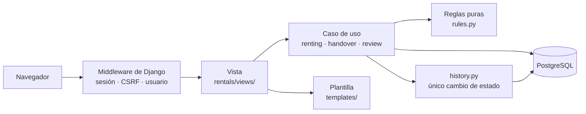
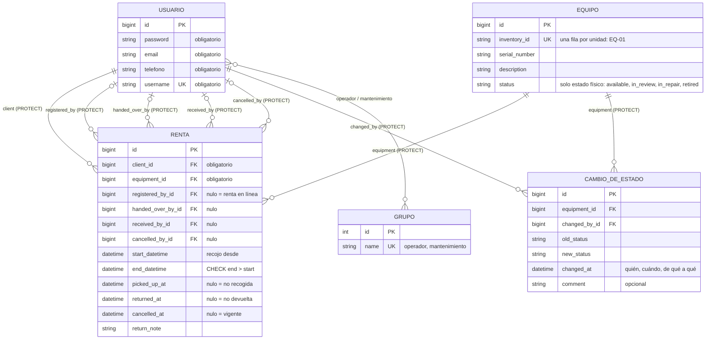

# Cómo está hecho el sistema

> Versión del 19/10/2026. Django 6.1 + PostgreSQL. Una app de negocio (`rentals`) y una de login (`accounts`).

## Capas

| Capa | Archivos | Qué hace | Qué no hace |
|---|---|---|---|
| Vista | `rentals/views/` | Lee la petición, llama a **una** función del caso de uso, muestra el mensaje y elige la página. | No decide reglas. |
| Caso de uso | `renting.py`, `handover.py`, `review.py`, `history.py` | Hace una operación completa: valida, bloquea la fila, guarda. | No sabe nada de HTTP. |
| Reglas | `rules.py` | Compara fechas y estados y responde sí o no. | No lee ni escribe la base. |
| Datos | `models.py`, `migrations/` | Define las tablas y calcula el estado de la renta. | — |

**Patrón de cada operación que guarda:** validar lo que no necesita la base → abrir la transacción → bloquear la fila (`select_for_update`) → validar lo que sí la necesita → guardar. Si algo falla, se lanza un error con la causa y no se guarda nada.

## Base de datos

| Decisión | Por qué |
|---|---|
| Una fila por cada mesa o silla | El cliente registra cada unidad por separado (ENT-09). |
| La renta **no guarda** su estado | Se calcula de sus fechas. Así nunca contradice a las fechas y «No recogida» aparece sola a las 12:01, sin un proceso programado (ENT-59). |
| El equipo guarda solo su estado físico | Un equipo rentado en noviembre sigue disponible en octubre (ENT-61). |
| El historial es una tabla aparte | Un equipo tiene muchos cambios; cada fila dice quién, cuándo, de qué a qué y por qué (ENT-34). |
| No hay tablas de clientes ni de reservas | Se usa el usuario de Django y su grupo. Una reserva es una renta todavía no recogida. |
| `PROTECT` en todas las relaciones | No se puede borrar un usuario o un equipo que tiene historial. |
| La base rechaza fin antes del inicio | `CheckConstraint`: una defensa más, aunque alguien se salte el código. |

## Roles

| Rol | Cómo se reconoce | Página de inicio |
|---|---|---|
| Cliente | Usuario sin grupo | Catálogo |
| Operador | Grupo `operador` | Reservas por entregar |
| Mantenimiento | Grupo `mantenimiento` | Mantenimiento |
| Admin | Superusuario: tiene todos los roles | Admin de Django |

`role_required` revisa el rol en cada página del personal: sin sesión manda al login; sin el rol responde 403.

## Pruebas y CI

| Tipo | Carpeta | Qué prueba |
|---|---|---|
| Unitarias | `tests/unit/` | Reglas y validaciones, sin base de datos. |
| Integración | `tests/integration/` | Cada caso de uso con la base de datos. |
| Sistema | `tests/system/` | Recorridos completos por la web. |

GitHub Actions (`.github/workflows/ci-sesion12.yml`) corre en cada push: revisa la configuración, que no falte ninguna migración, y todas las pruebas con un PostgreSQL temporal.
