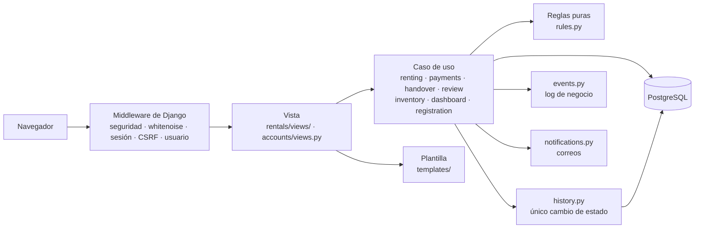
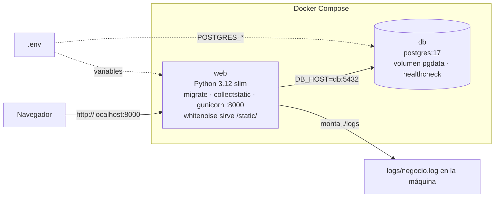
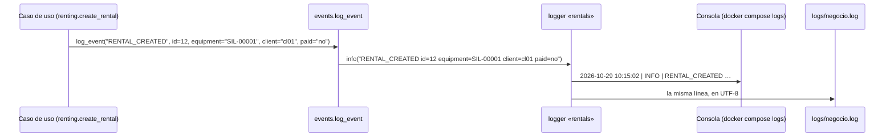

# Cómo está hecho el sistema

> Versión del 28/10/2026 (versión final). Django 6.1 + PostgreSQL 17. Una app de cuentas (`accounts`) y una de negocio (`rentals`).
> La base de datos, con el porqué de cada tabla, está en [base-de-datos.md](base-de-datos.md).

## Capas

| Capa | Archivos | Qué hace | Qué no hace |
|---|---|---|---|
| Vista | `rentals/views/`, `accounts/views.py` | Lee la petición, llama a **una** función del caso de uso, muestra el mensaje y elige la página. | No decide reglas. |
| Caso de uso | `renting.py` (rentar, modificar, cancelar), `payments.py` (QR, efectivo, deudas), `handover.py` (entregar y devolver), `review.py` (revisar), `inventory.py` (registrar equipos), `dashboard.py` (panel), `accounts/registration.py` (crear cuentas) | Hace una operación completa: valida, bloquea la fila, guarda, escribe el log y manda el correo. | No sabe nada de HTTP: una API futura puede llamar a las mismas funciones. |
| Reglas | `rules.py` | Compara fechas, horas y montos y responde sí, no o un número. | No lee ni escribe la base. |
| Datos | `models.py`, `migrations/` | Define las tablas, sus restricciones y calcula el estado de la renta. | — |

**Patrón de cada operación que guarda:** validar lo que no necesita la base → abrir la transacción → bloquear la fila (`select_for_update`) → validar lo que sí la necesita → guardar → escribir el log → mandar el correo. Si algo falla, se lanza un error (subclase de `OperationRejectedError`) con la causa en español, no se guarda nada y el log escribe `<ACCIÓN>_REJECTED`.

## Roles

| Rol (`Role.code`) | Página de inicio | Qué puede hacer |
|---|---|---|
| `cliente` | Catálogo | Crear su cuenta, rentar y pagar, modificar y cancelar sus reservas, ver sus rentas y su deuda. |
| `operador` | Reservas por entregar | Crear cuentas, rentar en tienda, entregar, cobrar, recibir, cobrar deudas, modificar y cancelar. |
| `mantenimiento` | Mantenimiento | Revisar los equipos devueltos. |
| `administrador` | Panel del responsable | Todo lo anterior, registrar equipos y el admin de Django. `is_staff` e `is_superuser` se ponen solos según el rol. |

`role_required` revisa el rol en cada página del personal: sin sesión manda al login; sin el rol responde 403 con una página en español. Solo el admin bloquea a un usuario, desactivando su cuenta (`is_active = False`). `AUTHENTICATION_BACKENDS` tiene primero `ModelBackend`, con el que entran las cuentas activas y que deja sin sesión a una cuenta que se desactiva, y después `AllowAllUsersModelBackend`, que solo reconoce una cuenta desactivada con su contraseña correcta para que `LoginForm.confirm_login_allowed` le diga por qué no entra.

## Despliegue con Docker

| Nodo | Imagen | Qué hace |
|---|---|---|
| `web` | `Dockerfile` (Python 3.12 slim) | Espera a que `db` esté sana, aplica las migraciones, junta los estáticos y arranca gunicorn en el puerto 8000. |
| `db` | `postgres:17` | Guarda los datos en el volumen `pgdata`, que sobrevive a `docker compose down`. |

Las opciones que exigen HTTPS (cookies seguras, redirección y HSTS) se activan con `USE_HTTPS=True` en `.env`.

## Cómo viaja una línea del log

Si un caso de uso lanza `OperationRejectedError`, el decorador `logs_rejection` escribe `RENTAL_REJECTED reason="…"` con nivel `WARNING` y deja pasar el error a la vista. Si un correo falla, `notifications.py` escribe `EMAIL_FAILED` y la operación sigue.

## Correo

Se usa `django.core.mail.send_mail` con el setting `MAILERS` de Django 6.1. Por defecto, el backend de consola (el correo se imprime en la terminal). Si `.env` tiene `EMAIL_HOST_USER` y `EMAIL_HOST_PASSWORD`, se usa el SMTP de Gmail (`smtp.gmail.com:587`, TLS, con una contraseña de aplicación).

## Pruebas y CI

| Tipo | Carpeta | Qué prueba |
|---|---|---|
| Unitarias | `tests/unit/` | Reglas y validaciones, sin base de datos. |
| Integración | `tests/integration/` | Cada caso de uso con la base de datos, el log (`caplog`) y el correo (`mail.outbox`). |
| Sistema | `tests/system/` | Recorridos completos por la web. |

GitHub Actions (`.github/workflows/ci-sesion12.yml`) corre en cada push: revisa la configuración, que no falte ninguna migración, y todas las pruebas con un PostgreSQL temporal.
