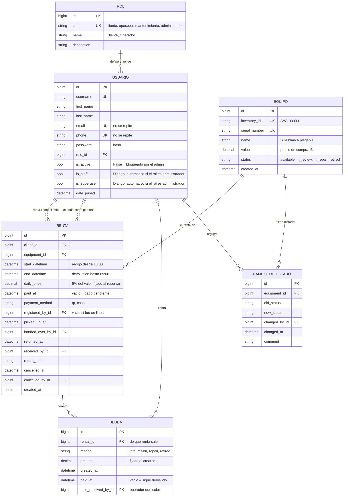

# Base de datos · versión final

> Versión del 27/10/2026, después de la última entrevista con el cliente y su respuesta sobre el pago fallido.
> Seis tablas propias, en tercera forma normal. Los nombres de campo son los del código (Django).

## Diagrama

## Por qué cada tabla

| Tabla | Qué representa | Relación |
|---|---|---|
| ROL | Los roles posibles del sistema. Agregar un rol nuevo es agregar una fila | 1 rol : N usuarios |
| USUARIO | Una persona con un rol. Correo y teléfono únicos, para que no pueda crearse otra cuenta con los mismos datos | — |
| EQUIPO | Una unidad física del inventario | — |
| RENTA | Un cliente renta un equipo en un periodo. Es la tabla intermedia de la relación N:M usuario–equipo | 1 usuario : N rentas · 1 equipo : N rentas |
| DEUDA | Un cargo pendiente: atraso, reparación o baja. Se paga una por una | 1 renta : 0..N deudas (máximo una por motivo) |
| CAMBIO_DE_ESTADO | **Cada** cambio físico de un equipo (una fila por cambio, sin límite). Es el historial completo | 1 equipo : N cambios |

## Lo que se calcula (no se guarda)

| Dato | Cómo se calcula |
|---|---|
| Estado de la renta | Cancelada > Devuelta > Rentada > No recogida > Reservada |
| No recogida | Si a la medianoche del día de recojo nadie la recogió, el equipo queda libre solo |
| Total de la renta | días × `daily_price` |
| Deuda total del cliente | suma de sus `DEUDA` con `paid_at` vacío; se muestra en pantalla y en el admin |
| ¿Puede rentar? | Solo si su deuda total es 0 |
| ¿El pago QR falló? | Renta en línea (`registered_by` vacío) con `paid_at` vacío, o pagada en efectivo |
| Quién cobró el pago | En tienda: `registered_by`. En línea con QR fallido: `handed_over_by` (se cobra al entregar) |

## Reglas que guardan datos

| Momento | Qué se guarda |
|---|---|
| Renta en línea, QR exitoso | `paid_at`, `payment_method = qr` |
| Renta en línea, QR fallido | La renta queda Reservada con `paid_at` vacío |
| Recojo con pago pendiente | Si paga: `paid_at`, `payment_method = cash` y se entrega. Si no paga: el operador cancela la renta |
| Devolución después de las 12:00 | `DEUDA` con `late_return` = días de atraso × `daily_price` |
| Revisión → reparación | Con «Cobrar el daño» marcado, `DEUDA` con `repair` = 20 % del valor, al último cliente (ENT-90). Se cancelan las reservas no recogidas del equipo (ENT-88) |
| Revisión → baja | Con «Cobrar el daño» marcado, `DEUDA` con `retired` = 100 % del valor, menos lo que esa renta ya debe por reparación (D-06). Se cancelan las reservas no recogidas del equipo |
| El admin corrige a reparación o baja | Ninguna `DEUDA` (ENT-75); se cancelan las reservas no recogidas del equipo |
| El admin desactiva a un cliente | `is_active` vacío; se cancelan sus reservas no recogidas (D-27) |
| El cliente paga una deuda | `paid_at` y `paid_received_by` en esa `DEUDA` |

## Parámetros (`settings.py`)

| Parámetro | Valor |
|---|---|
| `DAILY_RATE` | 0.05 |
| `REPAIR_CHARGE_RATE` | 0.20 |
| `RETIRE_CHARGE_RATE` | 1.00 |
| `INVENTORY_ID_FORMAT` | `^[A-Z]{3}-[0-9]{5}$` |

## Restricciones en la base

- `end_datetime > start_datetime`.
- `daily_price >= 0` y `amount >= 0`.
- `value > 0` en `EQUIPO` (agregada al programar, 28/10: el valor de compra nunca es 0 ni negativo, ENT-83).
- Únicos: `inventory_id`, `serial_number`, `email` (sin distinguir mayúsculas), `phone`, `ROL.code`.
- `DEUDA`: un solo registro por (`rental_id`, `reason`).
- Todas las claves foráneas con `PROTECT` y el admin sin permiso de borrar: nada se borra (ENT-97). Un equipo se da de baja y un usuario se desactiva.

## Redundancias conscientes

- **`EQUIPO.status` y `old_status`:** se podrían deducir del historial. Se guardan para consultar rápido y para que cada cambio se lea solo. Solo `equipment_status.change_status` los escribe.
- **`is_staff` e `is_superuser`:** Django los necesita para entrar al admin. Se ponen solos según el rol, nunca a mano.
- **`daily_price` y `DEUDA.amount`:** son el precio y el cargo **de ese momento**. Si el valor del equipo cambia después, no deben cambiar.
