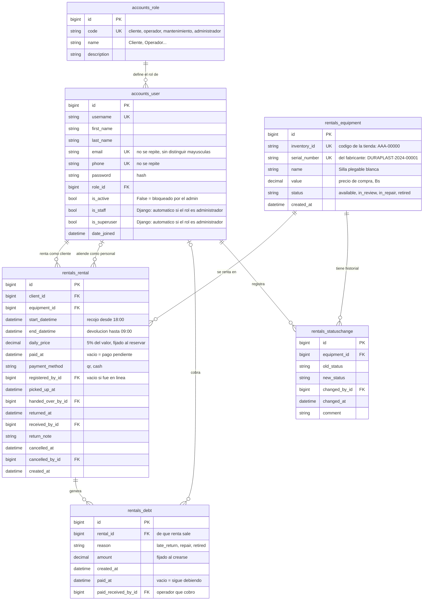

# Base de datos

Qué contiene: las 6 tablas propias del sistema y las 9 que crea Django, qué guarda cada una, qué se calcula sin guardarse, las restricciones y cómo ver la base con pgAdmin y psql.
Cuándo leerlo: antes de escribir una consulta o cambiar un modelo, o para revisar los datos de la demo. Los IDs (ENT, D, RF, RC) se explican en el [glosario de IDs](README.md#glosario-de-ids).

## Palabras que se usan aquí

- **Tabla:** una lista de filas con las mismas columnas, por ejemplo `rentals_rental` tiene una fila por renta. Django crea cada tabla a partir de un **modelo** de `models.py` y la nombra `<app>_<modelo>`.
- **PK** (clave primaria): la columna `id`, el número que identifica cada fila.
- **FK** (clave foránea): una columna que guarda el `id` de una fila de otra tabla, por ejemplo `rentals_rental.client_id` apunta a `accounts_user.id`.
- **UK** (único): la base no deja dos filas con el mismo valor en esa columna.
- **`PROTECT`:** la base no deja borrar una fila mientras otra la nombre en una FK. Así nunca se borra en silencio la historia ([ENT-97](respuestas-del-cliente.md#ent-97)).

## Diagrama

El mismo diagrama, editable y con los nombres de las tablas en español (`rol`, `usuario`, `equipo`, `renta`, `deuda`, `cambio_de_estado`), está en [base-de-datos.dbml](base-de-datos.dbml); para verlo, se pega su texto en dbdiagram.io.



## Las 6 tablas del sistema

Están en tercera forma normal: cada dato se guarda en un solo lugar.

| Tabla | Modelo | Qué guarda | Relación |
|---|---|---|---|
| `accounts_role` | `Role` | Los 4 roles del sistema. Agregar un rol nuevo es agregar una fila. La migración `accounts.0002_roles` los crea. | 1 rol : N usuarios |
| `accounts_user` | `User` | Una persona con un rol. Correo y teléfono únicos, para que no pueda crearse otra cuenta con los mismos datos ([ENT-84](respuestas-del-cliente.md#ent-84)). | — |
| `rentals_equipment` | `Equipment` | Una unidad física del inventario, por ejemplo una sola silla ([ENT-09](respuestas-del-cliente.md#ent-09)). | — |
| `rentals_rental` | `Rental` | Un cliente renta un equipo en un periodo, con sus momentos: pago, recojo, devolución o cancelación ([ENT-43](respuestas-del-cliente.md#ent-43)). Es la tabla intermedia de la relación N:M usuario–equipo. | 1 usuario : N rentas · 1 equipo : N rentas |
| `rentals_debt` | `Debt` | Un cargo de una renta: atraso, reparación o baja. Se paga una por una ([ENT-76](respuestas-del-cliente.md#ent-76)). | 1 renta : 0..N deudas (máximo una por motivo) |
| `rentals_statuschange` | `StatusChange` | **Cada** cambio de estado de un equipo, con quién, cuándo y por qué. Es el historial completo ([ENT-34](respuestas-del-cliente.md#ent-34)). | 1 equipo : N cambios |

## Las 9 tablas que crea Django

`python manage.py migrate` también crea estas tablas, porque el proyecto usa las apps de Django para usuarios, permisos, sesiones y el admin:

| Tabla | Para qué sirve |
|---|---|
| `auth_group` | Grupos de usuarios de Django; aquí queda vacía porque los permisos van por rol. |
| `auth_permission` | La lista de permisos que Django crea por cada modelo (agregar, cambiar, borrar, ver). |
| `auth_group_permissions` | Qué permisos tiene cada grupo; queda vacía. |
| `accounts_user_groups` | A qué grupos pertenece cada usuario; viene de `AbstractUser` y queda vacía porque los permisos van por rol. |
| `accounts_user_user_permissions` | Permisos sueltos de cada usuario; viene de `AbstractUser` y queda vacía por la misma razón. |
| `django_admin_log` | Lo que hace cada administrador en el admin de Django (qué agregó o cambió), con su fecha. |
| `django_content_type` | Un número por cada modelo del proyecto, que usan los permisos y el log del admin. |
| `django_migrations` | Qué migraciones ya se aplicaron, para que `migrate` no las repita. |
| `django_session` | Las sesiones abiertas: la cookie `sessionid` del navegador apunta a una fila de aquí. |

## Código de la tienda y número de serie

Cada equipo tiene dos identificadores, los dos únicos:

- **`inventory_id`** es el **código que pone la tienda**: 3 letras, un guion y 5 números (`MES-00001`, `SIL-00003`, `CMB-00001`). Lo escribe el admin al registrar el equipo y es el que se ve en las páginas, los mensajes, los correos y el log ([ENT-83](respuestas-del-cliente.md#ent-83)). El formato está en `INVENTORY_ID_FORMAT` de `settings.py`.
- **`serial_number`** es el **número que trae el equipo del fabricante**, por ejemplo `DURAPLAST-2024-00001` (fabricante, año y número). Sirve para reclamar una garantía o reconocer la unidad física; el sistema solo revisa que no se repita.

## Lo que se calcula (no se guarda)

| Dato | Cómo se calcula |
|---|---|
| Estado de la renta | Cancelada > Devuelta > Rentada > No recogida > Reservada, según qué momentos tiene (`Rental.status_at`, [RF-08](casos-de-uso.md#rf-08)). |
| No recogida | Si a la medianoche del día de recojo nadie la recogió, el equipo queda libre solo ([ENT-69](respuestas-del-cliente.md#ent-69)). |
| Total de la renta | días × `daily_price` ([cómo se cuentan los días](casos-de-uso.md#cómo-se-cuentan-los-días-y-el-atraso)). |
| Deuda total del cliente | La suma de sus deudas con `paid_at` vacío; se muestra en pantalla y en el admin. |
| ¿Puede rentar? | Solo si su deuda total es 0 ([ENT-77](respuestas-del-cliente.md#ent-77)). |
| ¿El pago QR falló? | Renta en línea (`registered_by` vacío) con `paid_at` vacío, o pagada después en efectivo. |
| Quién cobró el pago | En tienda: `registered_by`. En línea con QR fallido: `handed_over_by` (se cobra al entregar). |

## Qué se guarda en cada momento

| Momento | Qué se guarda |
|---|---|
| Renta en línea, QR exitoso | `paid_at`, `payment_method = qr` |
| Renta en línea, QR fallido | La renta queda Reservada con `paid_at` vacío |
| Recojo con pago pendiente | Si paga: `paid_at`, `payment_method = cash` y se entrega. Si no paga: el operador cancela la renta |
| Devolución desde las 12:01 del vencimiento | Una deuda con `late_return` = días de atraso × `daily_price` |
| Revisión → reparación | Con «Cobrar el daño» marcado, una deuda con `repair` = 20 % del valor, al último cliente ([ENT-90](respuestas-del-cliente.md#ent-90)). Se cancelan las reservas no recogidas del equipo ([ENT-88](respuestas-del-cliente.md#ent-88)) |
| Revisión → baja | Con «Cobrar el daño» marcado, una deuda con `retired` = 100 % del valor, menos lo que esa renta ya debe por reparación ([D-06](decisiones.md#d-06)). Se cancelan las reservas no recogidas del equipo |
| El admin corrige a reparación o baja | Ninguna deuda ([ENT-75](respuestas-del-cliente.md#ent-75)); se cancelan las reservas no recogidas del equipo |
| El admin desactiva a un cliente | `is_active` en falso; se cancelan sus reservas no recogidas ([D-27](decisiones.md#d-27)) |
| El cliente paga una deuda | `paid_at` y `paid_received_by` en esa deuda |

## Parámetros (`settings.py`)

| Parámetro | Valor | Qué es |
|---|---|---|
| `DAILY_RATE` | 0.05 | El precio por día es el 5 % del valor ([ENT-71](respuestas-del-cliente.md#ent-71)). |
| `REPAIR_CHARGE_RATE` | 0.20 | La reparación cobra el 20 % del valor ([ENT-74](respuestas-del-cliente.md#ent-74)). |
| `RETIRE_CHARGE_RATE` | 1.00 | La baja cobra el 100 % del valor ([ENT-74](respuestas-del-cliente.md#ent-74)). |
| `INVENTORY_ID_FORMAT` | `^[A-Z]{3}-[0-9]{5}$` | 3 letras, un guion y 5 números ([ENT-83](respuestas-del-cliente.md#ent-83)). |

## Restricciones en la base

La base misma rechaza estos datos, aunque alguien se salte el código:

- `end_datetime > start_datetime` en `rentals_rental`.
- `daily_price >= 0` y `amount >= 0`.
- `value > 0` en `rentals_equipment`: el valor de compra nunca es 0 ni negativo ([ENT-83](respuestas-del-cliente.md#ent-83), [D-02](decisiones.md#d-02)).
- Únicos: `inventory_id`, `serial_number`, `email` (sin distinguir mayúsculas), `phone` y `accounts_role.code`.
- `rentals_debt`: una sola fila por (`rental_id`, `reason`).
- Todas las claves foráneas con `PROTECT` y el admin sin permiso de borrar: nada se borra ([ENT-97](respuestas-del-cliente.md#ent-97)). Un equipo se da de baja y un usuario se desactiva. Solo `seed_demo` borra, en orden, y solo con `DEBUG=True` ([D-41](decisiones.md#d-41)).

## Redundancias conscientes

- **`rentals_equipment.status` y `old_status`:** se podrían deducir del historial. Se guardan para consultar rápido y para que cada cambio se lea solo. Solo `equipment_status.change_status` los escribe.
- **`is_staff` e `is_superuser`:** Django los necesita para entrar al admin. Se ponen solos según el rol, nunca a mano.
- **`daily_price` y `rentals_debt.amount`:** son el precio y el cargo **de ese momento**. Si el valor del equipo cambia después, no deben cambiar.

## Cómo ver la base

### Con pgAdmin

**pgAdmin 4** es el programa con ventanas que se instala junto con PostgreSQL en Windows.

1. Abre pgAdmin y despliega «Servers». Si no aparece tu servidor, clic derecho en «Servers» → «Register» → «Server…»: en «Connection» pon `localhost`, puerto `5432`, usuario `astra` y la contraseña de `DB_PASSWORD` de tu `.env`.
2. Despliega «Databases» → `astra_rent` → «Schemas» → «public» → «Tables».
3. Para ver una tabla: clic derecho en ella → «View/Edit Data» → «All Rows».
4. Para escribir una consulta: selecciona `astra_rent` y abre «Tools» → «Query Tool»; pega la consulta y presiona F5.

### Con la PSQL Tool

**psql** es la consola de PostgreSQL: se escriben consultas y comandos en texto.

- En pgAdmin: clic derecho en `astra_rent` → «PSQL Tool». Se abre una consola ya conectada a la base.
- Desde PowerShell, con la ruta completa (ajusta `17` a tu versión de PostgreSQL):
  ```powershell
  & "C:\Program Files\PostgreSQL\17\bin\psql.exe" -U astra -h localhost -d astra_rent
  ```

Comandos útiles dentro de psql: `\dt` lista las tablas, `\d rentals_rental` muestra las columnas de una tabla, `\x` muestra cada fila en vertical y `\q` sale. Cada consulta termina con `;`.

### 4 consultas útiles

Las fechas se guardan en UTC; `AT TIME ZONE 'America/La_Paz'` las muestra en hora de La Paz.

**Rentas de hoy** (las que se recogen hoy y no están canceladas):

```sql
SELECT r.id, e.inventory_id, e.name, u.username,
       r.start_datetime AT TIME ZONE 'America/La_Paz' AS recojo,
       r.end_datetime AT TIME ZONE 'America/La_Paz' AS devolucion,
       r.paid_at IS NOT NULL AS pagada
FROM rentals_rental r
JOIN rentals_equipment e ON e.id = r.equipment_id
JOIN accounts_user u ON u.id = r.client_id
WHERE (r.start_datetime AT TIME ZONE 'America/La_Paz')::date = (now() AT TIME ZONE 'America/La_Paz')::date
  AND r.cancelled_at IS NULL
ORDER BY r.start_datetime;
```

**Deudas pendientes por cliente:**

```sql
SELECT u.username, u.first_name || ' ' || u.last_name AS cliente,
       COUNT(*) AS deudas, SUM(d.amount) AS total_bs
FROM rentals_debt d
JOIN rentals_rental r ON r.id = d.rental_id
JOIN accounts_user u ON u.id = r.client_id
WHERE d.paid_at IS NULL
GROUP BY u.username, u.first_name, u.last_name
ORDER BY total_bs DESC;
```

**Historial de un equipo** (cambia el código por el que quieras ver):

```sql
SELECT s.changed_at AT TIME ZONE 'America/La_Paz' AS fecha,
       s.old_status, s.new_status, u.username AS cambiado_por, s.comment
FROM rentals_statuschange s
JOIN rentals_equipment e ON e.id = s.equipment_id
JOIN accounts_user u ON u.id = s.changed_by_id
WHERE e.inventory_id = 'SIL-00006'
ORDER BY s.changed_at;
```

**Equipos libres en una fecha** (para recoger el 05/11/2026 a las 18:00 y devolver el 06/11/2026 a las 09:00; es la misma regla del catálogo: solo ocupan las rentas «Reservadas» y «Rentadas»):

```sql
SELECT e.inventory_id, e.name, e.value
FROM rentals_equipment e
WHERE e.status = 'available'
  AND NOT EXISTS (
    SELECT 1
    FROM rentals_rental r
    WHERE r.equipment_id = e.id
      AND r.cancelled_at IS NULL
      AND r.returned_at IS NULL
      AND (r.picked_up_at IS NOT NULL
           OR r.start_datetime >= date_trunc('day', now() AT TIME ZONE 'America/La_Paz') AT TIME ZONE 'America/La_Paz')
      AND r.start_datetime < TIMESTAMP '2026-11-06 09:00' AT TIME ZONE 'America/La_Paz'
      AND r.end_datetime > TIMESTAMP '2026-11-05 18:00' AT TIME ZONE 'America/La_Paz'
  )
ORDER BY e.inventory_id;
```
