# Casos de uso, requisitos e historias

Qué contiene: los 17 casos de uso ([CU-01](#cu-01) a [CU-17](#cu-17)) con sus pasos, mensajes y diagramas, los requisitos funcionales (RF) y de calidad (RC), las historias de usuario (HU), cómo se cuentan los días y los estados de una renta, un equipo y una deuda.
Cuándo leerlo: para saber qué hace el sistema paso a paso y dónde está cada cosa en el código. Los IDs (ENT, D, CU, HU, RF, RC, PRE) se explican en el [glosario de IDs](README.md#glosario-de-ids).

## Cómo se relacionan los requisitos, las historias y los casos de uso

- Una **respuesta del cliente** (ENT) es lo que dijo SergioCorp cuando le preguntamos algo, por ejemplo [ENT-73](respuestas-del-cliente.md#ent-73): «hasta las 12:00 hay tolerancia; después se cobra un día extra». Están en [respuestas-del-cliente.md](respuestas-del-cliente.md). Cuando el cliente no respondió, el equipo tomó una **decisión** (D), en [decisiones.md](decisiones.md).
- Una **historia de usuario** (HU) es una necesidad dicha desde quien usa el sistema: «Como operador, quiero registrar la devolución y cobrar el atraso para que la demora se pague». Trae un ejemplo con «dado, cuando, entonces» que dice cuándo está cumplida.
- Un **requisito funcional** (RF) es una regla que el sistema debe cumplir, escrita para poder comprobarla: «la devolución desde las 12:01 crea una deuda de días de atraso × precio por día».
- Un **requisito de calidad** (RC) dice **qué tan bien** lo hace: rápido con 1000 equipos, seguro, que cada operación quede en el log.
- Un **caso de uso** (CU) describe los pasos de una persona con el sistema para lograr algo: qué presiona, qué ve, qué pasa si algo falla y qué se guarda.

La cadena es siempre la misma:

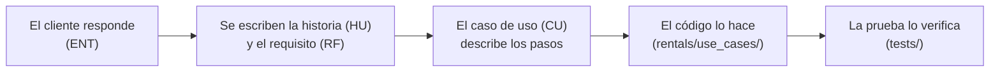

Cada caso de uso de abajo tiene su «Origen» (las ENT y D de donde sale), «Dónde está en el código» y su «Prueba», así se puede seguir la cadena en los dos sentidos.

## Índice por actor

Un **actor** es quien usa el sistema en ese caso de uso. Hay 4 roles: cliente, operador (la persona de la tienda), mantenimiento y administrador (el responsable, que puede todo).

- **Cuentas** (cualquier persona)
  - [CU-01](#cu-01) — Crear cuenta (el cliente, en la web)
  - [CU-02](#cu-02) — Crear cuenta en tienda (el operador, sin conocer la contraseña del cliente)
  - [CU-17](#cu-17) — Gestionar mi cuenta (cualquier usuario con sesión)
- **Cliente**
  - [CU-03](#cu-03) — Consultar equipos y disponibilidad (también el operador)
  - [CU-04](#cu-04) — Rentar en línea y pagar con QR simulado
  - [CU-06](#cu-06) — Modificar una reserva (también el operador y el administrador)
  - [CU-07](#cu-07) — Cancelar una reserva (también el operador y el administrador)
  - [CU-16](#cu-16) — Consultar mis rentas y mi deuda
- **Tienda** (operador)
  - [CU-05](#cu-05) — Rentar en tienda
  - [CU-08](#cu-08) — Entregar el equipo
  - [CU-09](#cu-09) — Registrar la devolución
  - [CU-11](#cu-11) — Registrar el pago de una deuda
- **Mantenimiento**
  - [CU-10](#cu-10) — Revisar el equipo
- **Administrador**
  - [CU-12](#cu-12) — Registrar un equipo
  - [CU-13](#cu-13) — Corregir el estado de un equipo
  - [CU-14](#cu-14) — Consultar el historial
  - [CU-15](#cu-15) — Ver el panel del responsable

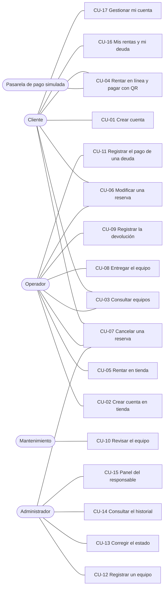

## Dónde está cada caso de uso

La **vista** es la función de Django que recibe la petición del navegador; solo lee los datos, llama a la **función del caso de uso** y elige la página. Las **reglas** son funciones puras de `rentals/rules.py`: comparan valores y nunca tocan la base. Las **tablas** son las de PostgreSQL ([base-de-datos.md](base-de-datos.md)). Los **eventos** son las líneas que se escriben en `logs/negocio.log` ([arquitectura.md](arquitectura.md#eventos-del-log)).

| CU | Página (URL) | Vista | Función del caso de uso | Reglas que usa | Tablas que escribe | Eventos del log | Archivo de prueba |
|---|---|---|---|---|---|---|---|
| [CU-01](#cu-01) | `/signup/` | [`accounts.views.sign_up`](../accounts/views.py) | [`registration.register_client`](../accounts/registration.py) | Validadores de contraseña de Django y [`accounts/validators.py`](../accounts/validators.py) | `accounts_user` | `ACCOUNT_CREATED`, `ACCOUNT_REJECTED` | [`integration/test_registro.py`](../tests/integration/test_registro.py), [`system/test_registro_web.py`](../tests/system/test_registro_web.py) |
| [CU-02](#cu-02) | `/staff/clients/new/` | [`accounts.views.register_client_at_store`](../accounts/views.py) | [`registration.register_store_client`](../accounts/registration.py) | Las de datos de [CU-01](#cu-01) | `accounts_user` | `ACCOUNT_CREATED`, `ACCOUNT_REJECTED`, `EMAIL_FAILED` | [`integration/test_correo_crea_tu_contrasena.py`](../tests/integration/test_correo_crea_tu_contrasena.py), [`integration/test_contrasena_del_cliente.py`](../tests/integration/test_contrasena_del_cliente.py) |
| [CU-03](#cu-03) | `/` | [`views.renting.catalog`](../rentals/views/renting.py) | [`catalog.browse_catalog`](../rentals/use_cases/catalog.py) | `combine_local` (el mismo cruce de `periods_overlap`, en SQL) | Ninguna | Ninguno | [`integration/test_catalogo.py`](../tests/integration/test_catalogo.py), [`integration/test_catalogo_sin_etiquetas.py`](../tests/integration/test_catalogo_sin_etiquetas.py) |
| [CU-04](#cu-04) | `/equipment/<código>/rent/`, `/rentals/<id>/pay/` | [`views.renting.rent_equipment`, `pay_rental`](../rentals/views/renting.py) | [`renting.create_rental`](../rentals/use_cases/renting.py), [`payments.pay_with_qr`](../rentals/use_cases/payments.py) | `is_pickup_date_allowed`, `ends_after_start`, `is_within_max_duration`, `is_pickup_time_allowed`, `is_return_time_allowed`, `is_rentable_status`, `periods_overlap`, `daily_price_for` | `rentals_rental` | `RENTAL_CREATED`, `RENTAL_REJECTED`, `PAYMENT_APPROVED`, `PAYMENT_FAILED`, `PAYMENT_REJECTED` | [`integration/test_rentar.py`](../tests/integration/test_rentar.py), [`integration/test_pagar.py`](../tests/integration/test_pagar.py) |
| [CU-05](#cu-05) | `/staff/walk-in/` | [`views.renting.walk_in_rental`](../rentals/views/renting.py) | [`renting.find_clients`, `create_rental`](../rentals/use_cases/renting.py) | Las de [CU-04](#cu-04) | `rentals_rental` | `RENTAL_CREATED`, `PAYMENT_CASH`, `RENTAL_REJECTED` | [`integration/test_rentar.py`](../tests/integration/test_rentar.py), [`integration/test_pagar.py`](../tests/integration/test_pagar.py) |
| [CU-06](#cu-06) | `/rentals/<id>/modify/` | [`views.renting.modify_reservation`](../rentals/views/renting.py) | [`reservation_changes.modify_rental`](../rentals/use_cases/reservation_changes.py) | Las del periodo de [CU-04](#cu-04), `can_client_change`, `can_staff_modify`, `rental_days` | `rentals_rental` | `RENTAL_MODIFIED`, `MODIFY_REJECTED` | [`integration/test_modificar.py`](../tests/integration/test_modificar.py), [`unit/test_reglas_de_cancelacion.py`](../tests/unit/test_reglas_de_cancelacion.py) |
| [CU-07](#cu-07) | `/rentals/<id>/cancel/` | [`views.renting.cancel_reservation`](../rentals/views/renting.py) | [`reservation_changes.cancel_rental`](../rentals/use_cases/reservation_changes.py) | `can_client_change`, `is_pickup_expired` | `rentals_rental` | `RENTAL_CANCELLED`, `CANCEL_REJECTED` | [`integration/test_cancelar.py`](../tests/integration/test_cancelar.py), [`unit/test_reglas_de_cancelacion.py`](../tests/unit/test_reglas_de_cancelacion.py) |
| [CU-08](#cu-08) | `/staff/reservations/`, `/staff/reservations/<id>/pickup/` | [`views.handover.staff_reservations`, `pickup_reservation`](../rentals/views/handover.py) | [`handover.reservations_to_hand_over`, `register_pickup`](../rentals/use_cases/handover.py) | `is_pickup_expired`, `is_rentable_status` | `rentals_rental` | `PAYMENT_CASH`, `PICKUP_REGISTERED`, `PICKUP_REJECTED` | [`integration/test_entregar_y_devolver.py`](../tests/integration/test_entregar_y_devolver.py), [`unit/test_reglas_de_entrega.py`](../tests/unit/test_reglas_de_entrega.py) |
| [CU-09](#cu-09) | `/staff/returns/`, `/staff/returns/<id>/` | [`views.handover.staff_returns`, `return_rental`](../rentals/views/handover.py) | [`handover.rentals_to_receive`, `register_return`](../rentals/use_cases/handover.py) | `classify_return`, `late_days`, `is_rentable_status` | `rentals_rental`, `rentals_equipment`, `rentals_statuschange`, `rentals_debt` | `RETURN_REGISTERED`, `STATUS_CHANGED`, `DEBT_CREATED`, `RETURN_REJECTED` | [`integration/test_entregar_y_devolver.py`](../tests/integration/test_entregar_y_devolver.py), [`integration/test_deudas.py`](../tests/integration/test_deudas.py), [`unit/test_clasificar_devolucion.py`](../tests/unit/test_clasificar_devolucion.py) |
| [CU-10](#cu-10) | `/maintenance/`, `/maintenance/<código>/` | [`views.review.maintenance`, `review_equipment_view`](../rentals/views/review.py) | [`review.review_queue`, `review_equipment`](../rentals/use_cases/review.py) | `next_statuses`, `damage_reason_and_rate`, `damage_charge`, `cap_damage` | `rentals_equipment`, `rentals_statuschange`, `rentals_debt`, `rentals_rental` | `STATUS_CHANGED`, `DEBT_CREATED`, `DAMAGE_NOT_CHARGED`, `RENTAL_CANCELLED`, `REVIEW_REJECTED`, `STATUS_CHANGE_REJECTED` | [`integration/test_revisar.py`](../tests/integration/test_revisar.py), [`unit/test_reglas_de_revision.py`](../tests/unit/test_reglas_de_revision.py) |
| [CU-11](#cu-11) | `/staff/debts/`, `/staff/debts/<id>/pay/` | [`views.debts.staff_debts`, `pay_debt_view`](../rentals/views/debts.py) | [`debts.debts_overview`, `pay_debt`](../rentals/use_cases/debts.py) | Ninguna | `rentals_debt` | `DEBT_PAID`, `DEBT_PAYMENT_REJECTED` | [`integration/test_deudas.py`](../tests/integration/test_deudas.py) |
| [CU-12](#cu-12) | `/equipment/new/` | [`views.inventory.register_equipment_view`](../rentals/views/inventory.py) | [`inventory.register_equipment`](../rentals/use_cases/inventory.py) | Las del modelo `Equipment` (formato `INVENTORY_ID_FORMAT`) | `rentals_equipment` | `EQUIPMENT_REGISTERED`, `EQUIPMENT_REJECTED` | [`integration/test_registrar_equipo.py`](../tests/integration/test_registrar_equipo.py), [`unit/test_codigo_de_equipo.py`](../tests/unit/test_codigo_de_equipo.py) |
| [CU-13](#cu-13) | `/admin/rentals/equipment/` (acciones) | [`admin.EquipmentAdmin.change_selected`](../rentals/admin.py) | [`equipment_status.correct_status`](../rentals/use_cases/equipment_status.py) | Ninguna (`check_status_can_change` está en el mismo archivo) | `rentals_equipment`, `rentals_statuschange`, `rentals_rental` | `STATUS_CHANGED`, `STATUS_CHANGE_REJECTED`, `RENTAL_CANCELLED` | [`integration/test_revisar.py`](../tests/integration/test_revisar.py), [`system/test_recorridos.py`](../tests/system/test_recorridos.py) |
| [CU-14](#cu-14) | `/admin/rentals/statuschange/` | [`admin.StatusChangeAdmin`](../rentals/admin.py) | Ninguna: es el admin de Django | Ninguna | Ninguna | Ninguno | [`system/test_recorridos.py`](../tests/system/test_recorridos.py) |
| [CU-15](#cu-15) | `/manager/` | [`views.dashboard.manager_dashboard`](../rentals/views/dashboard.py) | [`dashboard.manager_summary`](../rentals/use_cases/dashboard.py) | `start_of_day` | Ninguna | Ninguno | [`integration/test_panel.py`](../tests/integration/test_panel.py), [`integration/test_acceso.py`](../tests/integration/test_acceso.py) |
| [CU-16](#cu-16) | `/my-rentals/` | [`views.renting.client_rentals`](../rentals/views/renting.py) | [`renting.my_rentals`](../rentals/use_cases/renting.py) | `can_client_change` | Ninguna | Ninguno | [`integration/test_forma_de_pago.py`](../tests/integration/test_forma_de_pago.py), [`unit/test_etiqueta_de_pago.py`](../tests/unit/test_etiqueta_de_pago.py) |
| [CU-17](#cu-17) | `/account/`, `/account/password/`, `/password-reset/`, `/reset/<uid>/<token>/` | [`accounts.views.my_account`, `PasswordChangeView`](../accounts/views.py) y las vistas de Django en [`accounts/urls.py`](../accounts/urls.py) | [`account.update_profile`](../accounts/account.py) | Las de datos de [CU-01](#cu-01) | `accounts_user` | `PROFILE_UPDATED`, `PROFILE_REJECTED`, `PASSWORD_CHANGED`, `PASSWORD_RESET_REQUESTED` | [`integration/test_mi_cuenta.py`](../tests/integration/test_mi_cuenta.py), [`integration/test_contrasena_del_cliente.py`](../tests/integration/test_contrasena_del_cliente.py) |

## Requisitos funcionales

Un requisito funcional (RF) es una regla que el sistema cumple. «Dónde se cumple» nombra la función del código: las de `rentals/use_cases/` van con el nombre de su archivo (`renting.create_rental` es `rentals/use_cases/renting.py`), las reglas puras con `rules.` (`rentals/rules.py`). «Cómo se verifica» nombra el archivo de `tests/` que lo prueba; se corren con `python -m pytest -q`.

| ID | Requisito | Origen | Dónde se cumple | Cómo se verifica |
|---|---|---|---|---|
| <a id="rf-01"></a>RF-01 | Un equipo no tiene dos rentas con fechas que se crucen. Si chocan, el mensaje del rechazo dice cuándo está ocupado y hasta cuándo está libre (el catálogo no lo dice, [ENT-99](respuestas-del-cliente.md#ent-99)). Gana el primero que confirma. | [ENT-21](respuestas-del-cliente.md#ent-21), [ENT-36](respuestas-del-cliente.md#ent-36), [ENT-45](respuestas-del-cliente.md#ent-45), [PRE-04](presentacion12-10.md) | `renting.check_equipment_is_free`, `rules.periods_overlap` | `unit/test_cruce_de_periodos.py`, `unit/test_mensaje_ocupado.py`, `integration/test_rentar.py`, `system/test_recorridos.py` (rechazo por fechas ocupadas) |
| <a id="rf-02"></a>RF-02 | Recojo desde las 18:00, devolución hasta las 09:00, máximo 5 días. El recojo nunca es un día pasado; el de hoy vale hasta la medianoche. | [ENT-18](respuestas-del-cliente.md#ent-18), [ENT-19](respuestas-del-cliente.md#ent-19), [ENT-52](respuestas-del-cliente.md#ent-52), [ENT-72](respuestas-del-cliente.md#ent-72), [ENT-94](respuestas-del-cliente.md#ent-94) | `renting.check_period` con `rules.is_pickup_date_allowed`, `ends_after_start`, `is_within_max_duration`, `is_pickup_time_allowed` y `is_return_time_allowed` | `unit/test_horarios_y_duracion.py`, `unit/test_validar_periodo.py` |
| <a id="rf-03"></a>RF-03 | El precio por día es el 5 % del valor del equipo, se fija al crear la renta y no cambia. Total = días × precio por día; los días son las fechas que hay entre el recojo y la devolución (ver [Cómo se cuentan los días](#cómo-se-cuentan-los-días-y-el-atraso)). | [ENT-71](respuestas-del-cliente.md#ent-71), [ENT-72](respuestas-del-cliente.md#ent-72) | `rules.daily_price_for`, `rules.rental_days`, `Rental.total_price` | `unit/test_precio_y_plazos.py`, `unit/test_horarios_y_duracion.py` (1, 2, 5 y 6 días), `integration/test_rentar.py` (el precio no cambia con el valor) |
| <a id="rf-04"></a>RF-04 | La renta en línea se paga con un QR simulado. Si el pago falla, la reserva queda hecha con el pago pendiente. | [ENT-66](respuestas-del-cliente.md#ent-66), [ENT-67](respuestas-del-cliente.md#ent-67) | `payments.pay_with_qr` | `integration/test_pagar.py`, `system/test_recorridos.py` (pago fallido) |
| <a id="rf-05"></a>RF-05 | La renta en tienda se paga en efectivo al registrarla y nace «Reservada»; si el cliente se la lleva al momento, el operador registra el recojo ([CU-08](#cu-08)). | [ENT-70](respuestas-del-cliente.md#ent-70), [ENT-91](respuestas-del-cliente.md#ent-91), [PRE-03](presentacion12-10.md) | `renting.create_rental` con `registered_by` | `integration/test_pagar.py`, `integration/test_rentar.py`, `system/test_recorridos.py` (renta en tienda) |
| <a id="rf-06"></a>RF-06 | No se entrega un equipo sin pagar: el operador cobra en efectivo o cancela la reserva. Tampoco se entrega un equipo que no está «Disponible» (en revisión o en reparación). | [ENT-68](respuestas-del-cliente.md#ent-68) | `handover.register_pickup` | `integration/test_entregar_y_devolver.py` |
| <a id="rf-07"></a>RF-07 | Una reserva no recogida hasta la medianoche de su día de inicio pasa sola a «No recogida» y libera el equipo. | [ENT-69](respuestas-del-cliente.md#ent-69) | `rules.is_pickup_expired`, `Rental.status_at` | `unit/test_reserva_vencida.py`, `unit/test_estado_de_la_renta.py`, `unit/test_reglas_de_entrega.py` |
| <a id="rf-08"></a>RF-08 | El estado de la renta se calcula, no se guarda: Cancelada > Devuelta > Rentada > No recogida > Reservada. | [ENT-57](respuestas-del-cliente.md#ent-57), [ENT-61](respuestas-del-cliente.md#ent-61) | `Rental.status_at` | `unit/test_estado_de_la_renta.py` |
| <a id="rf-09"></a>RF-09 | Solo se devuelve una renta «Rentada». Hasta las 09:00 del día de vencimiento es a tiempo; hasta las 12:00, tolerancia sin cobro; desde las 12:01, deuda por atraso = días de atraso × precio por día. | [ENT-73](respuestas-del-cliente.md#ent-73), [ENT-93](respuestas-del-cliente.md#ent-93), [PRE-05](presentacion12-10.md) | `rules.classify_return`, `rules.late_days`, `handover.register_return` | `unit/test_clasificar_devolucion.py` (09:00, 09:01, 12:00, 12:01, el día siguiente y 5 días), `integration/test_deudas.py` |
| <a id="rf-10"></a>RF-10 | El equipo devuelto pasa a «En revisión». Mantenimiento cambia el estado de **cualquier** equipo que no esté de baja; la baja es definitiva. Cada cambio queda en el historial con quién, cuándo y por qué. | [ENT-03](respuestas-del-cliente.md#ent-03), [ENT-34](respuestas-del-cliente.md#ent-34), [ENT-49](respuestas-del-cliente.md#ent-49), [ENT-90](respuestas-del-cliente.md#ent-90), [PRE-06](presentacion12-10.md), [PRE-07](presentacion12-10.md) | `equipment_status.change_status`, `review.review_equipment`, `rules.next_statuses` | `unit/test_reglas_de_revision.py`, `integration/test_entregar_y_devolver.py`, `integration/test_revisar.py` |
| <a id="rf-11"></a>RF-11 | Mantenimiento decide si cobra el daño: con «Cobrar el daño al último cliente» marcado, reparación crea una deuda del 20 % del valor y baja una del 100 %, para el cliente de la última renta devuelta; sin marcar, no hay deuda y el log escribe `DAMAGE_NOT_CHARGED`. Las deudas por daño de una renta nunca suman más que el valor ([D-06](decisiones.md#d-06)). Reparación o baja, por mantenimiento o por el admin, cancelan las reservas no recogidas del equipo y avisan por correo. | [ENT-74](respuestas-del-cliente.md#ent-74), [ENT-88](respuestas-del-cliente.md#ent-88), [ENT-90](respuestas-del-cliente.md#ent-90) | `review.review_equipment`, `equipment_status.cancel_if_out_of_service`, `rules.damage_charge` | `unit/test_precio_y_plazos.py`, `integration/test_deudas.py`, `integration/test_revisar.py` |
| <a id="rf-12"></a>RF-12 | Cada deuda es de una renta y un motivo, y se paga una por una; el operador registra el pago. La deuda total se calcula y se muestra. | [ENT-76](respuestas-del-cliente.md#ent-76), [ENT-78](respuestas-del-cliente.md#ent-78) | `debts.pay_debt`, `debts.debt_total_of` | `integration/test_deudas.py`, `integration/test_panel.py` |
| <a id="rf-13"></a>RF-13 | Un cliente con deuda pendiente no puede crear rentas, ni en línea ni en tienda; sí puede devolver. | [ENT-77](respuestas-del-cliente.md#ent-77) | `renting.check_client_has_no_debt` | `integration/test_deudas.py`, `system/test_recorridos.py` (cliente con deuda) |
| <a id="rf-14"></a>RF-14 | Solo una renta «Reservada» se cancela o modifica. El cliente, hasta 24 h antes del inicio. El operador o el admin cancelan hasta el recojo y modifican hasta antes del inicio; si modifican, el cliente recibe las fechas nuevas por correo. Modificar es cambiar las fechas con la misma cantidad de días. | [ENT-80](respuestas-del-cliente.md#ent-80), [ENT-81](respuestas-del-cliente.md#ent-81), [ENT-89](respuestas-del-cliente.md#ent-89), [ENT-95](respuestas-del-cliente.md#ent-95) | `reservation_changes.cancel_rental`, `reservation_changes.modify_rental` | `unit/test_reglas_de_cancelacion.py`, `unit/test_precio_y_plazos.py` (plazo de 24 h), `integration/test_cancelar.py`, `integration/test_modificar.py` |
| <a id="rf-15"></a>RF-15 | El cliente crea su cuenta en la web con su contraseña: al menos 8 caracteres, una mayúscula y un número. El operador la crea en la tienda **sin** contraseña: la cuenta nace con una contraseña inutilizable y el cliente la crea con el enlace del correo ([ENT-102](respuestas-del-cliente.md#ent-102)). En los dos, las mismas reglas de datos: correo y teléfono únicos. | [ENT-15](respuestas-del-cliente.md#ent-15), [ENT-54](respuestas-del-cliente.md#ent-54), [ENT-84](respuestas-del-cliente.md#ent-84), [ENT-102](respuestas-del-cliente.md#ent-102) | `accounts/registration.register_client` y `register_store_client` | `unit/test_contrasena_y_telefono.py`, `integration/test_registro.py`, `integration/test_usuarios.py`, `integration/test_contrasena_del_cliente.py`, `system/test_registro_web.py` |
| <a id="rf-16"></a>RF-16 | Solo el admin registra equipos, a mano: código `AAA-00000` único, número de serie único, nombre y valor mayor que 0. Un combo es un equipo más (por ejemplo `CMB-00001` «Combo 6 sillas y 1 mesa»): su precio sale de su valor y no descuenta las sillas y mesas sueltas. | [ENT-14](respuestas-del-cliente.md#ent-14), [ENT-83](respuestas-del-cliente.md#ent-83), [ENT-96](respuestas-del-cliente.md#ent-96), [PRE-01](presentacion12-10.md) | `inventory.register_equipment`, `Equipment` | `unit/test_codigo_de_equipo.py`, `integration/test_registrar_equipo.py` |
| <a id="rf-17"></a>RF-17 | El catálogo se pagina de 20 en 20 y se filtra por código o nombre, por fechas libres y, para el personal, por estado. No muestra «Libre» ni «Ocupado del … al …»: sin fechas, los equipos disponibles; con fechas, solo los libres en ese periodo. | [ENT-86](respuestas-del-cliente.md#ent-86), [ENT-99](respuestas-del-cliente.md#ent-99), [PRE-02](presentacion12-10.md) | `catalog.browse_catalog` (con `search_catalog` y `catalog_page`) | `integration/test_catalogo.py`, `integration/test_catalogo_sin_etiquetas.py`, `system/test_recorridos.py` (filtro y páginas) |
| <a id="rf-18"></a>RF-18 | El responsable ve en una página las rentas activas, vencidas, reservas de hoy, pagos pendientes, equipos en revisión o reparación y deudas pendientes. | [ENT-87](respuestas-del-cliente.md#ent-87), [PRE-06](presentacion12-10.md), [PRE-08](presentacion12-10.md) | `dashboard.manager_summary` | `integration/test_panel.py`, `integration/test_acceso.py` |
| <a id="rf-19"></a>RF-19 | Cada rol ve solo lo suyo y el admin ve todo. Solo el admin bloquea a un usuario desmarcando «Activo»: con su contraseña correcta ve «Tu cuenta está desactivada. Comunícate con la tienda.», su sesión abierta deja de valer, la tienda ya no lo encuentra para rentarle y sus reservas no recogidas se cancelan ([D-27](decisiones.md#d-27)). | [ENT-53](respuestas-del-cliente.md#ent-53), [ENT-55](respuestas-del-cliente.md#ent-55), [ENT-79](respuestas-del-cliente.md#ent-79), [ENT-98](respuestas-del-cliente.md#ent-98) | `accounts/roles.role_required`, `LoginForm.confirm_login_allowed`, `AUTHENTICATION_BACKENDS`, `reservation_changes.cancel_reservations_of_deactivated` | `unit/test_roles.py`, `integration/test_acceso.py`, `integration/test_cuenta_desactivada.py` |
| <a id="rf-20"></a>RF-20 | El cliente recibe un correo al crear su cuenta (en la tienda, «Crea tu contraseña» con el enlace), al pedir «Olvidé mi contraseña», al confirmar o cancelar una renta, cuando la tienda modifica su reserva y al crearse una deuda. Todos salen en un hilo aparte, menos «Crea tu contraseña» ([D-40](decisiones.md#d-40)). Si el correo falla, la operación sigue; en la tienda el operador ve qué hacer. | [ENT-85](respuestas-del-cliente.md#ent-85), [ENT-88](respuestas-del-cliente.md#ent-88), [ENT-95](respuestas-del-cliente.md#ent-95), [ENT-102](respuestas-del-cliente.md#ent-102) | `rentals/services/notifications.py` | `integration/test_log_y_correo.py` (confirmación del QR, deuda por atraso, un correo que falla y el hilo aparte), `integration/test_registro.py` (bienvenida, también en el hilo aparte), `integration/test_modificar.py` (modificación de la tienda), `integration/test_revisar.py` (cancelación por reparación), `integration/test_contrasena_del_cliente.py` (crear y recuperar la contraseña), `integration/test_rentar.py` (renta en tienda confirmada) |
| <a id="rf-21"></a>RF-21 | El admin corrige el estado de un equipo desde el admin de Django, con historial y sin crear deudas; si lo manda a reparación o baja, se cancelan sus reservas no recogidas. | [ENT-40](respuestas-del-cliente.md#ent-40), [ENT-75](respuestas-del-cliente.md#ent-75), [ENT-88](respuestas-del-cliente.md#ent-88), [PRE-07](presentacion12-10.md) | `rentals/admin.py`, `equipment_status.correct_status` | `system/test_recorridos.py` (el admin manda a reparación y queda el historial), `integration/test_revisar.py` (la baja del admin cancela sin cobrar) |
| <a id="rf-22"></a>RF-22 | Nunca se borra nada: el admin no borra usuarios, roles, equipos, rentas, deudas ni cambios de estado; un equipo se da de baja y un usuario se desactiva. `seed_demo` borra todo para la demo, así que solo corre con `DEBUG=True`. | [ENT-97](respuestas-del-cliente.md#ent-97) | `has_delete_permission` en `rentals/admin.py` y `accounts/admin.py`, `seed_demo` | `integration/test_cuenta_desactivada.py` (el admin no borra), `integration/test_log_y_correo.py` (`seed_demo` con `DEBUG=False`) |
| <a id="rf-23"></a>RF-23 | Cada usuario gestiona su cuenta en «Mi cuenta»: edita nombre, apellido, correo y teléfono con las reglas del registro (su propio correo no choca con él), cambia su contraseña con la actual y los mismos validadores, y la recupera por correo con «Olvidé mi contraseña». El usuario y el rol no cambian. | [ENT-103](respuestas-del-cliente.md#ent-103) | `accounts/account.update_profile`; `PasswordChangeView` y `PasswordResetView` de Django con `accounts/forms.py` | `integration/test_mi_cuenta.py`, `integration/test_contrasena_del_cliente.py`, `integration/test_api_mi_cuenta.py` |
| <a id="rf-24"></a>RF-24 | Lo último primero: el admin ordena rentas, equipos y deudas por su creación, los cambios de estado por su fecha y los usuarios por su alta, con `date_hierarchy` y filtro por fecha; las páginas del personal y la API muestran lo más reciente arriba. «Reservas por entregar» y «Devoluciones» se pueden ordenar por fecha de recojo o de devolución. | [ENT-100](respuestas-del-cliente.md#ent-100) | `ordering` y `date_hierarchy` en `rentals/admin.py` y `accounts/admin.py`, `handover.order_field`, `dashboard.manager_summary`, `debts.pending_debts`, `review.latest_change_first` | `integration/test_lo_ultimo_primero.py` |
| <a id="rf-25"></a>RF-25 | La etiqueta del pago dice solo «Pagado» o «Pago pendiente» en las páginas, el admin y la API; la forma de pago (QR o efectivo) se ve en el detalle de la renta y en su columna del admin. | [ENT-104](respuestas-del-cliente.md#ent-104) | `Rental.payment_label`, `templates/rentals/rental_confirmation.html`, `RentalAdmin` | `unit/test_etiqueta_de_pago.py`, `integration/test_forma_de_pago.py` |

## Requisitos de calidad

Un requisito de calidad (RC) dice qué tan bien funciona el sistema, con una medida que se puede comprobar.

| ID | Atributo | Requisito medible | Dónde se cumple | Cómo se verifica |
|---|---|---|---|---|
| <a id="rc-01"></a>RC-01 | Rendimiento | Con 1000 equipos, el catálogo muestra páginas de 20 y hace la misma cantidad de consultas a la base que con 20 equipos ([ENT-02](respuestas-del-cliente.md#ent-02)). | `catalog.catalog_page` usa el `Paginator` de Django: cuenta y trae solo la página. | `integration/test_catalogo.py` cuenta las consultas con 25 y con 1000 equipos. Para verlo en la demo: `python manage.py seed_demo --equipos 1000`. |
| <a id="rc-02"></a>RC-02 | Concurrencia | Si dos clientes confirman a la vez el mismo equipo y fechas, solo una renta se guarda; el segundo recibe «ocupado» ([ENT-21](respuestas-del-cliente.md#ent-21), [ENT-37](respuestas-del-cliente.md#ent-37)). | Cada operación que escribe bloquea la fila con `select_for_update` dentro de `transaction.atomic()`: el segundo espera y después ve lo que guardó el primero. `create_rental` bloquea el equipo; `modify_rental` y `register_pickup` bloquean el equipo y después la renta, en el mismo orden, para no esperarse uno al otro. | Revisión del código y los diagramas de secuencia de cada caso de uso («bloquea la fila»). |
| <a id="rc-03"></a>RC-03 | Seguridad | Cada página del personal responde 403 a otro rol; las contraseñas pasan los validadores; todo formulario lleva CSRF; los secretos viven en `.env`; `check --deploy` sin advertencias con la configuración de producción. | `accounts/roles.role_required`, `AUTH_PASSWORD_VALIDATORS`, el middleware CSRF de Django, `config/settings.py`. | `integration/test_acceso.py`, `integration/test_registro.py` y `python manage.py check --deploy` ([pruebas.md](pruebas.md#revisión-de-seguridad-check---deploy)). |
| <a id="rc-04"></a>RC-04 | Usabilidad | Todo rechazo dice en una frase qué pasó y qué hacer, sin términos técnicos; los formularios muestran los requisitos antes de enviar; las páginas se usan sin desplazamiento horizontal en un celular de 360 px y una tablet de 600 px ([ENT-01](respuestas-del-cliente.md#ent-01), [ENT-42](respuestas-del-cliente.md#ent-42)). | `rentals/errors.py` (cada error lleva su causa), `services/formatting.py`, `static/css/style.css`. | Las pruebas comparan el mensaje exacto (por ejemplo `unit/test_validar_periodo.py`); el ancho, a mano con el modo de dispositivo del navegador. |
| <a id="rc-05"></a>RC-05 | Trazabilidad | Cada operación, aceptada o rechazada, escribe una línea en `logs/negocio.log` que se entiende sin buscar en la base: renta, equipo con su nombre, cliente con su nombre, periodo, monto y quién actuó; los rechazos, con lo que se intentó ([ENT-101](respuestas-del-cliente.md#ent-101)). Cada cambio de estado de un equipo queda en el historial. | `services/events.py` (`log_event`, `rental_context`, `logs_rejection`), `equipment_status.change_status`. | `integration/test_log_y_correo.py`, `integration/test_log_explicito.py`, `unit/test_contexto_del_log.py` (con `caplog`); en el admin, «Cambios de estado». |
| <a id="rc-06"></a>RC-06 | Mantenibilidad | Tasas y formatos en `settings.py`; cada regla tiene prueba de aceptación, límite y rechazo; el CI corre todo en cada push. | `config/settings.py` (`DAILY_RATE`, `REPAIR_CHARGE_RATE`, `RETIRE_CHARGE_RATE`, `INVENTORY_ID_FORMAT`), `.github/workflows/ci-sesion12.yml`. | `python -m pytest -q` y GitHub Actions en cada push. |
| <a id="rc-07"></a>RC-07 | Despliegue | Desde cero, el sistema queda funcionando en Windows siguiendo el README: con `runserver` para programar o con waitress como en producción (`DEBUG=False`, estilos con whitenoise). | [README del proyecto](../README.md). | Seguir el README en una máquina limpia: «Instalar en Windows» y «Antes de producción». |
| <a id="rc-08"></a>RC-08 | Compatibilidad | Funciona en las versiones actuales de Chrome y Firefox. | Plantillas y CSS sin JavaScript propio. | A mano antes de la entrega, en los dos navegadores. |

## Historias de usuario

Una historia de usuario (HU) dice quién necesita algo y para qué. «Dado» es la situación de partida, «cuando» es lo que hace la persona y «entonces» es lo que debe pasar: si pasa, la historia está cumplida.

| ID | Historia | Dado | Cuando | Entonces |
|---|---|---|---|---|
| <a id="hu-01"></a>HU-01 | Como **cliente**, quiero crear mi cuenta para rentar en línea sin ir a la tienda. | No tengo cuenta | Lleno el formulario y presiono «Registrarme» | Veo «Cuenta creada» y recibo un correo de bienvenida; si algo falla, veo todas las causas juntas y no se guarda nada. |
| <a id="hu-02"></a>HU-02 | Como **operador**, quiero crear la cuenta de un cliente en la tienda para rentarle aunque no tenga cuenta. | El cliente no tiene cuenta | Lleno sus datos, sin contraseña | La cuenta queda creada con las mismas reglas de datos que en la web, el cliente recibe un correo para crear su contraseña (yo nunca la conozco) y puedo rentarle de inmediato. |
| <a id="hu-03"></a>HU-03 | Como **cliente**, quiero buscar equipos libres en mis fechas para elegir uno que sí pueda rentar. | Hay 1000 equipos | Escribo «silla» y elijo dos fechas | Veo solo las sillas libres en esas fechas, de 20 en 20, sin ver cuándo las usan otras personas. |
| <a id="hu-04"></a>HU-04 | Como **cliente**, quiero rentar y pagar en línea para asegurar el equipo sin ir a la tienda. | Las fechas están libres y no debo nada | Confirmo y pago con el QR | La renta queda «Reservada» y pagada; si el pago falla, queda reservada con el pago pendiente. |
| <a id="hu-05"></a>HU-05 | Como **operador**, quiero rentar a un cliente en la tienda para atender a quien llega sin reserva. | El cliente paga en efectivo | Registro la renta | Queda pagada en efectivo y «Reservada»; se entrega con «Registrar recojo». |
| <a id="hu-06"></a>HU-06 | Como **cliente**, quiero cambiar las fechas de mi reserva para ajustarla si cambia mi evento. | Faltan más de 24 h para el recojo | Elijo otras fechas con los mismos días, desde hoy en adelante | La reserva cambia de fechas y el precio no cambia. |
| <a id="hu-07"></a>HU-07 | Como **cliente**, quiero cancelar mi reserva para liberar las fechas si ya no la necesito. | Faltan más de 24 h | Presiono «Cancelar» | La reserva queda «Cancelada», recibo un correo y las fechas quedan libres. |
| <a id="hu-08"></a>HU-08 | Como **operador**, quiero entregar el equipo solo si está pagado para no perder el cobro. | La reserva tiene el pago pendiente | El cliente paga en efectivo | Se registra el pago y el recojo; si no paga, cancelo la reserva. |
| <a id="hu-09"></a>HU-09 | Como **operador**, quiero registrar la devolución y cobrar el atraso para que el equipo vuelva a revisión y la demora se pague. | La renta venció el 10/10 | El equipo vuelve el 11/10 a las 12:01 | Se crea una deuda de 2 días × precio por día y el equipo pasa a revisión. |
| <a id="hu-10"></a>HU-10 | Como **mantenimiento**, quiero decidir el estado de cualquier equipo y si cobro el daño para que solo se rente lo que está en buen estado. | El equipo volvió de cl02 y está en revisión | Elijo «Baja» y marco «Cobrar el daño al último cliente» | Se crea la deuda del 100 % y se cancelan sus reservas con aviso por correo; sin marcar la casilla, no hay deuda. |
| <a id="hu-11"></a>HU-11 | Como **operador**, quiero registrar que un cliente pagó su deuda para que pueda volver a rentar. | El cliente debe 40 Bs | Registro el pago | La deuda queda pagada con mi usuario y el cliente puede volver a rentar. |
| <a id="hu-12"></a>HU-12 | Como **admin**, quiero registrar un equipo nuevo para que aparezca en el catálogo. | Tengo el código, la serie, el nombre y el valor | Guardo | El equipo queda «Disponible»; si el código no es `AAA-00000` o se repite, veo la causa. |
| <a id="hu-13"></a>HU-13 | Como **admin**, quiero corregir el estado de un equipo para arreglar un error sin cobrarle a nadie. | El equipo no está de baja | Elijo la acción en el admin | Cambia de estado, queda en el historial y no se crea deuda; si pasa a reparación o baja, sus reservas se cancelan. |
| <a id="hu-14"></a>HU-14 | Como **admin**, quiero ver la historia de un equipo para saber quién lo cambió, cuándo y por qué. | Hubo cambios | Abro «Cambios de estado» | Veo quién, cuándo, de qué a qué y por qué, sin poder editarlo. |
| <a id="hu-15"></a>HU-15 | Como **responsable**, quiero ver lo urgente en una página para saber qué atender cada día. | Hay rentas vencidas y deudas | Abro el panel | Veo cada lista con su total, lo último primero, y un enlace a su vista del admin. |
| <a id="hu-16"></a>HU-16 | Como **cliente**, quiero ver mis rentas, mis pagos y mi deuda para saber qué tengo pendiente. | Tengo rentas y una deuda | Abro «Mis rentas» | Veo el estado de cada renta, «Pagado» o «Pago pendiente» y el total que debo. |
| <a id="hu-17"></a>HU-17 | Como **cliente**, quiero cambiar mi contraseña y mis datos para mantener mi cuenta al día y segura. | Tengo sesión, o olvidé mi contraseña | Cambio mi teléfono o mi contraseña en «Mi cuenta», o pido el enlace con mi correo | Veo «Tus datos se guardaron.» o «Tu contraseña se cambió.»; si la olvidé, recibo un enlace para crear una nueva. Si algo falla, veo la causa y no se guarda nada. |

## Cómo leer los casos de uso

Cada caso de uso tiene la misma plantilla:

- **Actor:** quién lo hace. **Objetivo:** qué quiere lograr. **Precondición:** lo que tiene que ser cierto antes de empezar.
- **Flujo normal:** los pasos cuando todo sale bien. **Flujos alternativos:** cada caso en que algo falla, con el mensaje exacto que ve la persona. Un rechazo **no guarda nada**.
- **Postcondición:** cómo queda el sistema al terminar. **Qué guarda:** las columnas o filas que cambian en la base. **Log:** las líneas de `logs/negocio.log`. **Correo:** el aviso que recibe el cliente.
- **Origen:** las respuestas del cliente (ENT) y las decisiones del equipo (D) de donde sale. **Dónde está en el código** y **Prueba:** los archivos.

**Diagrama de secuencia:** muestra quién llama a quién, en orden, de arriba abajo. Cada columna es un **participante** con el nombre real del código: `views.X` está en `rentals/views/`, `use_cases.X` en `rentals/use_cases/` y `accounts.X` en `accounts/`. La flecha continua es una llamada y la punteada, la respuesta. Un bloque `alt` muestra caminos distintos según lo que pase: cada rechazo va primero y no guarda nada; `opt` es un paso que pasa solo a veces; `loop` se repite. «Bloquea la fila» es `SELECT … FOR UPDATE` (`select_for_update` en Django): si dos personas hacen clic a la vez, la segunda espera y después ve lo que guardó la primera ([RC-02](#rc-02)). En los diagramas, `#59;` es un punto y coma.

**Diagrama de actividad:** muestra las decisiones del caso de uso. El rombo es una pregunta; cada salida «sí» o «no» lleva a su camino. El paralelogramo es el mensaje de un flujo alternativo (no guarda nada) y el óvalo es el final, con el mensaje de éxito.

**Antes de cada vista**, el **middleware** de Django (el código que corre en cada petición antes de llegar a la vista) carga la sesión, revisa el token CSRF (una clave oculta en cada formulario que impide que otro sitio envíe formularios en nombre del usuario) e identifica al usuario; las páginas del personal además revisan el rol con `role_required`.

**Iniciar sesión:** con un usuario o una contraseña incorrectos se ve «Usuario o contraseña incorrectos.». Una cuenta desactivada por el admin ve «Tu cuenta está desactivada. Comunícate con la tienda.» solo si escribió su contraseña correcta, así el mensaje no da pistas a quien adivina cuentas; el log escribe `LOGIN_REJECTED reason=inactive user=cl01`. Si se desactiva con la sesión abierta, en su siguiente clic vuelve al login ([ENT-79](respuestas-del-cliente.md#ent-79), [D-16](decisiones.md#d-16)).

**Log:** cada operación escribe una línea que se entiende sin buscar en la base ([ENT-101](respuestas-del-cliente.md#ent-101)), por ejemplo `2026-10-29 19:02:11 | INFO    | PAYMENT_APPROVED rental=60 equipment=SIL-00003 "Silla plegable blanca" client=cl01 "Carla Mendoza" period=30/10/2026 18:00-01/11/2026 09:00 amount=8.00 by=cl01`. En los casos de uso, «(renta)» son esos campos, que arma `services.events.rental_context`. Cada rechazo escribe `<ACCIÓN>_REJECTED` con nivel `WARNING`, lo que se intentó (aunque todavía no tenga id), `reason="…"` y `by`. Si un caso de uso llama a otro que ya escribió el rechazo, no se repite. Nunca se escribe una contraseña. La tabla de todos los eventos está en [arquitectura.md](arquitectura.md#eventos-del-log).

---

### <a id="cu-01"></a>CU-01 — Crear cuenta

- **Actor:** cliente, sin sesión.
- **Objetivo:** tener una cuenta para rentar en línea.
- **Precondición:** no tiene cuenta.
- **Flujo normal:**
  1. En «Iniciar sesión» presiona «Crear cuenta».
  2. Escribe nombre, apellido, correo, teléfono, usuario, contraseña y su confirmación; la página muestra los requisitos de la contraseña.
  3. Presiona «Registrarme».
  4. Vuelve a «Iniciar sesión» con «Cuenta creada. Ya puedes iniciar sesión con cl03.».
- **Flujos alternativos:** se queda en el formulario con los datos escritos (menos las contraseñas) y el título «No se creó la cuenta:» seguido de **todas** las causas juntas:
  - si falta un campo → «Falta el campo Correo.» (con el nombre del campo que falta);
  - si el correo no tiene forma de correo → «El correo no es válido.»;
  - si el teléfono no tiene entre 7 y 15 números → «El teléfono debe tener entre 7 y 15 números.»;
  - si el usuario tiene otros signos → «El usuario solo puede tener letras, números y los signos @ . + - _»;
  - si las contraseñas son distintas → «Las contraseñas no coinciden.»;
  - si la contraseña no tiene mayúscula → «La contraseña necesita al menos una mayúscula.»;
  - si la contraseña no tiene número → «La contraseña necesita al menos un número.»;
  - si la contraseña es corta, común, solo numérica o parecida al usuario → el mensaje de Django en español;
  - si el usuario, el correo o el teléfono ya son de otra cuenta → «El usuario cl03 ya existe.», «El correo ya está registrado.», «El teléfono ya está registrado.»;
  - si otra persona guarda el mismo usuario, correo o teléfono en el mismo instante → «El usuario, el correo o el teléfono ya están registrados.».
- **Postcondición:** existe un usuario con rol «cliente» que puede iniciar sesión.
- **Qué guarda:** una fila en `accounts_user` con la contraseña cifrada (`set_password` guarda un hash, nunca la contraseña tal cual) y el teléfono solo con dígitos.
- **Log:** `ACCOUNT_CREATED user=cl03 "Lucía Quispe" email=lucia@correo.com role=cliente channel=web by=web` · `ACCOUNT_REJECTED username=cl03 email=lucia@correo.com reason="El usuario cl03 ya existe." by=web`.
- **Correo:** «Bienvenido a SergioCorp», al confirmarse la transacción y en un hilo aparte ([D-40](decisiones.md#d-40)).
- **Origen:** [ENT-15](respuestas-del-cliente.md#ent-15), [ENT-84](respuestas-del-cliente.md#ent-84), [PRE-01](presentacion12-10.md).
- **Dónde está en el código:** [`accounts/views.py`](../accounts/views.py) (`sign_up`) → [`accounts/registration.py`](../accounts/registration.py) (`register_client`).
- **Prueba:** [`tests/integration/test_registro.py`](../tests/integration/test_registro.py), [`tests/system/test_registro_web.py`](../tests/system/test_registro_web.py).

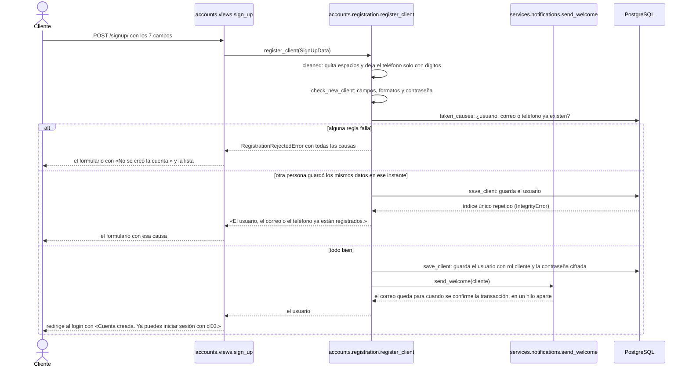

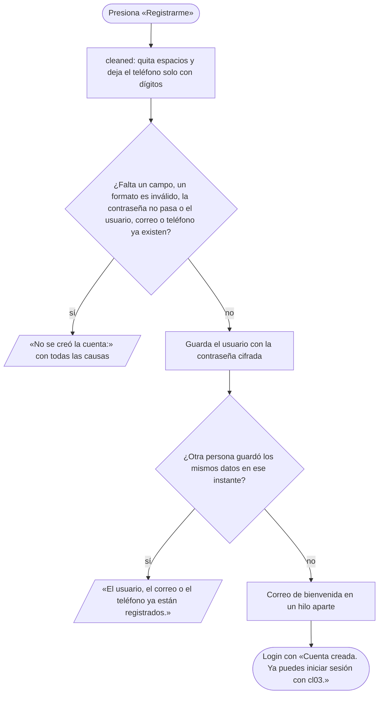

---

### <a id="cu-02"></a>CU-02 — Crear cuenta en tienda

- **Actor:** operador (`op01`).
- **Objetivo:** crear la cuenta de un cliente que está en la tienda, sin conocer su contraseña.
- **Precondición:** el cliente no tiene cuenta.
- **Flujo normal:**
  1. Abre «Nuevo cliente».
  2. Escribe nombre, apellido, correo, teléfono y usuario: **no hay campo de contraseña** ([ENT-102](respuestas-del-cliente.md#ent-102)).
  3. Presiona «Registrar cliente».
  4. Va a «Renta en tienda» con el cliente ya buscado y «Cuenta creada para cl03. Le enviamos un correo para crear su contraseña. Ya puedes registrar su renta.».
  5. El cliente abre el enlace del correo «Crea tu contraseña de SergioCorp» y la crea ([CU-17](#cu-17)).
- **Flujos alternativos:**
  - si falla una regla de datos de [CU-01](#cu-01) → el formulario con «No se creó la cuenta:» y las mismas causas (sin las de la contraseña);
  - si otra persona guarda el mismo usuario, correo o teléfono en el mismo instante → «El usuario, el correo o el teléfono ya están registrados.»;
  - si el correo no sale → la cuenta queda creada y el operador ve «La cuenta se creó, pero no se pudo enviar el correo. Pide al cliente que use "Olvidé mi contraseña" con su correo.».
- **Postcondición:** existe un usuario con rol «cliente» sin contraseña utilizable: no puede iniciar sesión hasta crearla con el enlace.
- **Qué guarda:** una fila en `accounts_user` con `set_unusable_password` (una marca que ninguna contraseña cumple) y el teléfono solo con dígitos.
- **Log:** `ACCOUNT_CREATED user=cl03 "Lucía Quispe" email=lucia@correo.com role=cliente channel=store by=op01` · `ACCOUNT_REJECTED username=cl03 email=… reason="…" by=op01` · si el correo falla, `EMAIL_FAILED to=cl03 subject="Crea tu contraseña de SergioCorp" error=SMTPException`.
- **Correo:** «Crea tu contraseña de SergioCorp», con el enlace de restablecimiento de Django (`/reset/<uid>/<token>/`). Sale en el momento y no en un hilo aparte, para que el operador sepa si salió ([D-37](decisiones.md#d-37)).
- **Origen:** [ENT-54](respuestas-del-cliente.md#ent-54), [ENT-84](respuestas-del-cliente.md#ent-84), [ENT-102](respuestas-del-cliente.md#ent-102), [D-37](decisiones.md#d-37).
- **Dónde está en el código:** [`accounts/views.py`](../accounts/views.py) (`register_client_at_store`) → [`accounts/registration.py`](../accounts/registration.py) (`register_store_client`) → [`rentals/services/notifications.py`](../rentals/services/notifications.py) (`send_create_password`).
- **Prueba:** [`tests/integration/test_correo_crea_tu_contrasena.py`](../tests/integration/test_correo_crea_tu_contrasena.py), [`tests/integration/test_contrasena_del_cliente.py`](../tests/integration/test_contrasena_del_cliente.py).


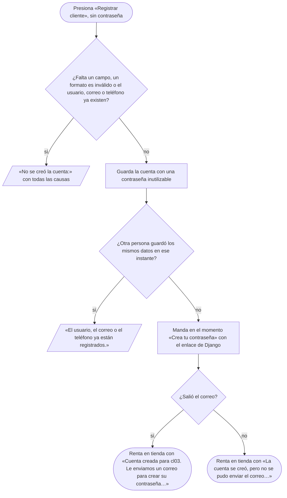

---

### <a id="cu-03"></a>CU-03 — Consultar equipos y disponibilidad

- **Actor:** cliente; el operador también, y además ve el filtro por estado.
- **Objetivo:** encontrar un equipo que se pueda rentar en las fechas del evento.
- **Precondición:** tiene sesión.
- **Flujo normal:**
  1. Abre el catálogo: ve 20 equipos disponibles por página, cada uno con su precio por día, **sin** etiquetas «Libre» ni «Ocupado del … al …» ([ENT-99](respuestas-del-cliente.md#ent-99): a quien renta no le interesa cuándo usan el equipo otras personas).
  2. Escribe un código o un nombre, o elige «Libre desde» y «Libre hasta».
  3. Presiona «Buscar» y ve solo los equipos que cumplen; con las dos fechas, solo los libres en ese periodo (desde las 18:00 del primer día hasta las 09:00 del último, [D-13](decisiones.md#d-13)).
  4. Pasa de página con «Anterior» y «Siguiente».
- **Flujos alternativos:**
  - si elige una sola fecha → «Elige las dos fechas para ver los equipos libres.» y el catálogo sin filtros;
  - si la fecha final es igual o anterior a la inicial → «La fecha final debe ser posterior a la inicial.» y el catálogo sin filtros;
  - si nada coincide → «No hay equipos que coincidan con la búsqueda.».
- **Postcondición:** no cambia nada.
- **Qué guarda:** nada.
- **Log:** nada (es una consulta).
- **Correo:** ninguno.
- **Origen:** [ENT-02](respuestas-del-cliente.md#ent-02), [ENT-86](respuestas-del-cliente.md#ent-86), [ENT-99](respuestas-del-cliente.md#ent-99), [D-13](decisiones.md#d-13), [PRE-02](presentacion12-10.md).
- **Dónde está en el código:** [`rentals/views/renting.py`](../rentals/views/renting.py) (`catalog`) → [`rentals/forms.py`](../rentals/forms.py) (`CatalogFilterForm`) → [`rentals/use_cases/catalog.py`](../rentals/use_cases/catalog.py) (`browse_catalog`).
- **Prueba:** [`tests/integration/test_catalogo.py`](../tests/integration/test_catalogo.py), [`tests/integration/test_catalogo_sin_etiquetas.py`](../tests/integration/test_catalogo_sin_etiquetas.py).

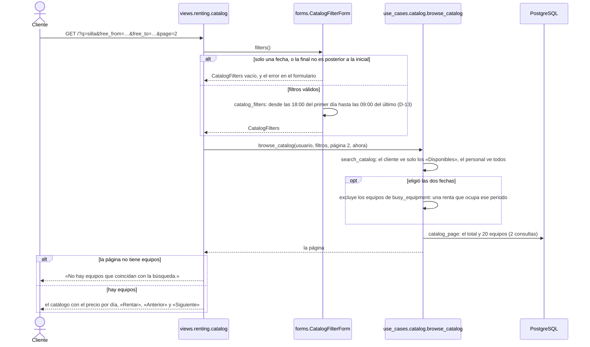


---

### <a id="cu-04"></a>CU-04 — Rentar en línea y pagar con QR simulado

- **Actor:** cliente (`cl01`); la pasarela de pago simulada.
- **Objetivo:** asegurar un equipo para unas fechas y pagarlo sin ir a la tienda.
- **Precondición:** tiene sesión y no tiene deuda pendiente.
- **Flujo normal:**
  1. En el catálogo presiona «Rentar» en un equipo.
  2. Elige fecha y hora de recojo y de devolución y presiona «Continuar al pago».
  3. La reserva queda guardada con el pago pendiente y ve la pantalla del QR con el total.
  4. Presiona «Simular pago exitoso».
  5. Ve la renta con «Pago recibido. Tu renta está confirmada.» y recibe el correo de confirmación.
- **Flujos alternativos:** las reglas del periodo se revisan en este orden y la primera que falla corta; en todas se queda en el formulario:
  - si el recojo es un día pasado → «La fecha de recojo ya pasó. Elige hoy o un día siguiente.» (el recojo de hoy a las 18:00 vale hasta la medianoche, [ENT-94](respuestas-del-cliente.md#ent-94));
  - si la devolución no es posterior al recojo → «La fecha y hora de devolución debe ser posterior a la de recojo.»;
  - si son más de 5 días → «La renta no puede durar más de 5 días.»;
  - si el recojo es antes de las 18:00 → «El recojo debe ser desde las 18:00.»;
  - si la devolución es después de las 09:00 → «La devolución debe ser hasta las 09:00.»;
  - si debe dinero → «Tienes una deuda pendiente de 12,00 Bs. Págala en la tienda para volver a rentar.»;
  - si el equipo no está «Disponible» → vuelve al catálogo con «El equipo MES-00002 no está disponible (estado: En revisión).»;
  - si las fechas chocan con otra renta → vuelve al catálogo con «El equipo MES-00002 está ocupado del 05/11/2026 18:00 al 07/11/2026 09:00. Está libre hasta el 05/11/2026 a las 09:00.» (la segunda frase solo si esa renta empieza después del recojo pedido);
  - si presiona «Simular pago fallido» → la reserva sigue hecha y ve «Tu reserva está hecha, pero el pago no se completó. Paga en la tienda al recoger el equipo.»; recibe el correo con el pago pendiente;
  - si la renta ya estaba pagada → «La renta de MES-00002 ya está pagada.»;
  - si la renta ya no está «Reservada» → el mensaje de su estado, por ejemplo «La reserva de MES-00002 venció a la medianoche.».
- **Postcondición:** la renta queda «Reservada», pagada con QR o con el pago pendiente.
- **Qué guarda:** una fila en `rentals_rental` con `daily_price` (5 % del valor); con el pago exitoso, `paid_at` y `payment_method = qr`.
- **Log:** `RENTAL_CREATED rental=12 equipment=MES-00002 "Mesa plegable 1,80 m" client=cl01 "Carla Mendoza" period=05/11/2026 18:00-07/11/2026 09:00 amount=40.00 by=cl01 payment=pending` · `PAYMENT_APPROVED` (renta) · `PAYMENT_FAILED` (renta) · `RENTAL_REJECTED equipment=MES-00002 "…" client=cl01 "…" period=<fechas pedidas> reason="…" by=cl01` · `PAYMENT_REJECTED` (renta) `reason="…"`.
- **Correo:** «Renta confirmada», pagada o con el pago pendiente, al presionar un botón del QR ([D-04](decisiones.md#d-04)).
- **Origen:** [ENT-16](respuestas-del-cliente.md#ent-16), [ENT-21](respuestas-del-cliente.md#ent-21), [ENT-48](respuestas-del-cliente.md#ent-48), [ENT-66](respuestas-del-cliente.md#ent-66), [ENT-67](respuestas-del-cliente.md#ent-67), [ENT-71](respuestas-del-cliente.md#ent-71), [ENT-77](respuestas-del-cliente.md#ent-77), [ENT-94](respuestas-del-cliente.md#ent-94), [D-04](decisiones.md#d-04), [PRE-03](presentacion12-10.md), [PRE-04](presentacion12-10.md).
- **Dónde está en el código:** [`rentals/views/renting.py`](../rentals/views/renting.py) (`rent_equipment`, `pay_rental`) → [`rentals/use_cases/renting.py`](../rentals/use_cases/renting.py) (`create_rental`) y [`rentals/use_cases/payments.py`](../rentals/use_cases/payments.py) (`pay_with_qr`).
- **Prueba:** [`tests/integration/test_rentar.py`](../tests/integration/test_rentar.py), [`tests/integration/test_pagar.py`](../tests/integration/test_pagar.py), [`tests/unit/test_validar_periodo.py`](../tests/unit/test_validar_periodo.py).


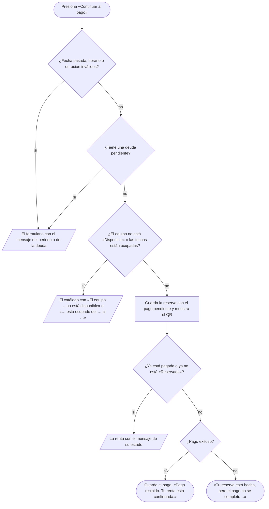

---

### <a id="cu-05"></a>CU-05 — Rentar en tienda

- **Actor:** operador (`op01`).
- **Objetivo:** registrar la renta de un cliente que está en la tienda y paga en efectivo.
- **Precondición:** el cliente tiene cuenta (si no, [CU-02](#cu-02)) y paga en efectivo.
- **Flujo normal:**
  1. Abre «Renta en tienda» y busca al cliente («rojas»): ve hasta 10 clientes activos cuyo usuario, nombre, apellido o correo lo contiene.
  2. Elige al cliente, el equipo (la lista solo ofrece los «Disponibles») y las fechas.
  3. Cobra en efectivo y presiona «Registrar renta».
  4. Ve la renta con «Registrada por op01», «Pagado» y la forma de pago «Efectivo» ([ENT-104](respuestas-del-cliente.md#ent-104)).
  5. Si el cliente se la lleva al momento, registra el recojo como cualquier otro ([CU-08](#cu-08)).
- **Flujos alternativos:** en todos se queda en el formulario:
  - si la búsqueda no encuentra a nadie → «No se encontró ningún cliente con «rojas».»; si no tiene cuenta, [CU-02](#cu-02);
  - si el cliente debe dinero → «El cliente cl02 tiene una deuda pendiente de 12,00 Bs. Cóbrala antes de registrar otra renta.» ([D-07](decisiones.md#d-07));
  - si la fecha, el horario o la duración no cumplen → los mensajes de [CU-04](#cu-04);
  - si el equipo no está «Disponible» o las fechas están ocupadas → los mensajes de [CU-04](#cu-04).
- **Postcondición:** la renta queda «Reservada» y pagada en efectivo ([ENT-91](respuestas-del-cliente.md#ent-91)).
- **Qué guarda:** una fila en `rentals_rental` con `daily_price`, `paid_at`, `payment_method = cash` y `registered_by`.
- **Log:** `RENTAL_CREATED` (renta, `by=op01`) `payment=paid` · `PAYMENT_CASH rental=13 equipment=MES-00004 "Mesa plegable 1,80 m" client=cl03 "Lucía Quispe" period=… amount=40.00 by=op01` · `RENTAL_REJECTED` (lo pedido) `reason="…" by=op01`.
- **Correo:** «Renta confirmada», pagada.
- **Origen:** [ENT-54](respuestas-del-cliente.md#ent-54), [ENT-70](respuestas-del-cliente.md#ent-70), [ENT-77](respuestas-del-cliente.md#ent-77), [ENT-91](respuestas-del-cliente.md#ent-91), [D-07](decisiones.md#d-07), [D-20](decisiones.md#d-20), [PRE-03](presentacion12-10.md).
- **Dónde está en el código:** [`rentals/views/renting.py`](../rentals/views/renting.py) (`walk_in_rental`) → [`rentals/use_cases/renting.py`](../rentals/use_cases/renting.py) (`find_clients`, `create_rental` con `registered_by`).
- **Prueba:** [`tests/integration/test_rentar.py`](../tests/integration/test_rentar.py), [`tests/integration/test_pagar.py`](../tests/integration/test_pagar.py), [`tests/system/test_recorridos.py`](../tests/system/test_recorridos.py).

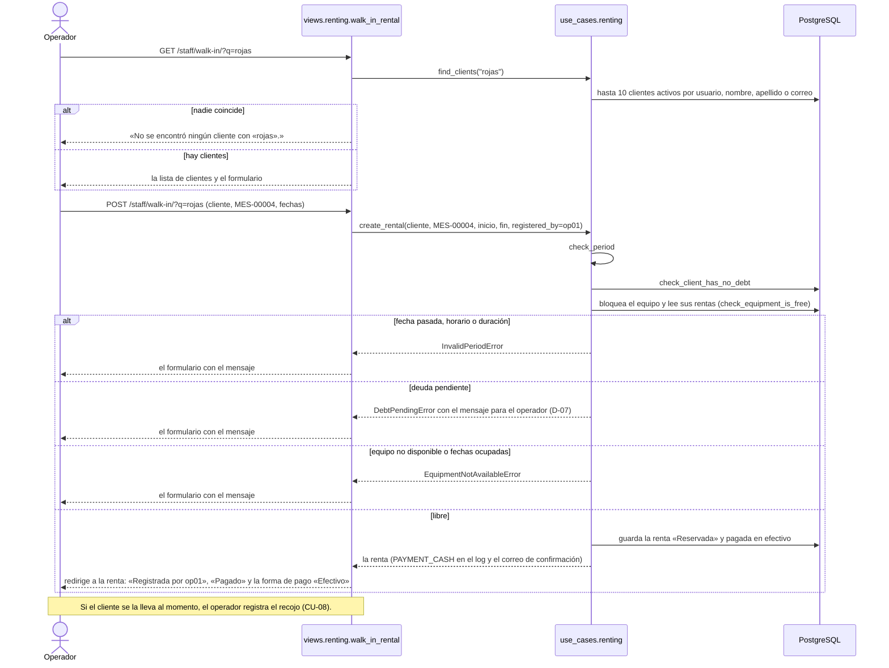

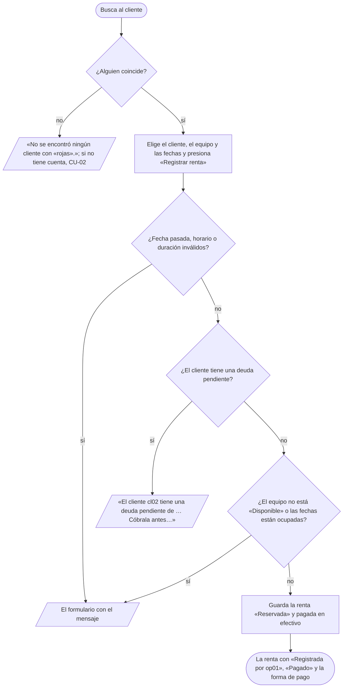

---

### <a id="cu-06"></a>CU-06 — Modificar una reserva

- **Actor:** cliente (sus reservas, hasta 24 h antes del inicio); operador o admin (cualquier reserva, hasta antes de que empiece).
- **Objetivo:** cambiar las fechas de una reserva sin cambiar el precio.
- **Precondición:** la renta está «Reservada».
- **Flujo normal:**
  1. En «Mis rentas» (o en «Reservas por entregar») presiona «Modificar».
  2. Elige las fechas nuevas, con la misma cantidad de días.
  3. Presiona «Guardar cambios».
  4. Vuelve a su lista con «Reserva modificada: MES-00005 ahora va del 06/11/2026 18:00 al 08/11/2026 09:00.».
- **Flujos alternativos:** en todos se queda en el formulario:
  - si la fecha, el horario o la duración no cumplen → los mensajes de [CU-04](#cu-04);
  - si la renta ya no está «Reservada» → «La renta de MES-00005 ya fue entregada el 28/10/2026 18:30.» (o cancelada, devuelta, o «La reserva de MES-00005 venció a la medianoche.»);
  - si es el cliente y faltan menos de 24 h → «Ya no puedes modificar en línea; comunícate con la tienda.»;
  - si es el personal y la reserva ya empezó → «La reserva de MES-00005 ya empezó el 06/11/2026 18:00; ya no se puede modificar.» (puede cancelarla hasta el recojo, [CU-07](#cu-07), [D-32](decisiones.md#d-32));
  - si las fechas nuevas tienen otra cantidad de días → «La reserva es de 2 días. Elige fechas con la misma cantidad de días; para cambiarla, cancela y renta de nuevo.»;
  - si el equipo no está «Disponible» o las fechas nuevas están ocupadas → los mensajes de [CU-04](#cu-04) (la misma reserva no cuenta como choque).
- **Postcondición:** la reserva tiene las fechas nuevas; el precio no cambia.
- **Qué guarda:** `start_datetime` y `end_datetime` de la renta.
- **Log:** `RENTAL_MODIFIED rental=12 equipment=MES-00005 "…" client=cl01 "…" period=06/11/2026 18:00-08/11/2026 09:00 amount=40.00 by=cl01` · `MODIFY_REJECTED` (la renta con `period` = las fechas pedidas) `reason="…" by=cl01`.
- **Correo:** «Reserva modificada», con las fechas nuevas, solo si la cambió el personal.
- **Origen:** [ENT-55](respuestas-del-cliente.md#ent-55), [ENT-80](respuestas-del-cliente.md#ent-80), [ENT-81](respuestas-del-cliente.md#ent-81), [ENT-94](respuestas-del-cliente.md#ent-94), [ENT-95](respuestas-del-cliente.md#ent-95), [D-12](decisiones.md#d-12), [D-32](decisiones.md#d-32).
- **Dónde está en el código:** [`rentals/views/renting.py`](../rentals/views/renting.py) (`modify_reservation`) → [`rentals/use_cases/reservation_changes.py`](../rentals/use_cases/reservation_changes.py) (`modify_rental`), que reutiliza `check_period` y `check_equipment_is_free` de [`renting.py`](../rentals/use_cases/renting.py).
- **Prueba:** [`tests/integration/test_modificar.py`](../tests/integration/test_modificar.py), [`tests/unit/test_reglas_de_cancelacion.py`](../tests/unit/test_reglas_de_cancelacion.py).

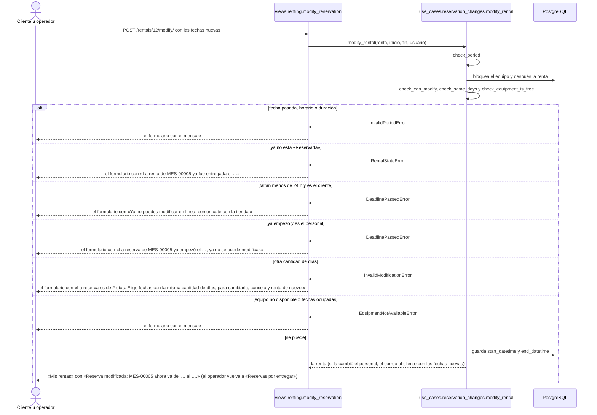

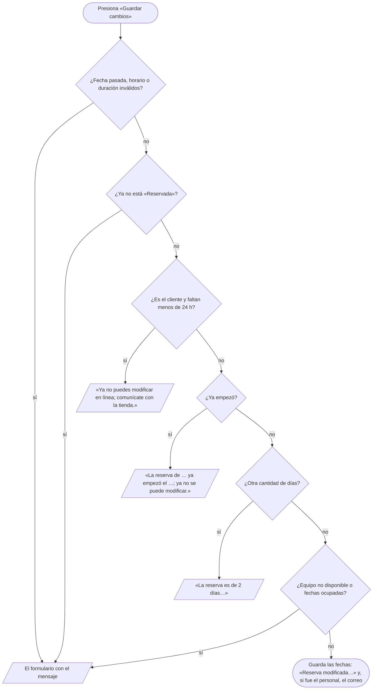

---

### <a id="cu-07"></a>CU-07 — Cancelar una reserva

- **Actor:** cliente (hasta 24 h antes); operador o admin (hasta el recojo; el admin también con la acción «Cancelar reserva» del admin de Django).
- **Objetivo:** liberar las fechas de una reserva que ya no se usará.
- **Precondición:** la renta está «Reservada».
- **Flujo normal:**
  1. Presiona «Cancelar» en la reserva.
  2. Ve «Reserva cancelada: MES-00005 de cl01.».
  3. El cliente recibe un correo con el motivo («Cancelaste tu reserva.» o «La tienda canceló tu reserva.»).
- **Flujos alternativos:**
  - si la renta ya no está «Reservada» → «La renta de MES-00005 ya fue cancelada el 27/10/2026 10:00.» (o entregada, devuelta, o «… venció a la medianoche.»);
  - si es el cliente y faltan menos de 24 h → «Ya no puedes cancelar en línea; comunícate con la tienda.»;
  - si el equipo pasa a reparación o baja ([CU-10](#cu-10), [CU-13](#cu-13)) → el sistema la cancela solo, con el motivo «El equipo no está disponible: pasó a reparación.» o «El equipo no está disponible: se dio de baja.» y el mismo correo ([ENT-88](respuestas-del-cliente.md#ent-88));
  - si el admin desactiva la cuenta del cliente → el sistema la cancela sola, con el motivo «La cuenta fue desactivada.» ([D-27](decisiones.md#d-27)).
- **Postcondición:** la renta queda «Cancelada» y sus fechas quedan libres. El sistema solo cancela: si estaba pagada, la devolución del dinero es manual ([ENT-89](respuestas-del-cliente.md#ent-89)).
- **Qué guarda:** `cancelled_at` y `cancelled_by`.
- **Log:** `RENTAL_CANCELLED` (renta, `by=op01`) `reason="La tienda canceló tu reserva."` · `CANCEL_REJECTED` (renta) `reason="…" by=cl01`.
- **Correo:** «Renta cancelada», con el motivo.
- **Origen:** [ENT-47](respuestas-del-cliente.md#ent-47), [ENT-55](respuestas-del-cliente.md#ent-55), [ENT-80](respuestas-del-cliente.md#ent-80), [ENT-82](respuestas-del-cliente.md#ent-82), [ENT-88](respuestas-del-cliente.md#ent-88), [ENT-89](respuestas-del-cliente.md#ent-89), [D-27](decisiones.md#d-27).
- **Dónde está en el código:** [`rentals/views/renting.py`](../rentals/views/renting.py) (`cancel_reservation`) → [`rentals/use_cases/reservation_changes.py`](../rentals/use_cases/reservation_changes.py) (`cancel_rental`; la cancelación automática es `cancel_reservations`, que llaman `equipment_status.cancel_if_out_of_service` y `accounts/admin.py`).
- **Prueba:** [`tests/integration/test_cancelar.py`](../tests/integration/test_cancelar.py), [`tests/integration/test_cuenta_desactivada.py`](../tests/integration/test_cuenta_desactivada.py), [`tests/unit/test_reglas_de_cancelacion.py`](../tests/unit/test_reglas_de_cancelacion.py).

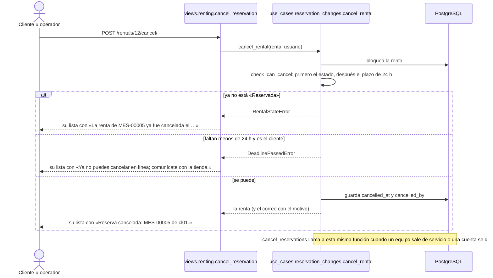

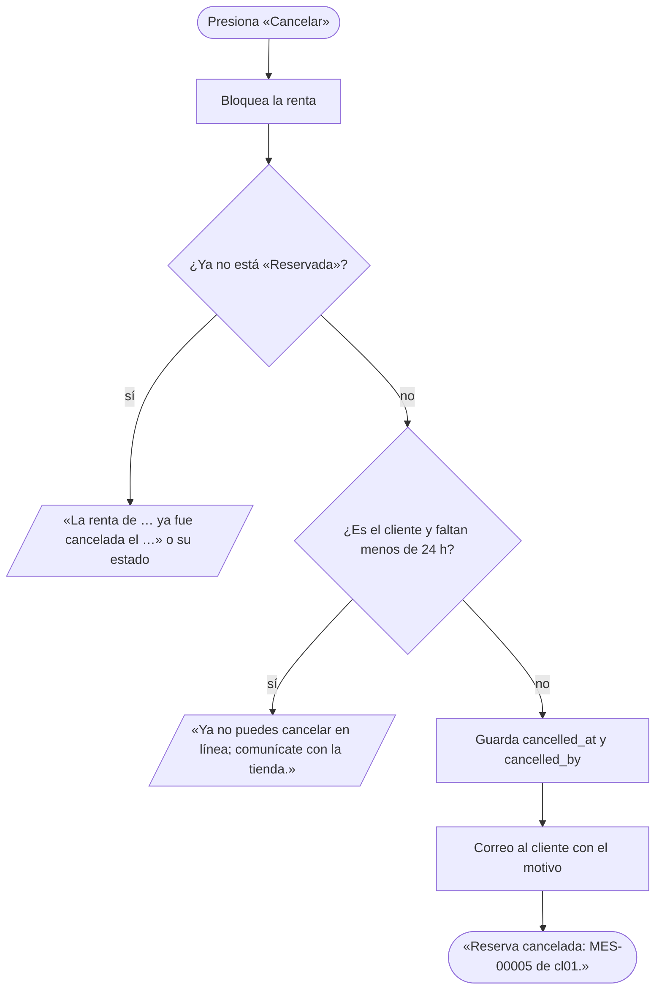

---

### <a id="cu-08"></a>CU-08 — Entregar el equipo

- **Actor:** operador (`op01`).
- **Objetivo:** registrar que el cliente se llevó el equipo, cobrando si faltaba el pago.
- **Precondición:** la renta está «Reservada» y su equipo «Disponible».
- **Flujo normal:**
  1. Abre «Reservas por entregar»: la más nueva arriba; con «Ordenar por: Fecha de recojo», la más próxima ([ENT-100](respuestas-del-cliente.md#ent-100)).
  2. Si está pagada, presiona «Registrar recojo».
  3. Ve «Recojo registrado: MES-00001 entregado a cl01.».
- **Flujos alternativos:** en todos vuelve a la lista con el mensaje:
  - si el pago está pendiente → el botón dice «Cobrar 20,00 Bs y entregar»; al presionarlo se guardan el cobro en efectivo y el recojo, y ve «Cobro de 20,00 Bs en efectivo y recojo registrados: MES-00003 entregado a cl02.»;
  - si el cliente no paga → el operador presiona «Cancelar» ([CU-07](#cu-07));
  - si se intenta entregar sin cobrar → «Falta el pago de 20,00 Bs de esta renta. Cóbralo en efectivo o cancela la reserva si el cliente no paga.»;
  - si la renta ya no está «Reservada» → «La reserva de MES-00001 venció a la medianoche.» (o entregada, cancelada, devuelta);
  - si el equipo está en revisión o en reparación → «El equipo MES-00001 está en revisión. Espera a que mantenimiento lo revise o cancela la reserva.».
- **Postcondición:** la renta queda «Rentada» y pagada.
- **Qué guarda:** `picked_up_at` y `handed_over_by`; si se cobró, también `paid_at` y `payment_method = cash`. El estado del equipo no cambia: «Rentada» se calcula desde `picked_up_at`.
- **Log:** `PAYMENT_CASH` (renta, `by=op01`), solo si cobró · `PICKUP_REGISTERED rental=12 equipment=MES-00001 "Mesa plegable 1,80 m" client=cl01 "Carla Mendoza" period=… amount=20.00 by=op01` · `PICKUP_REJECTED` (renta) `reason="…" by=op01`.
- **Correo:** ninguno.
- **Origen:** [ENT-56](respuestas-del-cliente.md#ent-56), [ENT-57](respuestas-del-cliente.md#ent-57), [ENT-68](respuestas-del-cliente.md#ent-68), [ENT-69](respuestas-del-cliente.md#ent-69), [ENT-91](respuestas-del-cliente.md#ent-91), [D-20](decisiones.md#d-20).
- **Dónde está en el código:** [`rentals/views/handover.py`](../rentals/views/handover.py) (`staff_reservations`, `pickup_reservation`) → [`rentals/use_cases/handover.py`](../rentals/use_cases/handover.py) (`reservations_to_hand_over`, `register_pickup`).
- **Prueba:** [`tests/integration/test_entregar_y_devolver.py`](../tests/integration/test_entregar_y_devolver.py), [`tests/unit/test_reglas_de_entrega.py`](../tests/unit/test_reglas_de_entrega.py), [`tests/integration/test_lo_ultimo_primero.py`](../tests/integration/test_lo_ultimo_primero.py).


---

### <a id="cu-09"></a>CU-09 — Registrar la devolución

- **Actor:** operador (`op01`).
- **Objetivo:** registrar que el equipo volvió, mandarlo a revisión y cobrar el atraso si lo hubo.
- **Precondición:** la renta está «Rentada»: el equipo salió y todavía no volvió ([ENT-93](respuestas-del-cliente.md#ent-93)).
- **Flujo normal:**
  1. Abre «Devoluciones pendientes»: solo aparecen las rentas «Rentadas», la más nueva arriba; con «Ordenar por: Fecha de devolución», la que vence primero ([ENT-100](respuestas-del-cliente.md#ent-100)).
  2. Elige la renta y escribe cómo llegó el equipo.
  3. Presiona «Registrar devolución».
  4. Ve «Devolución registrada: SIL-00007 recibido de cl02. A tiempo.» (o «En tolerancia, sin cobro.»).
- **Flujos alternativos:** en los rechazos se queda en el formulario:
  - si no escribe la observación → «Escribe cómo llegó el equipo.»;
  - si la renta nunca se entregó → «La renta de SIL-00007 nunca se entregó: solo se devuelve una renta «Rentada».»;
  - si ya fue devuelta o cancelada → «La renta de SIL-00007 ya fue devuelta el 28/10/2026 08:30.»;
  - si vuelve desde las 12:01 del día de vencimiento → se guarda la devolución con una deuda y ve «Devolución registrada: SIL-00001 recibido de cl01. Con 2 días de atraso: deuda de 8,00 Bs.»; el cliente recibe el correo de la deuda (ver [Cómo se cuentan los días](#cómo-se-cuentan-los-días-y-el-atraso));
  - si mantenimiento ya le cambió el estado mientras estaba afuera → se respeta ese estado y la devolución se guarda igual ([D-28](decisiones.md#d-28)).
- **Postcondición:** la renta queda «Devuelta» y el equipo «En revisión».
- **Qué guarda:** `returned_at`, `received_by` y `return_note`; el estado del equipo y una fila en `rentals_statuschange`; con atraso, una fila en `rentals_debt` con `late_return`.
- **Log:** `RETURN_REGISTERED` (renta, `by=op01`) `result=late late_days=2` · `STATUS_CHANGED equipment=SIL-00001 "Silla plegable blanca" old=available new=in_review by=op01` · `DEBT_CREATED debt=3 charge=late_return rental=12 equipment=… client=… period=… amount=8.00 by=op01` · `RETURN_REJECTED` (renta) `reason="…" by=op01`.
- **Correo:** «Tienes una deuda de …», si hubo atraso.
- **Origen:** [ENT-03](respuestas-del-cliente.md#ent-03), [ENT-73](respuestas-del-cliente.md#ent-73), [ENT-93](respuestas-del-cliente.md#ent-93), [D-17](decisiones.md#d-17), [D-28](decisiones.md#d-28), [PRE-05](presentacion12-10.md).
- **Dónde está en el código:** [`rentals/views/handover.py`](../rentals/views/handover.py) (`staff_returns`, `return_rental`) → [`rentals/use_cases/handover.py`](../rentals/use_cases/handover.py) (`register_return`) → [`rentals/use_cases/equipment_status.py`](../rentals/use_cases/equipment_status.py) (`change_status`) y [`rentals/use_cases/debts.py`](../rentals/use_cases/debts.py) (`charge_debt`); los días, en [`rentals/rules.py`](../rentals/rules.py) (`classify_return`, `late_days`).
- **Prueba:** [`tests/integration/test_entregar_y_devolver.py`](../tests/integration/test_entregar_y_devolver.py), [`tests/integration/test_deudas.py`](../tests/integration/test_deudas.py), [`tests/unit/test_clasificar_devolucion.py`](../tests/unit/test_clasificar_devolucion.py).

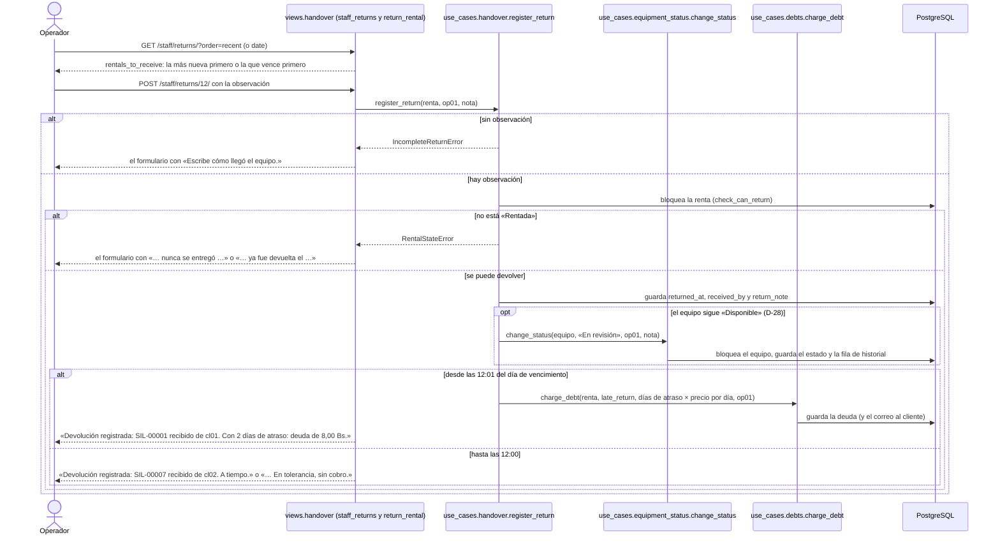


---

### <a id="cu-10"></a>CU-10 — Revisar el equipo

- **Actor:** mantenimiento (`mt01`).
- **Objetivo:** decidir el estado de un equipo y si se cobra el daño.
- **Precondición:** el equipo no está de baja.
- **Flujo normal:**
  1. Abre «Mantenimiento»: ve todos los equipos que no están de baja, el que cambió de estado más recientemente arriba ([ENT-100](respuestas-del-cliente.md#ent-100)), y puede filtrarlos por estado.
  2. En un equipo elige el estado nuevo (las opciones son los estados permitidos desde el actual, `rules.next_statuses`) y escribe un comentario opcional.
  3. Si eligió «En reparación» o «Baja» y el equipo tiene una renta devuelta, aparece la casilla «Cobrar el daño al último cliente (cl02, renta del 27/10)», **sin marcar**; la marca solo si decide cobrar ([D-30](decisiones.md#d-30)).
  4. Presiona «Guardar».
  5. Ve «SIL-00003 ahora está «Disponible».».
- **Flujos alternativos:** los rechazos vuelven a la lista con el mensaje:
  - si el estado pedido no existe → «El equipo SIL-00003 solo puede pasar a disponible, en revisión, en reparación o baja.»;
  - si el equipo está de baja → «El equipo SIL-00005 está dado de baja; su estado ya no puede cambiar.»;
  - si el equipo ya tiene ese estado → «El equipo SIL-00004 ya está «En reparación».»;
  - si elige reparación con la casilla marcada → deuda del 20 % para el cliente de la última renta devuelta y «SIL-00003 ahora está «En reparación». Deuda de 16,00 Bs para cl02.»;
  - si elige baja con la casilla marcada → deuda del 100 %, o lo que falta para llegar al valor si esa renta ya tenía la de reparación ([D-06](decisiones.md#d-06));
  - si elige reparación o baja sin marcar la casilla → no hay deuda y el log escribe `DAMAGE_NOT_CHARGED`;
  - si elige reparación o baja y el equipo tiene reservas no recogidas → se cancelan con «El equipo no está disponible: pasó a reparación.» o «… se dio de baja.», cada cliente recibe el correo y el mensaje termina con «Reservas futuras canceladas: 1.»;
  - si el equipo nunca volvió de una renta → no aparece la casilla y no hay a quién cobrar ([D-05](decisiones.md#d-05)).
- **Postcondición:** el equipo tiene su estado nuevo y queda en el historial.
- **Qué guarda:** el estado del equipo y una fila en `rentals_statuschange`; con la casilla marcada, una fila en `rentals_debt`; con reparación o baja, `cancelled_at` y `cancelled_by` en cada reserva no recogida. Todo en una sola transacción: se guarda junto o nada.
- **Log:** `STATUS_CHANGED equipment=SIL-00003 "Silla plegable blanca" old=in_review new=in_repair by=mt01` · `DEBT_CREATED debt=4 charge=repair rental=9 … amount=16.00 by=mt01` · `DAMAGE_NOT_CHARGED status=in_repair` (renta del último cliente, `by=mt01`) · `RENTAL_CANCELLED` (renta, `by=mt01`) `reason="El equipo no está disponible: pasó a reparación."` · `REVIEW_REJECTED equipment=SIL-00003 "…" status=<pedido> reason="…" by=mt01` (estado que no existe) · `STATUS_CHANGE_REJECTED equipment=SIL-00005 "…" new=<pedido> reason="…" by=mt01` (de baja o mismo estado: lo escribe `change_status` y no se repite).
- **Correo:** «Tienes una deuda de …», si se cobró; «Renta cancelada» a cada cliente afectado.
- **Origen:** [ENT-03](respuestas-del-cliente.md#ent-03), [ENT-34](respuestas-del-cliente.md#ent-34), [ENT-49](respuestas-del-cliente.md#ent-49), [ENT-74](respuestas-del-cliente.md#ent-74), [ENT-88](respuestas-del-cliente.md#ent-88), [ENT-90](respuestas-del-cliente.md#ent-90), [D-05](decisiones.md#d-05), [D-06](decisiones.md#d-06), [D-29](decisiones.md#d-29), [D-30](decisiones.md#d-30), [PRE-06](presentacion12-10.md).
- **Dónde está en el código:** [`rentals/views/review.py`](../rentals/views/review.py) (`maintenance`, `review_equipment_view`) → [`rentals/use_cases/review.py`](../rentals/use_cases/review.py) (`review_queue`, `review_equipment`) → [`equipment_status.py`](../rentals/use_cases/equipment_status.py) (`change_status`, `cancel_if_out_of_service`) y [`debts.py`](../rentals/use_cases/debts.py) (`charge_debt`).
- **Prueba:** [`tests/integration/test_revisar.py`](../tests/integration/test_revisar.py), [`tests/integration/test_deudas.py`](../tests/integration/test_deudas.py), [`tests/unit/test_reglas_de_revision.py`](../tests/unit/test_reglas_de_revision.py).

```mermaid
sequenceDiagram
    actor T as Mantenimiento
    participant V as views.review (maintenance y review_equipment_view)
    participant U as use_cases.review
    participant H as use_cases.equipment_status
    participant BD as PostgreSQL
    T->>V: GET /maintenance/?status=in_review
    V->>U: review_queue(estado)
    U->>BD: equipos que no están de baja, el último que cambió de estado primero, con sus rentas devueltas (2 consultas)
    V-->>T: cada equipo con sus opciones (rules.next_statuses) y, si tiene renta devuelta, la casilla de cobro
    T->>V: POST /maintenance/SIL-00003/ con el estado, el comentario y charge_last_client
    V->>U: review_equipment(SIL-00003, mt01, estado, comentario, charge_last_client)
    U->>U: check_review_result
    alt no es un estado del equipo
        U-->>V: InvalidStatusChangeError (REVIEW_REJECTED)
        V-->>T: la lista con «El equipo SIL-00003 solo puede pasar a disponible, en revisión, en reparación o baja.»
    else es un estado del equipo
        U->>H: change_status(equipo, estado, mt01, comentario)
        H->>BD: bloquea el equipo y lee su estado (check_status_can_change)
        alt de baja o ya tiene ese estado
            H-->>U: InvalidStatusChangeError (STATUS_CHANGE_REJECTED)
            U-->>V: el mismo rechazo
            V-->>T: la lista con «… está dado de baja#59; su estado ya no puede cambiar.» o «… ya está «En reparación».»
        else se puede cambiar
            H->>BD: guarda el estado nuevo y la fila de historial
            U->>U: settle_damage
            alt «Disponible» o «En revisión»
                V-->>T: «SIL-00003 ahora está «Disponible».»
            else reparación o baja con la casilla marcada y una renta devuelta
                U->>BD: charge_damage: deuda del 20 % o del 100 %, con el tope (D-06)
                U->>H: cancel_if_out_of_service: cancel_rental en cada reserva no recogida
                V-->>T: «SIL-00003 ahora está «En reparación». Deuda de 16,00 Bs para cl02.» (y «Reservas futuras canceladas: N.»)
            else reparación o baja sin marcar
                U->>U: el log escribe DAMAGE_NOT_CHARGED si había a quién cobrar
                U->>H: cancel_if_out_of_service: cancel_rental en cada reserva no recogida
                V-->>T: «SIL-00003 ahora está «En reparación».» (y «Reservas futuras canceladas: N.»)
            end
        end
    end
    Note over U,BD: Sin renta devuelta no hay a quién cobrar: no hay casilla ni deuda (D-05).
```

```mermaid
flowchart TD
    A(["Mantenimiento: el que cambió más recientemente primero"]) --> B{"¿Es un estado del equipo?"}
    B -- no --> C[/"«… solo puede pasar a disponible, en revisión, en reparación o baja.»"/]
    B -- sí --> D{"¿Está de baja o ya tiene ese estado?"}
    D -- sí --> E[/"«… está dado de baja…» o «… ya está «En reparación».»"/]
    D -- no --> F["Guarda el estado nuevo y su historial"]
    F --> G{"¿Reparación o baja?"}
    G -- no --> H(["«SIL-00003 ahora está «Disponible».»"])
    G -- sí --> I{"¿Marcó cobrar y hay una renta devuelta?"}
    I -- sí --> J["Deuda del 20 % o del 100 %, con el tope de D-06"]
    I -- no --> K["DAMAGE_NOT_CHARGED si había a quién cobrar"]
    J --> L(["Cancela sus reservas no recogidas y muestra el estado, la deuda y las canceladas"])
    K --> L
```

---

### <a id="cu-11"></a>CU-11 — Registrar el pago de una deuda

- **Actor:** operador (`op01`); el admin también, con la acción «Registrar pago» del admin de Django.
- **Objetivo:** registrar que el cliente pagó una deuda en la tienda, para que pueda volver a rentar.
- **Precondición:** el cliente tiene una deuda pendiente y paga en la tienda, en persona ([ENT-92](respuestas-del-cliente.md#ent-92)).
- **Flujo normal:**
  1. Abre «Deudas»: ve las deudas pendientes, la más nueva arriba, y el total por cliente, el de la deuda más nueva primero ([ENT-100](respuestas-del-cliente.md#ent-100)).
  2. Cobra y presiona «Registrar pago» en una deuda.
  3. Ve «Pago registrado: deuda de 12,00 Bs de cl02.».
- **Flujos alternativos:**
  - si la deuda ya estaba pagada (por ejemplo, otro operador hizo clic antes) → «Esta deuda ya se pagó el 28/10/2026 10:00.».
- **Postcondición:** la deuda queda pagada; si era la última, el cliente puede volver a rentar.
- **Qué guarda:** `paid_at` y `paid_received_by` en esa deuda.
- **Log:** `DEBT_PAID debt=3 charge=late_return rental=12 equipment=SIL-00006 "…" client=cl02 "Diego Rojas" period=… amount=12.00 by=op01` · `DEBT_PAYMENT_REJECTED` (deuda) `reason="…" by=op01`.
- **Correo:** ninguno.
- **Origen:** [ENT-76](respuestas-del-cliente.md#ent-76), [ENT-77](respuestas-del-cliente.md#ent-77), [ENT-78](respuestas-del-cliente.md#ent-78), [ENT-92](respuestas-del-cliente.md#ent-92).
- **Dónde está en el código:** [`rentals/views/debts.py`](../rentals/views/debts.py) (`staff_debts`, `pay_debt_view`) → [`rentals/use_cases/debts.py`](../rentals/use_cases/debts.py) (`debts_overview`, `pay_debt`).
- **Prueba:** [`tests/integration/test_deudas.py`](../tests/integration/test_deudas.py).

```mermaid
sequenceDiagram
    actor O as Operador
    participant V as views.debts.pay_debt_view
    participant U as use_cases.debts.pay_debt
    participant BD as PostgreSQL
    O->>V: POST /staff/debts/3/pay/
    V->>U: pay_debt(deuda, op01)
    U->>BD: bloquea la deuda (check_debt_is_pending)
    alt ya pagada
        U-->>V: DebtStateError
        V-->>O: la lista con «Esta deuda ya se pagó el 28/10/2026 10:00.»
    else pendiente
        U->>BD: guarda paid_at y paid_received_by
        U-->>V: la deuda
        V-->>O: la lista con «Pago registrado: deuda de 12,00 Bs de cl02.»
    end
```

```mermaid
flowchart TD
    A(["Deudas: la más nueva primero"]) --> B["Presiona «Registrar pago»"]
    B --> C["Bloquea la deuda"]
    C --> D{"¿Ya está pagada?"}
    D -- sí --> E[/"«Esta deuda ya se pagó el 28/10/2026 10:00.»"/]
    D -- no --> F["Guarda paid_at y paid_received_by"]
    F --> G(["«Pago registrado: deuda de 12,00 Bs de cl02.»"])
```

---

### <a id="cu-12"></a>CU-12 — Registrar un equipo

- **Actor:** administrador (`ad01`).
- **Objetivo:** agregar un equipo nuevo al inventario para que se pueda rentar.
- **Precondición:** tiene el código, el número de serie, el nombre y el valor de compra.
- **Flujo normal:**
  1. Abre «Registrar equipo».
  2. Escribe el código (`mes-00021` se guarda como `MES-00021`), el número de serie del fabricante, el nombre y el valor.
  3. Presiona «Registrar equipo».
  4. Ve «Equipo registrado: MES-00021 · Mesa plegable 1,80 m.».
- **Flujos alternativos:** se queda en el formulario con «No se registró el equipo:» y todas las causas:
  - si el código no tiene la forma `AAA-00000` → «El código debe tener 3 letras, un guion y 5 números, por ejemplo MES-00001.»;
  - si el código ya existe → «Ya existe un equipo con este código.»;
  - si el número de serie ya existe → «Ya existe un equipo con este número de serie.»;
  - si el valor es 0 o negativo → «El valor debe ser mayor que 0.»;
  - si falta el nombre → «Falta el campo Nombre.»;
  - si otro admin guarda el mismo código o serie en el mismo instante → «Ya existe un equipo con este código o número de serie.».
  
  También se puede registrar en el admin de Django, con las mismas validaciones. Un combo se registra igual, con su propio código (por ejemplo `CMB-00001`) y su valor: es una unidad aparte y no descuenta sillas ni mesas ([ENT-96](respuestas-del-cliente.md#ent-96)).
- **Postcondición:** el equipo existe, «Disponible», y aparece en el catálogo.
- **Qué guarda:** una fila en `rentals_equipment` con `created_at`.
- **Log:** `EQUIPMENT_REGISTERED equipment=MES-00021 "Mesa plegable 1,80 m" serial=DURAPLAST-2024-00031 value=400.00 by=ad01` · `EQUIPMENT_REJECTED equipment=MES-0002 "Mesa" serial=… value=… reason="…" by=ad01`.
- **Correo:** ninguno.
- **Origen:** [ENT-09](respuestas-del-cliente.md#ent-09), [ENT-14](respuestas-del-cliente.md#ent-14), [ENT-83](respuestas-del-cliente.md#ent-83), [ENT-96](respuestas-del-cliente.md#ent-96), [PRE-01](presentacion12-10.md).
- **Dónde está en el código:** [`rentals/views/inventory.py`](../rentals/views/inventory.py) (`register_equipment_view`) → [`rentals/use_cases/inventory.py`](../rentals/use_cases/inventory.py) (`register_equipment`); las reglas, en el modelo `Equipment` de [`rentals/models.py`](../rentals/models.py).
- **Prueba:** [`tests/integration/test_registrar_equipo.py`](../tests/integration/test_registrar_equipo.py), [`tests/unit/test_codigo_de_equipo.py`](../tests/unit/test_codigo_de_equipo.py).

```mermaid
sequenceDiagram
    actor A as Administrador
    participant V as views.inventory.register_equipment_view
    participant U as use_cases.inventory.register_equipment
    participant BD as PostgreSQL
    A->>V: POST /equipment/new/
    V->>U: register_equipment(código, serie, nombre, valor, ad01)
    U->>U: normalize_inventory_id: «mes-00021» pasa a «MES-00021»
    U->>BD: check_new_equipment: reglas del modelo y ¿código o serie repetidos?
    alt alguna regla falla
        U-->>V: EquipmentRegistrationError con todas las causas
        V-->>A: el formulario con «No se registró el equipo:» y la lista
    else otro admin guardó el mismo código o serie en ese instante
        U->>BD: guarda el equipo
        BD-->>U: índice único repetido (IntegrityError)
        U-->>V: «Ya existe un equipo con este código o número de serie.»
        V-->>A: el formulario con esa causa
    else todo bien
        U->>BD: guarda el equipo «Disponible»
        U-->>V: el equipo
        V-->>A: «Equipo registrado: MES-00021 · Mesa plegable 1,80 m.»
    end
```

```mermaid
flowchart TD
    A(["Presiona «Registrar equipo»"]) --> B["normalize_inventory_id: «mes-00021» pasa a «MES-00021»"]
    B --> C{"¿Rompe una regla del modelo: formato, repetido, nombre o valor?"}
    C -- sí --> D[/"«No se registró el equipo:» con todas las causas"/]
    C -- no --> E["Guarda el equipo «Disponible»"]
    E --> F{"¿Otro admin guardó el mismo código o serie en ese instante?"}
    F -- sí --> G[/"«Ya existe un equipo con este código o número de serie.»"/]
    F -- no --> H(["«Equipo registrado: MES-00021 · Mesa plegable 1,80 m.»"])
```

---

### <a id="cu-13"></a>CU-13 — Corregir el estado de un equipo

- **Actor:** administrador (`ad01`).
- **Objetivo:** corregir el estado de uno o varios equipos sin cobrarle a nadie.
- **Precondición:** está en el admin de Django (`/admin/`).
- **Flujo normal:**
  1. En «Equipos» (el registrado más recientemente arriba, con `date_hierarchy` y filtro por fecha de registro, [ENT-100](respuestas-del-cliente.md#ent-100)) marca uno o varios.
  2. Elige «Marcar disponible», «Mandar a reparación» o «Dar de baja».
  3. Ve «Equipos actualizados: 1.».
- **Flujos alternativos:**
  - si un equipo está de baja o ya tiene ese estado → no cambia y aparece en «No se cambiaron: SIL-00005.»;
  - si pasa a reparación o baja y tiene reservas no recogidas → se cancelan con «El equipo no está disponible: pasó a reparación.» o «… se dio de baja.» y cada cliente recibe el correo ([ENT-88](respuestas-del-cliente.md#ent-88)).
- **Postcondición:** el estado cambia y queda en el historial. **Nunca crea deudas** ([ENT-75](respuestas-del-cliente.md#ent-75)): es una corrección, no una revisión. El equipo no se puede borrar: se da de baja ([ENT-97](respuestas-del-cliente.md#ent-97)).
- **Qué guarda:** el estado del equipo y una fila en `rentals_statuschange`; con reparación o baja, `cancelled_at` y `cancelled_by` (el admin) en cada reserva no recogida.
- **Log:** `STATUS_CHANGED equipment=MES-00002 "Mesa plegable 1,80 m" old=available new=in_repair by=ad01` · `RENTAL_CANCELLED` (renta, `by=ad01`) `reason="El equipo no está disponible: pasó a reparación."` · `STATUS_CHANGE_REJECTED equipment=SIL-00005 "…" new=in_repair reason="…" by=ad01`.
- **Correo:** «Renta cancelada» a cada cliente afectado.
- **Origen:** [ENT-40](respuestas-del-cliente.md#ent-40), [ENT-50](respuestas-del-cliente.md#ent-50), [ENT-75](respuestas-del-cliente.md#ent-75), [ENT-88](respuestas-del-cliente.md#ent-88), [ENT-97](respuestas-del-cliente.md#ent-97), [PRE-07](presentacion12-10.md).
- **Dónde está en el código:** [`rentals/admin.py`](../rentals/admin.py) (`EquipmentAdmin.change_selected` y `apply_to_selected`) → [`rentals/use_cases/equipment_status.py`](../rentals/use_cases/equipment_status.py) (`correct_status`).
- **Prueba:** [`tests/integration/test_revisar.py`](../tests/integration/test_revisar.py), [`tests/system/test_recorridos.py`](../tests/system/test_recorridos.py).

```mermaid
sequenceDiagram
    actor A as Administrador
    participant V as admin.EquipmentAdmin.change_selected
    participant U as use_cases.equipment_status.correct_status
    participant BD as PostgreSQL
    A->>V: acción «Mandar a reparación» con los equipos marcados
    loop por cada equipo marcado (apply_to_selected)
        V->>U: correct_status(equipo, «En reparación», ad01)
        U->>BD: change_status: bloquea el equipo y lee su estado
        alt de baja o ya tiene ese estado
            U-->>V: InvalidStatusChangeError: va a «No se cambiaron»
        else se puede
            U->>BD: guarda el estado nuevo y la fila de historial
            U->>BD: cancel_if_out_of_service: cancela sus reservas no recogidas, sin deuda
        end
    end
    V-->>A: «Equipos actualizados: 1.» y, si hubo rechazos, «No se cambiaron: SIL-00005.»
```

```mermaid
flowchart TD
    A(["Elige la acción con los equipos marcados"]) --> B["correct_status del siguiente equipo"]
    B --> C{"¿Está de baja o ya tiene ese estado?"}
    C -- sí --> D["Lo anota en «No se cambiaron»"]
    C -- no --> E["Guarda el estado y su historial, sin deuda"]
    E --> F{"¿Reparación o baja?"}
    F -- sí --> G["Cancela sus reservas no recogidas, con correo"]
    F -- no --> H{"¿Quedan equipos marcados?"}
    G --> H
    D --> H
    H -- sí --> B
    H -- no --> I(["«Equipos actualizados: N.» y, si hubo, «No se cambiaron: …»"])
```

---

### <a id="cu-14"></a>CU-14 — Consultar el historial

- **Actor:** administrador (`ad01`).
- **Objetivo:** saber quién cambió el estado de un equipo, cuándo, de cuál a cuál y por qué.
- **Precondición:** está en el admin de Django (`/admin/`).
- **Flujo normal:**
  1. Abre «Cambios de estado»: el más nuevo arriba.
  2. Filtra por estado nuevo, por quién lo cambió o por fecha (`date_hierarchy` y filtro por fecha, [ENT-100](respuestas-del-cliente.md#ent-100)), o busca un código.
  3. Ve quién, cuándo, de qué a qué y por qué.
- **Flujos alternativos:**
  - si intenta agregar, editar o borrar una fila → no puede: el historial es evidencia y es de solo lectura.
- **Postcondición:** no cambia nada.
- **Qué guarda:** nada.
- **Log:** nada.
- **Correo:** ninguno.
- **Origen:** [ENT-34](respuestas-del-cliente.md#ent-34), [PRE-07](presentacion12-10.md), [PRE-08](presentacion12-10.md).
- **Dónde está en el código:** [`rentals/admin.py`](../rentals/admin.py) (`StatusChangeAdmin`).
- **Prueba:** [`tests/system/test_recorridos.py`](../tests/system/test_recorridos.py).

```mermaid
sequenceDiagram
    actor A as Administrador
    participant V as admin.StatusChangeAdmin
    participant BD as PostgreSQL
    alt busca o filtra
        A->>V: GET /admin/rentals/statuschange/?q=MES-00007
        V->>BD: cambios de ese equipo, el más nuevo primero
        V-->>A: la lista de solo lectura
    else intenta agregar, editar o borrar
        A->>V: abre una fila o busca el botón «Agregar»
        V-->>A: solo lectura: has_add, has_change y has_delete_permission responden False
    end
```

```mermaid
flowchart TD
    A(["Abre «Cambios de estado»: el más nuevo primero"]) --> B{"¿Quiere agregar, editar o borrar?"}
    B -- sí --> C[/"Solo lectura: el historial es evidencia"/]
    B -- no --> D["Filtra por estado, por quién o por fecha, o busca un código"]
    D --> E(["Quién, cuándo, de qué a qué y por qué"])
```

---

### <a id="cu-15"></a>CU-15 — Ver el panel del responsable

- **Actor:** administrador (`ad01`); al iniciar sesión llega aquí.
- **Objetivo:** ver en una sola página lo que necesita atención hoy.
- **Precondición:** tiene el rol administrador.
- **Flujo normal:**
  1. Abre «Panel».
  2. Ve seis listas con su cantidad: rentas activas, rentas vencidas (pasó la devolución y no se devolvió), reservas de hoy, reservas con pago pendiente, equipos en revisión o reparación y deudas pendientes (total y por cliente). Cada lista muestra lo último primero ([ENT-100](respuestas-del-cliente.md#ent-100)): las rentas por su creación, los equipos por su último cambio de estado y los clientes por su deuda más nueva.
  3. Presiona «Ver en el admin» en una lista y llega a esa misma lista filtrada en el admin, la más nueva primero.
- **Flujos alternativos:**
  - si una lista está vacía → «Nada por aquí.».
- **Postcondición:** no cambia nada.
- **Qué guarda:** nada.
- **Log:** nada.
- **Correo:** ninguno.
- **Origen:** [ENT-87](respuestas-del-cliente.md#ent-87), [D-14](decisiones.md#d-14), [D-15](decisiones.md#d-15), [PRE-06](presentacion12-10.md), [PRE-08](presentacion12-10.md).
- **Dónde está en el código:** [`rentals/views/dashboard.py`](../rentals/views/dashboard.py) (`manager_dashboard`) → [`rentals/use_cases/dashboard.py`](../rentals/use_cases/dashboard.py) (`manager_summary`), con las consultas de `RentalQuerySet` en [`rentals/models.py`](../rentals/models.py).
- **Prueba:** [`tests/integration/test_panel.py`](../tests/integration/test_panel.py), [`tests/integration/test_acceso.py`](../tests/integration/test_acceso.py).

```mermaid
sequenceDiagram
    actor A as Administrador
    participant V as views.dashboard.manager_dashboard
    participant U as use_cases.dashboard.manager_summary
    participant BD as PostgreSQL
    A->>V: GET /manager/
    V->>U: manager_summary(ahora)
    U->>BD: por cada lista, su total y sus primeras 10 filas, lo último primero, y la deuda total
    U-->>V: ManagerSummary con las seis listas
    alt una lista está vacía
        V-->>A: esa lista dice «Nada por aquí.»
    else la lista tiene filas
        V-->>A: el total, las filas y «Ver en el admin»
    end
```

```mermaid
flowchart TD
    A(["Abre «Panel»"]) --> B["manager_summary: seis listas, lo último primero"]
    B --> C{"¿La lista está vacía?"}
    C -- sí --> D[/"«Nada por aquí.»"/]
    C -- no --> E["Su total y sus primeras 10 filas"]
    E --> F(["«Ver en el admin»: la lista filtrada, la más nueva primero"])
```

---

### <a id="cu-16"></a>CU-16 — Consultar mis rentas y mi deuda

- **Actor:** cliente (`cl02`).
- **Objetivo:** ver sus rentas, si están pagadas y cuánto debe.
- **Precondición:** tiene sesión.
- **Flujo normal:**
  1. Abre «Mis rentas».
  2. Ve cada renta con sus fechas, total, estado y pago: solo «Pagado» o «Pago pendiente» ([ENT-104](respuestas-del-cliente.md#ent-104)); la forma de pago está en el detalle de la renta.
  3. Si debe, ve arriba «Tienes una deuda pendiente de 12,00 Bs. Págala en la tienda para volver a rentar.» y el detalle de cada deuda.
  4. En sus reservas con más de 24 h para el recojo ve «Modificar» y «Cancelar».
- **Flujos alternativos:**
  - si no tiene rentas → «Todavía no tienes rentas.»;
  - si no debe → no ve el aviso;
  - si a una reserva le faltan menos de 24 h → en lugar de los botones ve «Para cambiarla, comunícate con la tienda.»;
  - si la tienda o el sistema cancelaron una reserva (equipo en reparación o baja, cuenta desactivada) → aparece «Cancelada»; el motivo le llegó por correo;
  - si quiere pagar la deuda → no puede aquí: solo en la tienda, en persona ([ENT-92](respuestas-del-cliente.md#ent-92)).
- **Postcondición:** no cambia nada.
- **Qué guarda:** nada.
- **Log:** nada.
- **Correo:** ninguno.
- **Origen:** [ENT-55](respuestas-del-cliente.md#ent-55), [ENT-76](respuestas-del-cliente.md#ent-76), [ENT-88](respuestas-del-cliente.md#ent-88), [ENT-92](respuestas-del-cliente.md#ent-92), [ENT-104](respuestas-del-cliente.md#ent-104), [D-22](decisiones.md#d-22), [PRE-08](presentacion12-10.md).
- **Dónde está en el código:** [`rentals/views/renting.py`](../rentals/views/renting.py) (`client_rentals`) → [`rentals/use_cases/renting.py`](../rentals/use_cases/renting.py) (`my_rentals`), que lee las deudas con [`debts.py`](../rentals/use_cases/debts.py) (`pending_debts_of`, `debt_total_of`).
- **Prueba:** [`tests/integration/test_forma_de_pago.py`](../tests/integration/test_forma_de_pago.py), [`tests/unit/test_etiqueta_de_pago.py`](../tests/unit/test_etiqueta_de_pago.py), [`tests/system/test_recorridos.py`](../tests/system/test_recorridos.py).

```mermaid
sequenceDiagram
    actor C as Cliente
    participant V as views.renting.client_rentals
    participant U as use_cases.renting.my_rentals
    participant BD as PostgreSQL
    C->>V: GET /my-rentals/
    V->>U: my_rentals(cl02)
    U->>BD: sus rentas, sus deudas pendientes y su suma
    U-->>V: ClientRentals
    alt debe dinero
        V-->>C: arriba, «Tienes una deuda pendiente de 12,00 Bs. Págala en la tienda para volver a rentar.» y cada deuda
    else no debe
        V-->>C: sin aviso de deuda
    end
    alt no tiene rentas
        V-->>C: «Todavía no tienes rentas.»
    else tiene rentas
        V-->>C: la tabla con estado, «Pagado» o «Pago pendiente», y «Modificar» y «Cancelar» en sus reservas con más de 24 h
    end
    Note over C,V: La deuda se paga solo en la tienda (ENT-92): la página no tiene botón de pago.
```

```mermaid
flowchart TD
    A(["Abre «Mis rentas»"]) --> B{"¿Debe dinero?"}
    B -- sí --> C[/"«Tienes una deuda pendiente de … Págala en la tienda…» y cada deuda"/]
    B -- no --> D{"¿Tiene rentas?"}
    C --> D
    D -- no --> E[/"«Todavía no tienes rentas.»"/]
    D -- sí --> F["Cada renta con su estado y «Pagado» o «Pago pendiente»"]
    F --> G{"¿Es una reserva con más de 24 h para el recojo?"}
    G -- sí --> H(["«Modificar» y «Cancelar»"])
    G -- no --> I(["Sin botones o «Para cambiarla, comunícate con la tienda.»"])
```

---

### <a id="cu-17"></a>CU-17 — Gestionar mi cuenta

- **Actor:** cliente (`cl01`); cualquier usuario con sesión usa «Mi cuenta» igual.
- **Objetivo:** mantener sus datos al día, cambiar su contraseña o recuperarla si la olvidó.
- **Precondición:** tiene cuenta. Para editar o cambiar la contraseña, tiene sesión; para recuperarla, no.
- **Flujo normal:**
  - **Editar mis datos:**
    1. Presiona «Mi cuenta» en el menú.
    2. Ve su usuario y su rol (no se cambian) y cambia nombre, apellido, correo o teléfono.
    3. Presiona «Guardar mis datos» y ve «Tus datos se guardaron.».
  - **Cambiar la contraseña:**
    1. En «Mi cuenta» presiona «Cambiar contraseña».
    2. Escribe la actual y la nueva dos veces.
    3. Vuelve a «Mi cuenta» con «Tu contraseña se cambió.», con la sesión abierta.
  - **Recuperar la contraseña:**
    1. En «Iniciar sesión» presiona «Olvidé mi contraseña».
    2. Escribe su correo y presiona «Enviar el enlace».
    3. Ve «Revisa tu correo» y recibe «Tu enlace para crear la contraseña de SergioCorp».
    4. Abre el enlace, escribe la contraseña nueva dos veces y ve «Contraseña guardada. Ya puedes iniciar sesión.». El cliente creado en la tienda usa este mismo enlace ([CU-02](#cu-02)).
- **Flujos alternativos:**
  - si un dato no cumple → el formulario con «No se guardaron tus datos:» y todas las causas, con los mismos textos del registro: «Falta el campo Nombre.», «El correo no es válido.», «El teléfono debe tener entre 7 y 15 números.», «El correo ya está registrado.», «El teléfono ya está registrado.» (su propio correo, aunque cambie las mayúsculas, no choca con él);
  - si otra persona guarda el mismo correo o teléfono en el mismo instante → «El correo o el teléfono ya están registrados.»;
  - si la contraseña actual no es la correcta, las nuevas no coinciden o la nueva no pasa los validadores → el formulario con el mensaje de Django;
  - si el correo no es de una cuenta activa → ve la misma página «Revisa tu correo», sin decir si la cuenta existe, y no sale ningún correo ([D-38](decisiones.md#d-38));
  - si el enlace ya se usó o venció → «El enlace ya no sirve: se usó o venció. Pide otro en Olvidé mi contraseña.».
- **Postcondición:** la cuenta tiene sus datos o su contraseña nuevos; el usuario y el rol no cambian.
- **Qué guarda:** solo los campos que cambiaron de `first_name`, `last_name`, `email` y `phone`, o el hash de la contraseña nueva.
- **Log:** `PROFILE_UPDATED user=cl01 "Carla Mendoza" fields=phone by=cl01` (solo los nombres de los campos, nunca el correo o el teléfono nuevos) · `PROFILE_REJECTED user=cl01 "…" reason="…" by=cl01` · `PASSWORD_CHANGED user=cl01 "Carla Mendoza" channel=account by=cl01` (con el enlace, `channel=reset`) · `PASSWORD_RESET_REQUESTED email=cl01@correo.com users=cl01 by=web`.
- **Correo:** el enlace para crear la contraseña nueva, al pedirlo.
- **Origen:** [ENT-102](respuestas-del-cliente.md#ent-102), [ENT-103](respuestas-del-cliente.md#ent-103), [D-37](decisiones.md#d-37), [D-38](decisiones.md#d-38).
- **Dónde está en el código:** [`accounts/views.py`](../accounts/views.py) (`my_account`, `PasswordChangeView`) → [`accounts/account.py`](../accounts/account.py) (`update_profile`); recuperar la contraseña usa las vistas de Django configuradas en [`accounts/urls.py`](../accounts/urls.py), con el log y la cuenta sin contraseña en [`accounts/forms.py`](../accounts/forms.py) (`ClientPasswordResetForm.get_users`: la de Django omite esas cuentas y el cliente de la tienda nunca recibiría el enlace).
- **Prueba:** [`tests/integration/test_mi_cuenta.py`](../tests/integration/test_mi_cuenta.py), [`tests/integration/test_contrasena_del_cliente.py`](../tests/integration/test_contrasena_del_cliente.py), [`tests/integration/test_api_mi_cuenta.py`](../tests/integration/test_api_mi_cuenta.py).

```mermaid
sequenceDiagram
    actor C as Cliente
    participant V as accounts.views.my_account
    participant U as accounts.account.update_profile
    participant D as Vistas de Django (django.contrib.auth.views)
    participant BD as PostgreSQL
    C->>V: POST /account/ con nombre, apellido, correo y teléfono
    V->>U: update_profile(cl01, nombre, apellido, correo, teléfono)
    U->>U: cleaned y check_profile: campos y formatos
    U->>BD: taken_causes: ¿correo o teléfono de otra cuenta? (la suya no cuenta)
    alt alguna regla falla
        U-->>V: RegistrationRejectedError con todas las causas
        V-->>C: el formulario con «No se guardaron tus datos:» y la lista
    else todo bien
        U->>BD: bloquea su fila y guarda solo los campos que cambiaron
        U-->>V: la cuenta (PROFILE_UPDATED con los nombres de los campos)
        V-->>C: redirige a «Mi cuenta» con «Tus datos se guardaron.»
    end
    C->>D: POST /account/password/ con la actual y la nueva dos veces
    D->>D: AccountPasswordChangeForm: la actual, que coincidan y AUTH_PASSWORD_VALIDATORS
    alt la actual no es correcta o la nueva no pasa
        D-->>C: el formulario con el error
    else todo bien
        D->>BD: guarda el hash nuevo (PASSWORD_CHANGED channel=account)
        D-->>C: «Mi cuenta» con «Tu contraseña se cambió.», con la sesión abierta
    end
    C->>D: POST /password-reset/ con su correo
    D->>BD: ClientPasswordResetForm.get_users: cuentas activas con ese correo, también sin contraseña
    opt hay una cuenta
        D-->>C: el correo con el enlace /reset/uid/token/ (PASSWORD_RESET_REQUESTED)
    end
    D-->>C: «Revisa tu correo», exista o no la cuenta
    C->>D: abre el enlace y escribe la contraseña nueva dos veces
    alt el enlace se usó o venció
        D-->>C: «El enlace ya no sirve: se usó o venció.»
    else el enlace sirve
        D->>BD: ResetSetPasswordForm guarda el hash (PASSWORD_CHANGED channel=reset)
        D-->>C: «Contraseña guardada. Ya puedes iniciar sesión.»
    end
```

```mermaid
flowchart TD
    A(["Mi cuenta u Olvidé mi contraseña"]) --> B{"¿Qué quiere hacer?"}
    B -- editar sus datos --> C{"¿Falta un campo, un formato es inválido o el correo o teléfono es de otra cuenta?"}
    C -- sí --> D[/"«No se guardaron tus datos:» con todas las causas"/]
    C -- no --> E(["Guarda lo que cambió: «Tus datos se guardaron.»"])
    B -- cambiar la contraseña --> F{"¿La actual es correcta y la nueva coincide y pasa los validadores?"}
    F -- no --> G[/"El formulario con el error de Django"/]
    F -- sí --> H(["«Tu contraseña se cambió.», con la sesión abierta"])
    B -- recuperar la contraseña --> I{"¿El correo es de una cuenta activa?"}
    I -- sí --> J["Manda el enlace de Django"]
    I -- no --> K(["«Revisa tu correo», sin decir si la cuenta existe"])
    J --> K
```

---

## Cómo se cuentan los días y el atraso

Las reglas están en `rentals/rules.py` y no tocan la base. Todas las horas son de La Paz (zona `America/La_Paz`).

- **Días de renta** (`rules.rental_days`): cuántas fechas hay del día de recojo al día de devolución. La hora no cuenta, solo la fecha: del 09/10 al 11/10 son 2 días ([ENT-72](respuestas-del-cliente.md#ent-72)).
- **Total** (`Rental.total_price`): días × precio por día. El precio por día es el 5 % del valor del equipo ([ENT-71](respuestas-del-cliente.md#ent-71)); una mesa plegable de 400 Bs cuesta 20 Bs por día.
- **Horarios:** se recoge desde las 18:00 y se devuelve hasta las 09:00 ([ENT-19](respuestas-del-cliente.md#ent-19), [ENT-52](respuestas-del-cliente.md#ent-52)); como máximo 5 días ([ENT-18](respuestas-del-cliente.md#ent-18)).
- **Día de vencimiento:** la fecha de devolución de la renta (`Rental.due_date`).
- **Resultado de la devolución** (`rules.classify_return`): hasta las 09:00 del día de vencimiento, a tiempo; de 09:01 a 12:00, en tolerancia y sin cobro; desde las 12:01, con atraso ([ENT-73](respuestas-del-cliente.md#ent-73)). Se compara con las 09:00 y no con la hora que eligió el cliente, porque la regla es «hasta las 9 sin multas» ([ENT-65](respuestas-del-cliente.md#ent-65)).
- **Días de atraso** (`rules.late_days`): cuántos mediodías (12:00) pasaron desde el día de vencimiento hasta que el equipo volvió. Cada mediodía es un día.
- **Deuda por atraso** (`Rental.late_charge`): días de atraso × precio por día de la renta. Se crea al registrar la devolución ([CU-09](#cu-09)).

**Días y total.** Mesa plegable de 400 Bs, 20 Bs por día:

| Recojo | Devolución | Días | Total | Prueba |
|---|---|---|---|---|
| 09/10 18:00 | 10/10 09:00 (el día siguiente) | 1 | 20 Bs | `test_recojo_a_las_18_00_y_devolucion_al_dia_siguiente_a_las_09_00_es_un_dia` |
| 09/10 18:00 | 11/10 09:00 | 2 | 40 Bs | `test_duracion_dias_y_consistencia_temporal_de_la_renta` |
| 09/10 18:00 | 14/10 09:00 | 5 (el máximo) | 100 Bs | `test_renta_de_5_dias_cobra_5_veces_el_precio_por_dia` |
| 09/10 18:00 | 15/10 09:00 | 6 | No se guarda: «La renta no puede durar más de 5 días.» | `test_duracion_dias_y_consistencia_temporal_de_la_renta` |

Las pruebas están en `tests/unit/test_horarios_y_duracion.py`.

**Devolución y atraso.** La misma mesa, con la renta que vence el 10/10 a las 09:00:

| Momento de la devolución | Resultado | Días de atraso | Deuda | Prueba |
|---|---|---|---|---|
| 10/10 09:00 | A tiempo | 0 | Ninguna | `test_devolucion_a_las_09_00_es_a_tiempo_sin_deuda` |
| 10/10 09:01 | En tolerancia, sin cobro | 0 | Ninguna | `test_devolucion_a_las_09_01_entra_en_tolerancia_sin_deuda` |
| 10/10 12:00 | En tolerancia, sin cobro | 0 | Ninguna | `test_clasificacion_de_la_devolucion_por_horarios`, `test_calculo_de_dias_de_atraso_por_multa` |
| 10/10 12:01 | Con atraso | 1 (pasó el mediodía del 10/10) | 20 Bs | `test_clasificacion_de_la_devolucion_por_horarios`, `test_calculo_de_dias_de_atraso_por_multa` |
| 11/10 10:00 (el día siguiente, antes del mediodía) | Con atraso | 1 (solo pasó el mediodía del 10/10) | 20 Bs | `test_devolucion_al_dia_siguiente_a_las_10_00_cobra_un_dia` |
| 11/10 12:01 (el día siguiente, después del mediodía) | Con atraso | 2 (pasaron el del 10/10 y el del 11/10) | 40 Bs | `test_calculo_de_dias_de_atraso_por_multa` |
| 15/10 10:00 (5 días después) | Con atraso | 5 (del 10/10 al 14/10) | 100 Bs | `test_devolucion_5_dias_despues_a_las_10_00_cobra_5_dias` |

Las pruebas están en `tests/unit/test_clasificar_devolucion.py`.

## Qué guarda cada botón

Las funciones están en `rentals/use_cases/`, salvo `accounts.registration`, `accounts.account`, los formularios de contraseña y `UserAdmin` (en `accounts/`).

| Botón | Función | Qué cambia en la base |
|---|---|---|
| Registrarme | `accounts.registration.register_client` | Una fila en `accounts_user` con la contraseña cifrada |
| Registrar cliente (tienda) | `accounts.registration.register_store_client` | Una fila en `accounts_user` con una contraseña inutilizable; manda el correo «Crea tu contraseña» |
| Guardar mis datos | `accounts.account.update_profile` | Solo los campos que cambiaron de `first_name`, `last_name`, `email`, `phone` |
| Cambiar contraseña / Guardar contraseña | `PasswordChangeView` y `PasswordResetConfirmView` de Django con `AccountPasswordChangeForm` y `ResetSetPasswordForm` | El hash de la contraseña |
| Enviar el enlace | `PasswordResetView` de Django con `ClientPasswordResetForm` | Nada: manda el correo con el enlace |
| Continuar al pago / Registrar renta | `renting.create_rental` | Una fila en `rentals_rental` (en tienda, ya pagada) |
| Simular pago exitoso | `payments.pay_with_qr` | `paid_at`, `payment_method` |
| Guardar cambios (modificar) | `reservation_changes.modify_rental` | `start_datetime`, `end_datetime` |
| Cancelar | `reservation_changes.cancel_rental` | `cancelled_at`, `cancelled_by` |
| Registrar recojo / Cobrar y entregar | `handover.register_pickup` | `picked_up_at`, `handed_over_by` (y `paid_at`, `payment_method`) |
| Registrar devolución | `handover.register_return` | `returned_at`, `received_by`, `return_note`, estado del equipo, historial y, con atraso, una deuda |
| Guardar (mantenimiento) | `review.review_equipment` | Estado del equipo, historial, deuda si se marcó «Cobrar el daño» y reservas canceladas si es reparación o baja |
| Registrar pago (deuda) | `debts.pay_debt` | `paid_at`, `paid_received_by` |
| Registrar equipo | `inventory.register_equipment` | Una fila en `rentals_equipment` |
| Acciones del admin | `equipment_status.correct_status`, `reservation_changes.cancel_rental`, `debts.pay_debt` | Lo mismo que arriba; corregir el estado nunca crea deudas |
| Guardar (admin de usuarios, «Activo») | `UserAdmin.save_model`, `reservation_changes.cancel_reservations_of_deactivated` | `is_active`; el log escribe `ACCOUNT_DEACTIVATED user=cl01 by=ad01` o `ACCOUNT_REACTIVATED`; al desactivar, sus reservas no recogidas quedan canceladas ([D-27](decisiones.md#d-27)) |

## Estados

Un **estado** es la situación de algo en un momento: una renta puede estar «Reservada» y después «Rentada». Cada transición dice quién la hace y qué la provoca. El estado de la renta **no se guarda**: `Rental.status_at` lo calcula desde sus momentos ([RF-08](#rf-08)). El del equipo sí: solo `equipment_status.change_status` lo cambia, con su fila de historial ([RF-10](#rf-10)).

### Renta

```mermaid
stateDiagram-v2
    state "Reservada" as Reservada
    state "Rentada" as Rentada
    state "Devuelta" as Devuelta
    state "Cancelada" as Cancelada
    state "No recogida" as NoRecogida
    [*] --> Reservada: el cliente renta en línea o el operador en tienda
    Reservada --> Reservada: el cliente o el personal la modifican
    Reservada --> Rentada: el operador registra el recojo
    Reservada --> Cancelada: el cliente, el personal o el sistema la cancelan
    Reservada --> NoRecogida: nadie la recoge hasta la medianoche
    Rentada --> Devuelta: el operador registra la devolución
    Devuelta --> [*]
    Cancelada --> [*]
    NoRecogida --> [*]
```

| Desde | Hacia | Quién | Qué la provoca |
|---|---|---|---|
| — | Reservada | Cliente ([CU-04](#cu-04)) u operador ([CU-05](#cu-05)) | Una renta confirmada con fechas libres, desde hoy en adelante. En tienda nace pagada en efectivo ([ENT-91](respuestas-del-cliente.md#ent-91)). |
| Reservada | Reservada | Cliente hasta 24 h antes; operador o admin hasta el inicio ([CU-06](#cu-06)) | Fechas nuevas con la misma cantidad de días ([ENT-81](respuestas-del-cliente.md#ent-81), [ENT-95](respuestas-del-cliente.md#ent-95)). |
| Reservada | Rentada | Operador ([CU-08](#cu-08)) | El recojo, con el pago hecho y el equipo «Disponible». |
| Reservada | Cancelada | Cliente hasta 24 h antes; operador o admin hasta el recojo ([CU-07](#cu-07)); el sistema cuando el equipo pasa a reparación o baja ([CU-10](#cu-10), [CU-13](#cu-13)) o la cuenta se desactiva ([D-27](decisiones.md#d-27)) | La cancelación, con su motivo en el correo. |
| Reservada | No recogida | Nadie: la hora | Pasa la medianoche del día de inicio sin recojo ([ENT-69](respuestas-del-cliente.md#ent-69)). |
| Rentada | Devuelta | Operador ([CU-09](#cu-09)) | La devolución con su observación; desde las 12:01 del vencimiento deja una deuda por atraso. |

### Equipo

```mermaid
stateDiagram-v2
    state "Disponible" as Disponible
    state "En revisión" as EnRevision
    state "En reparación" as EnReparacion
    state "Baja" as Baja
    [*] --> Disponible: el admin lo registra
    Disponible --> EnRevision: vuelve de una renta o lo manda mantenimiento
    EnRevision --> Disponible: mantenimiento o admin
    EnRevision --> EnReparacion: mantenimiento o admin
    EnReparacion --> EnRevision: mantenimiento
    EnReparacion --> Disponible: mantenimiento o admin
    Disponible --> EnReparacion: mantenimiento o admin
    Disponible --> Baja: mantenimiento o admin
    EnRevision --> Baja: mantenimiento o admin
    EnReparacion --> Baja: mantenimiento o admin
    Baja --> [*]
```

| Desde | Hacia | Quién | Qué la provoca |
|---|---|---|---|
| — | Disponible | Admin ([CU-12](#cu-12)) | El registro del equipo. |
| Disponible | En revisión | Operador ([CU-09](#cu-09)) o mantenimiento ([CU-10](#cu-10)) | La devolución de una renta, o mantenimiento quiere revisarlo. |
| En revisión, En reparación | Disponible | Mantenimiento ([CU-10](#cu-10)) o admin ([CU-13](#cu-13)) | El equipo está bien. |
| Disponible, En revisión | En reparación | Mantenimiento ([CU-10](#cu-10)) o admin ([CU-13](#cu-13)) | Hay que arreglarlo: se cancelan sus reservas no recogidas; mantenimiento decide si cobra el 20 % ([ENT-88](respuestas-del-cliente.md#ent-88), [ENT-90](respuestas-del-cliente.md#ent-90)). |
| En reparación | En revisión | Mantenimiento ([CU-10](#cu-10)) | Vuelve de reparar y falta revisarlo. |
| Cualquiera menos Baja | Baja | Mantenimiento ([CU-10](#cu-10)) o admin ([CU-13](#cu-13)) | Ya no sirve: se cancelan sus reservas no recogidas; mantenimiento decide si cobra el valor. La baja es definitiva ([ENT-49](respuestas-del-cliente.md#ent-49)). |

Las correcciones del admin nunca cobran ([ENT-75](respuestas-del-cliente.md#ent-75)). La lista de mantenimiento solo ofrece los estados permitidos desde el actual (`rules.next_statuses`, [D-29](decisiones.md#d-29)).

### Deuda

```mermaid
stateDiagram-v2
    state "Pendiente" as Pendiente
    state "Pagada" as Pagada
    [*] --> Pendiente: devolución con atraso o revisión con el cobro marcado
    Pendiente --> Pagada: el operador registra el pago en la tienda
    Pagada --> [*]
```

| Desde | Hacia | Quién | Qué la provoca |
|---|---|---|---|
| — | Pendiente | Operador ([CU-09](#cu-09)) o mantenimiento ([CU-10](#cu-10)) | Una devolución desde las 12:01 del vencimiento ([ENT-73](respuestas-del-cliente.md#ent-73)), o reparación o baja con «Cobrar el daño» marcado ([ENT-90](respuestas-del-cliente.md#ent-90)). |
| Pendiente | Pagada | Operador ([CU-11](#cu-11)) o admin con su acción | El cliente paga en la tienda, en persona ([ENT-92](respuestas-del-cliente.md#ent-92)). Mientras haya una pendiente, no puede rentar ([ENT-77](respuestas-del-cliente.md#ent-77)). |

## Fuera de alcance

Lo que el sistema no hace a propósito, y por qué.

| Qué | Por qué no |
|---|---|
| PIN o verificación por SMS | Necesita un proveedor de SMS pagado; el equipo decidió registrar con correo y teléfono únicos ([ENT-84](respuestas-del-cliente.md#ent-84)). |
| Notificaciones por SMS, WhatsApp o Telegram | Cada canal necesita una cuenta de empresa y un proveedor; el correo cubre los avisos que definió el equipo ([ENT-85](respuestas-del-cliente.md#ent-85)). |
| Login con Google | Exige registrar la app en Google y no lo pidió el cliente; el usuario y la contraseña bastan. |
| Lector de código de barras o RFID | Necesita hardware; el admin escribe el código a mano ([ENT-83](respuestas-del-cliente.md#ent-83)). |
| Importación masiva de equipos | El cliente dijo que «puede mega esperar» ([ENT-14](respuestas-del-cliente.md#ent-14)). |
| Cliente frecuente | El cliente no definió qué lo hace frecuente ([ENT-20](respuestas-del-cliente.md#ent-20)); todos rentan como máximo 5 días. |
| Cobro forzoso y reporte de pérdidas | El sistema no cobra a la fuerza: la deuda queda visible y bloquea nuevas rentas ([ENT-78](respuestas-del-cliente.md#ent-78)). |
| Garantía | El precio no la separa; el daño se cobra como deuda de reparación o baja ([ENT-74](respuestas-del-cliente.md#ent-74)). |
| Validación real del pago | El QR es simulado ([ENT-66](respuestas-del-cliente.md#ent-66)); `payments.pay_with_qr` recibe solo «aprobado o no», así una pasarela real se conecta sin tocar la renta ([ENT-48](respuestas-del-cliente.md#ent-48)). |
| Restricción de exclusión en PostgreSQL (issue #30) | Que una renta ocupe el equipo depende de la hora (una reserva no recogida lo libera a la medianoche, [ENT-69](respuestas-del-cliente.md#ent-69)) y una restricción de la base no puede mirar la hora. El cruce ya se evita bloqueando la fila del equipo ([RC-02](#rc-02), [D-24](decisiones.md#d-24)). |
| Límite de cantidad de modificaciones de una reserva | El cliente aceptó que quede para la siguiente iteración ([ENT-95](respuestas-del-cliente.md#ent-95)); hoy se modifica cuantas veces se quiera dentro del plazo. |
| Pago de deudas en línea | El cliente pidió que se pague solo en la tienda, en persona ([ENT-92](respuestas-del-cliente.md#ent-92)). |
| Carrito de combos (varios equipos en un pedido) | El cliente dijo «sin carritos»: un combo es un equipo más con su propio código y su valor ([ENT-96](respuestas-del-cliente.md#ent-96)). |
| Errores del servidor (500) en `logs/negocio.log` | El log de negocio registra las operaciones del negocio ([RC-05](#rc-05)); Django escribe los errores del servidor en su propio log, en la consola. El usuario ve la página 500 en español, sin detalles técnicos. |
