# Casos de uso · versión final

> Versión del 28/10/2026, para la entrega del 30/10. Reemplaza a la versión del MVP (19/10).
> Las respuestas del cliente (ENT-xx) están en [respuestas-del-cliente.md](respuestas-del-cliente.md); ahí cada ENT dice qué parte dijo el cliente y qué parte es una decisión del equipo. Las necesidades del encargo (PRE-xx), en [presentacion12-10.md](presentacion12-10.md). La base de datos está en [base-de-datos.md](base-de-datos.md).

## 1. Mapa

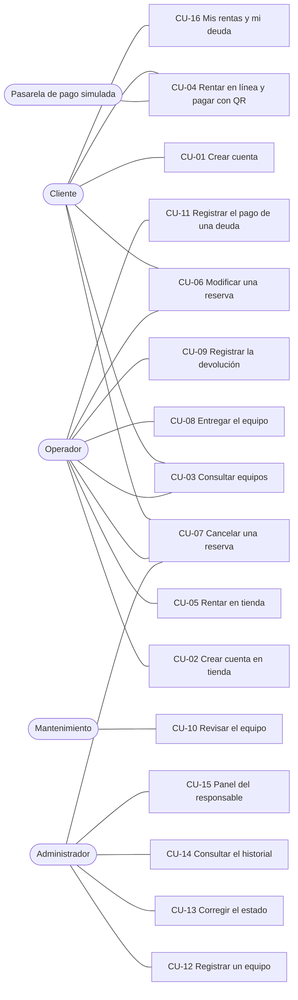

| CU | Nombre | Actor | Historia | Requisitos |
|---|---|---|---|---|
| [CU-01](#cu-01--crear-cuenta) | Crear cuenta | Cliente | HU-01 | RF-15 |
| [CU-02](#cu-02--crear-cuenta-en-tienda) | Crear cuenta en tienda | Operador | HU-02 | RF-15 |
| [CU-03](#cu-03--consultar-equipos-y-disponibilidad) | Consultar equipos y disponibilidad (filtros y paginación) | Cliente, Operador | HU-03 | RF-17 |
| [CU-04](#cu-04--rentar-en-línea-y-pagar-con-qr-simulado) | Rentar en línea y pagar con QR simulado | Cliente, Pasarela | HU-04 | RF-01 a RF-04, RF-13 |
| [CU-05](#cu-05--rentar-en-tienda) | Rentar en tienda (efectivo) | Operador | HU-05 | RF-01 a RF-03, RF-05, RF-13 |
| [CU-06](#cu-06--modificar-una-reserva) | Modificar una reserva | Cliente, Operador | HU-06 | RF-14 |
| [CU-07](#cu-07--cancelar-una-reserva) | Cancelar una reserva | Cliente, Operador, Administrador | HU-07 | RF-14 |
| [CU-08](#cu-08--entregar-el-equipo) | Entregar el equipo (cobra si el pago está pendiente) | Operador | HU-08 | RF-06, RF-07 |
| [CU-09](#cu-09--registrar-la-devolución) | Registrar la devolución (deuda por atraso) | Operador | HU-09 | RF-09, RF-12 |
| [CU-10](#cu-10--revisar-el-equipo) | Revisar el equipo (deuda por daño; cancela las reservas futuras si es baja) | Mantenimiento | HU-10 | RF-10, RF-11 |
| [CU-11](#cu-11--registrar-el-pago-de-una-deuda) | Registrar el pago de una deuda | Operador | HU-11 | RF-12 |
| [CU-12](#cu-12--registrar-un-equipo) | Registrar un equipo | Administrador | HU-12 | RF-16 |
| [CU-13](#cu-13--corregir-el-estado-de-un-equipo) | Corregir el estado de un equipo | Administrador | HU-13 | RF-21 |
| [CU-14](#cu-14--consultar-el-historial) | Consultar el historial (admin de Django) | Administrador | HU-14 | RF-10 |
| [CU-15](#cu-15--ver-el-panel-del-responsable) | Ver el panel del responsable | Administrador | HU-15 | RF-18 |
| [CU-16](#cu-16--consultar-mis-rentas-y-mi-deuda) | Consultar mis rentas y mi deuda | Cliente | HU-16 | RF-12, RF-19 |

## 2. Requisitos funcionales

| ID | Requisito | Origen | Dónde se cumple |
|---|---|---|---|
| RF-01 | Un equipo no tiene dos rentas con fechas que se crucen. Si chocan, se dice cuándo está ocupado y hasta cuándo está libre. Gana el primero que confirma. | ENT-21, ENT-36, ENT-45, PRE-04 | `renting.create_rental`, `rules.periods_overlap` |
| RF-02 | Recojo desde las 18:00, devolución hasta las 09:00, máximo 5 días. | ENT-18, ENT-19, ENT-52, ENT-72 | `renting.check_period`, `rules.py` |
| RF-03 | El precio diario es el 5 % del valor del equipo, se fija al crear la renta y no cambia. Total = días × precio diario; los días son los que hay entre la fecha de recojo y la de devolución. | ENT-71, ENT-72 | `rules.daily_price_for`, `rules.rental_days`, `Rental.total_price` |
| RF-04 | La renta en línea se paga con un QR simulado. Si el pago falla, la reserva queda hecha con el pago pendiente. | ENT-66, ENT-67 | `payments.pay_with_qr` |
| RF-05 | La renta en tienda se paga en efectivo al registrarla; si el cliente se lo lleva en ese momento, nace «Rentada». | ENT-57, ENT-70, PRE-03 | `renting.create_rental` |
| RF-06 | No se entrega un equipo sin pagar: el operador cobra en efectivo o cancela la reserva. | ENT-68 | `handover.register_pickup` |
| RF-07 | Una reserva no recogida hasta la medianoche de su día de inicio pasa sola a «No recogida» y libera el equipo. | ENT-69 | `rules.is_pickup_expired`, `Rental.status_at` |
| RF-08 | El estado de la renta se calcula, no se guarda: Cancelada > Devuelta > Rentada > No recogida > Reservada. | ENT-57, ENT-61 | `Rental.status_at` |
| RF-09 | La devolución hasta las 09:00 del día de vencimiento es a tiempo; hasta las 12:00, tolerancia sin cobro; desde las 12:01, deuda por atraso = días de atraso × precio diario. | ENT-73, PRE-05 | `rules.classify_return`, `rules.late_days`, `handover.register_return` |
| RF-10 | El equipo devuelto pasa a «En revisión»; mantenimiento decide disponible, en reparación o baja (definitiva). Cada cambio queda en el historial con quién, cuándo y por qué. | ENT-03, ENT-34, ENT-49, PRE-06, PRE-07 | `history.change_status`, `review.review_equipment` |
| RF-11 | Reparación crea una deuda del 20 % del valor y baja una del 100 %, para el cliente de la última renta devuelta. Las deudas por daño de una renta nunca suman más que el valor: una baja después de una reparación cobra el 80 % (D-06). La baja cancela las reservas futuras del equipo y avisa por correo. | ENT-74 | `review.review_equipment` |
| RF-12 | Cada deuda es de una renta y un motivo, y se paga una por una; el operador registra el pago. La deuda total se calcula y se muestra. | ENT-76, ENT-78 | `payments.pay_debt`, `payments.debt_total_of` |
| RF-13 | Un cliente con deuda pendiente no puede crear rentas, ni en línea ni en tienda; sí puede devolver. | ENT-77 | `renting.check_client_has_no_debt` |
| RF-14 | Solo una renta «Reservada» se cancela o modifica. El cliente, hasta 24 h antes del inicio; el operador o el admin, en cualquier momento antes del recojo. Modificar es cambiar las fechas con la misma cantidad de días. | ENT-80, ENT-81, ENT-82 | `renting.cancel_rental`, `renting.modify_rental` |
| RF-15 | El cliente crea su cuenta en la web o el operador en la tienda, con la misma función y las mismas reglas: correo y teléfono únicos, contraseña con al menos 8 caracteres, una mayúscula y un número. | ENT-15, ENT-54, ENT-84 | `accounts.registration.register_client` |
| RF-16 | Solo el admin registra equipos, a mano: código `AAA-00000` único, número de serie único, nombre y valor mayor que 0. | ENT-14, ENT-83, PRE-01 | `inventory.register_equipment`, `Equipment` |
| RF-17 | El catálogo se pagina de 20 en 20 y se filtra por código o nombre, por fechas libres y, para el personal, por estado. | ENT-86, PRE-02 | `renting.browse_catalog` (con `search_catalog` y `catalog_page`) |
| RF-18 | El responsable ve en una página las rentas activas, vencidas, reservas de hoy, pagos pendientes, equipos en revisión o reparación y deudas pendientes. | ENT-87, PRE-06, PRE-08 | `dashboard.manager_summary` |
| RF-19 | Cada rol ve solo lo suyo y el admin ve todo. Solo el admin bloquea a un usuario desmarcando «Activo»: con su contraseña correcta ve «Tu cuenta está desactivada. Comunícate con la tienda.», su sesión abierta deja de valer y la tienda ya no lo encuentra para rentarle. | ENT-53, ENT-55, ENT-79 | `roles.role_required`, `LoginForm.confirm_login_allowed`, `AUTHENTICATION_BACKENDS` |
| RF-20 | El cliente recibe un correo al crear su cuenta, al confirmar o cancelar una renta y al crearse una deuda. Si el correo falla, la operación sigue. | ENT-85 | `notifications.py` |
| RF-21 | El admin corrige el estado de un equipo desde el admin de Django, con historial y sin crear deudas. | ENT-40, ENT-75, PRE-07 | `rentals/admin.py`, `history.change_status` |

## 3. Requisitos de calidad

| ID | Atributo | Requisito medible | Cómo se comprueba |
|---|---|---|---|
| RC-01 | Rendimiento | Con 1000 equipos, el catálogo muestra páginas de 20 y hace la misma cantidad de consultas que con 20 equipos (ENT-02). | `tests/integration/test_catalogo.py` |
| RC-02 | Concurrencia | Si dos clientes confirman a la vez el mismo equipo y fechas, solo una renta se guarda; el segundo recibe «ocupado» (ENT-21, ENT-37). | `select_for_update` en cada escritura; el comando `stress_test` lo demuestra en vivo (lo hace otro integrante). |
| RC-03 | Seguridad | Cada página del personal responde 403 a otro rol; las contraseñas pasan los validadores; todo formulario lleva CSRF; los secretos viven en `.env`; `check --deploy` sin advertencias, salvo las de HTTPS en local. | `tests/integration/test_acceso.py`, `docs/decisiones-pendientes.md` |
| RC-04 | Usabilidad | Todo rechazo dice en una frase qué pasó y qué hacer, sin términos técnicos; los formularios muestran los requisitos antes de enviar; las páginas se usan sin desplazamiento horizontal en un celular de 360 px y una tablet de 600 px (ENT-01, ENT-42). | Mensajes exactos en las pruebas; revisión en el navegador con el modo de dispositivo. |
| RC-05 | Trazabilidad | Cada operación, aceptada o rechazada, escribe una línea en `logs/negocio.log`; cada cambio de estado de un equipo queda en el historial. | Pruebas con `caplog`; admin «Cambios de estado». |
| RC-06 | Mantenibilidad | Tasas y formatos en `settings.py`; cada regla tiene prueba de aceptación, límite y rechazo; el CI corre todo en cada push. | `python -m pytest -q`, GitHub Actions |
| RC-07 | Despliegue | Desde cero, el sistema queda funcionando con `docker compose up --build` siguiendo el README, o a mano en Windows. | README, caminos A y B |
| RC-08 | Compatibilidad | Funciona en las versiones actuales de Chrome y Firefox. | Revisión manual antes de la entrega |

## 4. Historias de usuario

| ID | Historia | Dado | Cuando | Entonces |
|---|---|---|---|---|
| HU-01 | Como **cliente**, quiero crear mi cuenta para rentar. | No tengo cuenta | Lleno el formulario y presiono «Registrarme» | Veo «Cuenta creada» y recibo un correo de bienvenida; si algo falla, veo todas las causas juntas y no se guarda nada. |
| HU-02 | Como **operador**, quiero crear la cuenta de un cliente en la tienda. | El cliente no tiene cuenta | Lleno sus datos | La cuenta queda creada con las mismas reglas que en la web y puedo rentarle de inmediato. |
| HU-03 | Como **cliente**, quiero buscar equipos libres en mis fechas. | Hay 1000 equipos | Escribo «silla» y elijo dos fechas | Veo solo las sillas libres en esas fechas, de 20 en 20. |
| HU-04 | Como **cliente**, quiero rentar y pagar en línea. | Las fechas están libres y no debo nada | Confirmo y pago con el QR | La renta queda «Reservada» y pagada; si el pago falla, queda reservada con el pago pendiente. |
| HU-05 | Como **operador**, quiero rentar a un cliente en la tienda. | El cliente paga en efectivo | Registro la renta | Queda pagada en efectivo; si se lo lleva ahora, nace «Rentada». |
| HU-06 | Como **cliente**, quiero cambiar las fechas de mi reserva. | Faltan más de 24 h para el recojo | Elijo otras fechas con los mismos días | La reserva cambia de fechas y el precio no cambia. |
| HU-07 | Como **cliente**, quiero cancelar mi reserva. | Faltan más de 24 h | Presiono «Cancelar» | La reserva queda «Cancelada», recibo un correo y las fechas quedan libres. |
| HU-08 | Como **operador**, quiero entregar el equipo solo si está pagado. | La reserva tiene el pago pendiente | El cliente paga en efectivo | Se registra el pago y el recojo; si no paga, cancelo la reserva. |
| HU-09 | Como **operador**, quiero registrar la devolución y cobrar el atraso. | La renta venció el día 10 | El equipo vuelve el 11 a las 12:01 | Se crea una deuda de 2 días × precio diario y el equipo pasa a revisión. |
| HU-10 | Como **mantenimiento**, quiero decidir qué pasa con un equipo devuelto. | El equipo está en revisión | Elijo «Baja» | Se crea la deuda del 100 % y se cancelan sus reservas futuras con aviso por correo. |
| HU-11 | Como **operador**, quiero registrar que un cliente pagó su deuda. | El cliente debe 40 Bs | Registro el pago | La deuda queda pagada con mi usuario y el cliente puede volver a rentar. |
| HU-12 | Como **admin**, quiero registrar un equipo nuevo. | Tengo el código, la serie, el nombre y el valor | Guardo | El equipo queda «Disponible»; si el código no es `AAA-00000` o se repite, veo la causa. |
| HU-13 | Como **admin**, quiero corregir el estado de un equipo. | El equipo no está de baja | Elijo la acción en el admin | Cambia de estado, queda en el historial y no se crea deuda. |
| HU-14 | Como **admin**, quiero ver la historia de un equipo. | Hubo cambios | Abro «Cambios de estado» | Veo quién, cuándo, de qué a qué y por qué, sin poder editarlo. |
| HU-15 | Como **responsable**, quiero ver lo urgente en una página. | Hay rentas vencidas y deudas | Abro el panel | Veo cada lista con su total y un enlace a su vista del admin. |
| HU-16 | Como **cliente**, quiero ver mis rentas, mis pagos y mi deuda. | Tengo rentas y una deuda | Abro «Mis rentas» | Veo el estado de cada renta, si está pagada y el total que debo. |

## 5. Casos de uso

**Cómo leer los diagramas:** la flecha continua es una llamada y la punteada, la respuesta. En `alt`, el rechazo va primero y **no guarda nada**. «Bloquea la fila» es `SELECT … FOR UPDATE`: si dos personas hacen clic a la vez, la segunda espera y ve lo que guardó la primera. Antes de cada vista, el middleware de Django carga la sesión, revisa el token CSRF e identifica al usuario.

**Iniciar sesión:** con un usuario o una contraseña incorrectos se ve «Usuario o contraseña incorrectos.». Una cuenta desactivada por el admin ve «Tu cuenta está desactivada. Comunícate con la tienda.» solo si escribió su contraseña correcta, así el mensaje no da pistas a quien adivina cuentas; el log escribe `LOGIN_REJECTED reason=inactive user=cl01`. Si se desactiva con la sesión abierta, en su siguiente clic vuelve al login (ENT-79).

**Log:** cada operación escribe una línea en `logs/negocio.log` con el formato `2026-10-29 10:15:02 | INFO    | RENTAL_CREATED id=12 equipment=SIL-00001 client=cl01 paid=no`. Cada rechazo escribe `<ACCIÓN>_REJECTED reason="…"` con nivel `WARNING`. Nunca se escribe una contraseña.

---

### CU-01 — Crear cuenta

| | |
|---|---|
| **Actor** | Cliente (sin sesión) |
| **Precondición** | No tiene cuenta. |
| **Flujo normal** | 1. En «Iniciar sesión» presiona «Crear cuenta». 2. Escribe nombre, apellido, correo, teléfono, usuario, contraseña y su confirmación (la página muestra los requisitos de la contraseña). 3. Presiona «Registrarme». 4. Vuelve a «Iniciar sesión» con «Cuenta creada. Ya puedes iniciar sesión con cl03.». |
| **Flujos alternativos** | Si alguna regla falla, se queda en el formulario con los datos escritos (menos las contraseñas) y el título «No se creó la cuenta:» seguido de **todas** las causas: «Falta el campo Correo.» · «El correo no es válido.» · «El teléfono debe tener entre 7 y 15 números.» · «El usuario solo puede tener letras, números y los signos @ . + - _» · «Las contraseñas no coinciden.» · «La contraseña necesita al menos una mayúscula.» · «La contraseña necesita al menos un número.» · los mensajes de Django para contraseñas cortas, comunes, solo numéricas o parecidas al usuario · «El usuario cl03 ya existe.» · «El correo ya está registrado.» · «El teléfono ya está registrado.» |
| **Postcondición** | Existe un usuario con rol «cliente» que puede iniciar sesión. |
| **Guarda** | Una fila en `accounts_user` con la contraseña cifrada (`set_password`) y el teléfono solo con dígitos. |
| **Log** | `ACCOUNT_CREATED id=7 username=cl03 role=cliente registered_by=web` · `ACCOUNT_REJECTED reason="No se creó la cuenta: El usuario cl03 ya existe."` |
| **Correo** | Bienvenida. |
| **Origen** | ENT-15, ENT-84, PRE-01 |

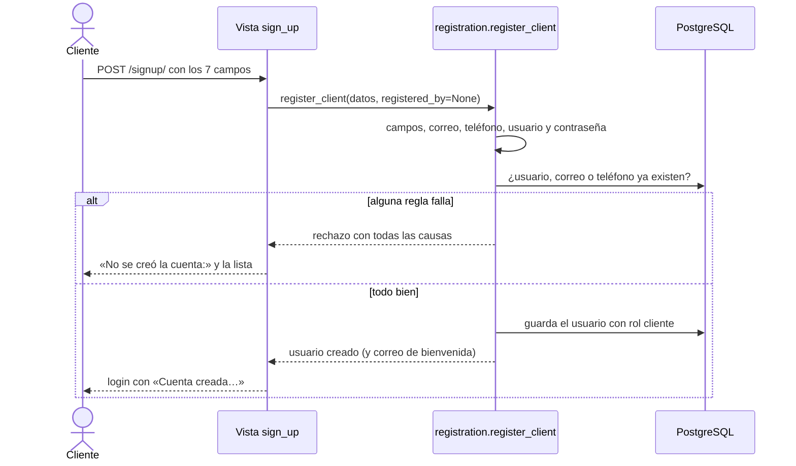

---

### CU-02 — Crear cuenta en tienda

| | |
|---|---|
| **Actor** | Operador (`op01`) |
| **Precondición** | El cliente está en la tienda y no tiene cuenta. |
| **Flujo normal** | 1. Abre «Nuevo cliente». 2. Escribe los datos del cliente; el cliente escribe su contraseña. 3. Presiona «Registrar cliente». 4. Va a «Renta en tienda» con el cliente ya buscado y «Cuenta creada para cl03. Ya puedes registrar su renta.». |
| **Flujos alternativos** | Los mismos de CU-01, con el título «No se creó la cuenta:». |
| **Postcondición** | Igual que CU-01. |
| **Guarda** | Igual que CU-01. |
| **Log** | `ACCOUNT_CREATED id=8 username=cl04 role=cliente registered_by=op01` |
| **Correo** | Bienvenida. |
| **Origen** | ENT-54 («si el cliente no tiene cuenta, el operador puede registrarla»), ENT-84 |

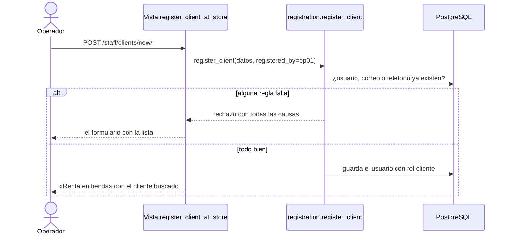

---

### CU-03 — Consultar equipos y disponibilidad

| | |
|---|---|
| **Actor** | Cliente; operador (también ve el filtro por estado) |
| **Precondición** | Tiene sesión. |
| **Flujo normal** | 1. Abre el catálogo: ve 20 equipos por página, cada uno con su precio por día y sus próximos periodos ocupados. 2. Escribe un código o un nombre, o elige «Libre desde» y «Libre hasta». 3. Presiona «Buscar» y ve solo los equipos que cumplen. 4. Pasa de página con «Anterior» y «Siguiente». |
| **Flujos alternativos** | Solo una fecha: «Elige las dos fechas para ver los equipos libres.» · Fecha final antes de la inicial: «La fecha final debe ser posterior a la inicial.» · Sin resultados: «No hay equipos que coincidan con la búsqueda.» |
| **Postcondición** | No cambia nada. |
| **Guarda** | Nada. |
| **Log** | Nada (es una consulta). |
| **Origen** | ENT-02 (unos 1000 equipos), ENT-64, ENT-86, PRE-02 |

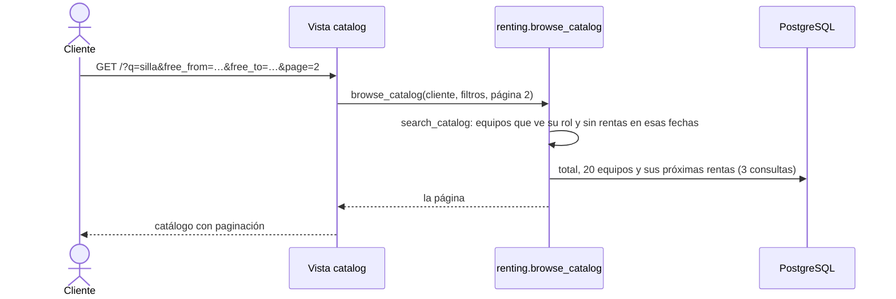

---

### CU-04 — Rentar en línea y pagar con QR simulado

| | |
|---|---|
| **Actor** | Cliente (`cl01`); Pasarela de pago simulada |
| **Precondición** | Tiene sesión y no tiene deuda pendiente. |
| **Flujo normal** | 1. En el catálogo presiona «Rentar» en un equipo. 2. Elige fecha y hora de recojo y de devolución y presiona «Continuar al pago». 3. La reserva queda guardada con el pago pendiente y ve la pantalla del QR con el total. 4. Presiona «Simular pago exitoso». 5. Ve la renta con «Pago recibido. Tu renta está confirmada.» y recibe el correo de confirmación. |
| **Flujos alternativos** | 4a. Presiona «Simular pago fallido»: la reserva sigue hecha y ve «Tu reserva está hecha, pero el pago no se completó. Paga en la tienda al recoger el equipo.»; recibe el correo con el pago pendiente. · 2a. Debe dinero: «Tienes una deuda pendiente de 40,00 Bs. Págala en la tienda para volver a rentar.» · 2b. Fechas ocupadas: vuelve al catálogo con «El equipo MES-00002 está ocupado del 05/11/2026 18:00 al 07/11/2026 09:00. Está libre hasta el 05/11/2026 a las 09:00.» · 2c. Horario o duración: «El recojo debe ser desde las 18:00.» · «La devolución debe ser hasta las 09:00.» · «La renta no puede durar más de 5 días.» · «La fecha y hora de devolución debe ser posterior a la de recojo.» · 2d. Equipo no disponible: «El equipo MES-00002 no está disponible (estado: En revisión).» · 4b. Ya pagada: «La renta de MES-00002 ya está pagada.» |
| **Postcondición** | La renta queda «Reservada», pagada con QR o con el pago pendiente. |
| **Guarda** | Una fila en `rentals_rental` con `daily_price` (5 % del valor); con el pago exitoso, `paid_at` y `payment_method = qr`. |
| **Log** | `RENTAL_CREATED id=12 equipment=MES-00002 client=cl01 paid=no registered_by=web` · `PAYMENT_APPROVED rental=12 amount=40.00` · `PAYMENT_FAILED rental=12 amount=40.00` · `RENTAL_REJECTED reason="…"` · `PAYMENT_REJECTED reason="…"` |
| **Correo** | Renta confirmada (pagada o con el pago pendiente). |
| **Origen** | ENT-16, ENT-21, ENT-48, ENT-66, ENT-67, ENT-71, ENT-77, PRE-03, PRE-04 |

```mermaid
sequenceDiagram
    actor C as Cliente
    participant V as Vistas rent_equipment y pay_rental
    participant U as renting.create_rental y payments.pay_with_qr
    participant BD as PostgreSQL
    C->>V: POST /equipment/MES-00002/rent/
    V->>U: create_rental(cl01, MES-00002, inicio, fin)
    U->>BD: ¿deuda pendiente? bloquea el equipo y lee sus rentas
    alt deuda, horario o fechas ocupadas
        U-->>V: rechazo con la causa
        V-->>C: el formulario o el catálogo con el mensaje
    else libre
        U->>BD: guarda la renta con daily_price
        V-->>C: pantalla del QR con el total
        C->>V: POST /rentals/12/pay/ (exitoso o fallido)
        V->>U: pay_with_qr(renta, cl01, aprobado)
        U->>BD: bloquea la renta; si aprobado, guarda paid_at y qr
        V-->>C: la renta con el mensaje del pago
    end
```

---

### CU-05 — Rentar en tienda

| | |
|---|---|
| **Actor** | Operador (`op01`) |
| **Precondición** | El cliente tiene cuenta (si no, CU-02) y paga en efectivo. |
| **Flujo normal** | 1. Abre «Renta en tienda» y busca al cliente («rojas»). 2. Lo elige, elige el equipo y las fechas, y marca «Se lo lleva ahora» si corresponde. 3. Cobra en efectivo y presiona «Registrar renta». 4. Ve la renta con «Registrada por op01» y «Pagado (efectivo)». |
| **Flujos alternativos** | El cliente debe dinero: «El cliente cl02 tiene una deuda pendiente de 40,00 Bs. Cóbrala antes de registrar otra renta.» · Los demás, iguales a CU-04. |
| **Postcondición** | La renta queda pagada en efectivo, «Reservada» o, con «Se lo lleva ahora», «Rentada». |
| **Guarda** | Una fila en `rentals_rental` con `daily_price`, `paid_at`, `payment_method = cash` y `registered_by`; con «Se lo lleva ahora», también `picked_up_at` y `handed_over_by`. |
| **Log** | `RENTAL_CREATED id=13 equipment=MES-00008 client=cl02 paid=yes registered_by=op01` · `PAYMENT_CASH rental=13 amount=40.00 received_by=op01` · `RENTAL_REJECTED reason="…"` |
| **Correo** | Renta confirmada (pagada). |
| **Origen** | ENT-54, ENT-57, ENT-70, ENT-77, PRE-03 |

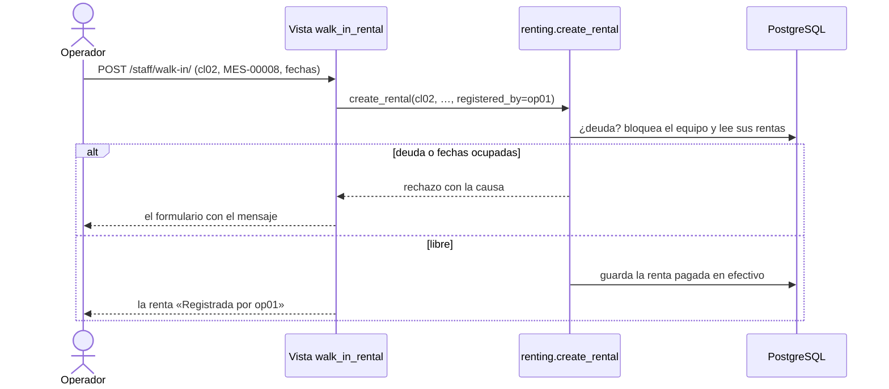

---

### CU-06 — Modificar una reserva

| | |
|---|---|
| **Actor** | Cliente (sus reservas, hasta 24 h antes); operador o admin (cualquier reserva, antes del recojo) |
| **Precondición** | La renta está «Reservada». |
| **Flujo normal** | 1. En «Mis rentas» (o en «Reservas por entregar») presiona «Modificar». 2. Elige las fechas nuevas, con la misma cantidad de días. 3. Presiona «Guardar cambios». 4. Ve «Reserva modificada: MES-00001 ahora va del 06/11/2026 18:00 al 08/11/2026 09:00.». |
| **Flujos alternativos** | Faltan menos de 24 h y es el cliente: «Ya no puedes modificar en línea; comunícate con la tienda.» · Otra cantidad de días: «La reserva es de 2 días. Elige fechas con la misma cantidad de días; para cambiarla, cancela y renta de nuevo.» · Ya no está reservada: «La renta de MES-00001 ya fue entregada el 28/10/2026 18:30.» (o cancelada, devuelta, o «La reserva de MES-00001 venció a la medianoche.») · Fechas ocupadas u horario: los mensajes de CU-04. |
| **Postcondición** | La reserva tiene las fechas nuevas; el precio no cambia. |
| **Guarda** | `start_datetime` y `end_datetime` de la renta. |
| **Log** | `RENTAL_MODIFIED id=12 equipment=MES-00001 start=2026-11-06T18:00 end=2026-11-08T09:00 by=cl01` · `MODIFY_REJECTED reason="…"` |
| **Origen** | ENT-55, ENT-80, ENT-81 |

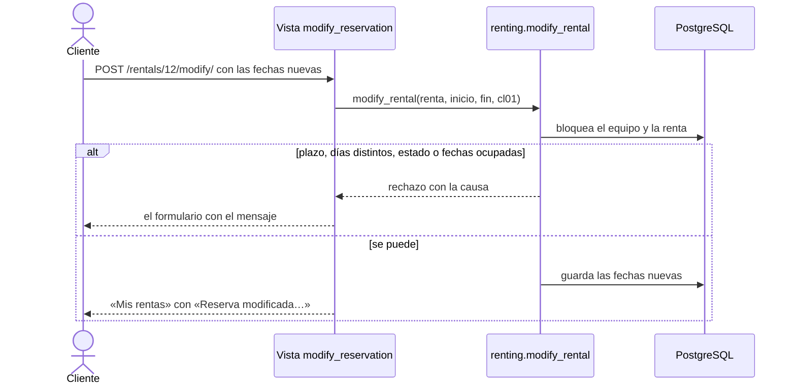

---

### CU-07 — Cancelar una reserva

| | |
|---|---|
| **Actor** | Cliente (hasta 24 h antes); operador o admin (antes del recojo; el admin también con la acción del admin) |
| **Precondición** | La renta está «Reservada». |
| **Flujo normal** | 1. Presiona «Cancelar» en la reserva. 2. Ve «Reserva cancelada: MES-00001 de cl01.». 3. El cliente recibe un correo con el motivo. |
| **Flujos alternativos** | Faltan menos de 24 h y es el cliente: «Ya no puedes cancelar en línea; comunícate con la tienda.» · Ya no está reservada: «La renta de MES-00001 ya fue cancelada el 27/10/2026 10:00.» (o entregada, devuelta, vencida). |
| **Postcondición** | La renta queda «Cancelada» y sus fechas quedan libres. La devolución del dinero ocurre fuera del sistema (ENT-82). |
| **Guarda** | `cancelled_at` y `cancelled_by`. |
| **Log** | `RENTAL_CANCELLED id=12 equipment=MES-00001 client=cl01 by=op01 reason="…"` · `CANCEL_REJECTED reason="…"` |
| **Correo** | Renta cancelada, con el motivo. |
| **Origen** | ENT-47, ENT-55, ENT-80, ENT-82 |

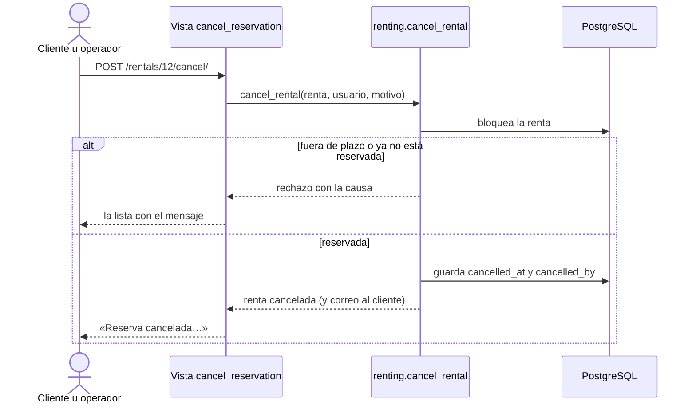

---

### CU-08 — Entregar el equipo

| | |
|---|---|
| **Actor** | Operador (`op01`) |
| **Precondición** | La renta está «Reservada». |
| **Flujo normal** | 1. Abre «Reservas por entregar». 2. Si está pagada, presiona «Registrar recojo». 3. Ve «Recojo registrado: MES-00001 entregado a cl01.». |
| **Flujos alternativos** | Pago pendiente: el botón dice «Cobrar 40,00 Bs y entregar»; al presionarlo se guarda el cobro en efectivo y el recojo, y ve «Cobro de 40,00 Bs en efectivo y recojo registrados: MES-00001 entregado a cl01.» · El cliente no paga: presiona «Cancelar» (CU-07). · Se intenta entregar sin cobrar: «Falta el pago de 40,00 Bs de esta renta. Cóbralo en efectivo o cancela la reserva si el cliente no paga.» · Ya no está reservada: «La reserva de MES-00001 venció a la medianoche.» (o entregada, cancelada, devuelta). |
| **Postcondición** | La renta queda «Rentada» y pagada. |
| **Guarda** | `picked_up_at` y `handed_over_by`; si se cobró, también `paid_at` y `payment_method = cash`. |
| **Log** | `PAYMENT_CASH rental=12 amount=40.00 received_by=op01` · `PICKUP_REGISTERED id=12 equipment=MES-00001 client=cl01 by=op01` · `PICKUP_REJECTED reason="…"` |
| **Origen** | ENT-56, ENT-57, ENT-68, ENT-69 |

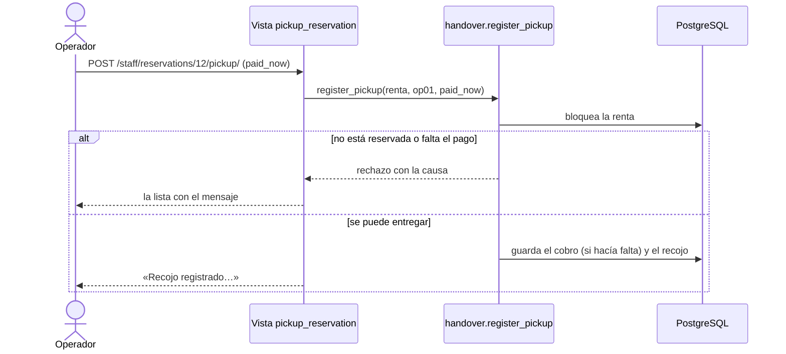

---

### CU-09 — Registrar la devolución

| | |
|---|---|
| **Actor** | Operador (`op01`) |
| **Precondición** | La renta no está cancelada ni devuelta. |
| **Flujo normal** | 1. Abre «Devoluciones pendientes». 2. Elige la renta y escribe cómo llegó el equipo. 3. Presiona «Registrar devolución». 4. Ve «Devolución registrada: MES-00004 recibido de cl01. A tiempo.» (o «En tolerancia, sin cobro.»). |
| **Flujos alternativos** | Llega desde las 12:01 del día de vencimiento: se crea la deuda y ve «… Con 2 días de atraso: deuda de 40,00 Bs.»; el cliente recibe el correo de la deuda. · Sin observación: «Escribe cómo llegó el equipo.» · Ya devuelta o cancelada: «La renta de MES-00004 ya fue devuelta el 28/10/2026 08:30.». |
| **Postcondición** | La renta queda «Devuelta» y el equipo «En revisión». |
| **Guarda** | `returned_at`, `received_by`, `return_note`; el estado del equipo y una fila en `rentals_statuschange`; con atraso, una fila en `rentals_debt` con `late_return`. |
| **Log** | `RETURN_REGISTERED id=12 equipment=MES-00004 client=cl01 by=op01 result=late late_days=2` · `STATUS_CHANGED equipment=MES-00004 old=available new=in_review by=op01` · `DEBT_CREATED id=3 rental=12 client=cl01 reason=late_return amount=40.00` · `RETURN_REJECTED reason="…"` |
| **Correo** | Deuda creada (si hubo atraso). |
| **Origen** | ENT-03, ENT-60, ENT-73, PRE-05 |

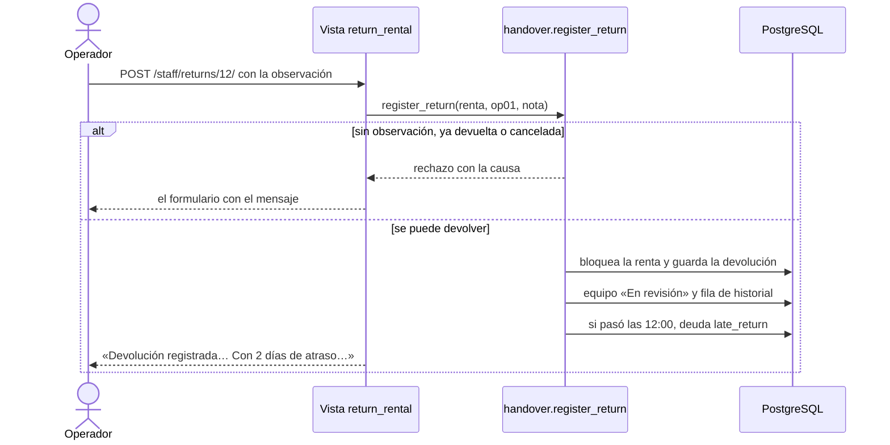

---

### CU-10 — Revisar el equipo

| | |
|---|---|
| **Actor** | Mantenimiento (`mt01`) |
| **Precondición** | El equipo está «En revisión» o «En reparación». |
| **Flujo normal** | 1. Abre «Mantenimiento». 2. Elige «Disponible», «En reparación» o «Baja» y escribe un comentario opcional. 3. Presiona «Guardar». 4. Ve «MES-00005 ahora está «Disponible».». |
| **Flujos alternativos** | En reparación: se crea la deuda del 20 % para el cliente de la última renta devuelta y ve «MES-00006 ahora está «En reparación». Deuda de 80,00 Bs para cl01.» · Baja: deuda del 100 % (o lo que falta para llegar al valor, si esa renta ya tenía la deuda de reparación: 320,00 Bs después de 80,00 Bs), se cancelan las reservas futuras del equipo (con correo a cada cliente) y ve «MES-00007 ahora está «Baja». Deuda de 400,00 Bs para cl02. Reservas futuras canceladas: 1.» · Sin renta devuelta antes, no hay a quién cobrar y no se crea deuda. · Rechazos: «El equipo MES-00007 está dado de baja; su estado ya no puede cambiar.» · «El equipo MES-00006 ya está «En reparación».» · «El equipo MES-00006 solo puede pasar a disponible, en reparación o baja.» |
| **Postcondición** | El equipo tiene su estado nuevo y queda en el historial. |
| **Guarda** | El estado del equipo y una fila en `rentals_statuschange`; con reparación o baja, una fila en `rentals_debt`; con baja, `cancelled_at` y `cancelled_by` (mantenimiento) en cada reserva futura. |
| **Log** | `STATUS_CHANGED equipment=MES-00007 old=in_review new=retired by=mt01` · `DEBT_CREATED id=4 rental=9 client=cl02 reason=retired amount=400.00` · `RENTAL_CANCELLED id=15 … by=mt01 reason="…"` · `REVIEW_REJECTED reason="…"` |
| **Correo** | Deuda creada; renta cancelada a cada cliente afectado. |
| **Origen** | ENT-03, ENT-34, ENT-47, ENT-49, ENT-74, PRE-06 |

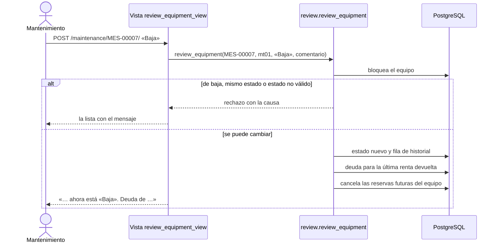

---

### CU-11 — Registrar el pago de una deuda

| | |
|---|---|
| **Actor** | Operador (`op01`) |
| **Precondición** | El cliente tiene una deuda pendiente y paga en la tienda. |
| **Flujo normal** | 1. Abre «Deudas»: ve las deudas pendientes y el total por cliente. 2. Cobra y presiona «Registrar pago» en una deuda. 3. Ve «Pago registrado: deuda de 40,00 Bs de cl02.». |
| **Flujos alternativos** | Ya pagada (por ejemplo, otro operador hizo clic antes): «Esta deuda ya se pagó el 28/10/2026 10:00.» |
| **Postcondición** | La deuda queda pagada; si era la última, el cliente puede volver a rentar. |
| **Guarda** | `paid_at` y `paid_received_by` en esa deuda. |
| **Log** | `DEBT_PAID id=3 client=cl02 amount=40.00 received_by=op01` · `DEBT_PAYMENT_REJECTED reason="…"` |
| **Origen** | ENT-76, ENT-77, ENT-78 |

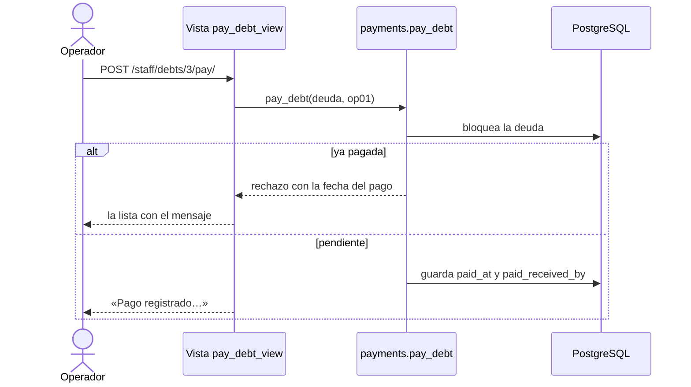

---

### CU-12 — Registrar un equipo

| | |
|---|---|
| **Actor** | Administrador (`ad01`) |
| **Precondición** | Tiene el código, el número de serie, el nombre y el valor de compra. |
| **Flujo normal** | 1. Abre «Registrar equipo». 2. Escribe el código (`mes-00021` se guarda como `MES-00021`), la serie, el nombre y el valor. 3. Presiona «Registrar equipo». 4. Ve «Equipo registrado: MES-00021 · Mesa plegable 1,80 m.». |
| **Flujos alternativos** | Se queda en el formulario con «No se registró el equipo:» y las causas: «El código debe tener 3 letras, un guion y 5 números, por ejemplo MES-00001.» · «Ya existe un equipo con este código.» · «Ya existe un equipo con este número de serie.» · «El valor debe ser mayor que 0.» · «Falta el campo Nombre.». También se puede registrar en el admin de Django, con las mismas validaciones. |
| **Postcondición** | El equipo existe, «Disponible», y aparece en el catálogo. |
| **Guarda** | Una fila en `rentals_equipment` con `created_at`. |
| **Log** | `EQUIPMENT_REGISTERED id=21 equipment=MES-00021 value=400.00 by=ad01` · `EQUIPMENT_REJECTED reason="…"` |
| **Origen** | ENT-09, ENT-14, ENT-83, PRE-01 |

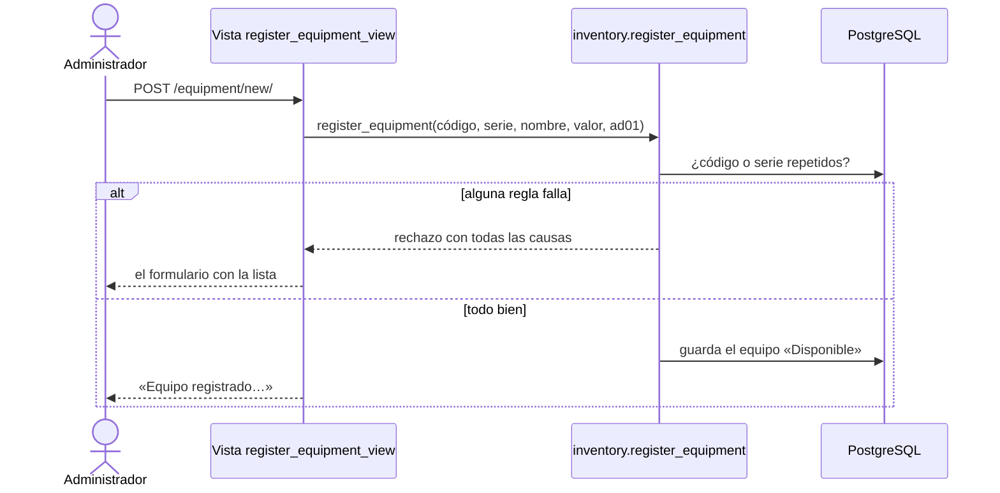

---

### CU-13 — Corregir el estado de un equipo

| | |
|---|---|
| **Actor** | Administrador (`ad01`) |
| **Precondición** | Está en el admin de Django. |
| **Flujo normal** | 1. En «Equipos» marca uno o varios. 2. Elige «Marcar disponible», «Mandar a reparación» o «Dar de baja». 3. Ve «Equipos actualizados: 1.». |
| **Flujos alternativos** | De baja o ya en ese estado: aparecen en «No se cambiaron: MES-00007.». |
| **Postcondición** | El estado cambia y queda en el historial. **No crea deudas** ni cancela reservas (ENT-75): es una corrección, no una revisión. |
| **Guarda** | El estado del equipo y una fila en `rentals_statuschange`. |
| **Log** | `STATUS_CHANGED equipment=MES-00002 old=available new=in_repair by=ad01` · `STATUS_CHANGE_REJECTED reason="…"` |
| **Origen** | ENT-40, ENT-50, ENT-75, PRE-07 |

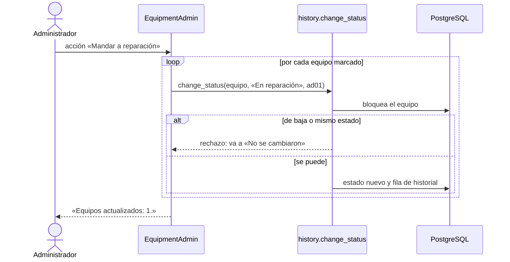

---

### CU-14 — Consultar el historial

| | |
|---|---|
| **Actor** | Administrador (`ad01`) |
| **Precondición** | Está en el admin de Django. |
| **Flujo normal** | 1. Abre «Cambios de estado». 2. Filtra por estado nuevo o busca un código. 3. Ve quién, cuándo, de qué a qué y por qué. |
| **Flujos alternativos** | No puede agregar, editar ni borrar filas: el historial es evidencia. |
| **Postcondición** | No cambia nada. |
| **Guarda** | Nada. |
| **Log** | Nada. |
| **Origen** | ENT-34, PRE-07, PRE-08 |

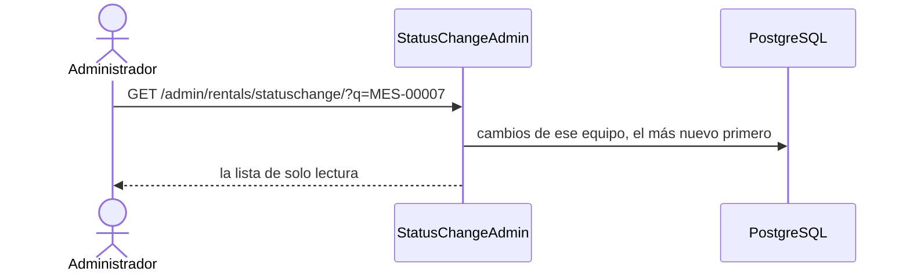

---

### CU-15 — Ver el panel del responsable

| | |
|---|---|
| **Actor** | Administrador (`ad01`): al iniciar sesión llega aquí |
| **Precondición** | Tiene el rol administrador. |
| **Flujo normal** | 1. Abre «Panel». 2. Ve seis listas con su cantidad: rentas activas, rentas vencidas (pasó la devolución y no se devolvió), reservas de hoy, reservas con pago pendiente, equipos en revisión o reparación y deudas pendientes (total y por cliente). 3. Presiona «Ver en el admin» en una lista y llega a esa misma lista filtrada en el admin. |
| **Flujos alternativos** | Lista vacía: «Nada por aquí.» |
| **Postcondición** | No cambia nada. |
| **Guarda** | Nada. |
| **Log** | Nada. |
| **Origen** | ENT-87, PRE-06, PRE-08 |

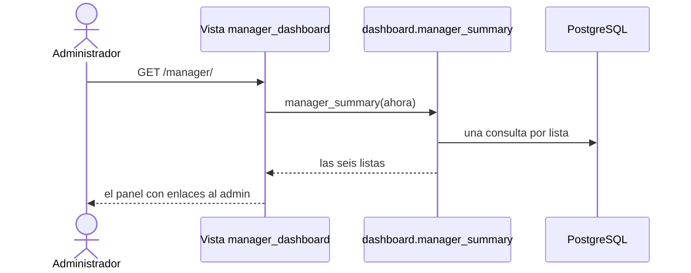

---

### CU-16 — Consultar mis rentas y mi deuda

| | |
|---|---|
| **Actor** | Cliente (`cl02`) |
| **Precondición** | Tiene sesión. |
| **Flujo normal** | 1. Abre «Mis rentas». 2. Ve cada renta con sus fechas, total, estado y pago («Pagado (QR)», «Pagado (efectivo)» o «Pago pendiente»). 3. Si debe, ve arriba «Tienes una deuda pendiente de 40,00 Bs. Págala en la tienda para volver a rentar.» y el detalle de cada deuda. 4. En sus reservas ve «Modificar» y «Cancelar». |
| **Flujos alternativos** | Sin rentas: «Todavía no tienes rentas.» |
| **Postcondición** | No cambia nada. |
| **Guarda** | Nada. |
| **Log** | Nada. |
| **Origen** | ENT-55, ENT-76, PRE-08 |

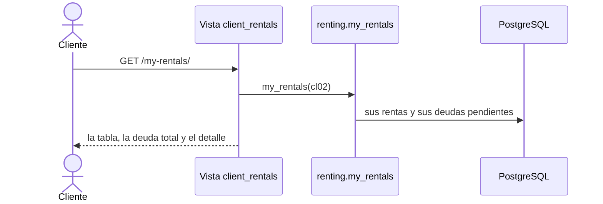

---

## 6. Qué guarda cada botón

| Botón | Función | Qué cambia en la base |
|---|---|---|
| Registrarme / Registrar cliente | `registration.register_client` | Una fila en `accounts_user` |
| Continuar al pago / Registrar renta | `renting.create_rental` | Una fila en `rentals_rental` (en tienda, ya pagada) |
| Simular pago exitoso | `payments.pay_with_qr` | `paid_at`, `payment_method` |
| Guardar cambios (modificar) | `renting.modify_rental` | `start_datetime`, `end_datetime` |
| Cancelar | `renting.cancel_rental` | `cancelled_at`, `cancelled_by` |
| Registrar recojo / Cobrar y entregar | `handover.register_pickup` | `picked_up_at`, `handed_over_by` (y `paid_at`, `payment_method`) |
| Registrar devolución | `handover.register_return` | `returned_at`, `received_by`, `return_note`, estado del equipo, historial y, con atraso, una deuda |
| Guardar (mantenimiento) | `review.review_equipment` | Estado del equipo, historial, deuda y reservas canceladas si es baja |
| Registrar pago (deuda) | `payments.pay_debt` | `paid_at`, `paid_received_by` |
| Registrar equipo | `inventory.register_equipment` | Una fila en `rentals_equipment` |
| Acciones del admin | `history.change_status`, `renting.cancel_rental`, `payments.pay_debt` | Lo mismo que arriba |
| Guardar (admin de usuarios, «Activo») | `UserAdmin.save_model` | `is_active`; el log escribe `ACCOUNT_DEACTIVATED user=cl01 by=ad01` o `ACCOUNT_REACTIVATED` |

## 7. Fuera de alcance

| Qué | Por qué no |
|---|---|
| PIN o verificación por SMS | Necesita un proveedor de SMS pagado; el equipo decidió registrar con correo y teléfono únicos (ENT-84). |
| Notificaciones por SMS, WhatsApp o Telegram | Cada canal necesita una cuenta de empresa y un proveedor; el correo cubre los avisos que definió el equipo (ENT-85). |
| Login con Google | Exige registrar la app en Google y no lo pidió el cliente; el usuario y la contraseña bastan. |
| Lector de código de barras o RFID | Necesita hardware; el admin escribe el código a mano (ENT-83). |
| Importación masiva de equipos | El cliente dijo que «puede mega esperar» (ENT-14). |
| Cliente frecuente | El cliente no definió qué lo hace frecuente (ENT-20); todos rentan como máximo 5 días. |
| Cobro forzoso y reporte de pérdidas | El sistema no cobra a la fuerza: la deuda queda visible y bloquea nuevas rentas (ENT-78). |
| Garantía | El precio no la separa; el daño se cobra como deuda de reparación o baja (ENT-74). |
| Validación real del pago | El QR es simulado (ENT-66); `payments.pay_with_qr` recibe solo «aprobado o no», así una pasarela real se conecta sin tocar la renta (ENT-48). |
