# Casos de uso · versión final

> Versión del 29/10/2026, para la entrega del 30/10, con las respuestas del cliente del 28/10 (ENT-88 a ENT-98) y lo que pidió al revisar el sistema el 29/10 (ENT-99 a ENT-104). Reemplaza a la versión del MVP (19/10).
> Las respuestas del cliente (ENT-xx) están en [respuestas-del-cliente.md](respuestas-del-cliente.md); ahí cada ENT dice qué parte dijo el cliente y qué parte es una decisión del equipo. Las decisiones del equipo (D-xx), en [decisiones.md](decisiones.md). Las necesidades del encargo (PRE-xx), en [presentacion12-10.md](presentacion12-10.md). La base de datos está en [base-de-datos.md](base-de-datos.md).

## 1. Mapa


| CU | Nombre | Actor | Historia | Requisitos |
|---|---|---|---|---|
| [CU-01](#cu-01--crear-cuenta) | Crear cuenta | Cliente | HU-01 | RF-15 |
| [CU-02](#cu-02--crear-cuenta-en-tienda) | Crear cuenta en tienda (sin la contraseña del cliente) | Operador | HU-02 | RF-15, RF-20 |
| [CU-03](#cu-03--consultar-equipos-y-disponibilidad) | Consultar equipos y disponibilidad (filtros y paginación, sin etiquetas de libre u ocupado) | Cliente, Operador | HU-03 | RF-17 |
| [CU-04](#cu-04--rentar-en-línea-y-pagar-con-qr-simulado) | Rentar en línea y pagar con QR simulado | Cliente, Pasarela | HU-04 | RF-01 a RF-04, RF-13 |
| [CU-05](#cu-05--rentar-en-tienda) | Rentar en tienda (efectivo) | Operador | HU-05 | RF-01 a RF-03, RF-05, RF-13 |
| [CU-06](#cu-06--modificar-una-reserva) | Modificar una reserva | Cliente, Operador | HU-06 | RF-14 |
| [CU-07](#cu-07--cancelar-una-reserva) | Cancelar una reserva | Cliente, Operador, Administrador | HU-07 | RF-14 |
| [CU-08](#cu-08--entregar-el-equipo) | Entregar el equipo (cobra si el pago está pendiente) | Operador | HU-08 | RF-06, RF-07, RF-24 |
| [CU-09](#cu-09--registrar-la-devolución) | Registrar la devolución (deuda por atraso) | Operador | HU-09 | RF-09, RF-12, RF-24 |
| [CU-10](#cu-10--revisar-el-equipo) | Revisar cualquier equipo (cobra el daño solo si mantenimiento lo decide; reparación o baja cancelan las reservas) | Mantenimiento | HU-10 | RF-10, RF-11 |
| [CU-11](#cu-11--registrar-el-pago-de-una-deuda) | Registrar el pago de una deuda | Operador | HU-11 | RF-12, RF-24 |
| [CU-12](#cu-12--registrar-un-equipo) | Registrar un equipo | Administrador | HU-12 | RF-16 |
| [CU-13](#cu-13--corregir-el-estado-de-un-equipo) | Corregir el estado de un equipo (nunca cobra; reparación o baja cancelan las reservas) | Administrador | HU-13 | RF-21 |
| [CU-14](#cu-14--consultar-el-historial) | Consultar el historial (admin de Django) | Administrador | HU-14 | RF-10 |
| [CU-15](#cu-15--ver-el-panel-del-responsable) | Ver el panel del responsable | Administrador | HU-15 | RF-18, RF-24 |
| [CU-16](#cu-16--consultar-mis-rentas-y-mi-deuda) | Consultar mis rentas y mi deuda | Cliente | HU-16 | RF-12, RF-19, RF-25 |
| [CU-17](#cu-17--gestionar-mi-cuenta) | Gestionar mi cuenta (cambiar contraseña, editar datos, recuperar contraseña) | Cliente (y cualquier usuario con sesión) | HU-17 | RF-23 |

## 2. Requisitos funcionales

Las funciones de «Dónde se cumple» están en `rentals/use_cases/` (por ejemplo `renting.create_rental` es `rentals/use_cases/renting.py`), salvo que se diga otra carpeta; las reglas puras, en `rentals/rules.py`. Las pruebas de «Cómo se verifica» están en `tests/` y se corren con `python -m pytest -q`.

| ID | Requisito | Origen | Dónde se cumple | Cómo se verifica |
|---|---|---|---|---|
| RF-01 | Un equipo no tiene dos rentas con fechas que se crucen. Si chocan, el mensaje del rechazo dice cuándo está ocupado y hasta cuándo está libre (el catálogo ya no lo dice, ENT-99). Gana el primero que confirma. | ENT-21, ENT-36, ENT-45, PRE-04 | `renting.create_rental`, `rules.periods_overlap` | `unit/test_cruce_de_periodos.py`, `unit/test_mensaje_ocupado.py`, `integration/test_rentar.py`, `system/test_recorridos.py` (rechazo por fechas ocupadas) |
| RF-02 | Recojo desde las 18:00, devolución hasta las 09:00, máximo 5 días. El recojo nunca es un día pasado; el de hoy vale hasta la medianoche. | ENT-18, ENT-19, ENT-52, ENT-72, ENT-94 | `renting.check_period`, `rules.py` | `unit/test_horarios_y_duracion.py`, `unit/test_validar_periodo.py` |
| RF-03 | El precio diario es el 5 % del valor del equipo, se fija al crear la renta y no cambia. Total = días × precio diario; los días son los que hay entre la fecha de recojo y la de devolución. | ENT-71, ENT-72 | `rules.daily_price_for`, `rules.rental_days`, `Rental.total_price` | `unit/test_precio_y_plazos.py`, `unit/test_horarios_y_duracion.py`, `integration/test_rentar.py` (el precio no cambia con el valor) |
| RF-04 | La renta en línea se paga con un QR simulado. Si el pago falla, la reserva queda hecha con el pago pendiente. | ENT-66, ENT-67 | `payments.pay_with_qr` | `integration/test_pagar.py`, `system/test_recorridos.py` (pago fallido) |
| RF-05 | La renta en tienda se paga en efectivo al registrarla y nace «Reservada»; si el cliente se la lleva al momento, el operador registra el recojo (CU-08). | ENT-70, ENT-91, PRE-03 | `renting.create_rental` | `integration/test_pagar.py`, `integration/test_rentar.py`, `system/test_recorridos.py` (renta en tienda) |
| RF-06 | No se entrega un equipo sin pagar: el operador cobra en efectivo o cancela la reserva. Tampoco se entrega un equipo que no está «Disponible» (en revisión o en reparación). | ENT-68 | `handover.register_pickup` | `integration/test_entregar_y_devolver.py` |
| RF-07 | Una reserva no recogida hasta la medianoche de su día de inicio pasa sola a «No recogida» y libera el equipo. | ENT-69 | `rules.is_pickup_expired`, `Rental.status_at` | `unit/test_reserva_vencida.py`, `unit/test_estado_de_la_renta.py`, `unit/test_reglas_de_entrega.py` |
| RF-08 | El estado de la renta se calcula, no se guarda: Cancelada > Devuelta > Rentada > No recogida > Reservada. | ENT-57, ENT-61 | `Rental.status_at` | `unit/test_estado_de_la_renta.py` |
| RF-09 | Solo se devuelve una renta «Rentada». La devolución hasta las 09:00 del día de vencimiento es a tiempo; hasta las 12:00, tolerancia sin cobro; desde las 12:01, deuda por atraso = días de atraso × precio diario. | ENT-73, ENT-93, PRE-05 | `rules.classify_return`, `rules.late_days`, `handover.register_return` | `unit/test_clasificar_devolucion.py`, `integration/test_deudas.py` |
| RF-10 | El equipo devuelto pasa a «En revisión». Mantenimiento cambia el estado de **cualquier** equipo que no esté de baja; la baja es definitiva. Cada cambio queda en el historial con quién, cuándo y por qué. | ENT-03, ENT-34, ENT-49, ENT-90, PRE-06, PRE-07 | `history.change_status`, `review.review_equipment` | `unit/test_reglas_de_revision.py`, `integration/test_entregar_y_devolver.py`, `integration/test_revisar.py` |
| RF-11 | Mantenimiento decide si cobra el daño: con «Cobrar el daño al último cliente» marcado, reparación crea una deuda del 20 % del valor y baja una del 100 %, para el cliente de la última renta devuelta; sin marcar, no hay deuda y el log escribe `DAMAGE_NOT_CHARGED`. Las deudas por daño de una renta nunca suman más que el valor (D-06). Reparación o baja, por mantenimiento o por el admin, cancelan las reservas no recogidas del equipo y avisan por correo. | ENT-74, ENT-88, ENT-90 | `review.review_equipment`, `history.cancel_if_out_of_service`, `rules.damage_charge` | `unit/test_precio_y_plazos.py`, `integration/test_deudas.py`, `integration/test_revisar.py` |
| RF-12 | Cada deuda es de una renta y un motivo, y se paga una por una; el operador registra el pago. La deuda total se calcula y se muestra. | ENT-76, ENT-78 | `payments.pay_debt`, `payments.debt_total_of` | `integration/test_deudas.py`, `integration/test_panel.py` |
| RF-13 | Un cliente con deuda pendiente no puede crear rentas, ni en línea ni en tienda; sí puede devolver. | ENT-77 | `renting.check_client_has_no_debt` | `integration/test_deudas.py`, `system/test_recorridos.py` (cliente con deuda) |
| RF-14 | Solo una renta «Reservada» se cancela o modifica. El cliente, hasta 24 h antes del inicio. El operador o el admin cancelan hasta el recojo y modifican hasta antes del inicio; si modifican, el cliente recibe las fechas nuevas por correo. Modificar es cambiar las fechas con la misma cantidad de días. | ENT-80, ENT-81, ENT-89, ENT-95 | `renting.cancel_rental`, `renting.modify_rental` | `unit/test_reglas_de_cancelacion.py`, `unit/test_precio_y_plazos.py` (plazo de 24 h), `integration/test_cancelar.py`, `integration/test_modificar.py` |
| RF-15 | El cliente crea su cuenta en la web con su contraseña: al menos 8 caracteres, una mayúscula y un número. El operador la crea en la tienda **sin** contraseña: la cuenta nace con una contraseña inutilizable y el cliente la crea con el enlace del correo (ENT-102). En los dos, las mismas reglas de datos: correo y teléfono únicos. | ENT-15, ENT-54, ENT-84, ENT-102 | `accounts/registration.register_client` y `register_store_client` | `unit/test_contrasena_y_telefono.py`, `integration/test_registro.py`, `integration/test_usuarios.py`, `integration/test_contrasena_del_cliente.py`, `system/test_registro_web.py` |
| RF-16 | Solo el admin registra equipos, a mano: código `AAA-00000` único, número de serie único, nombre y valor mayor que 0. Un combo es un equipo más (por ejemplo `CMB-00001` «Combo 6 sillas y 1 mesa»): su precio sale de su valor y no descuenta las sillas y mesas sueltas del inventario, es una unidad aparte. | ENT-14, ENT-83, ENT-96, PRE-01 | `inventory.register_equipment`, `Equipment` | `unit/test_codigo_de_equipo.py`, `integration/test_registrar_equipo.py` |
| RF-17 | El catálogo se pagina de 20 en 20 y se filtra por código o nombre, por fechas libres y, para el personal, por estado. No muestra «Libre» ni «Ocupado del … al …»: sin fechas, los equipos disponibles; con fechas, solo los libres en ese periodo. | ENT-86, ENT-99, PRE-02 | `catalog.browse_catalog` (con `search_catalog` y `catalog_page`) | `integration/test_catalogo.py`, `integration/test_catalogo_sin_etiquetas.py`, `system/test_recorridos.py` (filtro y páginas) |
| RF-18 | El responsable ve en una página las rentas activas, vencidas, reservas de hoy, pagos pendientes, equipos en revisión o reparación y deudas pendientes. | ENT-87, PRE-06, PRE-08 | `dashboard.manager_summary` | `integration/test_panel.py`, `integration/test_acceso.py` |
| RF-19 | Cada rol ve solo lo suyo y el admin ve todo. Solo el admin bloquea a un usuario desmarcando «Activo»: con su contraseña correcta ve «Tu cuenta está desactivada. Comunícate con la tienda.», su sesión abierta deja de valer, la tienda ya no lo encuentra para rentarle y sus reservas no recogidas se cancelan (D-27). | ENT-53, ENT-55, ENT-79, ENT-98 | `accounts/roles.role_required`, `LoginForm.confirm_login_allowed`, `AUTHENTICATION_BACKENDS` | `unit/test_roles.py`, `integration/test_acceso.py`, `integration/test_cuenta_desactivada.py` |
| RF-20 | El cliente recibe un correo al crear su cuenta (en la tienda, «Crea tu contraseña» con el enlace), al pedir «Olvidé mi contraseña», al confirmar o cancelar una renta, cuando la tienda modifica su reserva y al crearse una deuda. Si el correo falla, la operación sigue; en la tienda el operador ve qué hacer. | ENT-85, ENT-88, ENT-95, ENT-102 | `rentals/services/notifications.py` | `integration/test_log_y_correo.py` (confirmación del QR, deuda por atraso y un correo que falla al crear la cuenta), `integration/test_modificar.py` (modificación de la tienda), `integration/test_revisar.py` (cancelación por reparación), `integration/test_contrasena_del_cliente.py` (crear y recuperar la contraseña). Los correos de bienvenida y de cancelación se revisan en la consola durante la demo. |
| RF-21 | El admin corrige el estado de un equipo desde el admin de Django, con historial y sin crear deudas; si lo manda a reparación o baja, se cancelan sus reservas no recogidas. | ENT-40, ENT-75, ENT-88, PRE-07 | `rentals/admin.py`, `history.correct_status` | `system/test_recorridos.py` (el admin manda a reparación y queda el historial), `integration/test_revisar.py` (la baja del admin cancela sin cobrar). |
| RF-22 | Nunca se borra nada: el admin no borra usuarios, roles, equipos, rentas, deudas ni cambios de estado; un equipo se da de baja y un usuario se desactiva. `seed_demo` borra los datos de la demo, así que solo corre con `DEBUG=True`. | ENT-97 | `has_delete_permission` en `rentals/admin.py` y `accounts/admin.py`, `seed_demo` | `integration/test_cuenta_desactivada.py` (el admin no borra), `integration/test_log_y_correo.py` (`seed_demo` con `DEBUG=False`) |
| RF-23 | Cada usuario gestiona su cuenta en «Mi cuenta»: edita nombre, apellido, correo y teléfono con las reglas del registro (su propio correo no choca con él), cambia su contraseña con la actual y los mismos validadores, y la recupera por correo con «Olvidé mi contraseña». El usuario y el rol no cambian. | ENT-103 | `accounts/account.update_profile`; `PasswordChangeView` y `PasswordResetView` de Django con `accounts/forms.py` | `integration/test_mi_cuenta.py`, `integration/test_contrasena_del_cliente.py`, `integration/test_api_mi_cuenta.py` |
| RF-24 | Lo último primero: el admin ordena rentas, equipos y deudas por su creación, los cambios de estado por su fecha y los usuarios por su alta, con `date_hierarchy` y filtro por fecha; las páginas del personal y la API muestran lo más reciente arriba. «Reservas por entregar» y «Devoluciones» se pueden ordenar por fecha de recojo o de devolución. | ENT-100 | `ordering` y `date_hierarchy` en `rentals/admin.py` y `accounts/admin.py`, `handover.order_field`, `dashboard.manager_summary`, `payments.pending_debts`, `review.latest_change_first` | `integration/test_lo_ultimo_primero.py` |
| RF-25 | La etiqueta del pago dice solo «Pagado» o «Pago pendiente» en las páginas, el admin y la API; la forma de pago (QR o efectivo) se ve en el detalle de la renta y en su columna del admin. | ENT-104 | `Rental.payment_label`, `templates/rentals/rental_confirmation.html`, `RentalAdmin` | `unit/test_etiqueta_de_pago.py`, `integration/test_forma_de_pago.py` |

## 3. Requisitos de calidad

| ID | Atributo | Requisito medible | Cómo se comprueba |
|---|---|---|---|
| RC-01 | Rendimiento | Con 1000 equipos, el catálogo muestra páginas de 20 y hace la misma cantidad de consultas que con 20 equipos (ENT-02). | `tests/integration/test_catalogo.py`: cuenta las consultas con 25 y con 1000 equipos. |
| RC-02 | Concurrencia | Si dos clientes confirman a la vez el mismo equipo y fechas, solo una renta se guarda; el segundo recibe «ocupado» (ENT-21, ENT-37). | En el código, cada escritura bloquea la fila con `select_for_update` (diagramas de la sección 5). La prueba con muchas confirmaciones a la vez es el issue #34 del tablero. |
| RC-03 | Seguridad | Cada página del personal responde 403 a otro rol; las contraseñas pasan los validadores; todo formulario lleva CSRF; los secretos viven en `.env`; `check --deploy` sin advertencias, salvo las de HTTPS en local. | `tests/integration/test_acceso.py`, `tests/integration/test_registro.py` y `python manage.py check --deploy` (resultado en [arquitectura.md](arquitectura.md#despliegue)). |
| RC-04 | Usabilidad | Todo rechazo dice en una frase qué pasó y qué hacer, sin términos técnicos; los formularios muestran los requisitos antes de enviar; las páginas se usan sin desplazamiento horizontal en un celular de 360 px y una tablet de 600 px (ENT-01, ENT-42). | Las pruebas comparan el mensaje exacto (por ejemplo `tests/unit/test_validar_periodo.py`); el ancho, a mano con el modo de dispositivo del navegador. |
| RC-05 | Trazabilidad | Cada operación, aceptada o rechazada, escribe una línea en `logs/negocio.log` que se entiende sin buscar en la base: renta, equipo con su nombre, cliente con su nombre, periodo, monto y quién actuó; los rechazos, con lo que se intentó (ENT-101). Cada cambio de estado de un equipo queda en el historial. | `tests/integration/test_log_y_correo.py`, `tests/integration/test_log_explicito.py`, `tests/unit/test_contexto_del_log.py` (con `caplog`); en el admin, «Cambios de estado». |
| RC-06 | Mantenibilidad | Tasas y formatos en `settings.py`; cada regla tiene prueba de aceptación, límite y rechazo; el CI corre todo en cada push. | `python -m pytest -q` y GitHub Actions en cada push. |
| RC-07 | Despliegue | Desde cero, el sistema queda funcionando en Windows siguiendo el README: con `runserver` para programar o con waitress como en producción (`DEBUG=False`, estilos con whitenoise). | Seguir el README en una máquina limpia: «Instalar en Windows con PowerShell» y «Correr como en producción». |
| RC-08 | Compatibilidad | Funciona en las versiones actuales de Chrome y Firefox. | A mano antes de la entrega, en los dos navegadores. |

## 4. Historias de usuario

| ID | Historia | Dado | Cuando | Entonces |
|---|---|---|---|---|
| HU-01 | Como **cliente**, quiero crear mi cuenta para rentar en línea sin ir a la tienda. | No tengo cuenta | Lleno el formulario y presiono «Registrarme» | Veo «Cuenta creada» y recibo un correo de bienvenida; si algo falla, veo todas las causas juntas y no se guarda nada. |
| HU-02 | Como **operador**, quiero crear la cuenta de un cliente en la tienda para rentarle aunque no tenga cuenta. | El cliente no tiene cuenta | Lleno sus datos, sin contraseña | La cuenta queda creada con las mismas reglas de datos que en la web, el cliente recibe un correo para crear su contraseña (yo nunca la conozco) y puedo rentarle de inmediato. |
| HU-03 | Como **cliente**, quiero buscar equipos libres en mis fechas para elegir uno que sí pueda rentar. | Hay 1000 equipos | Escribo «silla» y elijo dos fechas | Veo solo las sillas libres en esas fechas, de 20 en 20, sin ver cuándo las usan otras personas. |
| HU-04 | Como **cliente**, quiero rentar y pagar en línea para asegurar el equipo sin ir a la tienda. | Las fechas están libres y no debo nada | Confirmo y pago con el QR | La renta queda «Reservada» y pagada; si el pago falla, queda reservada con el pago pendiente. |
| HU-05 | Como **operador**, quiero rentar a un cliente en la tienda para atender a quien llega sin reserva. | El cliente paga en efectivo | Registro la renta | Queda pagada en efectivo y «Reservada»; se entrega con «Registrar recojo». |
| HU-06 | Como **cliente**, quiero cambiar las fechas de mi reserva para ajustarla si cambia mi evento. | Faltan más de 24 h para el recojo | Elijo otras fechas con los mismos días, desde hoy en adelante | La reserva cambia de fechas y el precio no cambia. |
| HU-07 | Como **cliente**, quiero cancelar mi reserva para liberar las fechas si ya no la necesito. | Faltan más de 24 h | Presiono «Cancelar» | La reserva queda «Cancelada», recibo un correo y las fechas quedan libres. |
| HU-08 | Como **operador**, quiero entregar el equipo solo si está pagado para no perder el cobro. | La reserva tiene el pago pendiente | El cliente paga en efectivo | Se registra el pago y el recojo; si no paga, cancelo la reserva. |
| HU-09 | Como **operador**, quiero registrar la devolución y cobrar el atraso para que el equipo vuelva a revisión y la demora se pague. | La renta venció el día 10 | El equipo vuelve el 11 a las 12:01 | Se crea una deuda de 2 días × precio diario y el equipo pasa a revisión. |
| HU-10 | Como **mantenimiento**, quiero decidir el estado de cualquier equipo y si cobro el daño para que solo se rente lo que está en buen estado. | El equipo volvió de cl02 y está en revisión | Elijo «Baja» y marco «Cobrar el daño al último cliente» | Se crea la deuda del 100 % y se cancelan sus reservas con aviso por correo; sin marcar la casilla, no hay deuda. |
| HU-11 | Como **operador**, quiero registrar que un cliente pagó su deuda para que pueda volver a rentar. | El cliente debe 40 Bs | Registro el pago | La deuda queda pagada con mi usuario y el cliente puede volver a rentar. |
| HU-12 | Como **admin**, quiero registrar un equipo nuevo para que aparezca en el catálogo. | Tengo el código, la serie, el nombre y el valor | Guardo | El equipo queda «Disponible»; si el código no es `AAA-00000` o se repite, veo la causa. |
| HU-13 | Como **admin**, quiero corregir el estado de un equipo para arreglar un error sin cobrarle a nadie. | El equipo no está de baja | Elijo la acción en el admin | Cambia de estado, queda en el historial y no se crea deuda; si pasa a reparación o baja, sus reservas se cancelan. |
| HU-14 | Como **admin**, quiero ver la historia de un equipo para saber quién lo cambió, cuándo y por qué. | Hubo cambios | Abro «Cambios de estado» | Veo quién, cuándo, de qué a qué y por qué, sin poder editarlo. |
| HU-15 | Como **responsable**, quiero ver lo urgente en una página para saber qué atender cada día. | Hay rentas vencidas y deudas | Abro el panel | Veo cada lista con su total, lo último primero, y un enlace a su vista del admin. |
| HU-16 | Como **cliente**, quiero ver mis rentas, mis pagos y mi deuda para saber qué tengo pendiente. | Tengo rentas y una deuda | Abro «Mis rentas» | Veo el estado de cada renta, «Pagado» o «Pago pendiente» y el total que debo. |
| HU-17 | Como **cliente**, quiero cambiar mi contraseña y mis datos para mantener mi cuenta al día y segura. | Tengo sesión, o olvidé mi contraseña | Cambio mi teléfono o mi contraseña en «Mi cuenta», o pido el enlace con mi correo | Veo «Tus datos se guardaron.» o «Tu contraseña se cambió.»; si la olvidé, recibo un enlace para crear una nueva. Si algo falla, veo la causa y no se guarda nada. |

## 5. Casos de uso

**Cómo leer los diagramas:** la flecha continua es una llamada y la punteada, la respuesta. Los participantes llevan el nombre real del código: `views.X` está en `rentals/views/`, `use_cases.X` en `rentals/use_cases/` y `accounts.X` en `accounts/`. Las validaciones aparecen en el orden en que corren; la primera que falla corta la operación. En `alt`, cada rechazo va primero y **no guarda nada**. «Bloquea la fila» es `SELECT … FOR UPDATE`: si dos personas hacen clic a la vez, la segunda espera y ve lo que guardó la primera. Antes de cada vista, el middleware de Django carga la sesión, revisa el token CSRF e identifica al usuario; las páginas del personal además revisan el rol con `role_required`. En los diagramas, `#59;` es un punto y coma.

**Iniciar sesión:** con un usuario o una contraseña incorrectos se ve «Usuario o contraseña incorrectos.». Una cuenta desactivada por el admin ve «Tu cuenta está desactivada. Comunícate con la tienda.» solo si escribió su contraseña correcta, así el mensaje no da pistas a quien adivina cuentas; el log escribe `LOGIN_REJECTED reason=inactive user=cl01`. Si se desactiva con la sesión abierta, en su siguiente clic vuelve al login (ENT-79).

**Log:** cada operación escribe una línea en `logs/negocio.log` que se entiende sin buscar en la base (ENT-101), por ejemplo `2026-10-29 19:02:11 | INFO    | PAYMENT_APPROVED rental=60 equipment=SIL-00003 "Silla blanca plegable" client=cl01 "Carla Mendoza" period=30/10/2026 18:00-01/11/2026 09:00 amount=8.00 by=cl01`. En las tablas, «(renta)» son esos campos de `services.events.rental_context`. Cada rechazo escribe `<ACCIÓN>_REJECTED` con nivel `WARNING`, lo que se intentó (aunque todavía no tenga id), `reason="…"` y `by`. Nunca se escribe una contraseña. La tabla de todos los eventos está en [arquitectura.md](arquitectura.md#eventos-del-log).

**Diagramas de actividad:** cada caso de uso termina con uno. El rombo es una decisión y cada salida «sí» o «no» lleva a su flujo; el paralelogramo es el mensaje de un flujo alternativo y no guarda nada; el óvalo es el final con el mensaje de éxito.

---

### CU-01 — Crear cuenta

| | |
|---|---|
| **Actor** | Cliente (sin sesión) |
| **Precondición** | No tiene cuenta. |
| **Flujo normal** | 1. En «Iniciar sesión» presiona «Crear cuenta». 2. Escribe nombre, apellido, correo, teléfono, usuario, contraseña y su confirmación (la página muestra los requisitos de la contraseña). 3. Presiona «Registrarme». 4. Vuelve a «Iniciar sesión» con «Cuenta creada. Ya puedes iniciar sesión con cl03.». |
| **Flujos alternativos** | Si alguna regla falla, se queda en el formulario con los datos escritos (menos las contraseñas) y el título «No se creó la cuenta:» seguido de **todas** las causas: «Falta el campo Correo.» · «El correo no es válido.» · «El teléfono debe tener entre 7 y 15 números.» · «El usuario solo puede tener letras, números y los signos @ . + - _» · «Las contraseñas no coinciden.» · «La contraseña necesita al menos una mayúscula.» · «La contraseña necesita al menos un número.» · los mensajes de Django para contraseñas cortas, comunes, solo numéricas o parecidas al usuario · «El usuario cl03 ya existe.» · «El correo ya está registrado.» · «El teléfono ya está registrado.» · Si otra persona guarda el mismo usuario, correo o teléfono en el mismo instante: «El usuario, el correo o el teléfono ya están registrados.» |
| **Postcondición** | Existe un usuario con rol «cliente» que puede iniciar sesión. |
| **Guarda** | Una fila en `accounts_user` con la contraseña cifrada (`set_password`) y el teléfono solo con dígitos. |
| **Log** | `ACCOUNT_CREATED user=cl03 "Lucía Quispe" email=lucia@correo.com role=cliente channel=web by=web` · `ACCOUNT_REJECTED username=cl03 email=lucia@correo.com reason="El usuario cl03 ya existe." by=web` |
| **Correo** | Bienvenida. |
| **Origen** | ENT-15, ENT-84, PRE-01 |

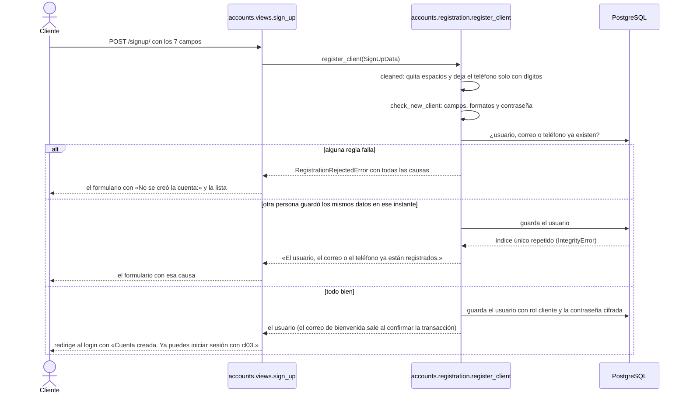

**Diagrama de actividad**

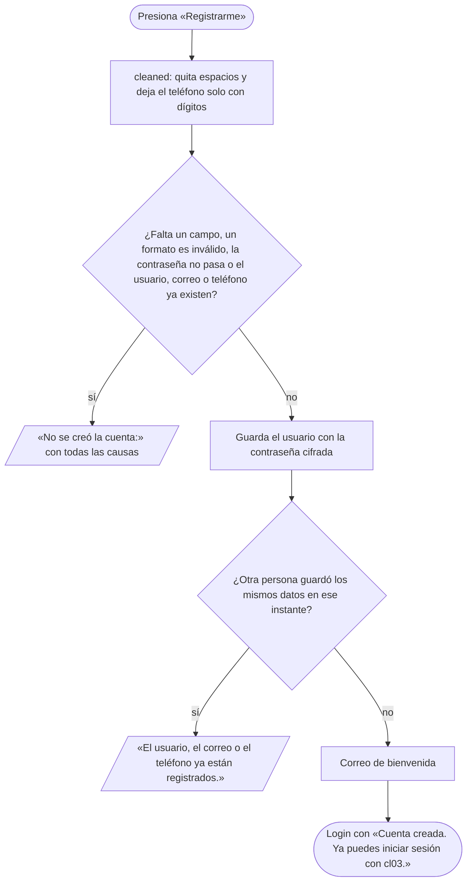

---

### CU-02 — Crear cuenta en tienda

| | |
|---|---|
| **Actor** | Operador (`op01`) |
| **Precondición** | El cliente está en la tienda y no tiene cuenta. |
| **Flujo normal** | 1. Abre «Nuevo cliente». 2. Escribe nombre, apellido, correo, teléfono y usuario: **no hay campo de contraseña** (ENT-102). 3. Presiona «Registrar cliente». 4. Va a «Renta en tienda» con el cliente ya buscado y «Cuenta creada para cl03. Le enviamos un correo para crear su contraseña. Ya puedes registrar su renta.». 5. El cliente abre el enlace del correo «Crea tu contraseña de SergioCorp» y la crea (CU-17). |
| **Flujos alternativos** | Los de datos de CU-01 (sin los de la contraseña), con el título «No se creó la cuenta:». · El correo no sale: la cuenta queda creada y el operador ve «La cuenta se creó, pero no se pudo enviar el correo. Pide al cliente que use "Olvidé mi contraseña" con su correo.». |
| **Postcondición** | Existe un usuario con rol «cliente» sin contraseña utilizable: no puede iniciar sesión hasta crearla con el enlace. |
| **Guarda** | Una fila en `accounts_user` con `set_unusable_password` y el teléfono solo con dígitos. |
| **Log** | `ACCOUNT_CREATED user=cl03 "Lucía Quispe" email=lucia@correo.com role=cliente channel=store by=op01` · `ACCOUNT_REJECTED username=cl03 email=… reason="…" by=op01` · si el correo falla, `EMAIL_FAILED to=cl03 subject="Crea tu contraseña de SergioCorp" error=SMTPException` |
| **Correo** | «Crea tu contraseña de SergioCorp», con el enlace de restablecimiento de Django (`/reset/<uid>/<token>/`). Sale en el momento, no al confirmar la transacción, para que el operador sepa si salió. |
| **Origen** | ENT-54 («si el cliente no tiene cuenta, el operador puede registrarla»), ENT-84, ENT-102 |

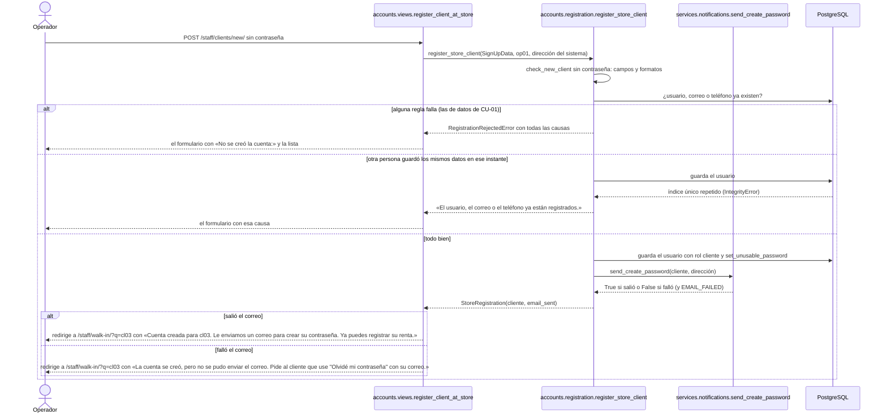

**Diagrama de actividad**

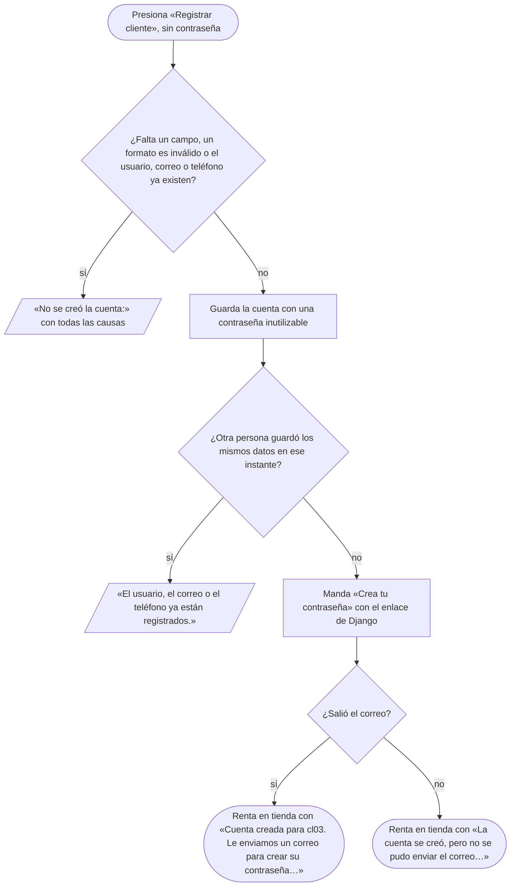

---

### CU-03 — Consultar equipos y disponibilidad

| | |
|---|---|
| **Actor** | Cliente; operador (también ve el filtro por estado) |
| **Precondición** | Tiene sesión. |
| **Flujo normal** | 1. Abre el catálogo: ve 20 equipos disponibles por página, cada uno con su precio por día, **sin** etiquetas «Libre» ni «Ocupado del … al …» (ENT-99: a quien renta no le interesa cuándo usan el equipo otras personas). 2. Escribe un código o un nombre, o elige «Libre desde» y «Libre hasta». 3. Presiona «Buscar» y ve solo los equipos que cumplen; con las dos fechas, solo los libres en ese periodo. 4. Pasa de página con «Anterior» y «Siguiente». |
| **Flujos alternativos** | Solo una fecha: «Elige las dos fechas para ver los equipos libres.» · Fecha final igual o anterior a la inicial: «La fecha final debe ser posterior a la inicial.» (en los dos casos el catálogo se muestra sin filtros, con el mensaje) · Sin resultados: «No hay equipos que coincidan con la búsqueda.» |
| **Postcondición** | No cambia nada. |
| **Guarda** | Nada. |
| **Log** | Nada (es una consulta). |
| **Origen** | ENT-02 (unos 1000 equipos), ENT-86, ENT-99 (reemplaza a ENT-64), PRE-02 |

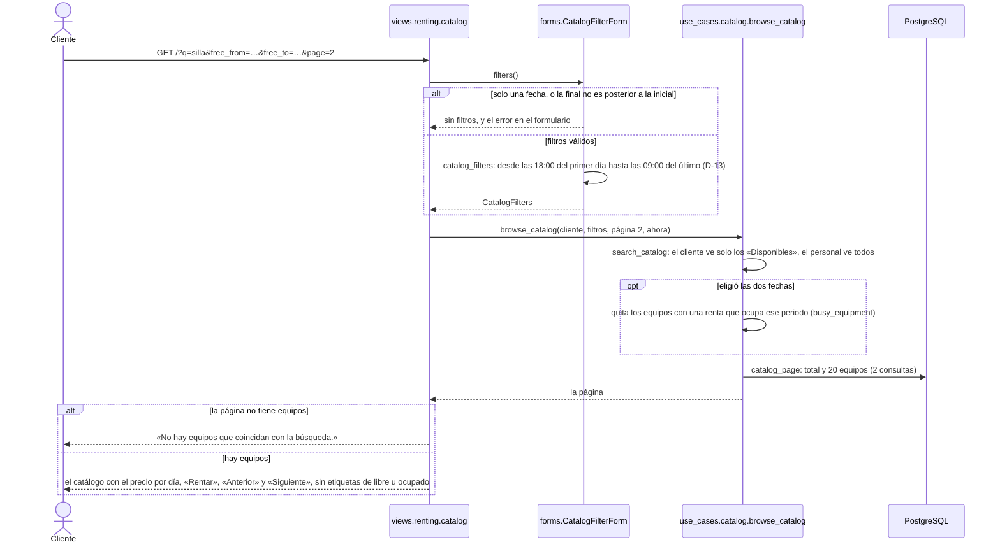

**Diagrama de actividad**

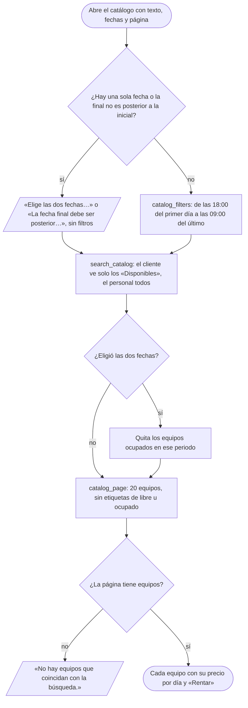

---

### CU-04 — Rentar en línea y pagar con QR simulado

| | |
|---|---|
| **Actor** | Cliente (`cl01`); Pasarela de pago simulada |
| **Precondición** | Tiene sesión y no tiene deuda pendiente. |
| **Flujo normal** | 1. En el catálogo presiona «Rentar» en un equipo. 2. Elige fecha y hora de recojo y de devolución y presiona «Continuar al pago». 3. La reserva queda guardada con el pago pendiente y ve la pantalla del QR con el total. 4. Presiona «Simular pago exitoso». 5. Ve la renta con «Pago recibido. Tu renta está confirmada.» y recibe el correo de confirmación. |
| **Flujos alternativos** | 2a. Fecha, horario o duración: se queda en el formulario con «La fecha de recojo ya pasó. Elige hoy o un día siguiente.» (el recojo de hoy a las 18:00 vale hasta la medianoche) · «La fecha y hora de devolución debe ser posterior a la de recojo.» · «La renta no puede durar más de 5 días.» · «El recojo debe ser desde las 18:00.» · «La devolución debe ser hasta las 09:00.» · 2b. Debe dinero: se queda en el formulario con «Tienes una deuda pendiente de 40,00 Bs. Págala en la tienda para volver a rentar.» · 2c. Fechas ocupadas: vuelve al catálogo con «El equipo MES-00002 está ocupado del 05/11/2026 18:00 al 07/11/2026 09:00. Está libre hasta el 05/11/2026 a las 09:00.» · 2d. Equipo no disponible: vuelve al catálogo con «El equipo MES-00002 no está disponible (estado: En revisión).» · 4a. Presiona «Simular pago fallido»: la reserva sigue hecha y ve «Tu reserva está hecha, pero el pago no se completó. Paga en la tienda al recoger el equipo.»; recibe el correo con el pago pendiente. · 4b. Ya pagada: «La renta de MES-00002 ya está pagada.» (si ya no está «Reservada», el mensaje de su estado, como en CU-06). |
| **Postcondición** | La renta queda «Reservada», pagada con QR o con el pago pendiente. |
| **Guarda** | Una fila en `rentals_rental` con `daily_price` (5 % del valor); con el pago exitoso, `paid_at` y `payment_method = qr`. |
| **Log** | `RENTAL_CREATED rental=12 equipment=MES-00002 "Mesa plegable 1,80 m" client=cl01 "Carla Mendoza" period=05/11/2026 18:00-07/11/2026 09:00 amount=40.00 by=cl01 paid=no` · `PAYMENT_APPROVED` (renta) · `PAYMENT_FAILED` (renta) · `RENTAL_REJECTED equipment=MES-00002 "…" client=cl01 "…" period=<fechas pedidas> reason="…" by=cl01` · `PAYMENT_REJECTED` (renta) `reason="…"` |
| **Correo** | Renta confirmada (pagada o con el pago pendiente), al presionar un botón del QR (D-04). |
| **Origen** | ENT-16, ENT-21, ENT-48, ENT-66, ENT-67, ENT-71, ENT-77, ENT-94, PRE-03, PRE-04 |

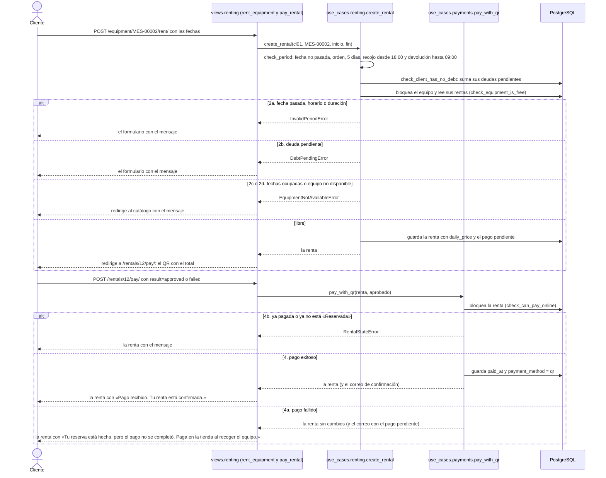

**Diagrama de actividad**


---

### CU-05 — Rentar en tienda

| | |
|---|---|
| **Actor** | Operador (`op01`) |
| **Precondición** | El cliente tiene cuenta (si no, CU-02) y paga en efectivo. |
| **Flujo normal** | 1. Abre «Renta en tienda» y busca al cliente («rojas»). 2. Lo elige y elige el equipo y las fechas. 3. Cobra en efectivo y presiona «Registrar renta». 4. Ve la renta con «Registrada por op01», «Pagado» y la forma de pago «Efectivo» (ENT-104). 5. Si el cliente se la lleva al momento, registra el recojo como cualquier otro (CU-08). |
| **Flujos alternativos** | 1a. La búsqueda no encuentra a nadie: «No se encontró ningún cliente con «rojas».»; si no tiene cuenta, CU-02. · 3a. El cliente debe dinero: «El cliente cl02 tiene una deuda pendiente de 40,00 Bs. Cóbrala antes de registrar otra renta.» · 3b. Fecha pasada, horario, duración o fechas ocupadas: los mensajes de CU-04, pero se queda en el formulario. La lista de equipos solo ofrece los «Disponibles». |
| **Postcondición** | La renta queda «Reservada» y pagada en efectivo (ENT-91). |
| **Guarda** | Una fila en `rentals_rental` con `daily_price`, `paid_at`, `payment_method = cash` y `registered_by`. |
| **Log** | `RENTAL_CREATED` (renta, `by=op01`) `paid=yes` · `PAYMENT_CASH rental=13 equipment=MES-00008 "Mesa plegable 1,80 m" client=cl02 "Diego Rojas" period=… amount=40.00 by=op01` · `RENTAL_REJECTED` (lo pedido) `reason="…" by=op01` |
| **Correo** | Renta confirmada (pagada). |
| **Origen** | ENT-54, ENT-70, ENT-77, ENT-91, PRE-03 |

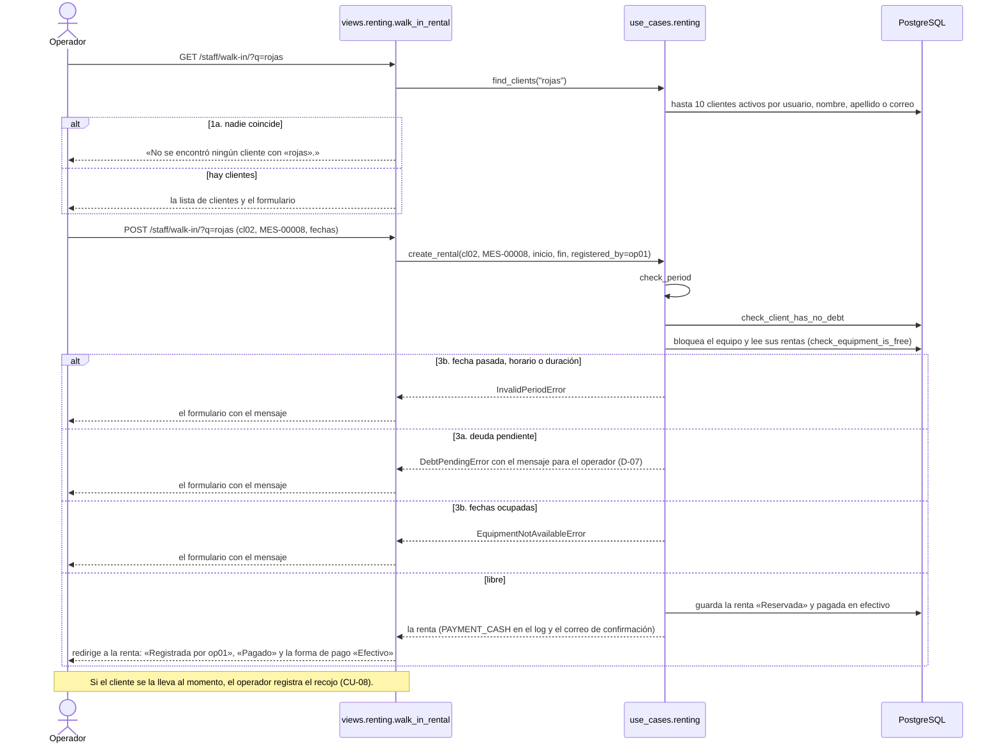

**Diagrama de actividad**

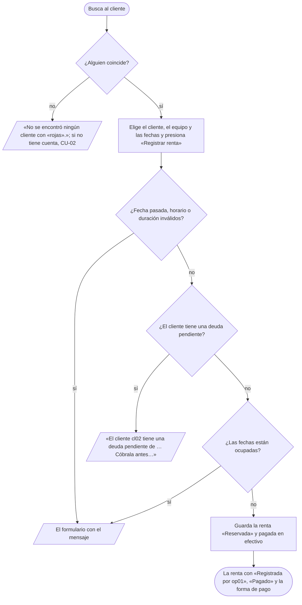

---

### CU-06 — Modificar una reserva

| | |
|---|---|
| **Actor** | Cliente (sus reservas, hasta 24 h antes del inicio); operador o admin (cualquier reserva, hasta antes de que empiece) |
| **Precondición** | La renta está «Reservada». |
| **Flujo normal** | 1. En «Mis rentas» (o en «Reservas por entregar») presiona «Modificar». 2. Elige las fechas nuevas, con la misma cantidad de días. 3. Presiona «Guardar cambios». 4. Vuelve a su lista con «Reserva modificada: MES-00001 ahora va del 06/11/2026 18:00 al 08/11/2026 09:00.». |
| **Flujos alternativos** | Fecha pasada, horario o duración: los mensajes de CU-04. · Ya no está reservada: «La renta de MES-00001 ya fue entregada el 28/10/2026 18:30.» (o cancelada, devuelta, o «La reserva de MES-00001 venció a la medianoche.») · Faltan menos de 24 h y es el cliente: «Ya no puedes modificar en línea; comunícate con la tienda.» · Ya empezó y es el personal: «La reserva de MES-00001 ya empezó el 06/11/2026 18:00; ya no se puede modificar.» (puede cancelarla hasta el recojo, CU-07) · Otra cantidad de días: «La reserva es de 2 días. Elige fechas con la misma cantidad de días; para cambiarla, cancela y renta de nuevo.» · Fechas ocupadas o equipo no disponible: los mensajes de CU-04. En todos, se queda en el formulario. |
| **Postcondición** | La reserva tiene las fechas nuevas; el precio no cambia. |
| **Guarda** | `start_datetime` y `end_datetime` de la renta. |
| **Log** | `RENTAL_MODIFIED rental=12 equipment=MES-00001 "…" client=cl01 "…" period=06/11/2026 18:00-08/11/2026 09:00 amount=40.00 by=cl01` · `MODIFY_REJECTED` (la renta con `period` = las fechas pedidas) `reason="…" by=cl01` |
| **Correo** | Reserva modificada, con las fechas nuevas, solo si la cambió el personal. |
| **Origen** | ENT-55, ENT-80, ENT-81, ENT-94, ENT-95 |

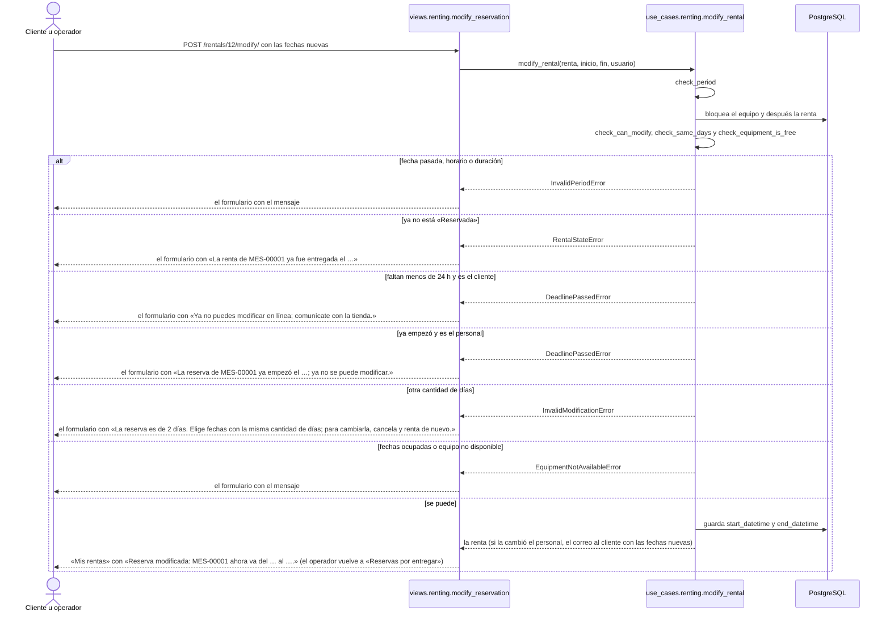

**Diagrama de actividad**


---

### CU-07 — Cancelar una reserva

| | |
|---|---|
| **Actor** | Cliente (hasta 24 h antes); operador o admin (antes del recojo; el admin también con la acción del admin) |
| **Precondición** | La renta está «Reservada». |
| **Flujo normal** | 1. Presiona «Cancelar» en la reserva. 2. Ve «Reserva cancelada: MES-00001 de cl01.». 3. El cliente recibe un correo con el motivo («Cancelaste tu reserva.» o «La tienda canceló tu reserva.»). |
| **Flujos alternativos** | Ya no está reservada: «La renta de MES-00001 ya fue cancelada el 27/10/2026 10:00.» (o entregada, devuelta, vencida). · Faltan menos de 24 h y es el cliente: «Ya no puedes cancelar en línea; comunícate con la tienda.» · El sistema también cancela solo, con el mismo correo: si el equipo pasa a reparación o baja («El equipo no está disponible: pasó a reparación.» o «… se dio de baja.», CU-10 y CU-13) o si la cuenta del cliente se desactiva («La cuenta fue desactivada.», D-27). |
| **Postcondición** | La renta queda «Cancelada» y sus fechas quedan libres. El sistema solo cancela: si estaba pagada, la devolución del dinero es manual (ENT-89). |
| **Guarda** | `cancelled_at` y `cancelled_by`. |
| **Log** | `RENTAL_CANCELLED` (renta, `by=op01`) `reason="La tienda canceló tu reserva."` · `CANCEL_REJECTED` (renta) `reason="…" by=cl01` |
| **Correo** | Renta cancelada, con el motivo. |
| **Origen** | ENT-47, ENT-55, ENT-80, ENT-88, ENT-89 |

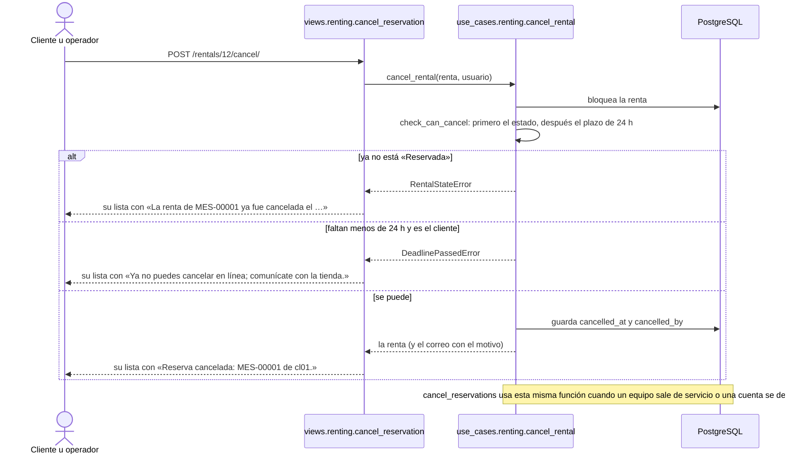

**Diagrama de actividad**


---

### CU-08 — Entregar el equipo

| | |
|---|---|
| **Actor** | Operador (`op01`) |
| **Precondición** | La renta está «Reservada» y su equipo «Disponible». |
| **Flujo normal** | 1. Abre «Reservas por entregar»: la más nueva arriba; con «Ordenar por: Fecha de recojo», la más próxima (ENT-100). 2. Si está pagada, presiona «Registrar recojo». 3. Ve «Recojo registrado: MES-00001 entregado a cl01.». |
| **Flujos alternativos** | Pago pendiente: el botón dice «Cobrar 40,00 Bs y entregar»; al presionarlo se guarda el cobro en efectivo y el recojo, y ve «Cobro de 40,00 Bs en efectivo y recojo registrados: MES-00001 entregado a cl01.» · El cliente no paga: presiona «Cancelar» (CU-07). · Se intenta entregar sin cobrar: «Falta el pago de 40,00 Bs de esta renta. Cóbralo en efectivo o cancela la reserva si el cliente no paga.» · Ya no está reservada: «La reserva de MES-00001 venció a la medianoche.» (o entregada, cancelada, devuelta). · El equipo está en revisión o en reparación: «El equipo MES-00001 está en revisión. Espera a que mantenimiento lo revise o cancela la reserva.» |
| **Postcondición** | La renta queda «Rentada» y pagada. |
| **Guarda** | `picked_up_at` y `handed_over_by`; si se cobró, también `paid_at` y `payment_method = cash`. |
| **Log** | `PAYMENT_CASH` (renta, `by=op01`) · `PICKUP_REGISTERED rental=12 equipment=MES-00001 "Mesa plegable 1,80 m" client=cl01 "Carla Mendoza" period=… amount=40.00 by=op01` · `PICKUP_REJECTED` (renta) `reason="…" by=op01` |
| **Origen** | ENT-56, ENT-57, ENT-68, ENT-69, ENT-91 |

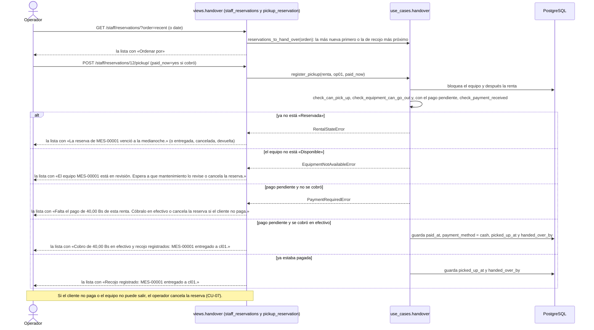

**Diagrama de actividad**

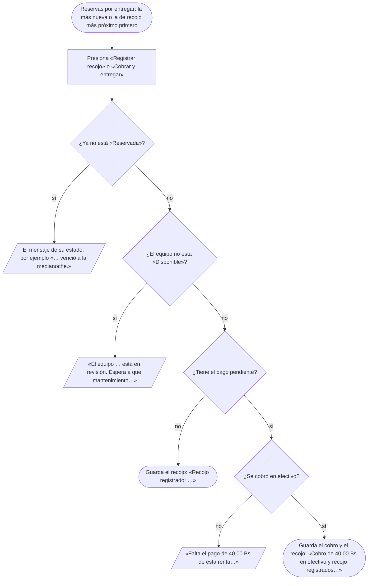

---

### CU-09 — Registrar la devolución

| | |
|---|---|
| **Actor** | Operador (`op01`) |
| **Precondición** | La renta está «Rentada»: el equipo salió y todavía no volvió (ENT-93). |
| **Flujo normal** | 1. Abre «Devoluciones pendientes»: solo aparecen las rentas «Rentadas», la más nueva arriba; con «Ordenar por: Fecha de devolución», la que vence primero (ENT-100). 2. Elige la renta y escribe cómo llegó el equipo. 3. Presiona «Registrar devolución». 4. Ve «Devolución registrada: MES-00004 recibido de cl01. A tiempo.» (o «En tolerancia, sin cobro.»). |
| **Flujos alternativos** | Sin observación: «Escribe cómo llegó el equipo.» · Nunca se entregó: «La renta de MES-00004 nunca se entregó: solo se devuelve una renta «Rentada».» · Ya devuelta o cancelada: «La renta de MES-00004 ya fue devuelta el 28/10/2026 08:30.» · Llega desde las 12:01 del día de vencimiento: se crea la deuda y ve «… Con 2 días de atraso: deuda de 40,00 Bs.»; el cliente recibe el correo de la deuda. · Si mantenimiento ya le cambió el estado mientras estaba afuera, se respeta (D-28). |
| **Postcondición** | La renta queda «Devuelta» y el equipo «En revisión». |
| **Guarda** | `returned_at`, `received_by`, `return_note`; el estado del equipo y una fila en `rentals_statuschange`; con atraso, una fila en `rentals_debt` con `late_return`. |
| **Log** | `RETURN_REGISTERED` (renta, `by=op01`) `result=late late_days=2` · `STATUS_CHANGED equipment=MES-00004 "Mesa plegable 1,80 m" old=available new=in_review by=op01` · `DEBT_CREATED debt=3 charge=late_return rental=12 equipment=… client=… period=… amount=40.00 by=op01` · `RETURN_REJECTED` (renta) `reason="…" by=op01` |
| **Correo** | Deuda creada (si hubo atraso). |
| **Origen** | ENT-03, ENT-73, ENT-93, PRE-05 |

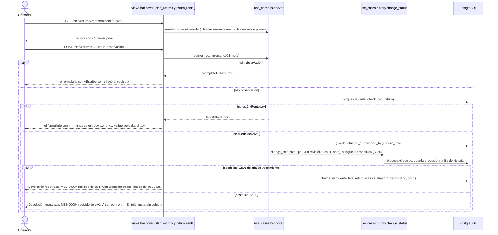

**Diagrama de actividad**

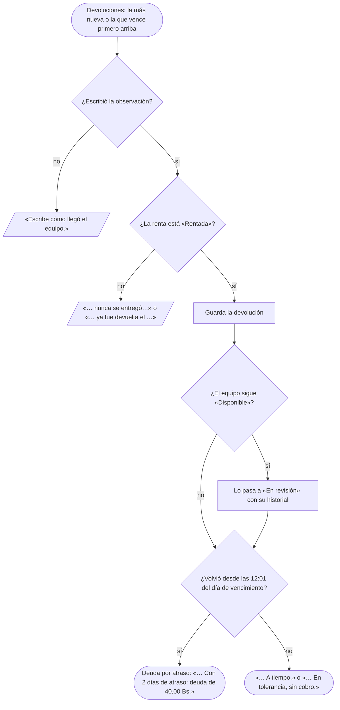

---

### CU-10 — Revisar el equipo

| | |
|---|---|
| **Actor** | Mantenimiento (`mt01`) |
| **Precondición** | El equipo no está de baja. |
| **Flujo normal** | 1. Abre «Mantenimiento»: ve todos los equipos que no están de baja, el que cambió de estado más recientemente arriba (ENT-100), y puede filtrarlos por estado. 2. En un equipo elige el estado nuevo (las opciones son los estados permitidos desde el actual) y escribe un comentario opcional. 3. Si eligió «En reparación» o «Baja» y el equipo tiene una renta devuelta, aparece la casilla «Cobrar el daño al último cliente (cl02, renta del 25/10)», **sin marcar**; la marca solo si decide cobrar. 4. Presiona «Guardar». 5. Ve «SIL-00003 ahora está «Disponible».». |
| **Flujos alternativos** | Estado que no existe: «El equipo SIL-00003 solo puede pasar a disponible, en revisión, en reparación o baja.» · De baja: «El equipo SIL-00005 está dado de baja; su estado ya no puede cambiar.» · Mismo estado: «El equipo SIL-00004 ya está «En reparación».» · Reparación con la casilla marcada: deuda del 20 % para el cliente de la última renta devuelta y «SIL-00003 ahora está «En reparación». Deuda de 16,00 Bs para cl02.» · Baja con la casilla marcada: deuda del 100 % (o lo que falta para llegar al valor, si esa renta ya tenía la de reparación, D-06). · Reparación o baja sin marcar la casilla: no hay deuda y el log escribe `DAMAGE_NOT_CHARGED`. · Reparación o baja con reservas no recogidas: se cancelan con «El equipo no está disponible: pasó a reparación.» o «… se dio de baja.», cada cliente recibe el correo y el mensaje termina con «Reservas futuras canceladas: 1.» · Sin renta devuelta, no aparece la casilla y no hay a quién cobrar (D-05). |
| **Postcondición** | El equipo tiene su estado nuevo y queda en el historial. |
| **Guarda** | El estado del equipo y una fila en `rentals_statuschange`; con la casilla marcada, una fila en `rentals_debt`; con reparación o baja, `cancelled_at` y `cancelled_by` (mantenimiento) en cada reserva no recogida. Todo en una sola transacción. |
| **Log** | `STATUS_CHANGED equipment=SIL-00003 "Silla plegable blanca" old=in_review new=in_repair by=mt01` · `DEBT_CREATED debt=4 charge=repair rental=9 … amount=16.00 by=mt01` · `DAMAGE_NOT_CHARGED status=in_repair` (renta del último cliente, `by=mt01`) · `RENTAL_CANCELLED` (renta, `by=mt01`) `reason="El equipo no está disponible: pasó a reparación."` · `REVIEW_REJECTED equipment=SIL-00003 "…" status=<pedido> reason="…" by=mt01` |
| **Correo** | Deuda creada (si se cobró); renta cancelada a cada cliente afectado. |
| **Origen** | ENT-03, ENT-34, ENT-49, ENT-74, ENT-88, ENT-90, PRE-06 |

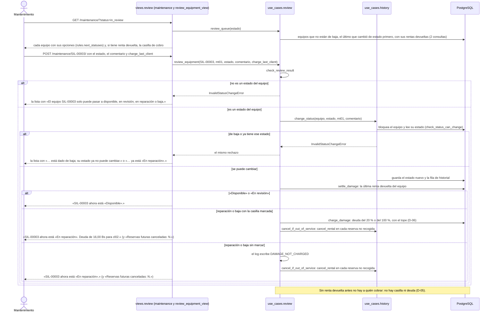

**Diagrama de actividad**

```mermaid
flowchart TD
    A(["Mantenimiento: el que cambió más recientemente primero"]) --> B{"¿Es un estado del equipo?"}
    B -- no --> C[/"«… solo puede pasar a disponible, en revisión, en reparación o baja.»"/]
    B -- sí --> D{"¿Está de baja o ya tiene ese estado?"}
    D -- sí --> E[/"«… está dado de baja…» o «… ya está «En reparación».»"/]
    D -- no --> F["Guarda el estado nuevo y su historial"]
    F --> G{"¿Reparación o baja?"}
    G -- no --> H(["«SIL-00003 ahora está «Disponible».»"])
    G -- sí --> I{"¿Marcó cobrar y hay una renta devuelta?"}
    I -- sí --> J["Deuda del 20 % o del 100 %, con el tope de D-06"]
    I -- no --> K["DAMAGE_NOT_CHARGED si había a quién cobrar"]
    J --> L(["Cancela sus reservas no recogidas y muestra el estado, la deuda y las canceladas"])
    K --> L
```

---

### CU-11 — Registrar el pago de una deuda

| | |
|---|---|
| **Actor** | Operador (`op01`) |
| **Precondición** | El cliente tiene una deuda pendiente y paga en la tienda. |
| **Flujo normal** | 1. Abre «Deudas»: ve las deudas pendientes, la más nueva arriba, y el total por cliente, el de la deuda más nueva primero (ENT-100). 2. Cobra y presiona «Registrar pago» en una deuda. 3. Ve «Pago registrado: deuda de 40,00 Bs de cl02.». |
| **Flujos alternativos** | Ya pagada (por ejemplo, otro operador hizo clic antes): «Esta deuda ya se pagó el 28/10/2026 10:00.» |
| **Postcondición** | La deuda queda pagada; si era la última, el cliente puede volver a rentar. |
| **Guarda** | `paid_at` y `paid_received_by` en esa deuda. |
| **Log** | `DEBT_PAID debt=3 charge=late_return rental=12 equipment=SIL-00006 "…" client=cl02 "Diego Rojas" period=… amount=40.00 by=op01` · `DEBT_PAYMENT_REJECTED` (deuda) `reason="…" by=op01` |
| **Origen** | ENT-76, ENT-77, ENT-78 |

```mermaid
sequenceDiagram
    actor O as Operador
    participant V as views.debts.pay_debt_view
    participant U as use_cases.payments.pay_debt
    participant BD as PostgreSQL
    O->>V: POST /staff/debts/3/pay/
    V->>U: pay_debt(deuda, op01)
    U->>BD: bloquea la deuda (check_debt_is_pending)
    alt ya pagada
        U-->>V: DebtStateError
        V-->>O: la lista con «Esta deuda ya se pagó el 28/10/2026 10:00.»
    else pendiente
        U->>BD: guarda paid_at y paid_received_by
        U-->>V: la deuda
        V-->>O: la lista con «Pago registrado: deuda de 40,00 Bs de cl02.»
    end
```

**Diagrama de actividad**

```mermaid
flowchart TD
    A(["Deudas: la más nueva primero"]) --> B["Presiona «Registrar pago»"]
    B --> C["Bloquea la deuda"]
    C --> D{"¿Ya está pagada?"}
    D -- sí --> E[/"«Esta deuda ya se pagó el 28/10/2026 10:00.»"/]
    D -- no --> F["Guarda paid_at y paid_received_by"]
    F --> G(["«Pago registrado: deuda de 40,00 Bs de cl02.»"])
```

---

### CU-12 — Registrar un equipo

| | |
|---|---|
| **Actor** | Administrador (`ad01`) |
| **Precondición** | Tiene el código, el número de serie, el nombre y el valor de compra. |
| **Flujo normal** | 1. Abre «Registrar equipo». 2. Escribe el código (`mes-00021` se guarda como `MES-00021`), la serie, el nombre y el valor. 3. Presiona «Registrar equipo». 4. Ve «Equipo registrado: MES-00021 · Mesa plegable 1,80 m.». |
| **Flujos alternativos** | Se queda en el formulario con «No se registró el equipo:» y las causas: «El código debe tener 3 letras, un guion y 5 números, por ejemplo MES-00001.» · «Ya existe un equipo con este código.» · «Ya existe un equipo con este número de serie.» · «El valor debe ser mayor que 0.» · «Falta el campo Nombre.» · Si otro admin guarda el mismo código o serie en el mismo instante: «Ya existe un equipo con este código o número de serie.» También se puede registrar en el admin de Django, con las mismas validaciones. Un combo se registra igual, con su propio código (por ejemplo `CMB-00001`) y su valor: es una unidad aparte y no descuenta sillas ni mesas (ENT-96). |
| **Postcondición** | El equipo existe, «Disponible», y aparece en el catálogo. |
| **Guarda** | Una fila en `rentals_equipment` con `created_at`. |
| **Log** | `EQUIPMENT_REGISTERED equipment=MES-00021 "Mesa plegable 1,80 m" serial=SN-MES-00021 value=400.00 by=ad01` · `EQUIPMENT_REJECTED equipment=MES-0002 "Mesa" serial=… value=… reason="…" by=ad01` |
| **Origen** | ENT-09, ENT-14, ENT-83, PRE-01 |

```mermaid
sequenceDiagram
    actor A as Administrador
    participant V as views.inventory.register_equipment_view
    participant U as use_cases.inventory.register_equipment
    participant BD as PostgreSQL
    A->>V: POST /equipment/new/
    V->>U: register_equipment(código, serie, nombre, valor, ad01)
    U->>U: normalize_inventory_id: «mes-00021» pasa a «MES-00021»
    U->>BD: check_new_equipment: reglas del modelo y ¿código o serie repetidos?
    alt alguna regla falla
        U-->>V: EquipmentRegistrationError con todas las causas
        V-->>A: el formulario con «No se registró el equipo:» y la lista
    else otro admin guardó el mismo código o serie en ese instante
        U->>BD: guarda el equipo
        BD-->>U: índice único repetido (IntegrityError)
        U-->>V: «Ya existe un equipo con este código o número de serie.»
        V-->>A: el formulario con esa causa
    else todo bien
        U->>BD: guarda el equipo «Disponible»
        U-->>V: el equipo
        V-->>A: «Equipo registrado: MES-00021 · Mesa plegable 1,80 m.»
    end
```

**Diagrama de actividad**

```mermaid
flowchart TD
    A(["Presiona «Registrar equipo»"]) --> B["normalize_inventory_id: «mes-00021» pasa a «MES-00021»"]
    B --> C{"¿Rompe una regla del modelo: formato, repetido, nombre o valor?"}
    C -- sí --> D[/"«No se registró el equipo:» con todas las causas"/]
    C -- no --> E["Guarda el equipo «Disponible»"]
    E --> F{"¿Otro admin guardó el mismo código o serie en ese instante?"}
    F -- sí --> G[/"«Ya existe un equipo con este código o número de serie.»"/]
    F -- no --> H(["«Equipo registrado: MES-00021 · Mesa plegable 1,80 m.»"])
```

---

### CU-13 — Corregir el estado de un equipo

| | |
|---|---|
| **Actor** | Administrador (`ad01`) |
| **Precondición** | Está en el admin de Django. |
| **Flujo normal** | 1. En «Equipos» (el registrado más recientemente arriba, con `date_hierarchy` y filtro por fecha de registro, ENT-100) marca uno o varios. 2. Elige «Marcar disponible», «Mandar a reparación» o «Dar de baja». 3. Ve «Equipos actualizados: 1.». |
| **Flujos alternativos** | De baja o ya en ese estado: aparecen en «No se cambiaron: SIL-00005.». · Reparación o baja con reservas no recogidas: se cancelan con «El equipo no está disponible: pasó a reparación.» o «… se dio de baja.» y cada cliente recibe el correo (ENT-88). |
| **Postcondición** | El estado cambia y queda en el historial. **Nunca crea deudas** (ENT-75): es una corrección, no una revisión. El equipo no se puede borrar: se da de baja (ENT-97). |
| **Guarda** | El estado del equipo y una fila en `rentals_statuschange`; con reparación o baja, `cancelled_at` y `cancelled_by` (el admin) en cada reserva no recogida. |
| **Log** | `STATUS_CHANGED equipment=MES-00002 "Mesa plegable 1,80 m" old=available new=in_repair by=ad01` · `RENTAL_CANCELLED` (renta, `by=ad01`) `reason="El equipo no está disponible: pasó a reparación."` · `STATUS_CHANGE_REJECTED equipment=SIL-00005 "…" new=in_repair reason="…" by=ad01` |
| **Correo** | Renta cancelada a cada cliente afectado. |
| **Origen** | ENT-40, ENT-50, ENT-75, ENT-88, ENT-97, PRE-07 |

```mermaid
sequenceDiagram
    actor A as Administrador
    participant V as admin.EquipmentAdmin.change_selected
    participant U as use_cases.history
    participant BD as PostgreSQL
    A->>V: acción «Mandar a reparación» con los equipos marcados
    loop por cada equipo marcado (apply_to_selected)
        V->>U: correct_status(equipo, «En reparación», ad01)
        U->>BD: change_status: bloquea el equipo y lee su estado
        alt de baja o ya tiene ese estado
            U-->>V: InvalidStatusChangeError: va a «No se cambiaron»
        else se puede
            U->>BD: guarda el estado nuevo y la fila de historial
            U->>BD: cancel_if_out_of_service: cancela sus reservas no recogidas, sin deuda
        end
    end
    V-->>A: «Equipos actualizados: 1.» y, si hubo rechazos, «No se cambiaron: SIL-00005.»
```

**Diagrama de actividad**

```mermaid
flowchart TD
    A(["Elige la acción con los equipos marcados"]) --> B["correct_status del siguiente equipo"]
    B --> C{"¿Está de baja o ya tiene ese estado?"}
    C -- sí --> D["Lo anota en «No se cambiaron»"]
    C -- no --> E["Guarda el estado y su historial, sin deuda"]
    E --> F{"¿Reparación o baja?"}
    F -- sí --> G["Cancela sus reservas no recogidas, con correo"]
    F -- no --> H{"¿Quedan equipos marcados?"}
    G --> H
    D --> H
    H -- sí --> B
    H -- no --> I(["«Equipos actualizados: N.» y, si hubo, «No se cambiaron: …»"])
```

---

### CU-14 — Consultar el historial

| | |
|---|---|
| **Actor** | Administrador (`ad01`) |
| **Precondición** | Está en el admin de Django. |
| **Flujo normal** | 1. Abre «Cambios de estado»: el más nuevo arriba. 2. Filtra por estado nuevo, por quién lo cambió o por fecha (`date_hierarchy` y filtro por fecha, ENT-100), o busca un código. 3. Ve quién, cuándo, de qué a qué y por qué. |
| **Flujos alternativos** | No puede agregar, editar ni borrar filas: el historial es evidencia. |
| **Postcondición** | No cambia nada. |
| **Guarda** | Nada. |
| **Log** | Nada. |
| **Origen** | ENT-34, PRE-07, PRE-08 |

```mermaid
sequenceDiagram
    actor A as Administrador
    participant V as admin.StatusChangeAdmin
    participant BD as PostgreSQL
    alt busca o filtra
        A->>V: GET /admin/rentals/statuschange/?q=MES-00007
        V->>BD: cambios de ese equipo, el más nuevo primero
        V-->>A: la lista de solo lectura
    else intenta agregar, editar o borrar
        A->>V: abre una fila o busca el botón «Agregar»
        V-->>A: solo lectura: has_add, has_change y has_delete_permission responden False
    end
```

**Diagrama de actividad**

```mermaid
flowchart TD
    A(["Abre «Cambios de estado»: el más nuevo primero"]) --> B{"¿Quiere agregar, editar o borrar?"}
    B -- sí --> C[/"Solo lectura: el historial es evidencia"/]
    B -- no --> D["Filtra por estado, por quién o por fecha, o busca un código"]
    D --> E(["Quién, cuándo, de qué a qué y por qué"])
```

---

### CU-15 — Ver el panel del responsable

| | |
|---|---|
| **Actor** | Administrador (`ad01`): al iniciar sesión llega aquí |
| **Precondición** | Tiene el rol administrador. |
| **Flujo normal** | 1. Abre «Panel». 2. Ve seis listas con su cantidad: rentas activas, rentas vencidas (pasó la devolución y no se devolvió), reservas de hoy, reservas con pago pendiente, equipos en revisión o reparación y deudas pendientes (total y por cliente). Cada lista muestra lo último primero (ENT-100): las rentas por su creación, los equipos por su último cambio de estado y los clientes por su deuda más nueva. 3. Presiona «Ver en el admin» en una lista y llega a esa misma lista filtrada en el admin, la más nueva primero. |
| **Flujos alternativos** | Lista vacía: «Nada por aquí.» |
| **Postcondición** | No cambia nada. |
| **Guarda** | Nada. |
| **Log** | Nada. |
| **Origen** | ENT-87, PRE-06, PRE-08 |

```mermaid
sequenceDiagram
    actor A as Administrador
    participant V as views.dashboard.manager_dashboard
    participant U as use_cases.dashboard.manager_summary
    participant BD as PostgreSQL
    A->>V: GET /manager/
    V->>U: manager_summary(ahora)
    U->>BD: por cada lista, su total y sus primeras 10 filas, lo último primero, y la deuda total
    U-->>V: ManagerSummary con las seis listas
    alt una lista está vacía
        V-->>A: esa lista dice «Nada por aquí.»
    else la lista tiene filas
        V-->>A: el total, las filas y «Ver en el admin»
    end
```

**Diagrama de actividad**

```mermaid
flowchart TD
    A(["Abre «Panel»"]) --> B["manager_summary: seis listas, lo último primero"]
    B --> C{"¿La lista está vacía?"}
    C -- sí --> D[/"«Nada por aquí.»"/]
    C -- no --> E["Su total y sus primeras 10 filas"]
    E --> F(["«Ver en el admin»: la lista filtrada, la más nueva primero"])
```

---

### CU-16 — Consultar mis rentas y mi deuda

| | |
|---|---|
| **Actor** | Cliente (`cl02`) |
| **Precondición** | Tiene sesión. |
| **Flujo normal** | 1. Abre «Mis rentas». 2. Ve cada renta con sus fechas, total, estado y pago: solo «Pagado» o «Pago pendiente» (ENT-104); la forma de pago está en el detalle de la renta. 3. Si debe, ve arriba «Tienes una deuda pendiente de 40,00 Bs. Págala en la tienda para volver a rentar.» y el detalle de cada deuda. 4. En sus reservas ve «Modificar» y «Cancelar». |
| **Flujos alternativos** | Sin rentas: «Todavía no tienes rentas.» · Sin deuda: no ve el aviso. · Una reserva que canceló la tienda o el sistema (equipo en reparación o baja, cuenta desactivada) aparece «Cancelada»; el motivo le llegó por correo. · La deuda no se paga aquí: solo en la tienda, en persona (ENT-92). |
| **Postcondición** | No cambia nada. |
| **Guarda** | Nada. |
| **Log** | Nada. |
| **Origen** | ENT-55, ENT-76, ENT-88, ENT-92, ENT-104, PRE-08 |

```mermaid
sequenceDiagram
    actor C as Cliente
    participant V as views.renting.client_rentals
    participant U as use_cases.renting.my_rentals
    participant BD as PostgreSQL
    C->>V: GET /my-rentals/
    V->>U: my_rentals(cl02)
    U->>BD: sus rentas, sus deudas pendientes y su suma
    U-->>V: ClientRentals
    alt debe dinero
        V-->>C: arriba, «Tienes una deuda pendiente de 40,00 Bs. Págala en la tienda para volver a rentar.» y cada deuda
    else no debe
        V-->>C: sin aviso de deuda
    end
    alt no tiene rentas
        V-->>C: «Todavía no tienes rentas.»
    else tiene rentas
        V-->>C: la tabla con estado, «Pagado» o «Pago pendiente», y «Modificar» y «Cancelar» en sus reservas con más de 24 h
    end
    Note over C,V: La deuda se paga solo en la tienda (ENT-92): la página no tiene botón de pago.
```

**Diagrama de actividad**

```mermaid
flowchart TD
    A(["Abre «Mis rentas»"]) --> B{"¿Debe dinero?"}
    B -- sí --> C[/"«Tienes una deuda pendiente de … Págala en la tienda…» y cada deuda"/]
    B -- no --> D{"¿Tiene rentas?"}
    C --> D
    D -- no --> E[/"«Todavía no tienes rentas.»"/]
    D -- sí --> F["Cada renta con su estado y «Pagado» o «Pago pendiente»"]
    F --> G{"¿Es una reserva con más de 24 h para el recojo?"}
    G -- sí --> H(["«Modificar» y «Cancelar»"])
    G -- no --> I(["Sin botones o «Para cambiarla, comunícate con la tienda.»"])
```

---

### CU-17 — Gestionar mi cuenta

| | |
|---|---|
| **Actor** | Cliente (`cl01`); cualquier usuario con sesión usa «Mi cuenta» igual |
| **Precondición** | Tiene cuenta. Para editar o cambiar la contraseña, tiene sesión; para recuperarla, no. |
| **Flujo normal** | **Editar mis datos:** 1. Presiona «Mi cuenta» en el menú. 2. Ve su usuario y su rol (no se cambian) y cambia nombre, apellido, correo o teléfono. 3. Presiona «Guardar mis datos» y ve «Tus datos se guardaron.». **Cambiar la contraseña:** 1. En «Mi cuenta» presiona «Cambiar contraseña». 2. Escribe la actual y la nueva dos veces. 3. Vuelve a «Mi cuenta» con «Tu contraseña se cambió.», con la sesión abierta. **Recuperar la contraseña:** 1. En «Iniciar sesión» presiona «Olvidé mi contraseña». 2. Escribe su correo y presiona «Enviar el enlace». 3. Ve «Revisa tu correo» y recibe «Tu enlace para crear la contraseña de SergioCorp». 4. Abre el enlace, escribe la contraseña nueva dos veces y ve «Contraseña guardada. Ya puedes iniciar sesión.». El cliente creado en la tienda usa este mismo enlace (CU-02). |
| **Flujos alternativos** | Datos: se queda en el formulario con «No se guardaron tus datos:» y todas las causas, con los mismos textos del registro: «Falta el campo Nombre.» · «El correo no es válido.» · «El teléfono debe tener entre 7 y 15 números.» · «El correo ya está registrado.» · «El teléfono ya está registrado.» (su propio correo, aunque cambie las mayúsculas, no choca con él). · Contraseña: la actual no es la correcta, las nuevas no coinciden o la nueva no pasa los validadores (los mismos del registro): se queda en el formulario con el mensaje de Django. · Recuperar con un correo que no es de una cuenta activa: ve la misma página «Revisa tu correo», sin decir si la cuenta existe, y no sale ningún correo. · Enlace usado o vencido: «El enlace ya no sirve: se usó o venció. Pide otro en Olvidé mi contraseña.». |
| **Postcondición** | La cuenta tiene sus datos o su contraseña nuevos; el usuario y el rol no cambian. |
| **Guarda** | `first_name`, `last_name`, `email` y `phone` que cambiaron (solo esos campos), o el hash de la contraseña nueva. |
| **Log** | `PROFILE_UPDATED user=cl01 "Carla Mendoza" fields=phone by=cl01` (solo los nombres de los campos, nunca el correo o el teléfono nuevos) · `PROFILE_REJECTED user=cl01 "…" reason="…" by=cl01` · `PASSWORD_CHANGED user=cl01 "Carla Mendoza" channel=account by=cl01` (con el enlace, `channel=reset`) · `PASSWORD_RESET_REQUESTED email=cl01@correo.com users=cl01 by=web` |
| **Correo** | El enlace para crear la contraseña nueva, al pedirlo. |
| **Origen** | ENT-102, ENT-103 |

Las vistas de la contraseña son las de Django (`PasswordChangeView`, `PasswordResetView`, `PasswordResetDoneView`, `PasswordResetConfirmView` y `PasswordResetCompleteView`) con plantillas en español. `accounts/forms.py` solo les agrega el log y, en `ClientPasswordResetForm.get_users`, la cuenta todavía sin contraseña: la de Django la omite y el cliente de la tienda nunca recibiría el enlace.

```mermaid
sequenceDiagram
    actor C as Cliente
    participant V as accounts.views.my_account
    participant U as accounts.account.update_profile
    participant D as Vistas de Django (django.contrib.auth.views)
    participant BD as PostgreSQL
    C->>V: POST /account/ con nombre, apellido, correo y teléfono
    V->>U: update_profile(cl01, nombre, apellido, correo, teléfono)
    U->>U: cleaned y check_profile: campos y formatos
    U->>BD: taken_causes: ¿correo o teléfono de otra cuenta? (la suya no cuenta)
    alt alguna regla falla
        U-->>V: RegistrationRejectedError con todas las causas
        V-->>C: el formulario con «No se guardaron tus datos:» y la lista
    else todo bien
        U->>BD: bloquea su fila y guarda solo los campos que cambiaron
        U-->>V: la cuenta (PROFILE_UPDATED con los nombres de los campos)
        V-->>C: redirige a «Mi cuenta» con «Tus datos se guardaron.»
    end
    C->>D: POST /account/password/ con la actual y la nueva dos veces
    D->>D: AccountPasswordChangeForm: la actual, que coincidan y AUTH_PASSWORD_VALIDATORS
    alt la actual no es correcta o la nueva no pasa
        D-->>C: el formulario con el error
    else todo bien
        D->>BD: guarda el hash nuevo (PASSWORD_CHANGED channel=account)
        D-->>C: «Mi cuenta» con «Tu contraseña se cambió.», con la sesión abierta
    end
    C->>D: POST /password-reset/ con su correo
    D->>BD: ClientPasswordResetForm.get_users: cuentas activas con ese correo, también sin contraseña
    opt hay una cuenta
        D-->>C: el correo con el enlace /reset/uid/token/ (PASSWORD_RESET_REQUESTED)
    end
    D-->>C: «Revisa tu correo», exista o no la cuenta
    C->>D: abre el enlace y escribe la contraseña nueva dos veces
    alt el enlace se usó o venció
        D-->>C: «El enlace ya no sirve: se usó o venció.»
    else el enlace sirve
        D->>BD: ResetSetPasswordForm guarda el hash (PASSWORD_CHANGED channel=reset)
        D-->>C: «Contraseña guardada. Ya puedes iniciar sesión.»
    end
```

**Diagrama de actividad**

```mermaid
flowchart TD
    A(["Mi cuenta u Olvidé mi contraseña"]) --> B{"¿Qué quiere hacer?"}
    B -- editar sus datos --> C{"¿Falta un campo, un formato es inválido o el correo o teléfono es de otra cuenta?"}
    C -- sí --> D[/"«No se guardaron tus datos:» con todas las causas"/]
    C -- no --> E(["Guarda lo que cambió: «Tus datos se guardaron.»"])
    B -- cambiar la contraseña --> F{"¿La actual es correcta y la nueva coincide y pasa los validadores?"}
    F -- no --> G[/"El formulario con el error de Django"/]
    F -- sí --> H(["«Tu contraseña se cambió.», con la sesión abierta"])
    B -- recuperar la contraseña --> I{"¿El correo es de una cuenta activa?"}
    I -- sí --> J["Manda el enlace de Django"]
    I -- no --> K(["«Revisa tu correo», sin decir si la cuenta existe"])
    J --> K
```

---

## 6. Qué guarda cada botón

Las funciones están en `rentals/use_cases/`, salvo `accounts.registration`, `accounts.account`, los formularios de contraseña y `UserAdmin` (en `accounts/`).

| Botón | Función | Qué cambia en la base |
|---|---|---|
| Registrarme | `accounts.registration.register_client` | Una fila en `accounts_user` con la contraseña cifrada |
| Registrar cliente (tienda) | `accounts.registration.register_store_client` | Una fila en `accounts_user` con una contraseña inutilizable; manda el correo «Crea tu contraseña» |
| Guardar mis datos | `accounts.account.update_profile` | Solo los campos que cambiaron de `first_name`, `last_name`, `email`, `phone` |
| Cambiar contraseña / Guardar contraseña | `PasswordChangeView` y `PasswordResetConfirmView` de Django con `AccountPasswordChangeForm` y `ResetSetPasswordForm` | El hash de la contraseña |
| Enviar el enlace | `PasswordResetView` de Django con `ClientPasswordResetForm` | Nada: manda el correo con el enlace |
| Continuar al pago / Registrar renta | `renting.create_rental` | Una fila en `rentals_rental` (en tienda, ya pagada) |
| Simular pago exitoso | `payments.pay_with_qr` | `paid_at`, `payment_method` |
| Guardar cambios (modificar) | `renting.modify_rental` | `start_datetime`, `end_datetime` |
| Cancelar | `renting.cancel_rental` | `cancelled_at`, `cancelled_by` |
| Registrar recojo / Cobrar y entregar | `handover.register_pickup` | `picked_up_at`, `handed_over_by` (y `paid_at`, `payment_method`) |
| Registrar devolución | `handover.register_return` | `returned_at`, `received_by`, `return_note`, estado del equipo, historial y, con atraso, una deuda |
| Guardar (mantenimiento) | `review.review_equipment` | Estado del equipo, historial, deuda si se marcó «Cobrar el daño» y reservas canceladas si es reparación o baja |
| Registrar pago (deuda) | `payments.pay_debt` | `paid_at`, `paid_received_by` |
| Registrar equipo | `inventory.register_equipment` | Una fila en `rentals_equipment` |
| Acciones del admin | `history.correct_status`, `renting.cancel_rental`, `payments.pay_debt` | Lo mismo que arriba; corregir el estado nunca crea deudas |
| Guardar (admin de usuarios, «Activo») | `UserAdmin.save_model`, `renting.cancel_reservations_of_deactivated` | `is_active`; el log escribe `ACCOUNT_DEACTIVATED user=cl01 by=ad01` o `ACCOUNT_REACTIVATED`; al desactivar, sus reservas no recogidas quedan canceladas (D-27) |

## 7. Fuera de alcance

| Qué | Por qué no |
|---|---|
| PIN o verificación por SMS | Necesita un proveedor de SMS pagado; el equipo decidió registrar con correo y teléfono únicos (ENT-84). |
| Notificaciones por SMS, WhatsApp o Telegram | Cada canal necesita una cuenta de empresa y un proveedor; el correo cubre los avisos que definió el equipo (ENT-85). |
| Login con Google | Exige registrar la app en Google y no lo pidió el cliente; el usuario y la contraseña bastan. |
| Lector de código de barras o RFID | Necesita hardware; el admin escribe el código a mano (ENT-83). |
| Importación masiva de equipos | El cliente dijo que «puede mega esperar» (ENT-14). |
| Cliente frecuente | El cliente no definió qué lo hace frecuente (ENT-20); todos rentan como máximo 5 días. |
| Cobro forzoso y reporte de pérdidas | El sistema no cobra a la fuerza: la deuda queda visible y bloquea nuevas rentas (ENT-78). |
| Garantía | El precio no la separa; el daño se cobra como deuda de reparación o baja (ENT-74). |
| Validación real del pago | El QR es simulado (ENT-66); `payments.pay_with_qr` recibe solo «aprobado o no», así una pasarela real se conecta sin tocar la renta (ENT-48). |
| Restricción de exclusión en PostgreSQL (issue #30) | Que una renta ocupe el equipo depende de la hora (una reserva no recogida lo libera a la medianoche, ENT-69) y una restricción de la base no puede mirar la hora. El cruce ya se evita bloqueando la fila del equipo (RC-02, D-24). |
| Límite de cantidad de modificaciones de una reserva | El cliente aceptó que quede para la siguiente iteración (ENT-95); hoy se modifica cuantas veces se quiera dentro del plazo. |
| Pago de deudas en línea | El cliente pidió que se pague solo en la tienda, en persona (ENT-92). |
| Carrito de combos (varios equipos en un pedido) | El cliente dijo «sin carritos»: un combo es un equipo más con su propio código y su valor (ENT-96). |
| Errores del servidor (500) en `logs/negocio.log` | El log de negocio registra las operaciones del negocio (RC-05); Django escribe los errores del servidor en su propio log, en la consola. El usuario ve la página 500 en español, sin detalles técnicos. |

## 8. Estados

Cada transición dice quién la hace y qué la provoca. El estado de la renta **no se guarda**: `Rental.status_at` lo calcula desde sus momentos (RF-08). El del equipo sí: solo `history.change_status` lo cambia, con su fila de historial (RF-10).

### Renta

```mermaid
stateDiagram-v2
    state "Reservada" as Reservada
    state "Rentada" as Rentada
    state "Devuelta" as Devuelta
    state "Cancelada" as Cancelada
    state "No recogida" as NoRecogida
    [*] --> Reservada: el cliente renta en línea o el operador en tienda
    Reservada --> Reservada: el cliente o el personal la modifican
    Reservada --> Rentada: el operador registra el recojo
    Reservada --> Cancelada: el cliente, el personal o el sistema la cancelan
    Reservada --> NoRecogida: nadie la recoge hasta la medianoche
    Rentada --> Devuelta: el operador registra la devolución
    Devuelta --> [*]
    Cancelada --> [*]
    NoRecogida --> [*]
```

| Desde | Hacia | Quién | Qué la provoca |
|---|---|---|---|
| — | Reservada | Cliente (CU-04) u operador (CU-05) | Una renta confirmada con fechas libres, desde hoy en adelante. En tienda nace pagada en efectivo (ENT-91). |
| Reservada | Reservada | Cliente hasta 24 h antes; operador o admin hasta el inicio (CU-06) | Fechas nuevas con la misma cantidad de días (ENT-81, ENT-95). |
| Reservada | Rentada | Operador (CU-08) | El recojo, con el pago hecho y el equipo «Disponible». |
| Reservada | Cancelada | Cliente hasta 24 h antes; operador o admin hasta el recojo (CU-07); el sistema cuando el equipo pasa a reparación o baja (CU-10, CU-13) o la cuenta se desactiva (D-27) | La cancelación, con su motivo en el correo. |
| Reservada | No recogida | Nadie: la hora | Pasa la medianoche del día de inicio sin recojo (ENT-69). |
| Rentada | Devuelta | Operador (CU-09) | La devolución con su observación; desde las 12:01 del vencimiento deja una deuda por atraso. |

### Equipo

```mermaid
stateDiagram-v2
    state "Disponible" as Disponible
    state "En revisión" as EnRevision
    state "En reparación" as EnReparacion
    state "Baja" as Baja
    [*] --> Disponible: el admin lo registra
    Disponible --> EnRevision: vuelve de una renta o lo manda mantenimiento
    EnRevision --> Disponible: mantenimiento o admin
    EnRevision --> EnReparacion: mantenimiento o admin
    EnReparacion --> EnRevision: mantenimiento
    EnReparacion --> Disponible: mantenimiento o admin
    Disponible --> EnReparacion: mantenimiento o admin
    Disponible --> Baja: mantenimiento o admin
    EnRevision --> Baja: mantenimiento o admin
    EnReparacion --> Baja: mantenimiento o admin
    Baja --> [*]
```

| Desde | Hacia | Quién | Qué la provoca |
|---|---|---|---|
| — | Disponible | Admin (CU-12) | El registro del equipo. |
| Disponible | En revisión | Operador (CU-09) o mantenimiento (CU-10) | La devolución de una renta, o mantenimiento quiere revisarlo. |
| En revisión, En reparación | Disponible | Mantenimiento (CU-10) o admin (CU-13) | El equipo está bien. |
| Disponible, En revisión | En reparación | Mantenimiento (CU-10) o admin (CU-13) | Hay que arreglarlo: se cancelan sus reservas no recogidas; mantenimiento decide si cobra el 20 % (ENT-88, ENT-90). |
| En reparación | En revisión | Mantenimiento (CU-10) | Vuelve de reparar y falta revisarlo. |
| Cualquiera menos Baja | Baja | Mantenimiento (CU-10) o admin (CU-13) | Ya no sirve: se cancelan sus reservas no recogidas; mantenimiento decide si cobra el valor. La baja es definitiva (ENT-49). |

Las correcciones del admin nunca cobran (ENT-75). La lista de mantenimiento solo ofrece los estados permitidos desde el actual (`rules.next_statuses`).

### Deuda

```mermaid
stateDiagram-v2
    state "Pendiente" as Pendiente
    state "Pagada" as Pagada
    [*] --> Pendiente: devolución con atraso o revisión con el cobro marcado
    Pendiente --> Pagada: el operador registra el pago en la tienda
    Pagada --> [*]
```

| Desde | Hacia | Quién | Qué la provoca |
|---|---|---|---|
| — | Pendiente | Operador (CU-09) o mantenimiento (CU-10) | Una devolución desde las 12:01 del vencimiento (ENT-73), o reparación o baja con «Cobrar el daño» marcado (ENT-90). |
| Pendiente | Pagada | Operador (CU-11) o admin con su acción | El cliente paga en la tienda, en persona (ENT-92). Mientras haya una pendiente, no puede rentar (ENT-77). |
