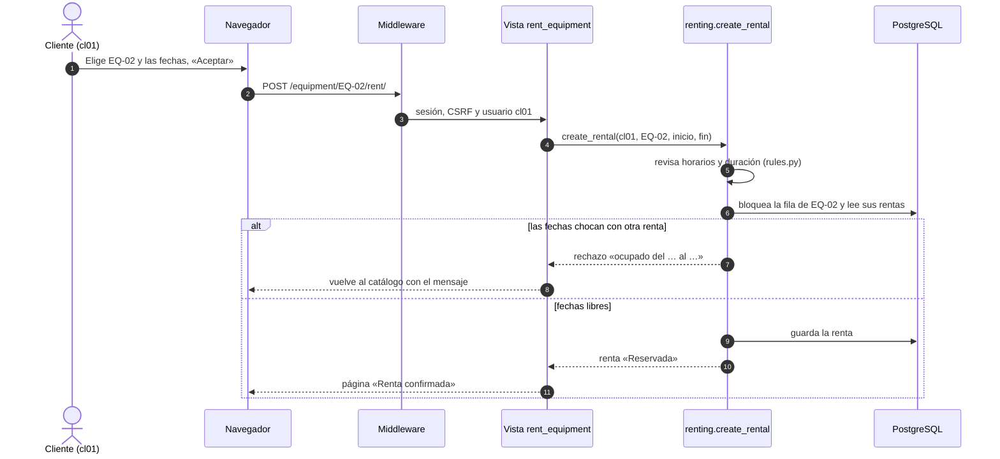
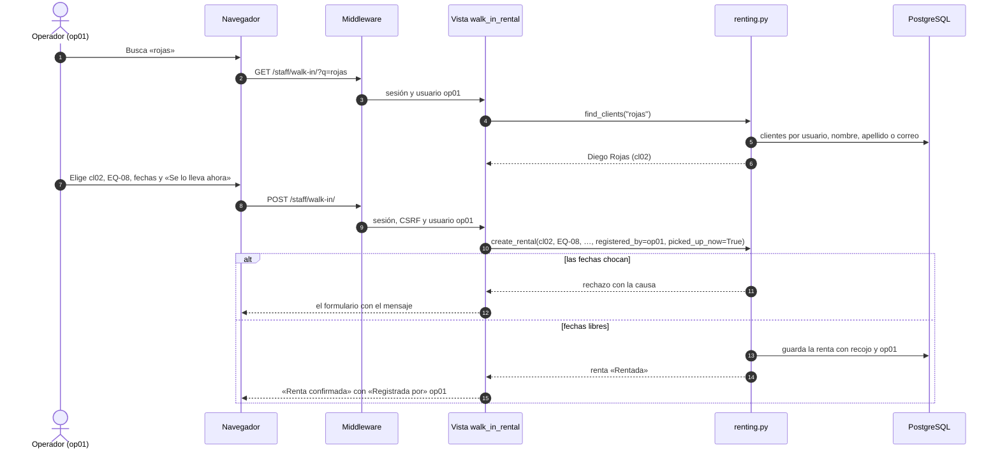
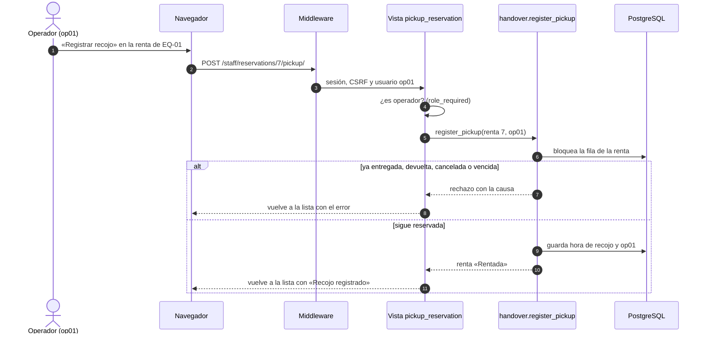
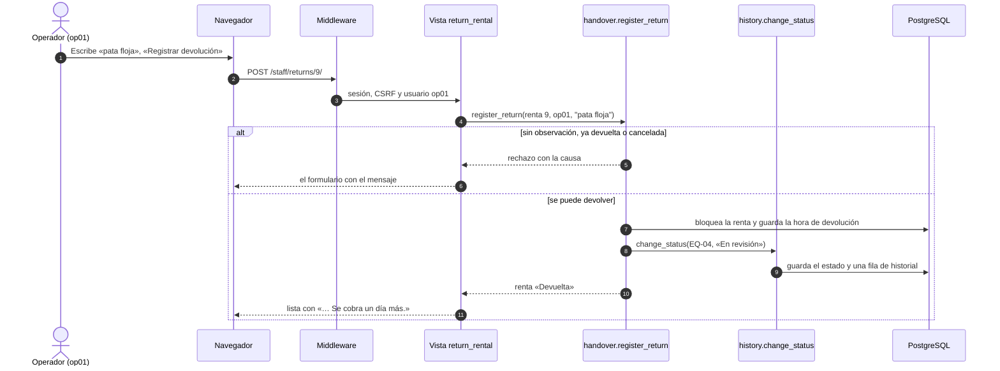
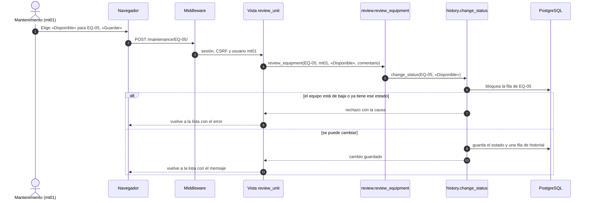
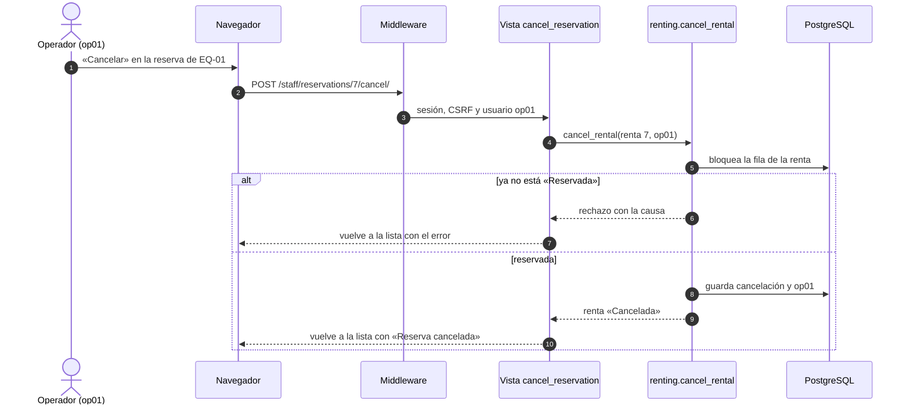
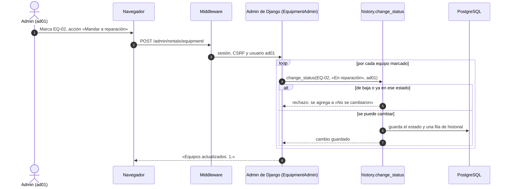

# Casos de uso del MVP

> Versión del 19/10/2026: requisitos, historias, casos de uso y diagramas de secuencia de lo que se presenta en el MVP. Reemplaza a `secuencias.md` y `secuencias_revisar_y_admin.md`.
> Las respuestas del cliente que se citan (ENT-xx) están en [respuestas-del-cliente.md](respuestas-del-cliente.md).

## Mapa

| Historia | Caso de uso | Actor | Qué logra | Requisitos |
|---|---|---|---|---|
| HU-01 | [CU-01 Rentar en línea](#cu-01--rentar-en-línea) | Cliente | Una renta «Reservada» | RF-01, RF-07 |
| HU-02 | [CU-02 Rentar en la tienda](#cu-02--rentar-en-la-tienda) | Operador | Una renta «Reservada» o «Rentada» | RF-06, RF-07 |
| HU-03 | [CU-03 Entregar el equipo](#cu-03--entregar-el-equipo) | Operador | La renta pasa a «Rentada» | RF-03, RF-08 |
| HU-04 | [CU-04 Registrar la devolución](#cu-04--registrar-la-devolución) | Operador | La renta pasa a «Devuelta» y el equipo a «En revisión» | RF-02, RF-04, RF-08 |
| HU-05 | [CU-05 Revisar el equipo](#cu-05--revisar-el-equipo) | Mantenimiento | El equipo queda disponible, en reparación o de baja | RF-04 |
| HU-06 | [CU-06 Cancelar una reserva](#cu-06--cancelar-una-reserva) | Operador o admin | La renta pasa a «Cancelada» y sus fechas quedan libres | RF-07, RF-09 |
| HU-07 | [CU-07 Corregir el estado desde el admin](#cu-07--corregir-el-estado-desde-el-admin) | Admin | El equipo cambia de estado y queda en el historial | RF-04, RF-09 |
| HU-08 | (consulta, sin caso de uso) | Cliente | Ve sus rentas y su estado en «Mis rentas» | RF-10 |

## Requisitos

| ID | Requisito (en una línea) | Dónde se cumple |
|---|---|---|
| RF-01 | Un equipo no puede tener dos rentas con fechas que se crucen; si chocan, se dice cuándo está ocupado y hasta cuándo está libre. Gana el primero que confirma. | `renting.create_rental`, `rules.periods_overlap` |
| RF-02 | La devolución se clasifica contra las 09:00 del día de vencimiento: hasta 09:00 a tiempo, hasta 12:00 con multa, después un día más. | `rules.classify_return` |
| RF-03 | Una reserva no recogida hasta las 12:00 del día siguiente queda «No recogida» y deja libres sus fechas. | `rules.is_pickup_expired`, `Rental.status_at` |
| RF-04 | El equipo devuelto pasa a «En revisión»; mantenimiento lo deja disponible, en reparación o de baja. La baja es definitiva. Cada cambio queda en el historial. | `history.change_status`, `review.review_equipment` |
| RF-05 | Cada mesa o silla es un equipo con código de inventario único. | `Equipment.inventory_id` |
| RF-06 | El operador busca al cliente por usuario, nombre, apellido o correo; nunca aparece el personal. | `renting.find_clients` |
| RF-07 | El estado de la renta se calcula: Cancelada, Devuelta, Rentada, No recogida o Reservada. | `Rental.status_at` |
| RF-08 | El operador registra el recojo y la devolución con la hora real y su usuario; la devolución lleva una observación. | `handover.register_pickup`, `handover.register_return` |
| RF-09 | El admin cancela reservas y corrige estados desde el admin de Django, sin crear ni editar rentas a mano. | `rentals/admin.py` |
| RF-10 | Cada rol ve solo lo suyo: cliente (catálogo y sus rentas), operador (reservas y devoluciones), mantenimiento (equipos por revisar), admin (todo). | `templates/base.html`, vistas |
| RF-11 | Las páginas del personal revisan el rol: sin sesión van al login; sin el rol, error 403. | `roles.role_required` |
| RC-01 | Cada rechazo muestra una frase con la causa. | `rentals/errors.py`, `rentals/formatting.py` |
| RT-01 | Se usa desde el navegador en celular, tablet o computadora. | `static/css/style.css` |

## Historias de usuario

| ID | Historia | Se acepta cuando |
|---|---|---|
| HU-01 | Como **cliente**, quiero rentar un equipo para unas fechas y que quede confirmado al instante. | Si las fechas están libres, veo «Renta confirmada». Si chocan, veo «ocupado del … al …» y no se guarda nada. |
| HU-02 | Como **operador**, quiero rentar a nombre de un cliente que llega a la tienda. | Lo encuentro por su apellido. Si marco «Se lo lleva ahora», la renta nace «Rentada» y dice «Registrada por» mi usuario. |
| HU-03 | Como **operador**, quiero registrar que el cliente se llevó el equipo. | La renta pasa a «Rentada» con la hora y mi usuario. Si ya se entregó o venció, veo la causa y nada cambia. |
| HU-04 | Como **operador**, quiero registrar la devolución con una observación. | La renta queda «Devuelta», veo si llegó a tiempo y el equipo pasa a «En revisión». Sin observación, no se guarda. |
| HU-05 | Como **mantenimiento**, quiero decidir qué pasa con un equipo devuelto. | Lo dejo disponible, en reparación o de baja, con un comentario opcional, y queda en el historial. |
| HU-06 | Como **operador**, quiero cancelar una reserva que no se va a recoger. | La reserva queda «Cancelada» y otro cliente puede rentar esas fechas. Una renta ya entregada no se cancela. |
| HU-07 | Como **admin**, quiero corregir el estado de un equipo sin saltarme las reglas. | El cambio queda en el historial con mi usuario. Un equipo de baja no cambia. |
| HU-08 | Como **cliente**, quiero ver mis rentas y su estado. | Veo solo las mías, con su estado actual. |

## Cómo leer los diagramas

- **Flecha continua (→):** una llamada o petición. **Flecha punteada (⇢):** la respuesta.
- **alt:** las dos salidas posibles. El rechazo siempre va primero y **no guarda nada**.
- **Middleware:** antes de cada vista, Django carga la sesión, revisa el token CSRF (que el formulario salió de nuestra página) e identifica al usuario. Después la vista revisa el rol.
- **Bloquea la fila:** `SELECT … FOR UPDATE`. Si dos personas hacen clic a la vez, la segunda espera y ve lo que guardó la primera.

---

## CU-01 — Rentar en línea

| | |
|---|---|
| **Actor** | Cliente (`cl01`) |
| **Flujo** | 1. Abre el catálogo y ve cuándo está ocupado cada equipo. 2. Elige un equipo y las fechas. 3. Confirma. 4. Ve «Renta confirmada». |
| **Rechazos** | Fechas u horas inválidas: se queda en el formulario con la causa. Fechas ocupadas: vuelve al catálogo con «El equipo EQ-02 está ocupado del … al …. Está libre hasta el … a las 09:00.». |
| **Reglas** | Recojo desde las 18:00, devolución hasta las 09:00, máximo 5 días. Las rentas canceladas, devueltas o no recogidas no ocupan el equipo. |

---

## CU-02 — Rentar en la tienda

| | |
|---|---|
| **Actor** | Operador (`op01`) |
| **Flujo** | 1. Abre «Renta en tienda» y busca al cliente (por ejemplo, «rojas»). 2. Lo elige, elige el equipo y las fechas. 3. Si se lo lleva en ese momento, marca «Se lo lleva ahora». 4. Confirma y ve la renta con «Registrada por» op01. |
| **Rechazos** | Los mismos de CU-01: las reglas son iguales para todos. |
| **Reglas** | En la búsqueda solo aparecen clientes (máximo 10). Con «Se lo lleva ahora» la renta nace «Rentada». |

---

## CU-03 — Entregar el equipo

| | |
|---|---|
| **Actor** | Operador (`op01`) |
| **Flujo** | 1. Abre «Reservas por entregar». 2. Presiona «Registrar recojo». 3. Ve «Recojo registrado: EQ-01 entregado a cl01.». |
| **Rechazos** | Solo se entrega una renta «Reservada»: no una ya entregada, devuelta, cancelada o vencida (pasó las 12:00 del día siguiente al inicio). El mensaje dice cuándo pasó, por ejemplo «La renta de EQ-01 ya fue cancelada el 19/10/2026 10:00.». |
| **Reglas** | Solo cambia la renta: el estado del equipo no se toca, porque «Rentada» se calcula desde la hora de recojo. |

---

## CU-04 — Registrar la devolución

| | |
|---|---|
| **Actor** | Operador (`op01`) |
| **Flujo** | 1. Abre «Devoluciones pendientes». 2. Elige la renta y escribe cómo llegó el equipo. 3. Ve «Devolución registrada: … A tiempo.» (o «Con multa», o «Se cobra un día más»). |
| **Rechazos** | Sin observación, ya devuelta o cancelada. |
| **Reglas** | La devolución se compara con las 09:00 del día de vencimiento. El equipo pasa a «En revisión» y queda una fila en el historial. Una renta que nunca se recogió también se puede devolver (ENT-60); si su equipo ya está «En revisión», no se agrega otra fila al historial. |

---

## CU-05 — Revisar el equipo

| | |
|---|---|
| **Actor** | Mantenimiento (`mt01`) |
| **Flujo** | 1. Abre «Mantenimiento»: ve los equipos en revisión o en reparación. 2. Elige el nuevo estado y escribe un comentario opcional. 3. Ve «EQ-05 ahora está «Disponible».». |
| **Rechazos** | Un equipo de baja ya no cambia. Un estado que no es resultado de una revisión. No se pasa al mismo estado («El equipo EQ-06 ya está «En reparación».»); por eso el formulario no ofrece el estado actual. |
| **Reglas** | Disponible vuelve al catálogo. Reparación vuelve a esta lista. Baja es definitiva. |

---

## CU-06 — Cancelar una reserva

| | |
|---|---|
| **Actor** | Operador (`op01`) desde «Reservas por entregar», o admin desde el admin |
| **Flujo** | 1. Presiona «Cancelar» en la reserva. 2. Ve «Reserva cancelada: EQ-01 de cl01.». |
| **Rechazos** | Solo se cancela una renta «Reservada»: no una ya entregada, devuelta, cancelada o vencida. |
| **Reglas** | Se guarda quién canceló y cuándo. Las fechas quedan libres para otros al instante. |

---

## CU-07 — Corregir el estado desde el admin

| | |
|---|---|
| **Actor** | Admin (`ad01`, superusuario) |
| **Flujo** | 1. En el admin, abre «Equipos» y marca uno o varios. 2. Elige la acción «Mandar a reparación» (o «Marcar disponible», o «Dar de baja»). 3. Ve cuántos cambió y cuáles no. 4. En «Cambios de estado» ve la fila nueva con su usuario. |
| **Rechazos** | Un equipo de baja no cambia, y no se pasa al mismo estado: los dos se listan en «No se cambiaron». |
| **Reglas** | El admin no puede editar el estado a mano ni crear rentas: todo pasa por las mismas funciones que validan y dejan historial. |

---

## Qué guarda cada botón

| Botón | Función | Qué cambia en la base |
|---|---|---|
| Rentar (cliente u operador) | `renting.create_rental` | Una fila nueva en `rentals_rental` |
| Registrar recojo | `handover.register_pickup` | `picked_up_at`, `handed_over_by` |
| Registrar devolución | `handover.register_return` | `returned_at`, `received_by`, `return_note`; el estado del equipo y una fila en `rentals_statuschange` (si el equipo no estaba ya «En revisión») |
| Guardar (mantenimiento) | `review.review_equipment` | El estado del equipo y una fila en `rentals_statuschange` |
| Cancelar | `renting.cancel_rental` | `cancelled_at`, `cancelled_by` |
| Acciones del admin | `history.change_status` o `renting.cancel_rental` | Lo mismo que arriba |
