# SergioCorp · astra-rent-system — Avance del proyecto

- **Integrantes:** Sofia Arduz Rengel, Andrés Laura Vargas, Peter Uriel Terán Bedregal
- **Proyecto:** renta de mesas y sillas para eventos (encargo P01, "Gestión de préstamos de equipos")
- **Qué mostramos:** el caso de uso PRE-CU-01 (el cliente renta un equipo en línea), funcionando con PostgreSQL y respaldado por pruebas
- **Versión:** rama `main`, commit `3b18466`

**Códigos que usamos**

| Código | Qué es | Ejemplo |
|---|---|---|
| PRE-01 … PRE-08 | Necesidades del encargo original | PRE-03 (registrar una renta) |
| ENT-xx | Hallazgo de la entrevista con el cliente | ENT-19 (entrega desde las 18:00, devolución hasta las 9:00) |
| PRE-RF-xx | Requisito funcional: una regla que el sistema cumple | PRE-RF-01 (el primero en confirmar se queda el equipo) |
| PRE-RC-xx | Requisito de calidad | PRE-RC-01 (el rechazo dice la causa) |
| PRE-CU-xx | Caso de uso: objetivo, actor y recorridos | PRE-CU-01 (rentar en línea) |
| PRE-HU-xx | Historia de usuario: quién necesita qué y para qué | PRE-HU-01 (renta en línea) |
| E1, E2 | Excepciones de PRE-CU-01 | E1 (equipo no disponible), E2 (usuario o clave incorrectos) |
| S-xx | Supuesto nuestro, marcado `# ASSUMPTION` en el código | S-08 (fuera de horario se rechaza) |

## Contenido

1. [El problema y el alcance](#1-el-problema-y-el-alcance)
2. [Daily review](#2-daily-review)
3. [Información del cliente](#3-información-del-cliente)
4. [Casos de uso e historias](#4-casos-de-uso-e-historias)
5. [Qué ve cada usuario](#5-qué-ve-cada-usuario)
6. [Cómo funciona por dentro](#6-cómo-funciona-por-dentro)
7. [Supuestos](#7-supuestos)
8. [Base de datos y pruebas](#8-base-de-datos-y-pruebas)
9. [Cronograma, ruta crítica y bloqueantes](#9-cronograma-ruta-crítica-y-bloqueantes)
10. [Riesgos](#10-riesgos)
11. [Avance y plan](#11-avance-y-plan)
12. [Quién hizo qué y cómo trabajamos](#12-quién-hizo-qué-y-cómo-trabajamos)
- [Anexo: recorridos de los demás casos de uso](#anexo-recorridos-de-los-demás-casos-de-uso)

---

## 1. El problema y el alcance

**Problema.** SergioCorp renta mesas y sillas para eventos. Hoy no tiene un registro que diga qué equipo está libre en qué fechas, quién lo tiene y en qué estado volvió. El riesgo principal es rentar dos veces el mismo equipo para las mismas fechas.

**Lo que resolvimos primero:** PRE-CU-01 (el cliente renta un equipo en línea). Es el inicio del recorrido: sin renta no hay devolución ni revisión.

| Límite de esta etapa | Cómo lo cumplimos |
|---|---|
| Catálogo: solo mesas y sillas (ENT-07) | Los datos de demo son 3 mesas y 3 sillas. El modelo `Equipment` sirve para cualquier unidad; si luego entran otros artículos, solo falta un campo de categoría (PRE-HU-10). |
| Interfaz: terminal o HTML simple | Páginas HTML con plantillas de Django y un CSS simple que se adapta a celular. |
| Persistencia | PostgreSQL. La regla "el primero en confirmar se queda el equipo" usa un bloqueo de la base (sección 6.4). |
| Sin pagos, multas, facturación ni sensores | No hay precios ni cobros en el sistema. |

---

## 2. Daily review

### 2.1 Dónde estamos

PRE-CU-01 está completo y en `main`: login, catálogo, formulario de renta, confirmación y los dos rechazos (E1 y E2). Los datos se guardan en PostgreSQL y se conservan al reiniciar. Todo cambio entró por un pull request revisado por otro integrante.

### 2.2 ¿Vamos detrás del cronograma?

**No.** Las cuatro tareas planificadas para este incremento están terminadas. Solo una parte pasó al plan siguiente: la restricción de la base contra rentas cruzadas (T-02).

| Tarea planificada | Estado |
|---|---|
| A — Proyecto Django con PostgreSQL | Hecha |
| B — Modelos, restricción en la base, datos de demo | Hecha; la restricción contra cruces pasó a T-02 |
| C — Regla con fechas y mensaje con equipo y fechas | Hecha |
| D — Pantallas y conexión | Hecha |

### 2.3 Cambios desde la revisión anterior (iteración 1, 28/09)

| Antes: iteración 1 | Ahora |
|---|---|
| Funciones en memoria (`rent_manager`) y terminal | Aplicación web con Django y PostgreSQL |
| Regla: un préstamo activo por equipo, sin fechas | Periodos con fecha y hora: cruce de periodos, máximo 5 días, recojo desde 18:00, devolución hasta 09:00 |
| Sin usuarios | Login y logout; cada cliente ve solo lo suyo |
| Los datos se perdían al cerrar el programa | Los datos se conservan en la base |
| Sin manejo de dos clientes al mismo tiempo | Bloqueo de fila: el primero en confirmar se queda el equipo |
| 25 pruebas | 82 pruebas: 57 nuevas y las 25 de la iteración 1, que se conservan |

### 2.4 Tareas críticas

| Resueltas | Faltan |
|---|---|
| Instalar y configurar Django con PostgreSQL en las tres máquinas | Roles de usuario (H05), primera tarea de la ruta crítica |
| "El primero que da clic se queda el equipo" (ENT-21) | Restricción en la base contra rentas cruzadas (T-02) |
| Reglas separadas de la interfaz y de los datos | Prueba automática de dos clientes al mismo tiempo (T-01) |
| Pruebas legibles: cada una dice su caso, entrada, condiciones y resultado esperado | Información pendiente del cliente (sección 9.5) |

---

## 3. Información del cliente

### 3.1 Qué recolectamos

- **Encargo P01:** las necesidades PRE-01 a PRE-08.
- **Entrevista** en clase y por WhatsApp: 34 hallazgos (ENT-01 a ENT-34). 15 confirmados, 8 confirmados en parte y 11 pendientes.
- **Revisión de la iteración 1** el 28/09.

### 3.2 De la respuesta del cliente al diseño

| Respuesta del cliente | Decisión de diseño | Dónde está |
|---|---|---|
| ENT-01: usable en celular, tablet y computadora | Páginas web con CSS adaptable; no hay aplicación nativa | `templates/`, `static/css/style.css` |
| ENT-07: solo mesas y sillas | Datos de demo con 3 mesas y 3 sillas | `seed_demo.py` |
| ENT-09: cada equipo se registra individualmente | Una fila por unidad, con número de inventario único (EQ-01, EQ-02…) | `Equipment.inventory_id` |
| ENT-10: una renta aparta el equipo solo en su periodo | Se comparan periodos; el estado del equipo no cambia al confirmar | `rules.periods_overlap`, `services.create_rental` |
| ENT-13: el superusuario "puede hacer todo" | Panel de administración de Django | `/admin` |
| ENT-16: confirmación al instante | Una renta guardada es una renta confirmada | `Rental` |
| ENT-18: 5 días por defecto | Se rechaza una renta de más de 5 días | `rules.MAX_RENTAL_DURATION` |
| ENT-19: entrega desde 18:00, devolución hasta 9:00 | El formulario muestra el horario y el servicio rechaza lo que está fuera | `rules.py`, ayuda en `forms.py` |
| ENT-21: "se lo queda el primero que le dio click" | Bloqueo de la fila del equipo mientras se guarda la renta | `services.create_rental` |
| ENT-33: cinco estados del equipo | Lista cerrada: disponible, rentado, en revisión, en reparación, baja | `EquipmentStatus` |
| PRE-RF-04: un equipo en revisión no se renta | Solo se renta un equipo "disponible" | `rules.is_rentable_status` |
| Encargo: conservar el historial | No se puede borrar un cliente o equipo que tiene rentas | `on_delete=PROTECT` en `Rental` |

### 3.3 Información que todavía nos falta

De los 11 hallazgos pendientes, los que frenan trabajo del plan están en la sección 9.5, junto a la tarea que bloquean. Mientras tanto trabajamos con supuestos (sección 7).

---

## 4. Casos de uso e historias

Desarrollamos **PRE-CU-01** y su historia **PRE-HU-01**. Los demás casos e historias están propuestos, armados con el encargo y la entrevista.

### 4.1 Actores y casos de uso

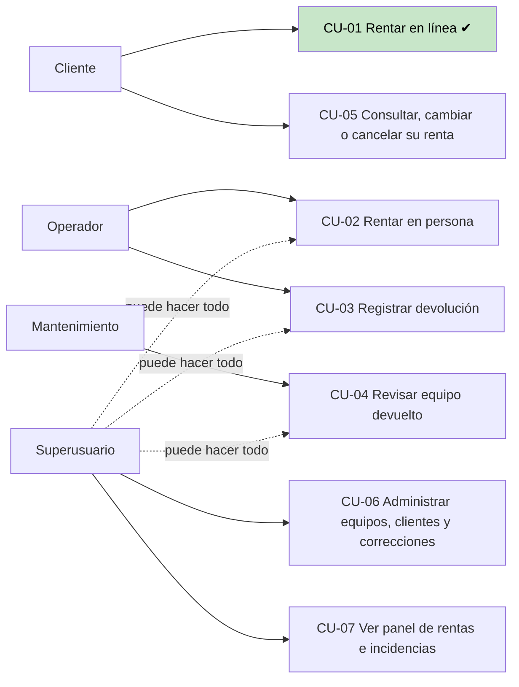

### 4.2 Casos de uso

| Caso | Actor | Sale de | Historia | Estado |
|---|---|---|---|---|
| **PRE-CU-01 Rentar en línea** | Cliente | PRE-02, PRE-03, PRE-04 (consultar, registrar y verificar); PRE-RF-01, PRE-RF-04 | PRE-HU-01 | **Implementado** |
| PRE-CU-02 Rentar en persona | Operador | PRE-03, PRE-04; PRE-RF-03 (rechazo por renta no recogida) | PRE-HU-04 | Propuesto |
| PRE-CU-03 Registrar devolución | Operador | PRE-05, PRE-06; PRE-RF-02 (devolución hasta 9:00 con 5 min de tolerancia) | PRE-HU-02 | Propuesto |
| PRE-CU-04 Revisar equipo devuelto | Mantenimiento | PRE-06; PRE-RF-04 | PRE-HU-03 | Propuesto |
| PRE-CU-05 Consultar, cambiar o cancelar | Cliente | PRE-08; ENT-24 (24 h de anticipación) | PRE-HU-06 | Propuesto |
| PRE-CU-06 Administrar y corregir | Superusuario | PRE-01, PRE-07 (corrección con motivo e historial) | PRE-HU-07, PRE-HU-08 | Propuesto; registrar equipos ya se puede en `/admin` |
| PRE-CU-07 Panel del responsable | Superusuario | PRE-06, PRE-08 | PRE-HU-09 | Propuesto |

Los recorridos de los casos propuestos están en el [anexo](#anexo-recorridos-de-los-demás-casos-de-uso).

### 4.3 Historias de usuario

| Historia | Como… quiero… para… | Caso | Estado |
|---|---|---|---|
| **PRE-HU-01** | Como cliente, quiero ingresar con mi usuario, elegir un equipo, indicar recojo y devolución y recibir la confirmación, para tener el equipo cuando lo necesito si está disponible. | CU-01 | **Hecha** |
| PRE-HU-02 | Como operador, quiero registrar la devolución con fecha, hora y observación, para que la renta quede "a tiempo" o "con retraso" y el equipo pase a revisión. | CU-03 | Propuesta |
| PRE-HU-03 | Como mantenimiento, quiero ver los equipos en revisión y pasarlos a disponible, reparación o baja con un comentario, para que no circule un equipo dañado. | CU-04 | Propuesta |
| PRE-HU-04 | Como operador, quiero rentar en persona para un cliente registrado o nuevo, para atender a quien no usa la web. | CU-02 | Propuesta |
| PRE-HU-05 | Como responsable, quiero que cada usuario tenga un rol, para que solo el personal registre entregas y devoluciones. | Todos | Propuesta |
| PRE-HU-06 | Como cliente, quiero ver mis rentas y cambiarlas o cancelarlas con 24 h de anticipación, para no perder el equipo si cambian mis planes. | CU-05 | Propuesta |
| PRE-HU-07 | Como superusuario, quiero registrar equipos y clientes, para tener el inventario en el sistema y no en hojas de cálculo. | CU-06 | Propuesta (en parte con `/admin`) |
| PRE-HU-08 | Como superusuario, quiero corregir un registro indicando el motivo, para arreglar un error sin perder el historial. | CU-06 | Propuesta |
| PRE-HU-09 | Como responsable, quiero un panel con rentas activas, vencidas, equipos en revisión e incidencias, para saber qué pasa sin preguntar. | CU-07 | Propuesta |
| PRE-HU-10 | Como cliente u operador, quiero filtrar el catálogo por tipo, fechas o estado, para encontrar rápido lo que necesito. | CU-01 | Propuesta |

Además hay dos tareas técnicas: **T-01**, prueba de carga con muchas rentas a la vez (ENT-02), y **T-02**, restricción en PostgreSQL contra rentas cruzadas.

### 4.4 Ciclo de vida de un equipo

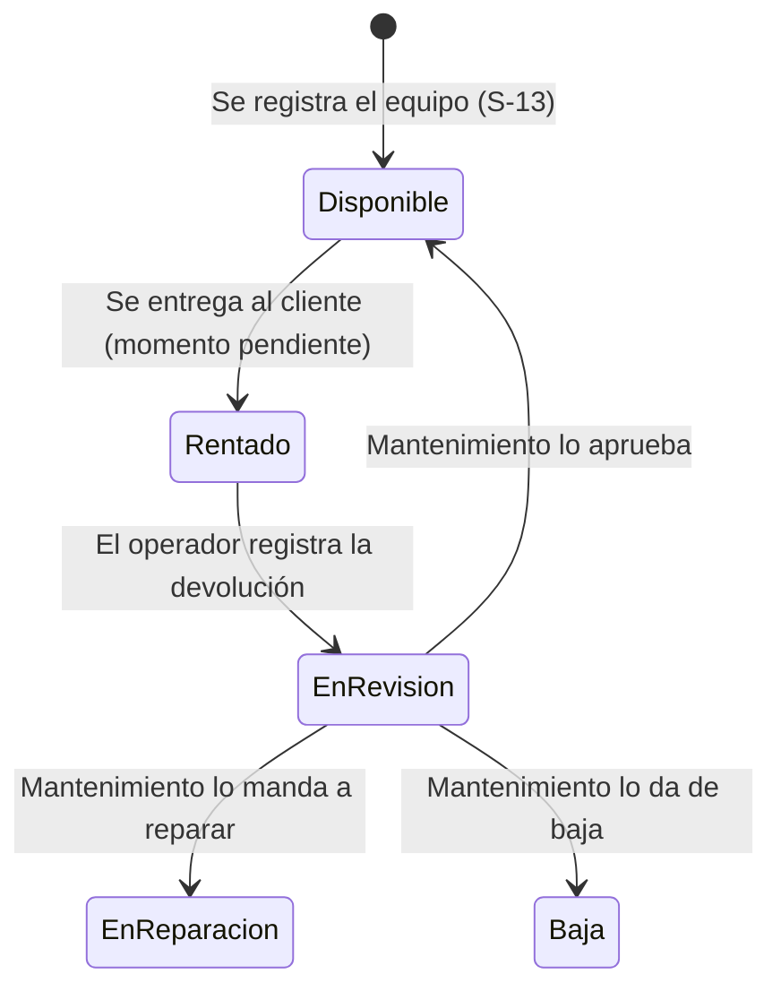

Solo dibujamos las transiciones que vienen del cliente (ENT-03, ENT-33, PRE-RF-04). Falta definir en qué momento pasa a "rentado", qué pasa al salir de reparación y si "baja" es definitiva. Hoy el código nunca pone un equipo en "rentado" (S-11), porque eso impediría rentarlo en otras fechas (ENT-10).

---

## 5. Qué ve cada usuario

| Usuario | Qué ve **hoy** | Qué verá después |
|---|---|---|
| **Cliente** | 1) Login → 2) catálogo con los equipos disponibles → 3) formulario con fecha y hora de recojo y de devolución; debajo de cada hora dice "Desde las 18:00" o "Hasta las 09:00" → 4) "Renta confirmada" con el equipo y las fechas. Si algo falla, ve la causa (E1 o E2). Botón "Cerrar sesión" en todas las páginas. | Sus rentas, y cambiar o cancelar (PRE-HU-06) |
| **Superusuario** | `/admin` de Django: equipos (buscar, filtrar por estado, crear, cambiar estado), rentas y usuarios | Panel de rentas e incidencias (PRE-HU-09); correcciones con motivo (PRE-HU-08) |
| **Operador** | Nada propio todavía. Mientras tanto, el superusuario lo hace desde `/admin` (S-02) | Rentar en persona y registrar devoluciones (PRE-HU-04, PRE-HU-02) |
| **Mantenimiento** | Nada propio todavía. Mientras tanto, el superusuario cambia el estado en `/admin` (S-02) | Lista de equipos en revisión y cambio de estado con comentario (PRE-HU-03) |

**Pantallas del cliente**

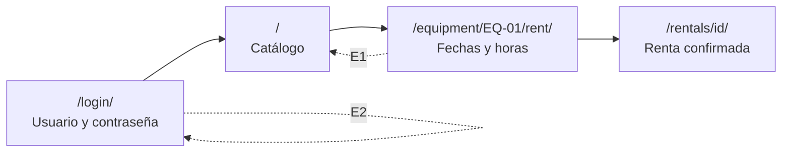

---

## 6. Cómo funciona por dentro

### 6.1 Recorrido del cliente

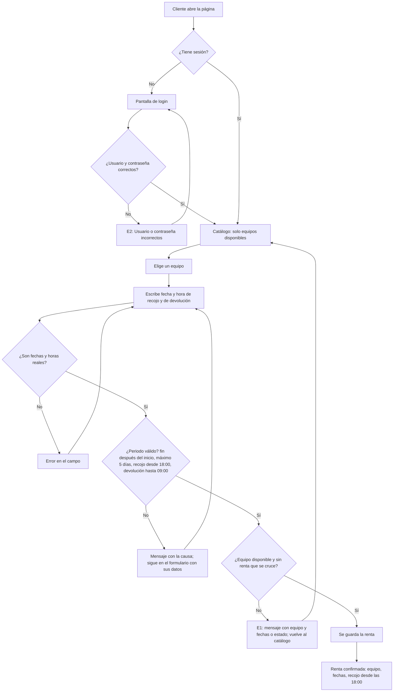

### 6.2 Cómo está organizado el código

Cada capa solo habla con la de abajo. Las reglas no saben nada de páginas ni de la base.

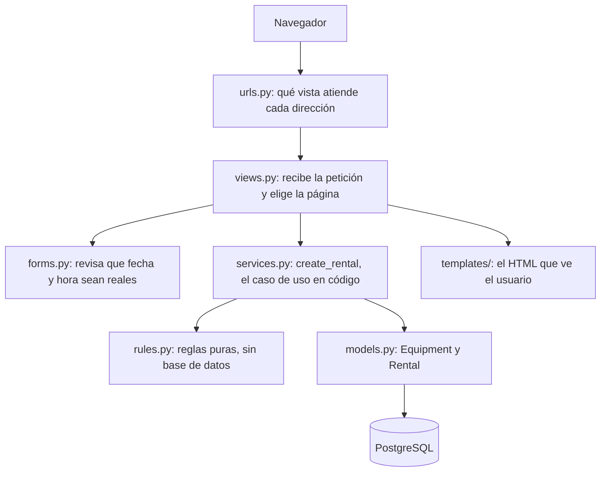

| Capa | Archivo | ¿Sabe de páginas? | ¿Sabe de la base? | Se prueba con |
|---|---|---|---|---|
| Reglas | `rentals/rules.py` | No | No | Pruebas unitarias (rápidas, sin base) |
| Servicio | `rentals/services.py` | No | Sí | Pruebas de integración con PostgreSQL |
| Formulario | `rentals/forms.py` | Solo los datos | No | Pruebas unitarias |
| Vistas | `rentals/views.py` | Sí | A través del servicio | Pruebas de integración con el navegador de pruebas |

### 6.3 Secuencia: renta aceptada y rechazo E1

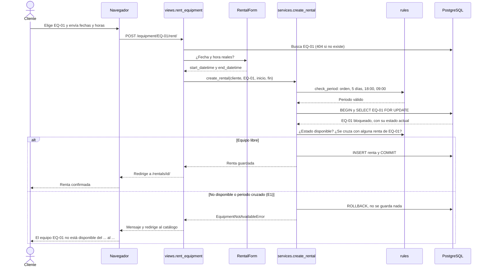

### 6.4 Secuencia: dos clientes al mismo tiempo (ENT-21)

La base hace esperar a la segunda petición; la regla de cruce, en el código, decide el rechazo.

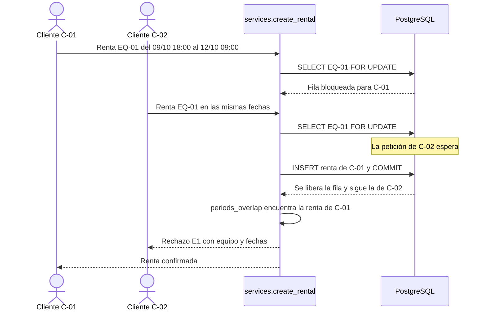

### 6.5 Reglas y las pruebas que las respaldan

| Regla | Sale de | Si no se cumple | Pruebas que la respaldan |
|---|---|---|---|
| Solo entra quien tiene usuario y clave | PRE-CU-01, E2 | "Usuario o contraseña incorrectos." | `test_login_correcto_abre_sesion_y_lleva_al_catalogo` · `test_login_incorrecto_muestra_el_mensaje_e2` (clave equivocada, usuario que no existe) · `test_sin_sesion_el_catalogo_redirige_al_login` · `test_cerrar_sesion_vuelve_al_login` |
| Solo se renta un equipo "disponible" | PRE-RF-04, ENT-33 | E1 con el estado; vuelve al catálogo | `test_solo_un_equipo_disponible_se_puede_rentar` (5 estados) · `test_un_equipo_en_revision_no_se_puede_rentar` · `test_el_estado_se_vuelve_a_leer_de_la_base_al_confirmar` · `test_el_catalogo_muestra_los_disponibles_y_oculta_los_que_estan_en_revision` |
| Dos rentas del mismo equipo no se cruzan; tocarse en el borde no es cruce | PRE-RF-01, ENT-10 | E1 con equipo y fechas; vuelve al catálogo | `test_cruce_de_periodos` (8 casos) · `test_si_c01_ya_tiene_eq01_la_renta_de_c02_en_esas_fechas_se_rechaza` · `test_el_mismo_equipo_se_puede_rentar_cuando_termina_la_renta_anterior` · `test_c02_es_rechazado_y_vuelve_al_catalogo_con_el_mensaje_e1` |
| La disponibilidad es por unidad, no por modelo | ENT-09 | — | `test_otra_unidad_del_mismo_modelo_si_se_puede_rentar_en_las_mismas_fechas` |
| El primero en confirmar se queda el equipo | ENT-21 | El segundo recibe E1 | Uno detrás de otro: `test_si_c01_ya_tiene_eq01…`. Al mismo instante: **sin prueba automática** (T-01) |
| La devolución es después del recojo | Sentido común; también lo exige la base | Mensaje en el formulario | `test_un_periodo_invalido_se_rechaza_con_su_mensaje` (devolución antes del recojo) |
| Máximo 5 días | ENT-18 (S-07) | Mensaje en el formulario | `test_una_renta_dura_como_maximo_5_dias` (3 casos) · `test_un_periodo_invalido_se_rechaza_con_su_mensaje` (más de 5 días) · `test_un_periodo_invalido_deja_al_cliente_en_el_formulario_con_la_causa` (más de 5 días) |
| Recojo desde 18:00 y devolución hasta 09:00 | ENT-19 (S-08) | Mensaje en el formulario, con lo que escribió el cliente | `test_el_recojo_es_desde_las_18_00` (4) · `test_la_devolucion_es_hasta_las_09_00` (3) · `test_un_periodo_invalido_se_rechaza_con_su_mensaje` (17:00, 10:00) · `test_un_periodo_invalido_deja_al_cliente_en_el_formulario_con_la_causa` (17:00, 09:30) · `test_el_formulario_no_aplica_el_horario_lo_hace_el_servicio` · `test_las_ayudas_de_los_campos_muestran_el_horario` |
| Fecha y hora deben ser reales | PRE-CU-01 paso 6 | Error en el campo | `test_datos_validos_se_convierten_en_fecha_y_hora_de_la_paz` · `test_datos_que_no_son_fecha_u_hora_se_rechazan_en_su_campo` (5 casos) |
| Cada cliente ve solo su confirmación | Privacidad | 404 (no encontrado) | `test_un_cliente_no_puede_ver_la_confirmacion_de_otro` |
| El equipo debe existir | Precondición de PRE-CU-01 | 404 | `test_rentar_un_equipo_que_no_existe_responde_404_y_no_guarda_nada` |

### 6.6 Límites conocidos

- Una renta creada a mano en `/admin` no pasa por la regla de cruce. La base solo exige que el fin sea después del inicio. Lo cierra T-02.
- La regla "dos clientes al mismo instante" no tiene prueba automática; el diseño está en 6.4 (T-01).
- No hay roles: operador y mantenimiento no tienen pantallas propias.
- Se aceptan fechas pasadas (S-06), porque ENT-17 dice que no hay límite de anticipación.

---

## 7. Supuestos

Lo que el sistema hace **sin** confirmación del cliente. Cada uno está marcado `# ASSUMPTION` en el código para encontrarlo y cambiarlo rápido.

| ID | Supuesto | Por qué | Si el cliente dice otra cosa |
|---|---|---|---|
| S-01 | El incremento incluye el inicio de sesión | El recorrido pedido empieza con login | Ya está hecho |
| S-02 | Solo existe el rol cliente; el superusuario usa `/admin` | Los roles son PRE-HU-05 | PRE-HU-05 |
| S-03 | Los clientes se crean con `seed_demo` o en `/admin`; no hay registro propio | ENT-15 dice "puede ser los dos" | PRE-HU-04, PRE-HU-07 |
| S-04 | El catálogo muestra solo los equipos disponibles | Sin respuesta | Cambiar un filtro |
| S-05 | Se permiten rentas futuras y se comparan periodos | ENT-10 lo describe | Rentar solo "desde ahora" |
| S-06 | No se rechazan fechas pasadas | ENT-17: "no hay límite con la anticipación" | Agregar una regla |
| S-07 | Máximo 5 días para todos; las 2 semanas del cliente frecuente no se aplican | ENT-18; ENT-20 "no lo sé todavía" | Cambiar la constante |
| S-08 | Fuera de horario (antes de 18:00 o después de 09:00) se **rechaza**, no se corrige | ENT-19; sin respuesta | Cambiar las constantes o corregir la hora |
| S-10 | Los 5 min de tolerancia son para la devolución real, no para pedir la renta | ENT-31 habla de la devolución | Sumar 5 min a la regla |
| S-11 | Al confirmar, el estado no cambia; "rentado" no se usa | Si pasara a "rentado", no se podría rentar en otras fechas (ENT-10) | Definir con PRE-HU-02 |
| S-12 | Solo "disponible" se renta; reparación, rentado y baja también bloquean | El cliente solo dijo que "en revisión" bloquea | Cambiar la lista |
| S-13 | Un equipo nuevo empieza "disponible" | Sin respuesta | Cambiar el valor por defecto |
| S-14 | Sin devoluciones registradas, el equipo se puede rentar apenas termina la renta anterior | PRE-RF-04 pide revisión, pero aún no hay devolución | PRE-HU-02 y PRE-HU-03 |
| S-15 | Una renta es de una sola unidad; sin combos | ENT-08 pendiente | Modelo de combo |
| S-16 | Los textos de E1 y E2 son provisionales | PRE-RC-01 propuesto | Cambiar textos |
| S-17 | Los números de inventario distinguen mayúsculas | Pendiente desde la iteración 1 | Quitar el `skip` y ajustar la búsqueda |
| S-18 | Zona horaria de La Paz | Las 18:00 y 09:00 son horas locales | — |
| S-19 | Datos ficticios: 3 mesas, 3 sillas, clientes `c01` y `c02` | ENT-07; el encargo pide datos ficticios | — |
| S-20 | Sin precios, pagos ni multas | El encargo los excluye; ENT-26 sin respuesta | Nuevas historias |

(S-09, "horas cada 30 minutos", se retiró: ahora el cliente escribe cualquier hora y la regla del horario la aplica el servicio.)

---

## 8. Base de datos y pruebas

### 8.1 Modelo de datos

Dos tablas propias y la tabla de usuarios de Django. Se declaran en `rentals/models.py` y se crean con la migración `0001_initial`.

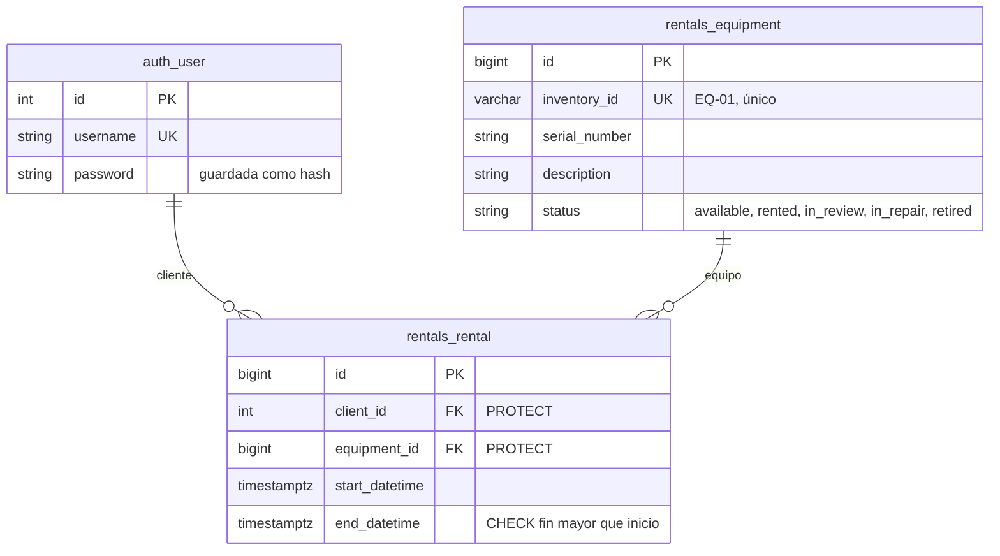

- **`PROTECT`:** no se puede borrar un cliente ni un equipo que tenga rentas; así no se pierde el historial.
- **`CHECK`:** la propia base rechaza una renta que termina antes de empezar, aunque alguien salte el código.
- **Bloqueo de fila:** al confirmar, la fila del equipo queda bloqueada hasta guardar (sección 6.4).

### 8.2 Pruebas

Cada prueba dice en español su **caso, entrada, condiciones, resultado esperado, requisito y código que cubre**, y comprueba con `assert` el resultado exacto.

```python
def test_si_c01_ya_tiene_eq01_la_renta_de_c02_en_esas_fechas_se_rechaza(...):
    """Caso:               C-01 confirmó EQ-01 primero; después C-02 pide EQ-01 para el mismo periodo.
    Entrada:            c02, eq01, recojo 09/10 18:00, devolución 12/10 09:00.
    Condiciones:        ya existe la renta de C-01 para ese periodo.
    Resultado esperado: EquipmentNotAvailableError con equipo y fechas; sigue una sola renta.
    Requisito:          PRE-RF-01 y PRE-RC-01.
    Código que cubre:   services.create_rental() y check_equipment_is_free()."""
```

- **Unitaria:** prueba una función sola, sin base de datos.
- **Integración:** usa una base PostgreSQL de pruebas (`test_astra_rent`) que se crea y se borra sola. Cada prueba empieza con la base vacía y crea solo lo que necesita. La base de la demo no se toca.

| Archivo | Tipo | Pruebas | Qué cubre | Responsable |
|---|---|---:|---|---|
| `unit/test_rules.py` | Unitaria | 23 | Cruce de periodos, estados, 5 días, 18:00 y 09:00 | Andrés |
| `unit/test_check_period.py` | Unitaria | 5 | Tipo de error y mensaje exacto de cada periodo inválido | Andrés |
| `unit/test_rental_form.py` | Unitaria | 9 | El formulario convierte texto en fecha y hora de La Paz; no aplica el horario | Sofia |
| `integration/test_views.py` | Integración | 14 (1 omitida) | Login, E2, catálogo, recorrido completo, E1, errores de periodo, 404 | Sofia |
| `integration/test_rental_service.py` | Integración | 6 | Guardar, rechazo E1, en revisión, otra unidad, borde, estado releído de la base | Peter |
| `conftest.py`, `helpers.py` | Datos de prueba | — | Clientes C-01 y C-02, equipos EQ-01 a EQ-03, fechas del escenario | Peter |
| `test_loans*.py` | Iteración 1 | 25 (4 omitidas) | `rent_manager`, la primera versión por terminal | Los tres |
| **Total** | | **82** | **77 pasan, 5 omitidas** | |

- **Las 25 pruebas de la iteración 1 se conservan** como prueba de regresión: si alguien rompe `rent_manager`, se ve al instante.
- **Las 5 omitidas tienen escrito su motivo** (`python -m pytest -rs`): 4 esperan información del cliente y 1 espera la devolución, que no está en este incremento.
- **Lo que no cubren:** dos clientes en el mismo instante (T-01), rentas creadas desde `/admin` (T-02), y lo que todavía no existe (roles, devolución, revisión).

### 8.3 Trazabilidad

Desde la necesidad del encargo hasta la prueba que la verifica y lo que se observó al ejecutarla.

| Necesidad | Requisito | Modelo | Verificación | Resultado |
|---|---|---|---|---|
| PRE-03 (registrar una renta) | PRE-HU-01, PRE-CU-01 caso normal | 6.1, 6.3 | `test_una_renta_valida_se_guarda_y_el_equipo_sigue_disponible` · `test_recorrido_completo_c01_renta_eq01_y_ve_la_confirmacion` | Pasa |
| PRE-04 (verificar disponibilidad) | PRE-RF-01 (el primero se queda el equipo) | 6.3, 6.4 | `test_cruce_de_periodos` · `test_si_c01_ya_tiene_eq01…` · `test_c02_es_rechazado…` | Pasa |
| PRE-04 | PRE-RF-04 (en revisión no se renta) | 4.4 | `test_solo_un_equipo_disponible…` · `test_un_equipo_en_revision…` · `test_el_estado_se_vuelve_a_leer…` | Pasa |
| PRE-04 (mensajes claros) | PRE-RC-01 (el rechazo dice la causa) | 6.3 | `test_un_periodo_invalido_se_rechaza_con_su_mensaje` · mensajes exactos en servicio y vistas | Pasa |
| PRE-03 (entrega y vencimiento) | ENT-18 (S-07), ENT-19 (S-08) | 6.1 | `test_una_renta_dura_como_maximo_5_dias` · `test_el_recojo_es_desde_las_18_00` · `test_un_periodo_invalido_deja_al_cliente…` | Pasa |
| PRE-01 (equipos individuales) | ENT-09 | 8.1 | `test_otra_unidad_del_mismo_modelo…` | Pasa |
| Acceso del cliente | PRE-CU-01 pasos 1 a 3 y E2 | 6.1 | `test_login_correcto…` · `test_login_incorrecto…` · `test_cerrar_sesion…` | Pasa |
| Privacidad | Cada cliente ve lo suyo | — | `test_un_cliente_no_puede_ver_la_confirmacion_de_otro` | Pasa |
| Simultaneidad | ENT-21 | 6.4 | Sin prueba automática (T-01) | Pendiente |
| Inventario | ¿Distingue mayúsculas? (S-17) | — | `test_numero_de_inventario_en_minusculas…` | Omitida: falta respuesta |

---

## 9. Cronograma, ruta crítica y bloqueantes

### 9.1 Estimación

Un **día de trabajo** es una noche de lunes a viernes, de unas 3 horas. Los fines de semana no se cuentan. El trabajo empieza el martes 13/10 y la materia termina el 04/11.

| ID | Trabajo | Días | Depende de | Responsable | Por qué esa estimación |
|---|---|---:|---|---|---|
| H05 | Roles y permisos (PRE-HU-05) | 2 | — | Andrés | Django ya trae grupos y permisos |
| H02 | Devolución a tiempo o con retraso (PRE-HU-02) | 3 | H05 | Andrés | Modelo nuevo, regla de 09:05 y pantalla del operador |
| H03 | Revisión de mantenimiento con historial (PRE-HU-03) | 3 | H02 | Peter | Tabla de historial (quién, cuándo, comentario) y pantalla |
| H08 | Corrección con motivo (PRE-HU-08) | 3 | H03 | Peter | Reutiliza el historial de H03 |
| H09 | Panel del responsable (PRE-HU-09) | 2 | H08 | Sofia | Consultas sobre rentas, devoluciones, revisiones y correcciones |
| ENT | Entrega final: regresión, README, requisitos vigentes, trazabilidad y registro de cambios | 2 | Todo | Los tres | Lo que pide la entrega común del encargo |
| H04 | Renta en persona (PRE-HU-04) | 3 | H05 | Andrés | Reutiliza `create_rental`; nuevo: registrar cliente y PRE-RF-03 |
| H07 | Registro de equipos y clientes (PRE-HU-07) | 1 | H05 | Peter | Gran parte ya existe en `/admin` |
| T01 | Prueba de carga y de dos clientes al mismo tiempo (ENT-02) | 2 | — | Peter | Primera vez que hacemos una |
| T02 | Restricción contra rentas cruzadas en PostgreSQL | 1 | — | Peter | Django la trae (`ExclusionConstraint`) |
| H10 | Filtros del catálogo (PRE-HU-10) | 1 | — | Sofia | Un campo de categoría y un filtro |
| H06 | Consultar, cambiar o cancelar (PRE-HU-06) | 2 | — | Sofia | Pantalla "mis rentas" y regla de 24 h |

### 9.2 Red de dependencias

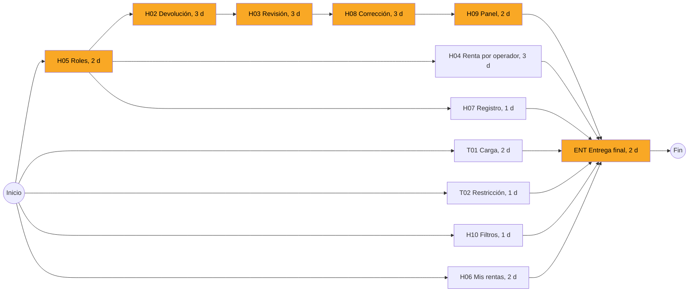

**Por qué ese orden:**

- **Roles antes que devolución:** solo el personal puede registrar una devolución.
- **Devolución antes que revisión:** un equipo entra "en revisión" cuando se devuelve (PRE-RF-04).
- **Revisión antes que corrección:** la corrección guarda el valor anterior en el historial que crea la revisión.
- **Corrección antes que panel:** el panel muestra quién usó cada equipo y qué incidencias y correcciones hubo.
- **Todo antes de la entrega:** la regresión y la trazabilidad se hacen sobre el sistema completo.

### 9.3 Cálculo de la ruta crítica

IT y FT son el inicio y fin más temprano; ITa y FTa, el inicio y fin más tarde sin atrasar la entrega. **Holgura = ITa − IT.** Holgura 0 es ruta crítica.

| Trabajo | Días | IT | FT | ITa | FTa | Holgura |
|---|---:|---:|---:|---:|---:|---:|
| H05 | 2 | 0 | 2 | 0 | 2 | **0** |
| H02 | 3 | 2 | 5 | 2 | 5 | **0** |
| H03 | 3 | 5 | 8 | 5 | 8 | **0** |
| H08 | 3 | 8 | 11 | 8 | 11 | **0** |
| H09 | 2 | 11 | 13 | 11 | 13 | **0** |
| ENT | 2 | 13 | 15 | 13 | 15 | **0** |
| H04 | 3 | 2 | 5 | 10 | 13 | 8 |
| H07 | 1 | 2 | 3 | 12 | 13 | 10 |
| T01 | 2 | 0 | 2 | 11 | 13 | 11 |
| H06 | 2 | 0 | 2 | 11 | 13 | 11 |
| T02 | 1 | 0 | 1 | 12 | 13 | 12 |
| H10 | 1 | 0 | 1 | 12 | 13 | 12 |

- **Ruta crítica: H05 → H02 → H03 → H08 → H09 → ENT = 2 + 3 + 3 + 3 + 2 + 2 = 15 días de trabajo.** Pasa por los tres integrantes.
- 15 días de trabajo, del martes 13/10 al lunes 02/11. **El martes 03/11 queda de reserva**, antes del cierre de la materia.
- Los demás trabajos tienen entre 8 y 12 días de holgura: se usan para repartir la carga.

### 9.4 Gantt
[GitHub Gantt](https://github.com/users/peterteranb/projects)
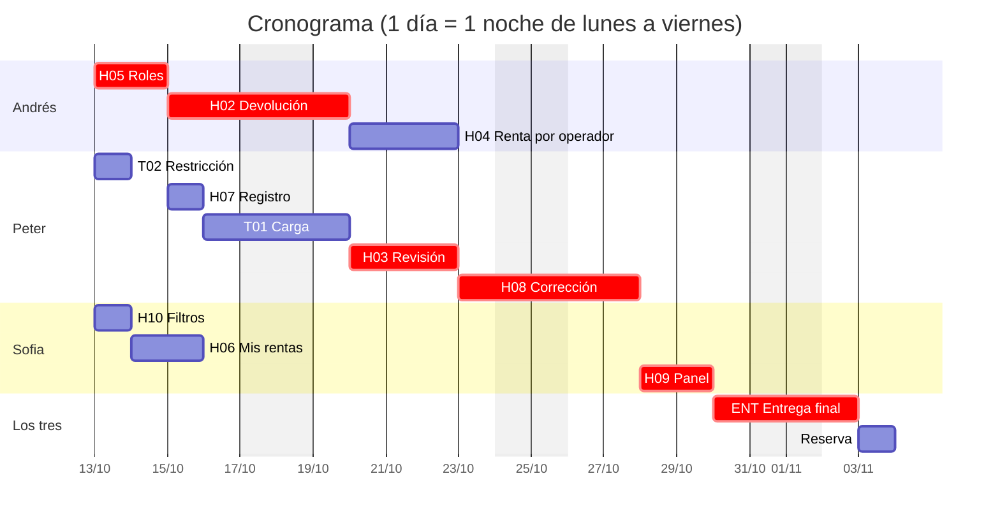

| Trabajo | Resp. | 13 | 14 | 15 | 16 | 19 | 20 | 21 | 22 | 23 | 26 | 27 | 28 | 29 | 30 | 02 | 03 |
|---|---|---|---|---|---|---|---|---|---|---|---|---|---|---|---|---|---|
| H05 ★ | Andrés | ■ | ■ | | | | | | | | | | | | | | |
| H02 ★ | Andrés | | | ■ | ■ | ■ | | | | | | | | | | | |
| H04 | Andrés | | | | | | ■ | ■ | ■ | | | | | | | | |
| T02 | Peter | ■ | | | | | | | | | | | | | | | |
| H07 | Peter | | | ■ | | | | | | | | | | | | | |
| T01 | Peter | | | | ■ | ■ | | | | | | | | | | | |
| H03 ★ | Peter | | | | | | ■ | ■ | ■ | | | | | | | | |
| H08 ★ | Peter | | | | | | | | | ■ | ■ | ■ | | | | | |
| H10 | Sofia | ■ | | | | | | | | | | | | | | | |
| H06 | Sofia | | ■ | ■ | | | | | | | | | | | | | |
| H09 ★ | Sofia | | | | | | | | | | | | ■ | ■ | | | |
| ENT ★ | Los tres | | | | | | | | | | | | | | ■ | ■ | |
| Reserva | — | | | | | | | | | | | | | | | | □ |

★ = ruta crítica. Del 16/10 al 27/10, Sofia hace en pareja las pantallas de H02, H03 y H08 con quien lleva cada historia. Cada historia termina con su PR revisado por otro integrante.

**Contingencia:** si Andrés se atrasa en H05 o H02, Peter lo apoya: sus trabajos de esos días (H07, T01) tienen holgura. Un atraso de un día en la ruta crítica consume la reserva del 03/11.

### 9.5 Bloqueantes e información que nos falta

| Bloqueante | Bloquea | Qué necesitamos saber |
|---|---|---|
| Cómo se identifica cada rol | H05 y toda la ruta crítica | Si basta con usuarios y grupos de Django |
| Límite exacto de la devolución | H02 | Si 09:05:00 exactas está a tiempo y desde cuándo se cuenta el retraso |
| Devolución repetida | H02 | Qué pasa si se registra dos veces la misma devolución |
| Salida de reparación | H03 | Si vuelve directo a disponible o pasa otra vez por revisión |
| Plazo para recoger (ENT-22) | H04 (PRE-RF-03) | Si es hasta las 20:00 del mismo día o hasta las 12:00 del siguiente |
| Combos (ENT-08) | H04 | Si un combo con un equipo no disponible se rechaza entero |
| Vista del responsable (ENT-28) | H09 | Qué necesita ver al entrar |
| Multa por cancelar tarde (ENT-24) | H06 | El porcentaje |
| Demora aceptable (ENT-29) | T01 | Qué tiempo de respuesta es inaceptable |

---

## 10. Riesgos

| # | Riesgo | Probabilidad | Consecuencia | Respuesta prevista | Seguimiento |
|---|---|---|---|---|---|
| R1 | Se atrasa la ruta crítica | Media | Se pierde la reserva y luego se atrasa la entrega | Empezar por H05; Peter apoya a Andrés con lo que tiene holgura | Daily review contra el Gantt |
| R2 | La información del cliente tarda | Alta | Trabajamos con supuestos que pueden cambiar | Supuestos marcados `# ASSUMPTION` y en constantes fáciles de cambiar | Revisar la tabla 9.5 en cada clase |
| R3 | Una renta creada en `/admin` se cruza con otra | Media | Dos clientes con el mismo equipo | T-02; mientras tanto, no crear rentas en `/admin` | Prueba que intente guardar una renta cruzada directo en la base |
| R4 | La simultaneidad falla con mucha carga | Baja | Doble renta en un evento real | T-01 | Resultado de T-01 |
| R5 | El conocimiento queda en una sola persona | Alta | Nadie más puede explicar o cambiar esa parte | Pruebas repartidas: cada uno sube y explica las suyas; revisión cruzada de PR | Cada uno explica una parte que no escribió |
| R6 | Un cambio de último momento rompe lo que funciona | Media | Falla la demo o la entrega | Solo se integra por PR con las pruebas pasando | `pytest` en `main` después de cada merge |

---

## 11. Avance y plan

### 11.1 Barra de avance

PRE-HU-01 equivale a unos 4 días de trabajo y faltan 25 (sección 9.1).

```text
Esfuerzo     ███░░░░░░░░░░░░░░░░░   14 %   (4 de 29 días de trabajo)
Encargo      ███████░░░░░░░░░░░░░   1 de 8 necesidades hecha y 3 en parte
Historias    1 de 10 terminadas · tareas técnicas 0 de 2
```

### 11.2 Avance por necesidad del encargo

| Necesidad | Estado | Qué falta |
|---|---|---|
| PRE-01 Registrar equipos y solicitantes | En parte | Existe por `/admin` y `seed_demo`; falta registro por el operador (PRE-HU-07) |
| PRE-02 Consultar disponibilidad con filtros | En parte | Catálogo sin filtros (PRE-HU-10) |
| PRE-03 Registrar renta con equipo, persona, entrega y vencimiento | **Hecho** para el cliente en línea | Renta por el operador (PRE-HU-04) |
| PRE-04 Verificar disponibilidad y condiciones del solicitante | En parte | Falta "renta anterior no recogida" (PRE-RF-03) |
| PRE-05 Registrar devolución | No | PRE-HU-02 |
| PRE-06 Vencidos y equipos en revisión | No | PRE-HU-02, PRE-HU-03, PRE-HU-09 |
| PRE-07 Corrección con motivo e historial | No | PRE-HU-08 |
| PRE-08 Activos, historial y vista del responsable | No | PRE-HU-06, PRE-HU-09 |

### 11.3 Plan de avance

| Incremento | Hasta | Trabajo | Qué se podrá demostrar |
|---|---|---|---|
| 1 | Hoy | PRE-HU-01 | El cliente renta en línea; rechazos E1 y E2; datos en PostgreSQL |
| 2 | 22/10 | H05, H02, H03, H07, H10, H06, T01, T02 | El operador registra la devolución; mantenimiento la revisa; el cliente ve y cancela sus rentas; catálogo con filtros; la base rechaza rentas cruzadas |
| 3 | 27/10 | H04, H08 | Renta en persona por el operador; correcciones con motivo e historial |
| 4 | 02/11 | H09, ENT | Panel del responsable; entrega final con regresión, README, requisitos y trazabilidad |

---

## 12. Quién hizo qué y cómo trabajamos

### 12.1 Aporte de cada integrante

| Integrante | Rol principal | Aporte en código y pruebas |
|---|---|---|
| **Peter** | Base de datos y coordinación | Instalación de Django con PostgreSQL, modelos y migración, organización en reglas / servicio / vistas, datos de demo, README, ramas y PR. Pruebas: `conftest.py`, `helpers.py`, `test_rental_service.py` |
| **Andrés** | Backend | Primera versión del backend de `rentals` y `accounts`: modelos, servicio con transacción y bloqueo de fila, inicio de sesión. Pruebas: `test_rules.py`, `test_check_period.py` |
| **Sofia** | Frontend y documentación | Diagramas de casos de uso por rol, tablero del proyecto, documentación. Pruebas: `test_rental_form.py`, `test_views.py` |
| **Los tres** | — | Iteración 1 (`rent_manager`) en programación en grupo con rotación; entrevista y requisitos; casos de uso y modelos; plan del incremento |

### 12.2 Cómo trabajamos

- **Entrega incremental:** iteración 1 con funciones y terminal; iteración 2 con Django, PostgreSQL y pantallas. Cada incremento se ejecuta y se prueba.
- **Tablero del proyecto y daily review** para ver qué falta y quién lo hace.
- **Pruebas automáticas** y **revisión de cada cambio por otra persona** antes de entrar a `main`.

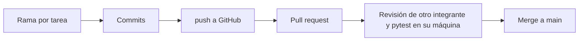

| Cambio | Rama | Abrió | Revisaron |
|---|---|---|---|
| Flujo de renta: login, catálogo, formulario, confirmación | `feature/rental-flow` | Peter | Sofia y Andrés |
| Hora libre en el formulario | `feature/free-time-input` | Peter | Sofia y Andrés |
| Pruebas reescritas, un commit por integrante | `test/clearer-tests` (PR #28) | Sofia | Andrés |

---

## Anexo: recorridos de los demás casos de uso

Propuestas armadas con el encargo y la entrevista.

### PRE-CU-02 — El operador renta en persona

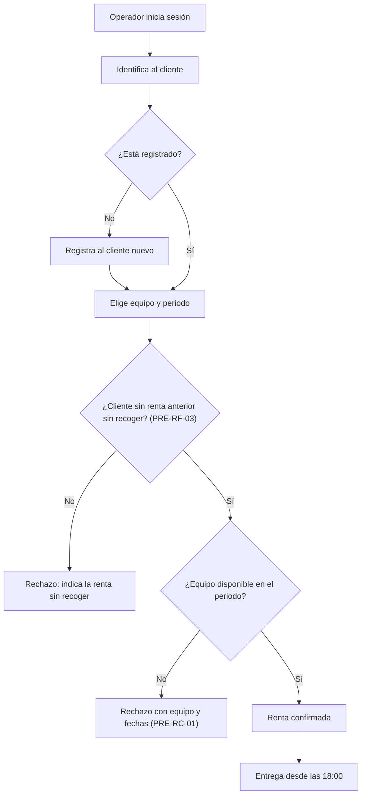

### PRE-CU-03 — El operador registra la devolución

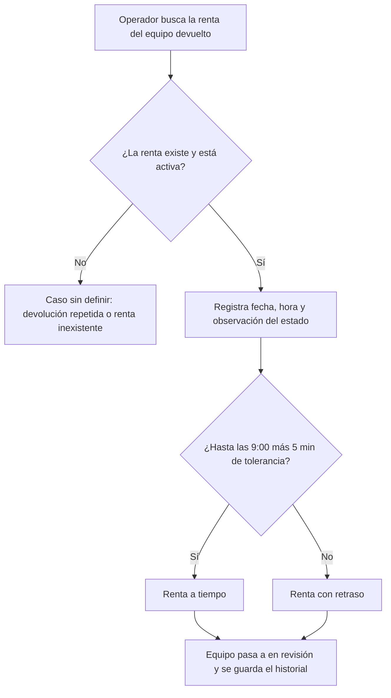

### PRE-CU-04 — Mantenimiento revisa el equipo devuelto

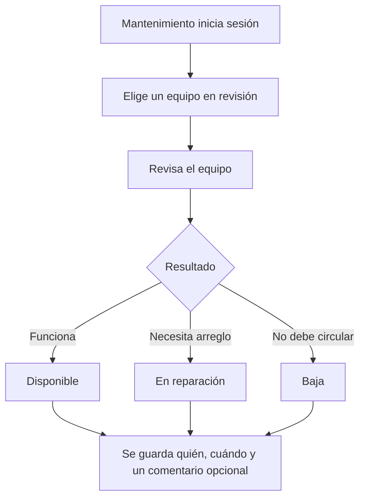

### PRE-CU-05 — El cliente consulta, cambia o cancela

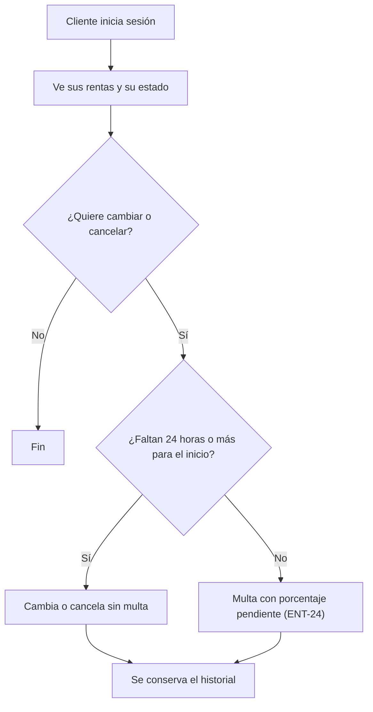

### PRE-CU-06 y PRE-CU-07 — El superusuario administra y supervisa

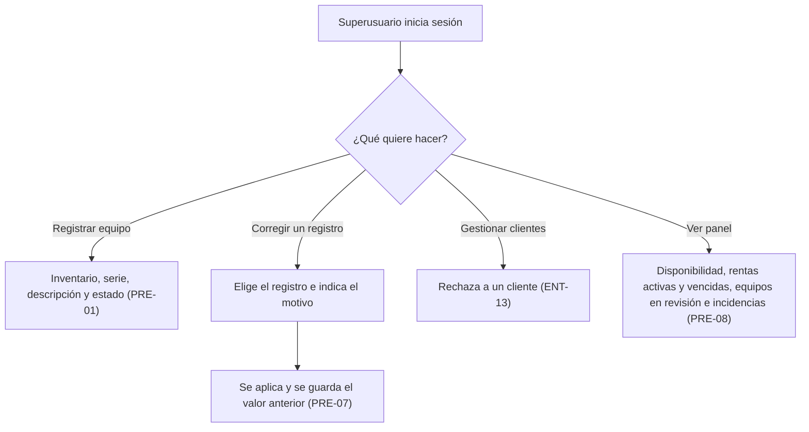
