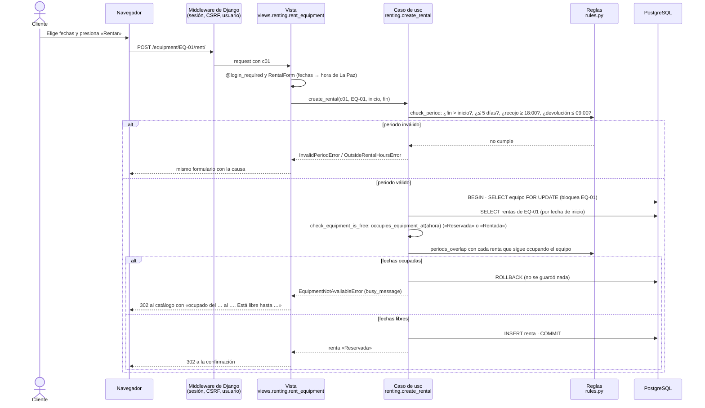
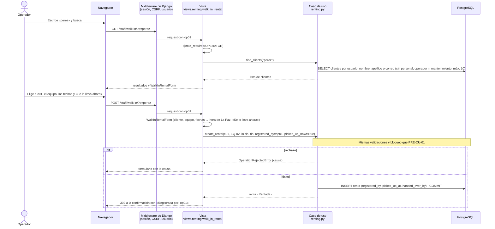
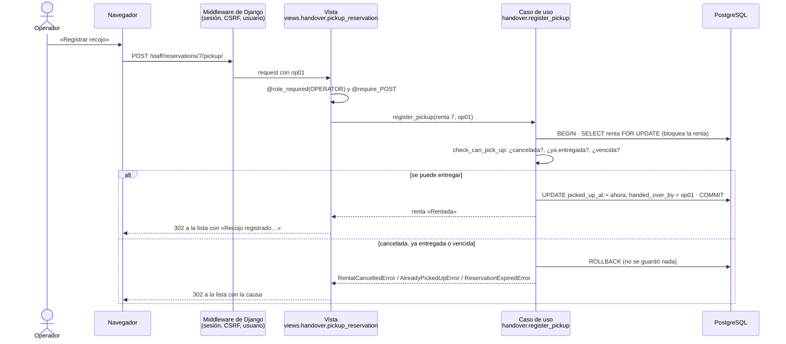
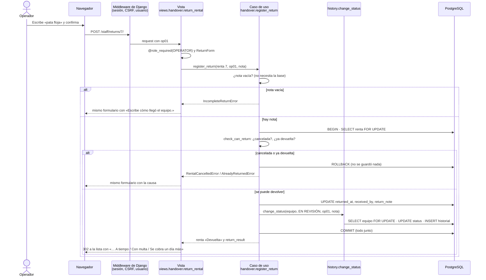
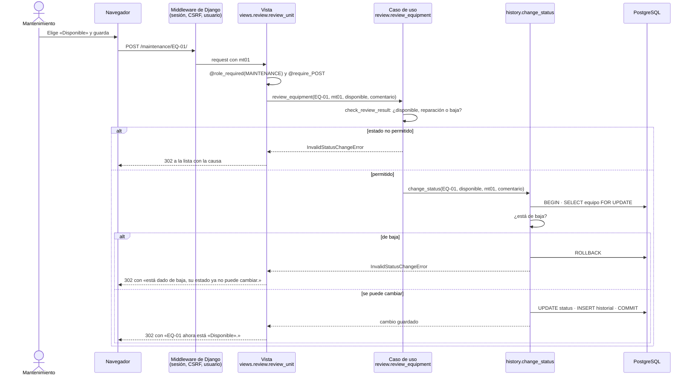
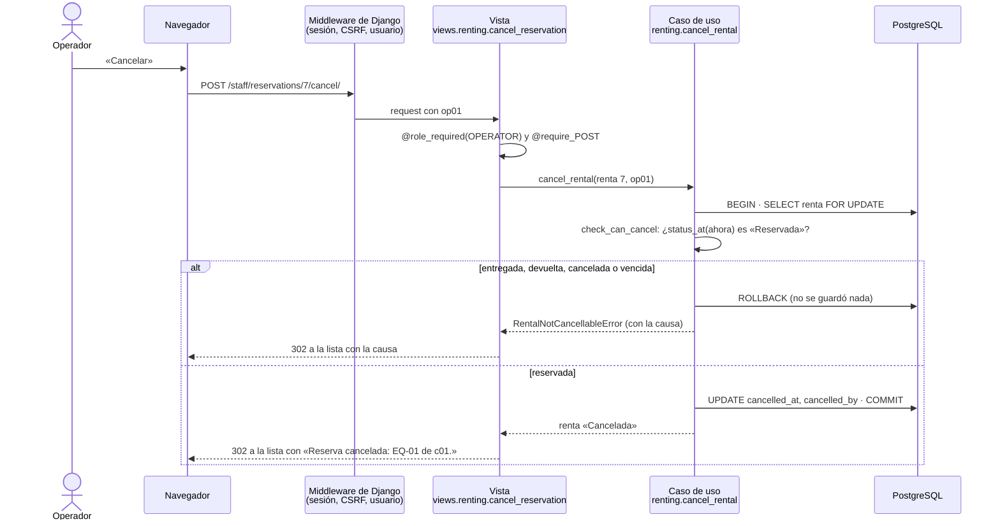

# Casos de uso y diagramas de secuencia del MVP

Un caso de uso por sección: primero **qué hace** (actor, pasos y rechazos), después **cómo lo hace el código**.

**Cómo leer los diagramas:**
- Flecha continua: una llamada.
- Flecha punteada: la respuesta.
- `alt` separa el camino de éxito del de rechazo.
- Todo rechazo ocurre **antes** de escribir en la base, así que la base no cambia.

**Lo que hace Django antes de cada vista, en todos los casos:**
1. El middleware carga la sesión.
2. Valida el token CSRF de los formularios.
3. Pone en `request.user` a la persona que inició sesión.
4. Después, el decorador de la vista revisa el rol: `@login_required` para el cliente, `@role_required(...)` para el personal.

| Caso de uso | Actor | Resultado | Código |
|---|---|---|---|
| [PRE-CU-01 Rentar en línea](#pre-cu-01--rentar-en-línea) | Cliente | Renta «Reservada» | `renting.create_rental` |
| [PRE-CU-02 Rentar en la tienda](#pre-cu-02--rentar-en-la-tienda) | Operador | Renta «Reservada» o «Rentada» | `renting.find_clients`, `renting.create_rental` |
| [PRE-CU-03 Entregar el equipo](#pre-cu-03--entregar-el-equipo) | Operador | Renta «Rentada» | `handover.register_pickup` |
| [PRE-CU-04 Registrar la devolución](#pre-cu-04--registrar-la-devolución) | Operador | Renta «Devuelta», equipo «En revisión» | `handover.register_return` |
| [PRE-CU-05 Revisar el equipo](#pre-cu-05--revisar-el-equipo) | Mantenimiento | Disponible, en reparación o baja | `review.review_equipment` |
| [PRE-CU-06 Cancelar una reserva](#pre-cu-06--cancelar-una-reserva) | Operador o admin | Renta «Cancelada» | `renting.cancel_rental` |

---

## PRE-CU-01 — Rentar en línea

| | |
|---|---|
| **Actor** | Cliente (`c01`) |
| **Disparador** | Elige un equipo del catálogo y unas fechas. |
| **Pasos** | 1. Elige el equipo en el catálogo, que muestra «Ocupado del … al …» (hasta 3 periodos) o «Libre» (`renting.catalog_entries`). 2. Escribe el recojo (desde las 18:00) y la devolución (hasta las 09:00). 3. Confirma. 4. Ve la confirmación. |
| **Rechazos** | Fechas inválidas: se queda en el formulario con la causa. Fechas ocupadas: vuelve al catálogo con «El equipo EQ-01 está ocupado del … al ….» y, si esa renta empieza después del recojo pedido, «Está libre hasta el … a las 09:00.». |
| **Reglas** | PRE-RF-01 (gana el primero, sin cruces), ENT-19, ENT-52, ENT-64. |

**Por qué se bloquea la fila del equipo:** si dos clientes confirman a la vez, el segundo espera a que termine el primero, ve su renta y recibe el rechazo. Así «gana el primero que hizo clic» (ENT-21).

---

## PRE-CU-02 — Rentar en la tienda

| | |
|---|---|
| **Actor** | Operador (`op01`) |
| **Disparador** | Un cliente llega a la tienda. |
| **Pasos** | 1. Abre «Renta en tienda» y busca al cliente por nombre, apellido, usuario o correo. 2. Lo elige. 3. Elige el equipo y las fechas. 4. Si el cliente se lo lleva en ese momento, marca «Se lo lleva ahora». 5. Confirma. 6. Ve la confirmación con «Registrada por: op01». |
| **Rechazos** | Los mismos de PRE-CU-01: las reglas son iguales para todos. |
| **Reglas** | ENT-53, ENT-54, ENT-57. La renta queda «Registrada por: op01». Con «Se lo lleva ahora» nace «Rentada». |

---

## PRE-CU-03 — Entregar el equipo

| | |
|---|---|
| **Actor** | Operador (`op01`) |
| **Disparador** | El cliente llega a recoger. |
| **Pasos** | 1. Abre «Reservas por entregar». 2. Presiona «Registrar recojo» en la renta. 3. Ve «Recojo registrado: EQ-01 entregado a c01.». |
| **Rechazos** | Ya entregada (con la fecha del primer recojo), reserva vencida (después de las 12:00 del día siguiente) o cancelada. |
| **Reglas** | ENT-56 («todo inventariado»), ENT-59. El estado del equipo **no** cambia: «Rentada» se calcula desde la renta. |

---

## PRE-CU-04 — Registrar la devolución

| | |
|---|---|
| **Actor** | Operador (`op01`) |
| **Disparador** | El cliente trae el equipo. |
| **Pasos** | 1. Abre «Devoluciones». 2. Elige la renta. 3. Escribe cómo llegó el equipo. 4. Confirma. 5. Ve «Devolución registrada: EQ-01 recibido de c01. A tiempo.» (o «Con multa.» / «Se cobra un día más.»). |
| **Rechazos** | Sin observación, ya devuelta (con la fecha) o cancelada. Una renta que **nunca se recogió sí** se puede devolver (ENT-60). |
| **Reglas** | ENT-43, ENT-63, ENT-65: hasta las 09:00 a tiempo, hasta las 12:00 con multa y desde las 12:01 un día más, siempre contra las 09:00 del día de vencimiento. |

---

## PRE-CU-05 — Revisar el equipo

| | |
|---|---|
| **Actor** | Mantenimiento (`mt01`) |
| **Disparador** | Hay equipos «En revisión» o «En reparación». |
| **Pasos** | 1. Abre «Mantenimiento». 2. Elige el nuevo estado de un equipo. 3. Escribe un comentario opcional. 4. Guarda. 5. Ve «EQ-01 ahora está «Disponible».». |
| **Rechazos** | Un estado que no es resultado de una revisión, o un equipo dado de baja (la baja es definitiva). |
| **Reglas** | ENT-34, ENT-49. Desde revisión: disponible, reparación o baja. Desde reparación: disponible (o baja). Cada cambio queda en el historial. |

---

## PRE-CU-06 — Cancelar una reserva

| | |
|---|---|
| **Actor** | Operador desde «Reservas por entregar», o admin desde su panel |
| **Disparador** | El cliente avisa que no vendrá, o hay un problema (por ejemplo, el equipo se rompió antes, ENT-47). |
| **Pasos** | 1. Presiona «Cancelar» en la reserva. 2. Ve «Reserva cancelada: EQ-01 de c01.». |
| **Rechazos** | Solo se cancela una reserva «Reservada». Si ya fue entregada, devuelta o cancelada, el mensaje dice cuándo; si venció, «La reserva de EQ-01 venció a las 12:00.». |
| **Reglas** | ENT-55 («hacer y deshacer reservas»). Las fechas quedan libres para otros. |

---

## Qué tabla cambia cada botón

| Botón | Función | Tabla: columnas que cambian |
|---|---|---|
| Rentar (cliente u operador) | `renting.create_rental` | `rentals_rental`: fila nueva (con «Se lo lleva ahora», también `picked_up_at` y `handed_over_by`) |
| Registrar recojo | `handover.register_pickup` | `rentals_rental`: `picked_up_at`, `handed_over_by` |
| Registrar devolución | `handover.register_return` | `rentals_rental`: `returned_at`, `received_by`, `return_note` |
| ↳ (dentro de la devolución) | `history.change_status` | `rentals_equipment`: `status` · `rentals_statuschange`: fila nueva |
| Guardar (mantenimiento) | `review.review_equipment` → `history.change_status` | `rentals_equipment`: `status` · `rentals_statuschange`: fila nueva |
| Cancelar | `renting.cancel_rental` | `rentals_rental`: `cancelled_at`, `cancelled_by` |
