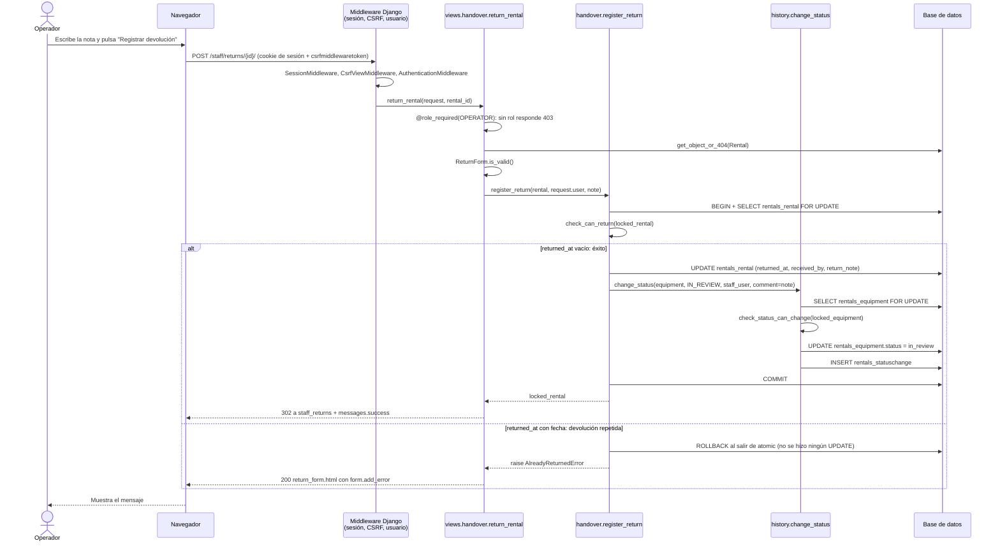

# Diagramas de secuencia

## Entregar y devolver

| Botón | Función | Tabla y columna que cambia |
|---|---|---|
| Registrar recojo | `handover.register_pickup` | `rentals_rental`: `picked_up_at`, `handed_over_by` |
| Registrar devolución | `handover.register_return` | `rentals_rental`: `returned_at`, `received_by`, `return_note` |
| Registrar devolución | `history.change_status` | `rentals_equipment`: `status`; `rentals_statuschange`: fila nueva |
