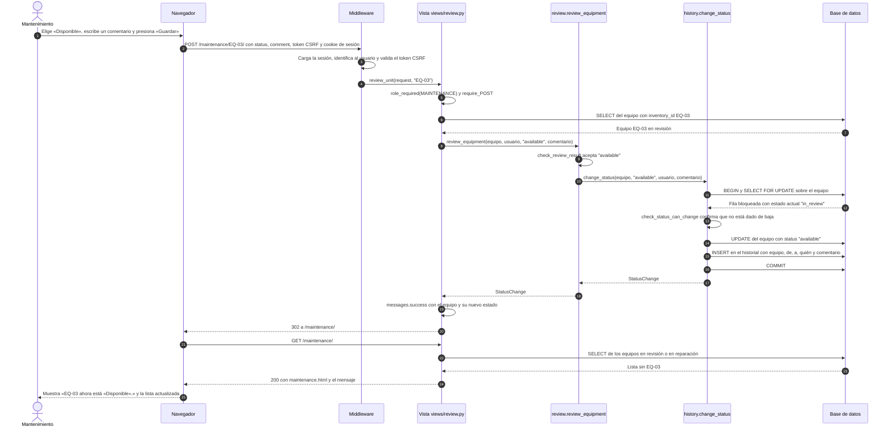
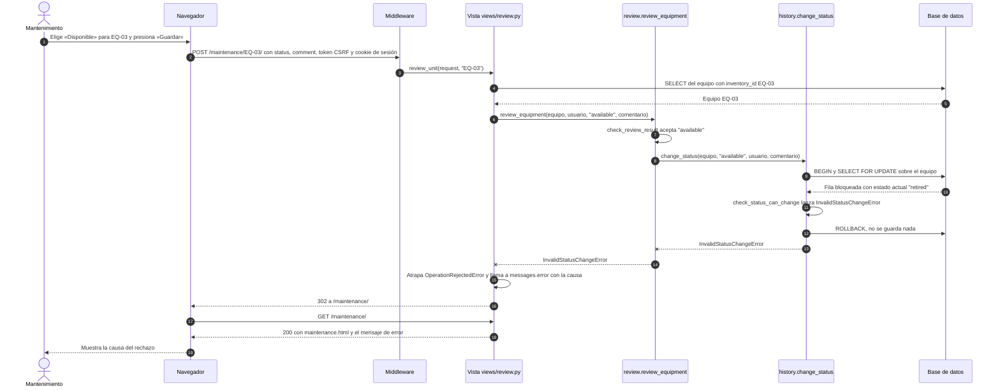

## Revisar y admin

Mantenimiento revisa un equipo devuelto desde `/maintenance/` (D2). El cambio de estado siempre pasa por `history.change_status`, que lo guarda junto con su historial (ENT-34).

### Éxito: un equipo en revisión pasa a disponible

### Rechazo: un equipo dado de baja no vuelve a disponible

La baja es definitiva. Esto ocurre si la página ya estaba abierta cuando otra persona dio de baja el equipo, o si alguien envía el formulario a mano.

El mensaje que ve mantenimiento es «El equipo EQ-03 está dado de baja; su estado ya no puede cambiar.». El equipo y el historial quedan igual que antes del intento.

### Botón, función y datos que cambian

| Botón | Función | Tabla y columna que cambia |
|---|---|---|
| «Guardar» (`/maintenance/`) | `views.review.review_unit` → `review.review_equipment` → `history.change_status` | `rentals_equipment.status`, y una fila nueva en `rentals_statuschange` (`equipment_id`, `old_status`, `new_status`, `changed_by_id`, `changed_at`, `comment`) |
| «Marcar disponible» (admin, Equipos) | `EquipmentAdmin.mark_available` → `change_selected` → `history.change_status` | `rentals_equipment.status` = `available` y una fila en `rentals_statuschange` |
| «Mandar a reparación» (admin, Equipos) | `EquipmentAdmin.send_to_repair` → `change_selected` → `history.change_status` | `rentals_equipment.status` = `in_repair` y una fila en `rentals_statuschange` |
| «Dar de baja» (admin, Equipos) | `EquipmentAdmin.retire` → `change_selected` → `history.change_status` | `rentals_equipment.status` = `retired` y una fila en `rentals_statuschange` |
| «Cancelar reserva» (admin, Rentas) | `RentalAdmin.cancel_reservations` → `renting.cancel_rental` | `rentals_rental.cancelled_at` y `rentals_rental.cancelled_by_id` |
