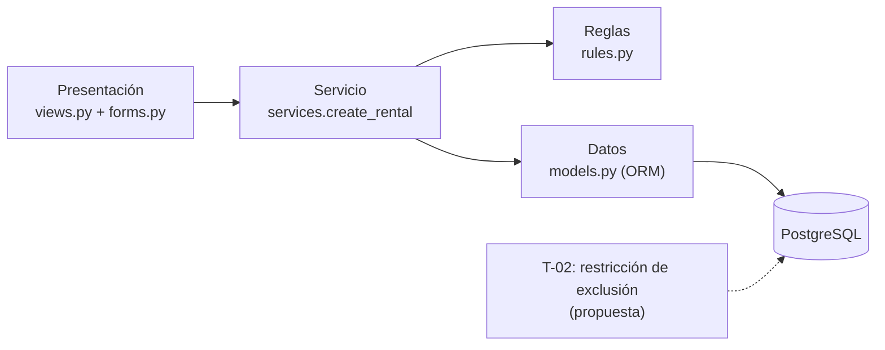

# Sesión 12 — Arquitectura y verificación del flujo

Actualizado el 19/10/2026: las pruebas del contrato de esta sesión ahora están en tests/integration/test_rentar.py.

- Proyecto e integrantes: astra-rent-system — SergioCorp (renta de mesas y sillas); Sofia Arduz Rengel, Andrés Laura Vargas, Peter Uriel Terán Bedregal.
- Fecha real de la actividad: 13/10/2026.
- Requisitos: [Sesión 6](sesion-06-requisitos.md).
- Modelos: [Sesión 7](sesion-07-modelos.md).
- Plan: [Sesiones 8–9](sesion-08-09-plan.md).
- Operación seleccionada: **rentar un equipo en línea** — `rentals/services.py -> create_rental()`.
- IDs vigentes y estado de aprobación: caso de uso PRE-CU-01 (redactado y revisado en la Sesión 7, implementado); historia PRE-HU-01; PRE-RF-01 (el primero en confirmar se queda el equipo, ENT-21) y PRE-RC-01 (mensaje de rechazo con la causa). Horario 18:00/09:00 y máximo de 5 días (ENT-19): tomados como supuesto, ver sección 6.
- Tarea/issue que continúa: **T-02** — restricción de exclusión en PostgreSQL contra rentas cruzadas — [issue #30](https://github.com/peterteranb/astra-rent-system/issues/30).
- Retroalimentación que atiende, si existe: ninguna.

## 1. Punto de partida y alcance

- Qué ya funcionaba y con qué evidencia: en `main` (`3b18466`, PR #28) el cliente inicia sesión, ve el catálogo, renta EQ-01 y ve la confirmación; un segundo cliente es rechazado con E1 y unas credenciales incorrectas con E2. Lo prueban `tests/integration/test_rental_service.py` y `tests/integration/test_views.py` (82 pruebas: 57 nuevas y 25 de la iteración 1).
- Problema o brecha que abordamos: la separación vista → servicio → reglas ya existía, pero ninguna prueba comparaba **toda** la base antes y después de un rechazo, y las pruebas no corrían en GitHub.
- Incluimos hoy: tres pruebas del contrato de `create_rental` en `tests/sesion12/` y el workflow de CI con un PostgreSQL temporal.
- Queda pendiente: T-02 (que la base misma impida rentas cruzadas), solicitudes simultáneas reales y la confirmación del límite de 5 días.
- Comando y resultado inicial real: `python -m pytest -q` en `main` (`3b18466`) → 77 aprobadas, 5 saltadas (pendientes de respuestas del cliente); Python 3.14.6, Django 6.1.2, PostgreSQL 18.6 en la máquina de Peter.

## 2. Responsabilidades y dependencias

| Grupo/componente | Responsabilidad | Código existente o propuesto | Usa qué interfaz de otro grupo |
|---|---|---|---|
| Presentación (web) | Recibir la solicitud del navegador, leer el formulario y elegir la página | `rentals/views.py -> rent_equipment()`, `rentals/forms.py -> RentalForm`; existente | `services.create_rental()` y las clases de `rentals/errors.py` |
| Servicio (caso de uso) | Ejecutar PRE-CU-01: validar el periodo, bloquear el equipo, revisar cruces y guardar | `rentals/services.py -> create_rental()`, `check_period()`, `check_equipment_is_free()`; existente | `rules.py` (funciones puras) y el ORM de `models.py` |
| Reglas | Decidir si un periodo es válido o se cruza, sin leer ni escribir datos | `rentals/rules.py -> periods_overlap()`, `is_within_max_duration()`, `is_pickup_time_allowed()`, `is_return_time_allowed()`; existente | Ninguna (solo `datetime`) |
| Datos | Consultar y guardar equipos y rentas; impedir fin antes del inicio | `rentals/models.py -> Equipment`, `Rental` (CHECK `rental_end_after_start`); PostgreSQL; existente. Restricción de exclusión: **propuesta (T-02)** | Django ORM → PostgreSQL |

- Cohesión: cada grupo tiene un solo propósito. `rules.py` solo compara fechas; `views.py` solo traduce HTTP ↔ servicio.
- Acoplamiento: la vista conoce la firma de `create_rental` y las clases de error, no cómo se decide. Si cambia una regla (por ejemplo, el límite de 5 días), solo cambia `rules.py`. Si cambia el nombre de una excepción, cambia la vista.
- Frontera que ya estaba separada: `views.py` no contiene ninguna regla de negocio; un `except RentalRejectedError` muestra el mensaje que arma el servicio.

## 3. Interfaz seleccionada

- Proveedor y consumidor: proveedor `services.create_rental`; consumidor `views.rent_equipment` (y en el futuro la pantalla del operador, PRE-CU-02).
- Operación y firma real: `create_rental(client, equipment, start_datetime, end_datetime) -> Rental` (implementada).
- Entradas: `client` (usuario de Django), `equipment` (fila `Equipment`), `start_datetime` y `end_datetime` (`datetime` con zona horaria; se convierten a America/La_Paz). Supuestos: recojo desde las 18:00, devolución hasta las 09:00, máximo 5 días.
- Resultado aceptado: devuelve la `Rental` creada; se guarda **una** fila en `rentals_rental`; el estado del equipo **no** cambia (S-11).
- Resultado de rechazo/repetición: lanza `EquipmentNotAvailableError` (E1: equipo ocupado o no disponible), `InvalidPeriodError` (fin antes del inicio o más de 5 días) u `OutsideRentalHoursError` (fuera de horario). El mensaje nombra la causa (PRE-RC-01).
- Datos que deben conservarse: ante cualquier rechazo, todas las rentas y el estado de todos los equipos quedan iguales. Ante una aceptación, solo se agrega la renta nueva.
- Consulta y escritura: el servicio lee el equipo con `select_for_update()` dentro de `transaction.atomic()` (bloquea la fila hasta terminar), lee sus rentas y guarda con `Rental.objects.create()` al final, solo si todo pasó.
- Restricción de uso/importación para pruebas: las pruebas llaman a la función directamente, sin navegador ni teclado. No usan la base de desarrollo: pytest-django crea una base temporal `test_astra_rent` y la borra; en CI es un contenedor PostgreSQL de GitHub.

## 4. Vistas del mismo flujo

### Responsabilidades y dependencias

- Las flechas significan: "depende de / llama a". No es el orden en que viajan los datos.
- Lo ya implementado y lo propuesto se distinguen mediante: línea continua = implementado; línea punteada = propuesto (T-02).
- Pregunta que responde esta vista: ¿qué archivos hay que tocar si cambia una regla de renta? Solo `rules.py`.

### Ejecución: éxito y rechazo

- Modelo reutilizado: [Sesión 7, diagrama de secuencia de PRE-CU-01](sesion-07-modelos.md).
- Recorrido de éxito:
  1. La vista valida el formulario y llama a `create_rental`.
  2. `check_period` revisa horario y duración.
  3. Se bloquea la fila de EQ-01 (`select_for_update`).
  4. `check_equipment_is_free` confirma que no hay cruce.
  5. Se guarda la renta y la vista redirige a la confirmación.
- Recorrido de rechazo/repetición: se decide en el paso 2 (periodo) o 4 (cruce). Se lanza el error, no se guarda nada y la transacción se deshace. La vista muestra la causa: E1 vuelve al catálogo; los demás quedan en el formulario.
- Cambio realizado al modelo anterior: ninguno.

### Ubicación

| Componente/datos | Dónde se ejecuta o almacena hoy | Ubicación prevista, si cambia |
|---|---|---|
| Navegador del cliente | Equipo del cliente | Sin cambio |
| Django (vistas, servicio, reglas) | Servidor de desarrollo en la laptop de un integrante (`127.0.0.1:8000`) | Servidor de SergioCorp; por definir |
| PostgreSQL (`astra_rent`) | Misma laptop | Servidor de SergioCorp; por definir |

- Dónde ejecuta las pruebas CI: máquina temporal `ubuntu-latest` de GitHub Actions, con un contenedor `postgres:18` creado y borrado en cada ejecución. No es el servidor de la aplicación.

## 5. Decisión arquitectónica y calidad

- Objetivo y contexto: que las reglas de PRE-CU-01 se puedan probar y reutilizar (en PRE-CU-02, renta en persona) sin depender de la página web. Atributos: mantenibilidad y facilidad de prueba.
- Observación que permitiría evaluar la mejora: las pruebas de `tests/sesion12/` llaman a la operación sin navegador; cambiar una regla debería tocar solo `rules.py` y sus pruebas.

| Alternativa | Beneficio | Trabajo adicional o límite |
|---|---|---|
| A: capas separadas — vista → servicio → reglas → modelos | Se prueba sin navegador; CU-02 reutiliza el mismo servicio; la vista queda corta | Más archivos y un salto más para seguir el código |
| B: toda la lógica dentro de la vista | Menos archivos; todo en un lugar | Solo se prueba por el navegador; CU-02 tendría que copiar las reglas |

- Elección y razones: **A**. Evita duplicar reglas y permite probar el contrato directamente.
- Estado: implementada.
- Qué nueva evidencia podría obligarnos a revisarla: si CU-02 necesitara reglas distintas para el operador, o si la restricción T-02 hiciera innecesaria parte de `check_equipment_is_free`.

## 6. Cambio y trazabilidad de las pruebas

- Cambio real o frontera comprobada: la frontera ya estaba separada desde que pasamos de la iteración 1 (en memoria) a Django con capas. Ampliamos la comprobación de su interfaz con `tests/sesion12/test_sesion12_contrato_renta.py`, que compara una copia independiente de la base (`foto_de_la_base()`) antes y después. También agregamos `.github/workflows/ci-sesion12.yml` y `requirements-ci.txt`. [PR #40](https://github.com/peterteranb/astra-rent-system/pull/40).
- Cómo se conservan las reglas acordadas: no se cambió código de producción; las pruebas usan los mismos datos de los documentos (C-01, C-02, EQ-01, 09/10/2026 18:00 – 12/10/2026 09:00).
- Si se corrigió un requisito/modelo: no hubo cambio.

| Requisito | Ruta del caso de uso | Función/contrato | Test real y caso | Respuesta y estado esperados |
|---|---|---|---|---|
| PRE-RF-01 | Éxito (pasos 5–9) | `create_rental` | `test_aceptacion_c01_renta_eq01_y_solo_se_agrega_esa_renta`: C-01, EQ-01, 09/10 18:00 – 12/10 09:00 | Devuelve la renta; hay 1 renta con esos datos; EQ-01 sigue disponible y EQ-02 no cambia |
| PRE-CU-01 E1, PRE-RC-01 | Rechazo/repetición | `create_rental` | `test_rechazo_y_repeticion_no_crean_otra_renta_ni_cambian_nada`: (a) C-01 repite su solicitud; (b) C-02 pide lo mismo | `EquipmentNotAvailableError` con "EQ-01" y la fecha; la base es idéntica a la copia previa; sigue 1 renta |
| Límite de 5 días + horario (ENT-19; **confirmar con el cliente**) | Límite | `create_rental` | `test_limite_la_renta_mas_larga_permitida_se_acepta_y_un_dia_mas_se_rechaza`: 09/10 18:00 – 14/10 09:00 y 09/10 18:00 – 15/10 09:00 | La de 4 d 15 h se guarda; la de un día más lanza `InvalidPeriodError` sin cambiar la base |

- Pruebas nuevas, reutilizadas o ampliadas: nuevas en `tests/sesion12/`. Reutilizan las fixtures de `tests/conftest.py` y amplían la comprobación con la copia completa de la base.
- Comando y resultado final local real: `python -m pytest tests/sesion12 -q --junitxml=evidencias/sesion12-junit.xml` → 4 aprobadas, 0 errores, 0 fallidas, 0 saltadas (3 pruebas; la de rechazo tiene 2 casos); máquina de Peter (PC-TERAN).
- Suite anterior: `python -m pytest -q` → 81 aprobadas, 5 saltadas: las 77 anteriores + las 4 nuevas.
- Alcance no comprobado: dos solicitudes realmente simultáneas (las pruebas usan una sola conexión), el navegador real, CSRF real y la restricción T-02 (aún no existe).

## 7. Evidencia de CI y versión

- Archivo de workflow: [.github/workflows/ci-sesion12.yml](../.github/workflows/ci-sesion12.yml).
- Dependencias instaladas: `requirements-ci.txt` (pytest 8.4.2, pytest-django 4.14+, Django 6.1, psycopg[binary] 3.3+, python-dotenv 1.2+). Configuración: servicio `postgres:18` y variables `DB_*` en el workflow, porque `config/settings.py` las lee y en GitHub no hay `.env`. El CI usa Python 3.12.15; la máquina de Peter usa 3.14.6.
- Comando que ejecuta: `python -m pytest tests/sesion12 -q --junitxml=evidencias/sesion12-junit.xml` (carpeta `tests/sesion12`, 3 pruebas / 4 casos).
- Ejecución de Actions: [ejecución 38483627007](https://github.com/peterteranb/astra-rent-system/actions/runs/38483627007) (disparada por `push` en la rama `docs/sesion-12-arquitectura.md-plan`).
- Commit probado: `7d9d206662a5a8758a19608daac016a098ad2dc5` (el que imprime el paso "Registrar entorno y version comprobada").
- Estado real: **aprobado**.
- Resultado: 4 aprobadas, 0 fallidas en 2.84 s.
- Reporte de pruebas: [artefacto `resultados-sesion12-…`](https://github.com/peterteranb/astra-rent-system/actions/runs/38483627007/artifacts/11858097688) (`sesion12-junit.xml`, sha256 `3c781d817e230029405c92c1594e871ae67a00415834dbe4930a091dd86292d9`).
- Candidato de código fuente: todavía no generado. El workflow solo lo produce cuando las pruebas pasan en `main`; el PR #40 está revisado y pendiente de integración.
- Commit del MD, si fue posterior: posterior al commit probado; la diferencia es solo este archivo (`docs/sesion-12-arquitectura.md`).
- Qué falta para una entrega o despliegue en el entorno destino: elegir servidor; instalar PostgreSQL; configurar `.env` real, `DEBUG=False` y `ALLOWED_HOSTS`; ejecutar `migrate`; cargar el inventario real; y probar desde otra máquina. Este CI solo ejecuta las pruebas; no despliega la aplicación.

## 8. Plan actualizado y participación

- Tarea/issue y estado real: T-02 — [issue #30](https://github.com/peterteranb/astra-rent-system/issues/30) — **en curso**. Hoy se dejaron las pruebas del contrato y el CI que la comprobarán. PRE-HU-01 sigue terminada.
- Evidencia para ese estado: pruebas de `tests/sesion12/` y la ejecución de Actions. Falta para el cierre: migración con la restricción de exclusión (`btree_gist`), una prueba que intente guardar una renta cruzada sin pasar por el servicio y la revisión de un integrante.
- Dependencia o riesgo que cambió: el CI ahora necesita PostgreSQL; si T-02 usa la extensión `btree_gist`, el contenedor del CI la soporta, pero la base local necesita permiso para crearla.
- Siguiente acción, responsable y condición de revisión: implementar T-02 — Peter Uriel Terán Bedregal — se revisa en un PR cuando el workflow pase en `main` con la nueva prueba. Después, roles y permisos (H05), a cargo de Andrés Laura Vargas.
- Aportes individuales:
  - Peter Uriel Terán Bedregal (base de datos y servicio desde antes): hoy ajustó las pruebas de `tests/sesion12/` y las ejecutó en su máquina, dejó el workflow con PostgreSQL y el `requirements-ci.txt` final, completó este documento y integrará el PR #40.
  - Andrés Laura Vargas (backend y reglas desde antes): hoy escribió el primer borrador de este documento, subió las pruebas a la rama y revisó la rama.
  - Sofia Arduz Rengel (frontend y vistas desde antes): hoy abrió la rama, subió el primer borrador del workflow y de `requirements-ci.txt`, y agregó la carpeta `docs/` con la plantilla original.
- Asistencia de IA, si se utilizó: herramientas de asistencia para estructurar la documentación y redactar pruebas; el equipo ejecutó las pruebas, revisó el contenido y cada integrante puede explicar su parte.

## 9. Enlaces de entrega

- Este MD en GitHub: [docs/sesion-12-arquitectura.md](https://github.com/peterteranb/astra-rent-system/blob/docs/sesion-12-arquitectura.md-plan/docs/sesion-12-arquitectura.md) (rama `docs/sesion-12-arquitectura.md-plan`).
- Pull request, si se utilizó: [PR #40](https://github.com/peterteranb/astra-rent-system/pull/40) — revisado por Andrés Laura Vargas; pendiente de integración a `main`.
- Hallazgo principal de la sesión: la separación en capas ya permitía probar la operación sin la página. Lo nuevo es comprobar que un rechazo deja **toda** la base igual. Eso será la base para verificar T-02.