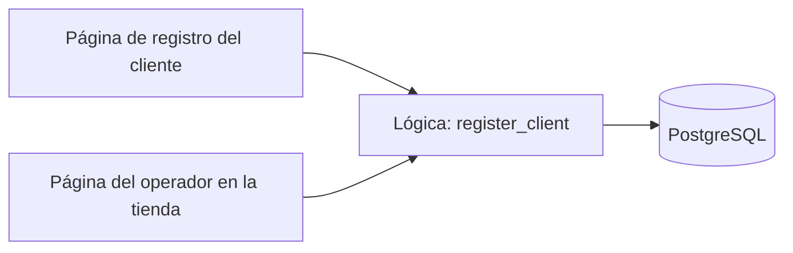
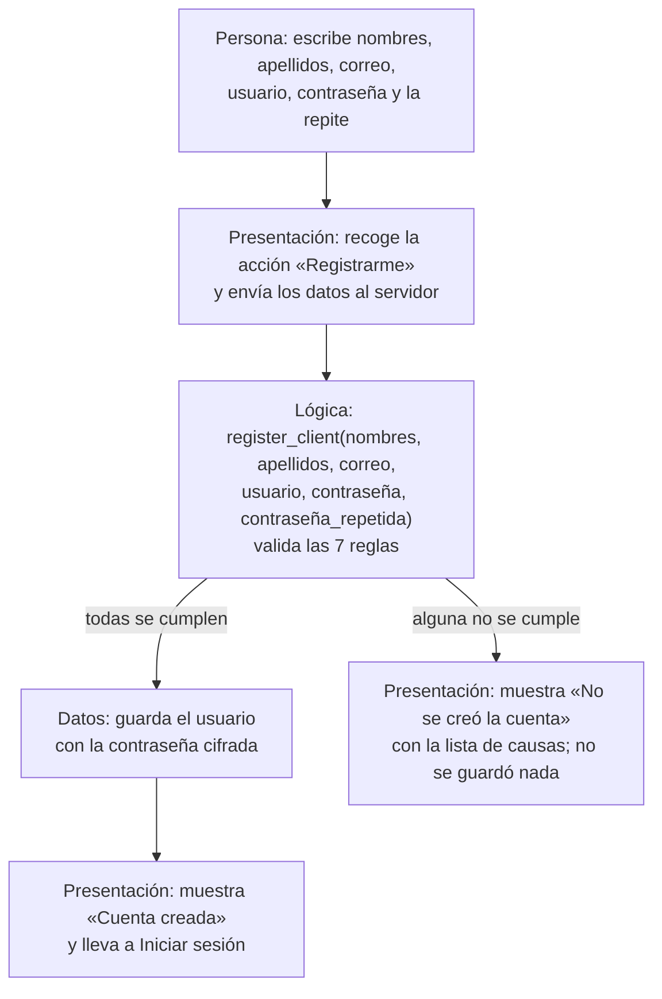
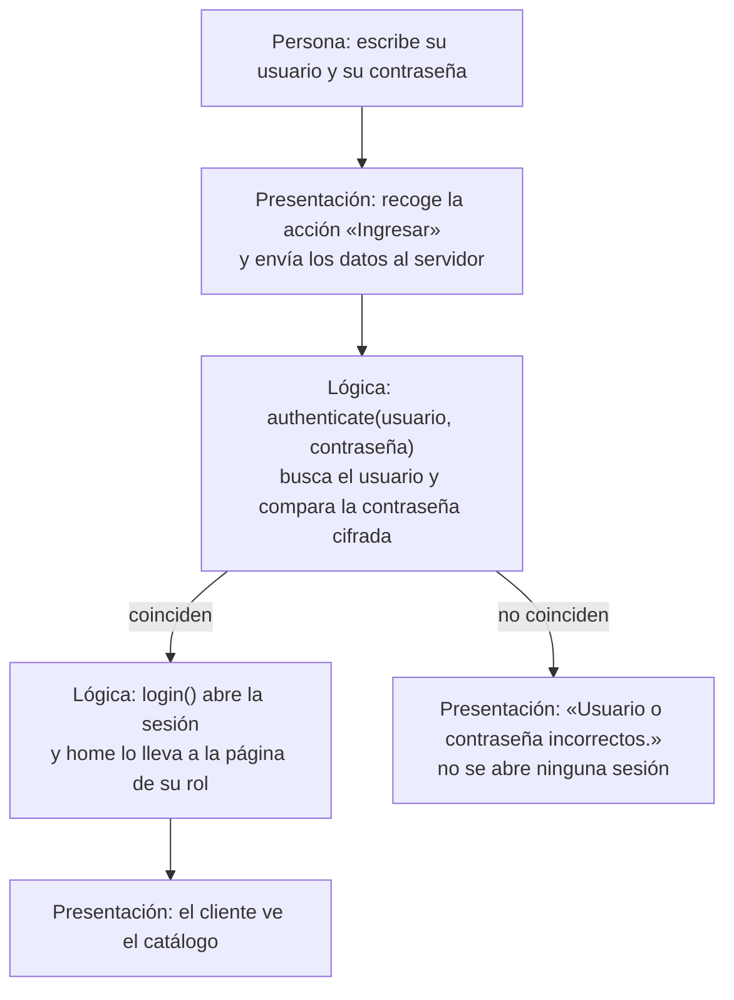

# Sesión 20 — Bocetos y recorridos: registro e inicio de sesión

https://canva.link/hbnc46om5arbw4h

```
                                                          
                                                          
                                                          
                                                          
                 *%%*. .-+#%%#*-: =%#%:                
                =+*.:=#+=++*%#**++=%+-.==#                
                :#=%*=+++*==+#==+*=#==%*+*                
                 +====+:-+======++.=====%                 
                .*===%-:=-.#+=*-:+.:#*==#:                
               .#=%=+#-:-:=++=**::-:#=+*+++               
               %*=*#=+*=+*:=====*=#+==#-%-%-              
               #:***-+*===+====++===#-*:%:*.              
               %=-%-#+=+==+========+=*#-+:%+              
               **:@++-:*==========+:.*:%-=%               
               =*=:#%#:*#=:%+=##-+#*=%#=.#+               
                 #%=...#=+=.-*.:+++-..:%%-                
                   +#%*%%%***+#*%%%####                   
                        %......*+                        
                          -##*##.                         
                                                          
     ____                 _          ____                 
 / ___|  ___ _ __ __ _(_) ___    / ___|___  _ __ _ __  
 \___ \ / _ \ '__/ _` | |/ _ \  | |   / _ \| '__| '_ \ 
  ___) |  __/ | | (_| | | (_) | | |__| (_) | |  | |_) |
 |____/ \___|_|  \__, |_|\___/   \____\___/|_|  | .__/ 
                 |___/                          |_|   
                                                          
                                                          
                                                          
                                                          
```

- **Proyecto:** astra-rent-system, renta de mesas y sillas para eventos (cliente: SergioCorp).
- **Integrantes:** Sofia Arduz Rengel, Andrés Laura Vargas, Peter Uriel Terán Bedregal.
- **Fecha:** 21/10/2026.
- **Estado:**
  - **Inicio de sesión:** ya funciona (`accounts/`).
  - **Registro de cliente:** este documento es su diseño. Se programa en el issue #81, junto al login (ENT-15: «puede ser los dos»; ENT-54: el operador también registra en la tienda).

## La idea principal: quién valida y cuándo

Cada pantalla tiene dos partes, y cada una hace una sola cosa:

| Parte | Qué hace | Qué **no** hace |
|---|---|---|
| **Presentación** (la página en el navegador) | Pide los datos, muestra los requisitos como ayuda, envía la acción y muestra el resultado. | No decide si un dato es válido y no consulta la base de datos. |
| **Lógica** (una función en el servidor) | Revisa **todas** las reglas, guarda solo si todas se cumplen y devuelve el resultado o la lista de causas. | No sabe cómo se ve la página. |

**La validación ocurre una sola vez: en la lógica, en el momento en que la persona presiona el botón** («Registrarme» o «Ingresar»). Antes de presionar, la página solo informa los requisitos («mínimo 8 caracteres, una mayúscula y un número»): informar no es validar. Si una regla no se cumple, no se guarda nada y la página muestra la causa.

**Por qué así:** la misma regla sirve para cualquier pantalla. El registro lo pueden hacer el cliente en la web y el operador en la tienda; los dos usan la **misma** función `register_client`. Si cada pantalla validara por su cuenta, habría dos reglas que mantener iguales, y cualquiera podría saltarse la de la página enviando el formulario a mano.



---

## 1. Registro de un cliente

### Tarea

| | |
|---|---|
| **Tarea** | Una persona sin cuenta quiere crear una para poder rentar. |
| **Acción** | Llenar sus datos y presionar «Registrarme». |
| **Resultado útil** | Ver «Cuenta creada» y poder iniciar sesión con su usuario. |

### Boceto

```text
┌──────────────────────────────────────────────────┐
│  Crear cuenta                                    │
│                                                  │
│  Nombres            [ Carla                    ] │
│  Apellidos          [ Mendoza                  ] │
│  Correo             [ carla.mendoza@correo.com ] │
│  Nombre de usuario  [ cl03                     ] │
│  Contraseña         [ ••••••••                 ] │
│    Mínimo 8 caracteres, una mayúscula y un número│
│  Repetir contraseña [ ••••••••                 ] │
│                                                  │
│               [ Registrarme ]                    │
│                                                  │
│  ¿Ya tienes cuenta? Iniciar sesión               │
└──────────────────────────────────────────────────┘
```

- **Resultado si sale bien:** vuelve a «Iniciar sesión» con el mensaje **«Cuenta creada. Ya puedes iniciar sesión con cl03.»**
- **Resultado si no sale bien:** se queda en la misma página con los datos escritos (menos las contraseñas) y arriba el mensaje:

  > **No se creó la cuenta:**
  > - El usuario cl03 ya existe.
  > - La contraseña necesita al menos una mayúscula.

  El mensaje dice qué acción no se completó y por qué (todas las causas a la vez), para que la persona corrija todo de una sola vez.

### Recorrido



### Qué valida la lógica, en este orden

Se revisan primero las reglas que no necesitan la base de datos y después las que sí. Se juntan todas las causas y se devuelven juntas.

| # | Regla | Mensaje si no se cumple | Necesita la base |
|---|---|---|---|
| 1 | Nombres, apellidos, correo, usuario y contraseña no están vacíos. | «Falta el campo Correo.» (uno por campo) | No |
| 2 | El correo tiene forma de correo (`algo@dominio.com`). | «El correo no es válido.» | No |
| 3 | La contraseña tiene al menos 8 caracteres. | «La contraseña necesita al menos 8 caracteres.» | No |
| 4 | La contraseña tiene al menos una mayúscula. | «La contraseña necesita al menos una mayúscula.» | No |
| 5 | La contraseña tiene al menos un número. | «La contraseña necesita al menos un número.» | No |
| 6 | Las dos contraseñas son iguales. | «Las contraseñas no coinciden.» | No |
| 7 | El usuario y el correo no los tiene otra cuenta. | «El usuario cl03 ya existe.» / «El correo ya está registrado.» | Sí |

Si las 7 se cumplen, la lógica crea el usuario: la contraseña se guarda **cifrada (hash)**, nunca tal cual. La cuenta queda como **cliente** (sin grupo de personal). Si dos personas eligen el mismo usuario en el mismo segundo, la base de datos rechaza al segundo (el usuario es único) y recibe el mismo mensaje de la regla 7.

### Contrato entre la presentación y la lógica

| | |
|---|---|
| **Entrada** | `register_client(first_name, last_name, email, username, password, password_confirmation)`: los seis textos tal como los escribió la persona. |
| **Salida si sale bien** | El usuario creado. |
| **Salida si no** | Un error de rechazo con la lista de causas en español. No se guardó nada. |
| **Quién la usa** | La página de registro del cliente y, después, la página del operador en la tienda (ENT-54). |
| **Dónde va** | `accounts/`, junto al login: lo de cuentas queda en un solo lugar. |

---

## 2. Inicio de sesión de un cliente

### Tarea

| | |
|---|---|
| **Tarea** | Un cliente con cuenta quiere entrar para rentar. |
| **Acción** | Escribir su usuario y su contraseña y presionar «Ingresar». |
| **Resultado útil** | Ver el catálogo de equipos. |

### Boceto

Es la pantalla que ya existe (`templates/accounts/login.html`).

```text
┌──────────────────────────────────────────┐
│  Iniciar sesión                          │
│                                          │
│  Nombre de usuario [ cl01              ] │
│  Contraseña        [ ••••••••          ] │
│                                          │
│            [ Ingresar ]                  │
│                                          │
│  ¿No tienes cuenta? Crear cuenta         │
└──────────────────────────────────────────┘
```

- **Resultado si sale bien:** entra y ve su página de inicio. El cliente ve el **catálogo**. (El operador, el personal de mantenimiento y el admin llegan cada uno a su página: la vista `home` los reparte según su rol.)
- **Resultado si no sale bien:** se queda en «Iniciar sesión» con el mensaje **«Usuario o contraseña incorrectos.»**. No dice cuál de los dos está mal, para no darle pistas a alguien que intenta adivinar cuentas.

El enlace «Crear cuenta» se agrega cuando exista el registro (#81).

### Recorrido



**Cuándo se valida:** igual que en el registro, al presionar «Ingresar» y en el servidor. La página no compara nada con la base de datos: solo envía lo escrito y muestra la respuesta.

**Dónde está en el código:**

| Paso | Archivo | Qué hace |
|---|---|---|
| La página | `templates/accounts/login.html` | Dibuja los campos y el botón «Ingresar». |
| Recibir la acción | `accounts/urls.py` → `LoginView` de Django | Recibe el formulario enviado. |
| Validar | `accounts/forms.py` → `LoginForm` | Llama a `authenticate`, que busca el usuario en la tabla `auth_user` y compara la contraseña cifrada. Si no coinciden, da nuestro mensaje «Usuario o contraseña incorrectos.». |
| Abrir la sesión | `LoginView` → `login()` de Django | Guarda la sesión y redirige a `home`. |
| A cada rol su página | `rentals/views/home.py` | Cliente → catálogo; operador → reservas; mantenimiento → mantenimiento; admin → panel. |

---

## 3. Cómo se comprueba

Las pruebas de **lógica** dan evidencia de que la regla se cumple. Las pruebas a través de la **interfaz** dan evidencia de lo que ve la persona. Se complementan.

### Pruebas de la lógica

| Prueba | Entrada | Esperado |
|---|---|---|
| Contraseña corta | `"Abc1"` | «al menos 8 caracteres» |
| Contraseña sin mayúscula | `"abcdefg1"` | «al menos una mayúscula» |
| Contraseña sin número | `"Abcdefgh"` | «al menos un número» |
| Contraseña válida | `"Abcdefg1"` | Sin causas |
| Contraseñas distintas | `"Abcdefg1"` y `"Abcdefg2"` | «Las contraseñas no coinciden.» |
| Usuario repetido | `cl01`, que ya existe | «El usuario cl01 ya existe.» y la base no cambia |
| Login con clave incorrecta | `cl01` / `mala1234` | No se abre sesión. Esta prueba ya existe en `tests/integration/test_acceso.py`. |

Las primeras cinco no necesitan base de datos: son funciones que reciben texto y devuelven las causas.

### Pruebas a través de la interfaz

| Momento | Registro | Inicio de sesión |
|---|---|---|
| **Estado inicial** | No existe ninguna cuenta `cl03`. | Existe `cl01` con clave `demo1234`. |
| **Acción** | Llenar el formulario con `cl03` y `Abcdefg1` dos veces, y presionar «Registrarme». | Escribir `cl01` y `demo1234`, y presionar «Ingresar». |
| **Resultado visible** | «Cuenta creada. Ya puedes iniciar sesión con cl03.» en la página de login. | El catálogo de equipos. |
| **Acción de rechazo** | Repetir el mismo registro. | Escribir `cl01` y `otra`. |
| **Resultado visible del rechazo** | «No se creó la cuenta: El usuario cl03 ya existe.» | «Usuario o contraseña incorrectos.» |

### Lo que esta evidencia no demuestra

- Que la página se vea bien en todos los navegadores y teléfonos.
- Que personas reales entiendan el formulario sin ayuda. Para eso, alguien que no conoce el sistema debe intentarlo mientras lo observamos.

---

## 4. Relación con la arquitectura del proyecto

| Capa (diapositivas) | En nuestro sistema |
|---|---|
| Presentación | Las plantillas HTML en el navegador (`templates/`). |
| Aplicación (lógica) | Django: las vistas reciben la acción y llaman a las funciones de cada caso de uso (`accounts/`, `rentals/`). |
| Datos | PostgreSQL (tablas `auth_user` para las cuentas, y `rentals_*` para equipos y rentas). |

La aplicación y la base de datos corren en la misma máquina en la demo: separar responsabilidades no exige separar computadoras.